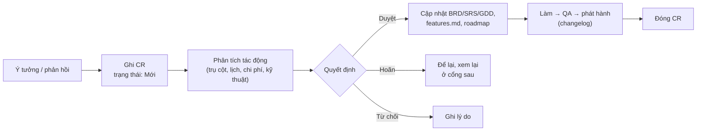

# Yêu cầu thay đổi (Change Requests)

Sổ ghi **mọi thay đổi phạm vi** sau khi [Tầm nhìn](../01-product/vision.md), [BRD](../01-product/brd.md) và [SRS](../01-product/srs.md) đã chốt (2026-10-10): thêm tính năng, đổi luật chơi, dời việc giữa các giai đoạn, bỏ tính năng. Sửa lỗi và việc đã có trong SRS **không** cần CR.

Mục đích: dù làm một mình, vẫn biết *vì sao* phạm vi thay đổi và thay đổi đó đã kéo theo những gì. Đây cũng là chỗ bắt đầu khi muốn **cập nhật thêm sau khi phát hành**.

## Quy trình



Trạng thái: **Mới** → **Đang phân tích** → **Duyệt** / **Hoãn** / **Từ chối** → **Đã làm** (đóng).

Tiêu chí duyệt nhanh: CR phải hỗ trợ ít nhất một [trụ cột thiết kế](../01-product/vision.md#3-trụ-cột-thiết-kế-design-pillars) và không đẩy mốc gần nhất trễ quá 1 tuần. Không đạt thì mặc định **Hoãn** tới sau 1.0.

## Danh sách

| ID | Tiêu đề | Ngày mở | Loại | Tác động lịch | Trạng thái |
| --- | --- | --- | --- | --- | --- |
| [CR-001](#cr-001) | Làm i18n tiếng Anh ngay từ GĐ 0 thay vì GĐ 3 | 2026-10-09 | Dời việc | +1 ngày ở GĐ 0 | Đã làm |
| [CR-002](#cr-002) | Phong cách bảng phấn + 6 nhân vật SVG thay chấm màu avatar | 2026-10-10 | Thay đổi thiết kế | +3 ngày ở GĐ 0 | Đã làm |
| [CR-003](#cr-003) | Thêm Tìm trận, Thử thách hôm nay, Bảng xếp hạng (từ bản thiết kế menu) | 2026-10-10 | Thêm tính năng | Lớn (chưa ước lượng) | Hoãn — xem lại sau 1.0 |
| [CR-004](#cr-004) | Tổ chức lại web theo feature + shadcn/ui | 2026-10-09 | Kỹ thuật | +1 ngày ở GĐ 0 | Đã làm |
| [CR-005](#cr-005) | Luồng trận kiểu party game: phòng chờ 2D, chọn game (vòng quay / chủ phòng chọn + bình chọn), hướng dẫn + độ khó từng người, đếm ngược 5 giây, cộng điểm và vinh danh kiểu Kahoot, bỏ 3D | 2026-10-10 | Đổi luật + thay đổi thiết kế | +1,5–2 tuần ở GĐ 1; bớt việc ở GĐ 2 | Đã làm (2026-10-12) |
| [CR-006](#cr-006) | Cân bằng điểm giữa các mức độ khó, thưởng tốc độ theo từng game, vòng 60 giây cho game mới | 2026-10-10 | Đổi luật (điểm) | +1–2 ngày, làm cùng đợt code 4 game | Đã làm (cơ chế, 2026-10-12) |
| [CR-007](#cr-007) | Nhạc nền nhiều bài + thanh nhạc trên header, làm sớm ở GĐ 1 (tách khỏi FR-GD-07) | 2026-10-14 | Dời việc + thêm chi tiết | +1–2 ngày ở GĐ 1 | Đã làm (2026-10-14) |
| [CR-008](#cr-008) | Âm thanh hiệu ứng khi bấm nút, làm sớm ở GĐ 1; tách rung + Wake Lock thành FR-GD-11 | 2026-10-14 | Dời việc + thêm chi tiết | +1 ngày ở GĐ 1 | Đã làm (2026-10-14) |
| [CR-009](#cr-009) | Đưa Luyện tập, Kiểm tra não, Tài khoản (Supabase) và Bảng xếp hạng lên làm trước | 2026-10-16 | Dời việc + thêm tính năng | +2–3 tuần, chen trước Cổng 1 | Duyệt (2026-10-16) |
| [CR-010](#cr-010) | Vinh danh hồi hộp hơn, công tắc hiệu ứng chuyển động, danh hiệu và điểm theo thể loại trong trận party | 2026-10-19 | Thêm tính năng + thay đổi thiết kế | +1–2 ngày | Duyệt (2026-10-19) |
| [CR-011](#cr-011) | Chat real-time trong phòng party: chữ + biểu cảm nhanh, lọc từ tục, chủ phòng tắt chat, tắt tiếng từng người | 2026-10-20 | Thêm tính năng | +1–2 ngày | Duyệt (2026-10-20) |
| [CR-012](#cr-012) | Thêm 2 minigame ngoài SRS: Luyện ngắm (aim trainer, Nhận diện) và Phấn trượt (đổi luật theo màu, Phân tích) | 2026-10-20 | Thêm tính năng | +2–3 ngày | Duyệt (2026-10-20) |
| [CR-013](#cr-013) | Mở rộng minigame từ nghiên cứu Pumer Party, đợt đầu 7 game: Tráo cốc, Xếp lại tháp, Chuỗi quy luật, Đếm sĩ số, Mảnh vừa khít, Ô bí ẩn, Nối mạch | 2026-10-20 | Thêm tính năng | +5–7 ngày | Duyệt (2026-10-20) |
| [CR-014](#cr-014) | Mở rộng minigame, đợt hai 7 game còn lại của kế hoạch: Tìm bạn, Giỏ hời nhất, Rót vừa vạch, Hình to hình nhỏ, Nhại nhịp, Cổng luật, Đường số | 2026-10-20 | Thêm tính năng | +8–12 ngày | Duyệt (2026-10-20) |
| [CR-015](#cr-015) | Vòng quay chọn game chỉ lấy 8 game chưa chơi (mỗi nhóm ít nhất 1 lát) thay cho 30 lát | 2026-10-20 | Đổi luật + thay đổi thiết kế | +0,5–1 ngày | Từ chối (2026-11-19) — thay bằng CR-017 |
| [CR-016](#cr-016) | Chơi với bot: chủ phòng thêm bot 4 mức vào ghế trống, nút "Chơi với máy" ở menu, lịch sử gắn nhãn có bot | 2026-10-21 | Thêm tính năng | +3,5–4,5 ngày công (2,5–3 ngày lịch) | Đã làm (2026-10-21), chờ QA và merge |
| [CR-017](#cr-017) | Trống quay dọc vô hạn kiểu bộ chọn giờ iPhone thay vòng quay tròn, mỗi game có biểu tượng, ẩn danh sách "Trong vòng quay" | 2026-11-19 | Thay đổi thiết kế | +1 ngày | Duyệt (2026-11-19) |
| [CR-018](#cr-018) | Phòng party tối đa 12 người, điểm trận theo thứ hạng co giãn theo số người | 2026-11-19 | Đổi luật | +1 ngày | Duyệt (2026-11-19) |
| [CR-019](#cr-019) | Trang quản trị: cấu hình điểm + hệ số trận party, bật/tắt game, lịch sử đăng nhập, người chơi, trận đấu, tổng quan, phòng đang mở, quản trị viên | 2026-11-19 | Thêm tính năng | +3–4 ngày công (2 ngày lịch khi chạy song song) | Duyệt (2026-11-19) |
| [CR-020](#cr-020) | Game yêu thích ở Luyện tập (⭐, mục Yêu thích đầu danh sách, đồng bộ tài khoản) | 2026-11-19 | Thêm tính năng | +0,5–1 ngày | Duyệt (2026-11-19) |
| [CR-021](#cr-021) | Màn hướng dẫn: khung minh hoạ to hơn, nút Phóng to, hình động diễn cách chơi (đợt đầu 5 game MVP) | 2026-11-19 | Thêm tính năng + thay đổi thiết kế | +1,5 ngày (5 game), +3 ngày cho 25 game còn lại | Duyệt (2026-11-19) |
| [CR-022](#cr-022) | Tách URL theo màn ngoài phòng (Back/Forward/F5 giữ màn, link sâu) | 2026-11-19 | Kỹ thuật + thay đổi thiết kế | +1 ngày | Duyệt (2026-11-19) |
| [CR-023](#cr-023) | Phấn (tiền trong game, không tiền thật), máy quay phụ kiện công khai tỉ lệ + bảo hiểm, tủ đồ 24 phụ kiện cả phòng thấy | 2026-11-20 | Thêm tính năng | +3–4 ngày công | Duyệt (2026-11-19, chủ dự án uỷ quyền) |
| [CR-024](#cr-024) | 6 bạn đồng hành mới khoá theo thành tích (điểm game, trung bình nhóm, trận party, Điểm Não), tiến độ + Luyện ngay | 2026-11-20 | Thêm tính năng | +2 ngày công | Duyệt (2026-11-19, chủ dự án uỷ quyền) |

---

### CR-001

**Làm i18n tiếng Anh ngay từ GĐ 0 thay vì GĐ 3**

- **Ngày mở / đóng:** 2026-10-09 / 2026-10-09 · **Loại:** Dời việc
- **Lý do:** đang chuyển giao diện sang shadcn, sửa mọi chuỗi một lần rẻ hơn nhiều so với rà lại toàn bộ chữ cứng ở GĐ 3.
- **Tác động:** thêm i18next (~10 KB gzip); mọi chữ phải qua `t()` (thành quy tắc trong `AGENTS.md`); `en.ts` bị TypeScript ép đủ khoá.
- **Tài liệu kéo theo:** [ADR 0007](../02-architecture/decisions/0007-i18n-inline-resources.md), [Lộ trình](../01-product/roadmap.md) (tick mục i18n ở GĐ 3), [Tầm nhìn](../01-product/vision.md#11-câu-hỏi-mở) (Q5).
- **Quyết định:** Duyệt · **Kết quả:** có trong 0.1.0.

### CR-002

**Phong cách bảng phấn + 6 nhân vật SVG thay chấm màu avatar**

- **Ngày mở / đóng:** 2026-10-10 / 2026-10-10 · **Loại:** Thay đổi thiết kế
- **Lý do:** giao diện kem/tím than ban đầu thiếu cá tính; avatar chấm màu không giúp người chơi nhận ra nhau. Bản mẫu mới trên canvas [Brain Rizz — Màn chờ & Menu](https://claude.ai/artifact/GJZbipfsLC2TNo7TPws7CZ). Hỗ trợ BR-09.
- **Tác động:** giao thức thêm trường `avatar` (`JoinOptions`, `SetProfile`, `PlayerView`); thêm màn giới thiệu, menu, chọn bạn đồng hành; token màu mới.
- **Tài liệu kéo theo:** [ADR 0009](../02-architecture/decisions/0009-chalkboard-style-and-characters.md), [UI/UX](../01-product/ui-ux.md), [Thiết kế game › Nhân vật](../01-product/game-design.md#8-nhân-vật--phong-cách-hình-ảnh), [Tổng quan kiến trúc](../02-architecture/overview.md).
- **Quyết định:** Duyệt · **Kết quả:** có trong 0.1.0.

### CR-003

**Thêm Tìm trận, Thử thách hôm nay, Bảng xếp hạng**

- **Ngày mở:** 2026-10-10 · **Loại:** Thêm tính năng · **Người đề xuất:** từ bản thiết kế menu chính
- **Mô tả:** menu chính trên canvas có thêm 3 mục ngoài kế hoạch: Tìm trận (ghép với người lạ), Thử thách hôm nay (3 minigame/ngày, chung đề), Bảng xếp hạng (bạn bè và toàn cầu). Hiện đã hiển thị với nhãn "Sắp có".
- **Phân tích tác động:**
  - *Trụ cột:* hỗ trợ "giữ chân" nhưng Tìm trận đi ngược giả định "chơi với bạn bè" trong [Tầm nhìn](../01-product/vision.md#6-phạm-vi).
  - *Kỹ thuật:* Tìm trận cần matchmaking công khai và chống gian lận mạnh hơn (client hiện biết seed — NFR-SEC-02). Bảng xếp hạng và Thử thách hôm nay cần tài khoản + DB (phụ thuộc UC-16, GĐ 3). Thử thách hôm nay khá rẻ nếu có DB: seed theo ngày.
  - *Chi phí:* phòng công khai làm máy chủ chạy lâu hơn → có thể vượt 1 USD/tháng (NFR-COST-01).
  - *Lịch:* ước lượng thô 3–5 tuần cho cả ba.
- **Đề xuất:** Hoãn tới sau 1.0. Khi xem lại, ưu tiên **Thử thách hôm nay** (rẻ nhất, hợp trụ cột) → Bảng xếp hạng bạn bè → Tìm trận cuối cùng. Phụ thuộc câu hỏi mở Q2 trong [Tầm nhìn](../01-product/vision.md#11-câu-hỏi-mở).
- **Quyết định:** Hoãn (2026-10-10) · **Xem lại:** Cổng 3.
- **Cập nhật 2026-10-16:** riêng **Bảng xếp hạng (UC-19)** được duyệt sớm theo [CR-009](#cr-009): bảng Điểm Não toàn cầu + bảng từng minigame; phần bạn bè chờ tính năng kết bạn. Tìm trận và Thử thách hôm nay vẫn Hoãn.
- **Tài liệu kéo theo (khi duyệt):** BRD (BR-14 đổi từ W), SRS (chi tiết UC-17 → UC-19), [Danh sách tính năng](features.md#e7--chế-độ-mở-rộng--tài-khoản), Lộ trình.

### CR-004

**Tổ chức lại web theo feature + shadcn/ui**

- **Ngày mở / đóng:** 2026-10-09 / 2026-10-09 · **Loại:** Kỹ thuật (không đổi hành vi)
- **Lý do:** cấu trúc `ui/screens` cũ khó mở rộng khi có 15 minigame; muốn cấu trúc giống dự án LogiX đã quen.
- **Tác động:** di chuyển toàn bộ `apps/web/src`; thêm alias `@/`; quy tắc "feature chỉ import feature khác qua `index.ts`".
- **Tài liệu kéo theo:** [ADR 0006](../02-architecture/decisions/0006-ui-shadcn-and-theme-tokens.md), [ADR 0008](../02-architecture/decisions/0008-web-feature-folders-and-game-modules.md), [Cây thư mục](../02-architecture/folder-structure.md).
- **Quyết định:** Duyệt · **Kết quả:** có trong 0.1.0.

### CR-005

**Luồng vào trận kiểu party game**

- **Ngày mở:** 2026-10-10 · **Loại:** Đổi luật + thay đổi thiết kế · **Người đề xuất:** chủ dự án (tham khảo Pummel Party, phòng chờ Goose Goose Duck)
- **Mô tả:** trước mỗi minigame đi qua 6 bước:
  1. **Phòng chờ 2D** (bỏ sân khấu 3D): ô người chơi, đếm "Sẵn sàng x/y", mã phòng ẩn/hiện + sao chép, đổi nhân vật ngay trong phòng.
  2. **Chủ phòng chọn số vòng** — mỗi vòng là một minigame, tổng điểm sau các vòng quyết định người thắng.
  3. **Chọn game mỗi vòng:** vòng quay ngẫu nhiên, hoặc chủ phòng chọn từ danh sách (người chơi khác bình chọn để gợi ý).
  4. **Màn hướng dẫn** cách chơi và điều khiển của game được chọn.
  5. **Chọn độ khó** (ban đầu đề xuất độ khó chung cho cả phòng; chốt: mỗi người tự chọn, chủ phòng giám sát), rồi nút Bắt đầu.
  7–9. Chơi → bảng điểm vòng → cộng điểm trận; lặp tới hết số vòng rồi vinh danh người thắng.
  6. **Đếm ngược 5 giây** rồi vào chơi.
- **Đối chiếu với hiện tại:**

| Bước | Hiện có | Phải thêm/đổi |
| --- | --- | --- |
| 1 | Sảnh 3D, danh sách người chơi, sẵn sàng; đổi nhân vật chỉ ở menu | Bỏ 3D; giao diện ô người chơi; đổi nhân vật trong phòng (giao thức `setProfile` đã hỗ trợ sẵn) |
| 2 | Chủ phòng chọn 1–10 vòng ở sảnh | Giữ nguyên, chỉ làm lại giao diện |
| 3 | Chủ phòng chọn game ở sảnh; các vòng sau tự xoay vòng | Pha mới `game-select`; vòng quay; bình chọn |
| 4 | Không có | Pha mới `game-intro`; mỗi minigame thêm nội dung hướng dẫn + điều khiển trong `locales.ts` |
| 5 | Mỗi người tự chọn độ khó ở hồ sơ/sảnh, điểm nhân hệ số | Chọn độ khó **cho từng game** ở màn hướng dẫn; chủ phòng xem độ khó từng người, cảnh báo người lệch, nút "Nhắc" |
| 7–9 | Bảng kết quả vòng, bảng chung cuộc | Thêm bước cộng điểm trận có hiệu ứng sau mỗi vòng; vinh danh top 3 kiểu Kahoot bằng 2D |
| 6 | Đếm ngược 3 giây | Đổi `COUNTDOWN_MS` thành 5 giây |

- **Phân tích tác động:**
  - *Trụ cột:* hợp "Vào là chơi" và "Ngắn, gọn" (luồng rõ ràng hơn). Đề xuất ban đầu "độ khó chung" đi ngược trụ cột "Công bằng cho mọi lứa tuổi" (persona P2, BR-04); phương án đã chốt (mỗi người tự chọn + chủ phòng giám sát) giữ được trụ cột này.
  - *Kỹ thuật — server:* thêm 2 pha vào máy trạng thái phòng (`lobby → game-select → game-intro → countdown → playing → round-results → game-select …`); thêm tin nhắn (đều validate bằng zod): `voteGame`, `spinWheel`, `pickGame`, `setDifficulty`, `introReady`, `nudgeDifficulty`. **Kết quả vòng quay do server quyết định** rồi gửi cho mọi máy để cùng quay tới một lát — client không tự random. Phiếu bình chọn chỉ là state trong RAM của phòng (`votes: Map<người chơi, gameId>`), xoá khi qua vòng. **Không cần database, không cần Supabase.** Chi phí server gần như không đổi.
  - *Kỹ thuật — shared:* `PartyStateView` thêm `votes`, `introReady`, `playedGames`, kết quả vòng quay; `difficulty` của từng người giữ nguyên nhưng được đặt lại ở mỗi vòng. Đổi giao thức → client và server phải phát hành cùng lúc (vẫn trước 1.0 nên không cần tăng MAJOR).
  - *Kỹ thuật — web:* làm lại `features/lobby`; thêm feature `game-select` và `game-intro`; gỡ `LobbyStage` 3D → **bớt three.js khỏi gói tải ở sảnh**, quy tắc "một canvas WebGL" dễ giữ hơn.
  - *Tài liệu kéo theo:* BRD (BR-04, BR-11, RULE-05/06), SRS (UC-05, UC-06 viết lại; thêm UC chọn game, UC hướng dẫn; FR-VC-02, FR-VC-12, FR-VC-13, FR-GD-05), GDD (vòng lặp chơi, độ khó, tính điểm), UI/UX (màn S4–S6 mới), đặc tả minigame (mục hướng dẫn + điều khiển), Tổng quan kiến trúc (pha, tin nhắn), ADR mới về độ khó chung.
  - *Lịch:* +1–1,5 tuần ở GĐ 1. Bù lại FR-VC-12 (màn hướng dẫn) và FR-VC-13 (chọn game vòng sau) vốn đã có trong GĐ 1 được làm luôn trong CR này.
- **Đề xuất của PM:** Duyệt, làm trước 4 minigame MVP còn lại (vì mỗi game mới cần nội dung hướng dẫn theo khuôn mới).
- **Bản mẫu:** canvas [Brain Rizz — Màn chờ & Menu](https://claude.ai/artifact/GJZbipfsLC2TNo7TPws7CZ), khu 5–11.
- **Câu hỏi đã trả lời (2026-10-10):**

| # | Câu hỏi | Quyết định của chủ dự án |
| --- | --- | --- |
| 1 | Độ khó chung hay riêng? | **Mỗi người tự chọn độ khó cho từng game** ở màn hướng dẫn (điểm vẫn nhân hệ số). Chủ phòng chọn độ khó của mình và **xem được độ khó của từng người**; người chọn lệch so với đa số được đánh dấu, chủ phòng bấm "Nhắc" được. → Bước 5 không còn đi ngược trụ cột "Công bằng". |
| 2 | Luồng một trận? | Phòng chờ → chủ phòng chọn số vòng (một lần) → **lặp mỗi vòng:** 3 chọn game → 4 hướng dẫn → 5 độ khó + bắt đầu → 6 đếm ngược 5 giây → 7 chơi → 8 bảng điểm vòng → 9 cộng điểm trận cho từng người → hết số vòng: bảng xếp hạng người thắng. |
| 3 | Ai bắt đầu ở bước 5? | Theo đề xuất PM: ai đọc xong bấm "Đã hiểu"; chủ phòng bấm Bắt đầu khi mọi người xong; tự bắt đầu sau 20 giây. |
| 4 | Bình chọn ảnh hưởng vòng quay? | **Không.** Bình chọn chỉ để gợi ý chủ phòng khi muốn chơi đích danh một game. Vòng quay gồm toàn bộ game hệ thống. |
| 5 | Có lặp game không? | **Không lặp:** game đã chơi bị loại khỏi vòng quay và danh sách ở các vòng sau. |
| 6 | Bước 7 là gì? | 7 chơi, 8 tổng điểm vòng, 9 cộng điểm trận — lặp tới hết trận. |
| 7 | Bục trao giải 3D? | **Bỏ 3D.** Vinh danh top 3 kiểu Kahoot bằng 2D để tối ưu hiệu năng. |

- **Hệ quả thêm từ quyết định:**
  - Không còn chỗ nào dùng 3D → gỡ hẳn three.js / React Three Fiber khỏi dự án khi làm (ghi [ADR 0010](../02-architecture/decisions/0010-drop-3d-2d-lobby-and-podium.md)). Gói tải nhẹ hơn; bỏ 2 việc 3D của GĐ 2 (avatar .glb, bục 3D).
  - Thêm tin nhắn `nudgeDifficulty` (chủ phòng → một người), giới hạn tối đa 1 lần/10 giây cho mỗi người.
- **Giả định PM tự đặt (báo lại nếu không đúng):**
  - Đổi nhân vật ở phòng chờ không huỷ sẵn sàng.
  - "Lệch" = khác mức độ khó mà nhiều người trong phòng đang chọn nhất. Chỉ là cảnh báo cho chủ phòng, không chặn bắt đầu.
  - Hết game chưa chơi (số vòng nhiều hơn số game đang có) thì danh sách được làm mới từ đầu. Hiện mới có 1 game nên mọi vòng tạm thời đều là Kẻ lạc đàn.
  - Từ bảng cộng điểm sang vòng sau: chủ phòng bấm "Vòng tiếp theo" như hiện tại.
  - *(Bổ sung 2026-10-12 khi bắt đầu code; chủ dự án chưa trả lời nên PM áp dụng đề xuất, đổi được sau)*:
    - **"Chơi lại"** giữ nguyên người chơi và số vòng, vào thẳng Chọn game vòng 1. **"Về phòng chờ"** về phòng chờ để đổi nhân vật, số vòng, chờ thêm người.
    - **Hoà điểm:** hoà điểm vòng thì cùng hạng và cùng điểm trận; hoà điểm trận ở cuối thì ai có tổng điểm vòng cao hơn xếp trên.
    - **Bắt đầu trận:** cần ≥ 2 người và **tất cả** (kể cả chủ phòng) đã sẵn sàng.
    - Chủ phòng không bỏ phiếu. Vòng quay chỉ có game đã làm xong.
    - Màu "trả lời đúng" giữ như bản mẫu (vàng chủ đạo kèm dấu ✓).
    - Vòng cuối cũng hiện bảng điểm vòng và bảng cộng điểm trước; chủ phòng bấm "Xem người thắng" mới sang vinh danh.
- **Quyết định:** **Duyệt** (2026-10-10). Đã cập nhật BRD 1.1, SRS 1.1, GDD 1.1, UI/UX 1.1, Tầm nhìn, Lộ trình, Danh sách tính năng. Tổng quan kiến trúc, Tech stack và Cây thư mục mô tả code nên sẽ cập nhật khi làm.
- **Đã làm:** 2026-10-12, sau khi QA soát. Cập nhật kèm: SRS 1.2 (chốt "Chơi lại"), Tổng quan kiến trúc, Tech stack, Cây thư mục, ADR 0010, Danh sách tính năng, Nhật ký phát hành.

### CR-006

**Cân bằng điểm giữa các mức độ khó và thưởng tốc độ theo từng game**

- **Ngày mở:** 2026-10-10 · **Loại:** Đổi luật (điểm) · **Người đề xuất:** game-designer (khi viết đặc tả 4 game MVP), PM tổng hợp
- **Bối cảnh:** khi viết đặc tả [Theo dấu ánh đèn](../04-minigames/light-trail.md), [Cân não](../04-minigames/balance.md), [Bóng bay số](../04-minigames/number-balloons.md), [Xoay hình](../04-minigames/rotate-match.md), mô phỏng điểm theo công thức hiện tại (RULE-06, RULE-07, `packages/shared/src/scoring.ts`) cho thấy hai vấn đề chung cho mọi game.
- **Vấn đề 1 — thưởng tốc độ chung (trọn 50 khi ≤ 1,5 giây, hết từ 8 giây) không hợp với mọi game:**

| Game | Vì sao | Thưởng trung bình ở Siêu khó |
| --- | --- | --- |
| Theo dấu ánh đèn | Đồng hồ tính cả ~3 giây trình chiếu, lúc đó không bấm được | ~3/50 |
| Bóng bay số | 5 lần chạm đã mất ~1,75 giây | ~7/50 |
| Cân não | Câu Siêu khó cần 5–7 giây suy luận | ~14/50 |
| Xoay hình | Hợp, giữ nguyên | 8–23/50 |

- **Vấn đề 2 — cùng một người, chọn mức càng cao điểm càng thấp; chọn Mầm được gấp đôi.** Điểm vòng của người lớn so với khi chơi Thường (mô phỏng của từng đặc tả):

| Game | Người lớn ở Mầm | Người lớn ở Khó | Người lớn ở Siêu khó | Trẻ 7 tuổi ở Mầm |
| --- | --- | --- | --- | --- |
| Cân não | ~162 % | ~69 % | ~48 % | ~65 % |
| Bóng bay số | ~210 % | ~93 % | ~75 % | ~77 % |
| Xoay hình | ~223 % | ~66 % | ~45 % | ~93 % |
| Theo dấu ánh đèn | (chưa mô phỏng) | ~89 % | ~81 % | ~81 % |

  - *Nguyên nhân:* câu Siêu khó mất gấp 2–3 lần thời gian câu Thường nhưng hệ số chỉ × 1,5; combo không có trần (chuỗi 20 câu đúng nhân tới × 2,8) nên chơi mức dễ, nhanh được lợi gấp đôi.
  - *Hệ quả:* người giỏi không có lý do chọn mức cao. Cơ chế "lệch" + "Nhắc" của CR-005 chỉ chặn được về mặt xã giao.
- **Đề xuất của PM:**
  1. **Một cơ chế "miễn trừ thời gian" cho thưởng tốc độ**: mỗi game tự khai báo số mili giây được trừ khỏi thời gian trả lời theo câu đố và độ khó (thời gian trình chiếu, số lần chạm, mức khó). Server trừ trước khi tính thưởng. Gộp 3 đề xuất riêng của các đặc tả (`revealMs`, `speedAllowanceMs`, nhân khung theo hệ số) thành **một trường tuỳ chọn** trong `MinigameDef`. Không đổi giao thức.
  2. **Hệ số điểm theo từng game** thay cho hệ số chung 0,8 / 1 / 1,25 / 1,5: tính từ thời gian giải dự kiến mỗi mức (đã có trong bảng Cân bằng của từng đặc tả), để người chơi đúng sức ở bất kỳ mức nào được điểm vòng xấp xỉ nhau. Kèm **trần combo × 1,5**.
     - Không công thức nào chặn hẳn việc người lớn chọn mức dễ (họ vẫn giải nhanh hơn trẻ). Phần đó vẫn do chủ phòng giám sát. Mục tiêu là **không phạt người chọn mức cao**.
  3. **Vòng 60 giây cho 4 game mới** (Kẻ lạc đàn giữ 45 giây), để ở Siêu khó vẫn còn ≥ 8 câu mỗi vòng.
  4. **Trả lời sai thì hiện đáp án đúng trong 1,5 giây khoá, áp dụng cho mọi game.** 3/4 đặc tả mới đã làm vậy; Kẻ lạc đàn sửa theo cho nhất quán.
  - Cơ chế làm ngay cùng đợt code 4 game; **con số cụ thể chốt sau buổi chơi thử đủ 5 game MVP**, chỉnh số không cần sửa code.
- **Tác động:** shared (`MinigameDef` thêm trường tuỳ chọn, `scoring.ts` nhận hệ số theo game + trần combo), server (`handleAnswer` trừ miễn trừ), web (Kẻ lạc đàn hiện đáp án đúng khi sai). Tài liệu: GDD mục 6–7, BRD RULE-06/07, SRS FR-VC-05/06, đặc tả 5 game.
- **Quyết định:** **Duyệt** (2026-10-12), cùng với việc làm 4 game theo đúng đề xuất trong đặc tả. Cơ chế làm cùng đợt code 4 game; con số chốt sau buổi chơi thử đủ 5 game MVP.
- **Giả định PM khi code (2026-10-12, đổi được sau chơi thử):**
  - Hệ số Mầm = **min(giá trị mô phỏng cho trẻ 7 tuổi, 1)**: Theo dấu ánh đèn, Cân não, Bóng bay số mô phỏng ra 1,15–1,35 nên đặt 1; Xoay hình ra 0,86 nên đặt 0,85. Lý do: hệ số không giảm khi lên mức, và người lớn chọn Mầm không được lợi thêm (với × 1,35 người lớn ở Mầm được ~200 % điểm Thường). Trẻ ở Mầm được khoảng 80–90 % điểm người lớn ở Thường.
  - Miễn trừ `Infinity`/NaN/số âm do game khai báo sai được coi là 0 (không miễn trừ).
  - Cân não giữ bộ vật đồ ăn như đặc tả; chỉ đổi sang bộ trung tính nếu chơi thử thấy trẻ bị nhiễu.
- **Đã làm:** 2026-10-12, QA PASS. Cơ chế trong `scoring.ts` + `PartyRoom.ts`; 4 game mới khai báo hệ số/miễn trừ, vòng 60 giây; Kẻ lạc đàn hiện đáp án đúng khi sai. Còn lại: chốt con số sau buổi chơi thử đủ 5 game (chỉnh hằng, không sửa cơ chế). Cập nhật kèm: BRD 1.2, SRS 1.3, GDD 1.2, đặc tả 5 game, `_template.md`.

### CR-007

**Nhạc nền nhiều bài + thanh nhạc trên header, làm sớm ở GĐ 1**

- **Ngày mở:** 2026-10-14 · **Loại:** Dời việc + thêm chi tiết · **Người đề xuất:** chủ dự án
- **Mô tả:** nhạc nền gồm nhiều bài do chủ dự án tự chọn, chép vào thư mục `apps/web/src/assets/music/`. Trên header có thanh nhạc để phát/dừng và chuyển bài; máy tính có thêm tên bài và âm lượng.
- **Lý do:** nhạc nền đã có trong phạm vi (FR-GD-07, GĐ 2), nhưng SRS chưa nói giao diện điều khiển; chủ dự án muốn có sớm để không khí phòng chờ sôi động hơn trước buổi chơi thử. Không đi ngược trụ cột nào; giữ trụ cột 4 "Nhẹ và rẻ" bằng cách chỉ tải nhạc khi phát và không thêm thư viện.
- **Phân tích tác động:**
  - *Kỹ thuật:* chỉ web (feature mới `features/music/`, một `HTMLAudioElement`, không thêm thư viện). Không đổi giao thức, seed hay server. Không thêm canvas WebGL.
  - *Hiệu năng:* bài nhạc chỉ tải khi phát (`preload="none"`), không tăng gói JS ban đầu đáng kể (NFR-PERF-01). Mỗi bài nên ≤ 3 MB.
  - *Pháp lý:* chủ dự án dùng nhạc "no copyright", có thể không được phép dùng trong game → ngoại lệ NFR-LEGAL-01, rủi ro [R-12](../01-product/vision.md#10-rủi-ro-risk-register). Cách giảm: chuyển repo sang private trước khi commit nhạc, ghi nguồn từng bài vào `assets/LICENSES.md`.
  - *Lịch:* +1–2 ngày ở GĐ 1; GĐ 2 bớt tương ứng.
- **Quyết định:** **Duyệt** (2026-10-14, chủ dự án). Giả định PM chốt theo đề xuất ban đầu, chủ dự án đồng ý "theo hướng nói ban đầu":
  - Mặc định bật; phát ở lần chạm đầu (trình duyệt chặn tự phát, NFR-UX-02).
  - Phát lần lượt theo tên file, hết danh sách thì lặp lại.
  - Đếm ngược và đang chơi: nhạc nhỏ còn một nửa, thanh nhạc ẩn cùng nút ngôn ngữ/giao diện.
  - Tab ẩn thì tạm dừng.
- **Tài liệu kéo theo:** SRS 1.4 (thêm FR-GD-10, tách khỏi FR-GD-07; sửa UC-11, NFR-UX-02, NFR-LEGAL-01), vision.md (R-12), roadmap, `assets/LICENSES.md`, features.md, changelog.
- **Kết quả:** đã làm 2026-10-14, QA PASS (Chrome headless, gồm cả vào pha chơi). Còn lại: chủ dự án chép file nhạc và ghi nguồn vào `assets/LICENSES.md`; thử trên iPhone thật (mở khoá âm thanh, giảm âm, khoá máy/cuộc gọi). Sẽ có trong bản 0.1.0 hoặc bản trung gian GĐ 1.

### CR-008

**Âm thanh hiệu ứng khi bấm nút, làm sớm ở GĐ 1**

- **Ngày mở:** 2026-10-14 · **Loại:** Dời việc + thêm chi tiết · **Người đề xuất:** chủ dự án
- **Mô tả:** tiếng click khi bấm nút trong toàn hệ thống, cùng tiếng báo lỗi, tích tắc đếm ngược và đúng/sai. Chủ dự án giao PM tự chọn tiếng, sẽ thay bằng file mong muốn sau khi thử.
- **Lý do:** âm thanh hiệu ứng đã có trong phạm vi (FR-GD-07, GĐ 2); làm cùng đợt nhạc nền ([CR-007](#cr-007)) vì dùng chung phần mở khoá âm thanh. Giữ trụ cột 4 "Nhẹ và rẻ": tiếng mặc định tạo bằng Web Audio (0 KB, không vướng giấy phép), không thêm thư viện.
- **Phân tích tác động:**
  - *Kỹ thuật:* chỉ web (feature mới `features/sfx/`); một AudioContext dùng chung với nhạc nền; gắn tiếng bằng một listener chung cho mọi nút, nút đặc biệt khai báo `data-sfx`. Đúng/sai bắt từ `answerResult` ở tầng React, không sửa scene Phaser. Không đổi giao thức.
  - *Pháp lý:* tiếng tạo bằng code không cần giấy phép; file thay thế sau này (gợi ý Kenney Interface Sounds, CC0) ghi vào `assets/LICENSES.md`.
  - *Lịch:* +1 ngày ở GĐ 1.
- **Quyết định:** **Duyệt** (2026-10-14, chủ dự án: "tự quyết định cho sound, triển khai luôn"). Giả định PM:
  - 8 loại tiếng: click, toggle, confirm, back, error, tick, correct, wrong. Có file `apps/web/src/assets/sfx/<loại>.mp3` thì dùng file, không thì dùng tiếng tạo bằng code.
  - Nút bật/tắt riêng, độc lập với nhạc nền; mặc định bật; âm lượng cố định.
  - Tách rung + Wake Lock thành FR-GD-11, giữ ở GĐ 2.
- **Tài liệu kéo theo:** SRS 1.5 (FR-GD-07 viết lại, thêm FR-GD-11; UC-11, NFR-UX-02, mục Dữ liệu), roadmap, features.md, changelog.
- **Kết quả:** đã làm 2026-10-14, QA PASS (Chrome headless, chơi thật một vòng 2 tab). Nút bật/tắt dùng icon chuông để không nhầm với âm lượng nhạc. Còn lại: nghe thử bằng tai, thử iPhone thật; chủ dự án thay file tiếng mong muốn vào `apps/web/src/assets/sfx/` và ghi nguồn vào `assets/LICENSES.md`.

### CR-009

**Đưa Luyện tập, Kiểm tra não, Tài khoản và Bảng xếp hạng lên làm trước**

- **Ngày mở:** 2026-10-16 · **Loại:** Dời việc + thêm tính năng · **Người đề xuất:** chủ dự án
- **Mô tả:** làm ngay UC-13 Luyện tập, UC-14 Kiểm tra não, UC-16 Tài khoản (khách ẩn danh + Google, Supabase) và UC-19 Bảng xếp hạng, thay vì chờ GĐ 3 / sau 1.0. Bảng xếp hạng gồm bảng Điểm Não chung và bảng từng minigame; bảng bạn bè làm sau khi có tính năng kết bạn. Lịch sử lưu cả kết quả Kiểm tra não, kết quả trận party và kỷ lục luyện tập.
- **Lý do:** BR-10 (có lý do quay lại khi không có bạn chơi cùng); repo đã lên GitHub, luồng party đã chạy, muốn có chế độ chơi một mình.
- **Phân tích tác động:**
  - *Trụ cột:* hỗ trợ "giữ chân"; giữ "Nhẹ và rẻ" vì Supabase Free 0 đồng và app vẫn chơi được khi thiếu Supabase.
  - *Kỹ thuật:* [ADR 0011](../02-architecture/decisions/0011-supabase-accounts-and-solo-modes.md). Shared: thêm `brain-test.ts` (chọn 5 game, tính Điểm Não), schema tin nhắn và `BrainStateView`. Server: phòng solo `BrainTestRoom`, tách logic chấm câu khỏi `PartyRoom` để dùng chung, xác thực token Supabase khi vào phòng, ghi kết quả trận. Web: 4 màn mới (Luyện tập, Kiểm tra não, Tài khoản & lịch sử, Bảng xếp hạng). Thêm migration SQL cho Supabase. **Không đổi seed hay bộ sinh câu đố.** Join options của phòng party thêm `accessToken` (tuỳ chọn), tương thích ngược.
  - *Chi phí:* Supabase Free 0 đồng; chủ dự án tự tạo project, bật Anonymous sign-in và Manual linking, tạo OAuth client Google.
  - *Riêng tư:* bắt đầu lưu tên hiển thị và email Google → sửa NFR-PRIV-01, thêm chức năng "Xoá dữ liệu của tôi".
  - *Lịch:* ước lượng 2–3 tuần; chen trước các việc còn lại của GĐ 1 (QR, deploy, Playwright, chơi thử). Cổng 1 lùi tương ứng.
- **Quyết định:** **Duyệt** (2026-10-16, chủ dự án). Chốt cùng chủ dự án: server chấm điểm Kiểm tra não; đăng nhập khách ẩn danh + Google; lịch sử gồm 3 loại; bảng xếp hạng chung + từng minigame. Giả định PM:
  - Kiểm tra não chơi ở **một độ khó cố định** cho mọi người để so sánh được; bảng từng minigame lấy điểm game đó trong các lượt Kiểm tra não. Luyện tập do client tự chấm nên không lên bảng xếp hạng.
  - Mũ phần thưởng (FR-MR-05) và Đấu bóng ma (UC-15) chưa làm trong đợt này.
  - Phiên khách tạo lười (chỉ khi cần lưu), không tạo ngay khi mở trang.
- **Tài liệu kéo theo:** SRS 1.6 (chi tiết UC-13, UC-14, UC-16, UC-19; FR-MR; NFR-PRIV-01; Dữ liệu), BRD (BR-14), GDD (Kiểm tra não, Điểm Não), UI-UX (4 màn mới), ADR 0011, tổng quan kiến trúc, tech stack, `.env.example`, features.md, roadmap.
- **Kết quả:** đang làm trên nhánh `feat/accounts-solo-modes`.

---

### CR-010

**Vinh danh hồi hộp hơn, công tắc hiệu ứng chuyển động, danh hiệu và điểm theo thể loại**

- **Ngày mở:** 2026-10-19 · **Loại:** Thêm tính năng + thay đổi thiết kế · **Người đề xuất:** chủ dự án
- **Mô tả:**
  1. Máy chủ phòng không thấy vòng quay quay, bục hiện cùng lúc, không có pháo giấy, trong khi người khác thấy đủ. Nguyên nhân: Windows tắt "Animation effects" → trình duyệt báo `prefers-reduced-motion: reduce` → app tự tắt hiệu ứng. Thêm công tắc **Hiệu ứng: Theo hệ thống / Luôn bật** (mặc định Theo hệ thống, lưu trên máy). Khi giảm chuyển động, bục vẫn hiện lần lượt (chỉ bỏ trượt, giữ mờ dần) vì nhịp hồi hộp không phải chuyển động.
  2. Vinh danh hồi hộp hơn: hạng 4 trở xuống hiện trước, rồi hạng 3 → 2, chờ lâu hơn kèm tiếng trống dồn rồi mới tới hạng 1 (pháo giấy + hiệu ứng mạnh hơn). Nhãn "Bạn hạng …" chỉ hiện sau khi chỗ của mình được lật.
  3. Điểm theo thể loại: server cộng điểm vòng của từng người theo thể loại game (Nhận diện, Ghi nhớ, Phân tích, Tính toán, Hình dung). Cuối trận hiện thẻ **"Giỏi nhất mỗi thể loại"** (chỉ các thể loại đã chơi trong trận). Lưu điểm theo thể loại và danh hiệu đạt được vào `match_results`; màn Tài khoản hiện thế mạnh party theo thể loại.
- **Lý do:** trụ cột vui khi chơi chung (khoảnh khắc vinh danh); BR-10 (lý do quay lại: biết mình giỏi loại nào).
- **Phân tích tác động:**
  - *Trụ cột:* giữ "Nhẹ và rẻ" (tiếng trống bằng Web Audio, không thêm thư viện, thêm cột jsonb).
  - *Kỹ thuật:* shared thêm hàm thuần tìm người giỏi nhất mỗi thể loại + trường điểm theo thể loại trong `PlayerView`; server cộng dồn khi chấm vòng, xoá khi chơi lại, ghi kèm `match_results`; migration Supabase mới. Web: một nguồn "giảm chuyển động" dùng chung thay cho đọc `matchMedia` rải rác (cả scene Phaser), biến thể Tailwind `motion-safe`/`motion-reduce` theo công tắc. **Không đổi seed hay bộ sinh câu đố.**
  - *Chi phí:* 0 đồng.
  - *Lịch:* ước lượng 1–2 ngày, làm trên nhánh `feat/accounts-solo-modes`.
- **Quyết định:** **Duyệt** (2026-10-19, chủ dự án chọn qua câu hỏi). Giả định PM: so tổng điểm vòng thô trong cùng thể loại (CR-006 đã cân bằng điểm giữa các mức khó); hoà thì cùng nhận danh hiệu; thể loại mà mọi người đều 0 điểm thì không trao. Bảng xếp hạng toàn cầu theo thể loại **chưa làm**.
- **Tài liệu kéo theo:** SRS (UC vinh danh, FR liên quan, mục Dữ liệu), UI-UX (màn vinh danh, cài đặt), features.md, changelog.
- **Kết quả:** code xong 2026-10-19 trên nhánh `feat/accounts-solo-modes`, chưa phát hành:
  - *Công tắc hiệu ứng* (FR-GD-12): `apps/web/src/features/motion/` là nguồn duy nhất; 12 scene Phaser, vòng quay, đếm số, vinh danh và CSS (`motion-safe`/`motion-reduce`, `characters.css`, `shadcn.css`) đều đọc theo nó. Đã kiểm Chrome headless có `--force-prefers-reduced-motion`.
  - *Vinh danh hồi hộp* (FR-GD-06): lịch theo ui-ux 6.2 (`podium-timeline.ts` + test), 3 tiếng Web Audio mới. Giả định FE: bậc 2 trống (đồng hạng nhất) thì trống dồn bắt đầu đúng lúc lẽ ra hạng 2 lật; "vào lại giữa chừng" nhận biết bằng việc máy này không thấy pha đổi sang `podium` (không thêm trường vào giao thức).
  - *Điểm theo thể loại* (FR-VC-21, FR-MR-16): shared + server + migration (xem changelog); thẻ Giỏi nhất mỗi thể loại, thẻ Thế mạnh trong trận party. Thể loại đã chơi ở web lấy từ khoá của `categoryScores`.
  - **Migration:** `20261019000000_match_category_scores.sql` đã chạy trên project Supabase (2026-10-19, `supabase db push`). Project mới phải chạy nó **trước** khi deploy cả server lẫn web: server ghi hai cột mới (thiếu cột thì mọi lần ghi `match_results` lỗi, mất kết quả trận), web đọc hai cột (thiếu thì tab Trận party báo lỗi).
  - **Còn lại:** thẻ Thế mạnh tính trên 50 trận gần nhất (`fetchMatchHistory(50)`), chưa tổng hợp toàn bộ lịch sử. Chưa xem trận thật 2 máy, chưa nghe trống/kèn bằng tai.

### CR-011

**Chat real-time trong phòng party**

- **Ngày mở:** 2026-10-20 · **Loại:** Thêm tính năng · **Người đề xuất:** chủ dự án
- **Mô tả:** người chơi trong cùng phòng party nhắn tin với nhau theo thời gian thực.
  - **Pha:** chat hiện ở phòng chờ, chọn game, hướng dẫn, bảng điểm vòng và vinh danh. Lúc đếm ngược và đang chơi, khung chat ẩn; tin đến trong lúc đó được gom lại, hiện số chưa đọc sau vòng.
  - **Loại tin:** chữ tự do (tối đa 120 ký tự) và một hàng biểu cảm/câu chọn sẵn bấm một chạm; biểu cảm hiện thành bong bóng ngắn trên avatar.
  - **Kiểm soát:** server lọc từ tục (vi + en, thay bằng `***`); chủ phòng bật/tắt chat cả phòng; mỗi người tự tắt tiếng một người khác trên máy mình.
  - **Lưu:** không lưu. Server giữ khoảng 30 tin gần nhất trong RAM của phòng để người vào sau hoặc nối lại thấy; phòng đóng là mất.
- **Lý do:** trụ cột vui khi chơi chung — trò chuyện, chọc nhau giữa các vòng, nhất là khi chơi qua `pnpm share` với bạn ở xa không ngồi cạnh nhau.
- **Phân tích tác động:**
  - *Trụ cột:* giữ "Nhẹ và rẻ": tin đi qua kết nối Colyseus sẵn có dưới dạng tin nhắn một lần (không nằm trong state đồng bộ, trừ cờ bật/tắt chat), vài trăm byte mỗi tin, không thêm dịch vụ hay bảng Supabase. Khung chat là React DOM, không đụng canvas Phaser (bất biến 4), không ảnh hưởng FPS.
  - *Kỹ thuật:* shared thêm schema zod cho tin chat + hành động bật/tắt chat (bất biến 3), danh sách từ cấm + hàm lọc thuần có test, hằng số giới hạn. Server: giới hạn tần suất mỗi người (khoảng 1 tin/giây, cụm tối đa vài tin), cắt độ dài, lọc, chặn khi chat tắt hoặc đang ở pha chơi, bộ đệm 30 tin gửi cho người vào/nối lại; cờ `chatEnabled` trong `PartyState` khớp `PartyStateView` (bất biến 5). Web: feature `chat` (khung chat, ô nhập, hàng biểu cảm, bong bóng trên avatar, số chưa đọc, tắt tiếng lưu trên máy), mọi chữ qua `t()`. **Không đổi seed hay bộ sinh câu đố.**
  - *Riêng tư:* không lưu nội dung chat ở đâu ngoài RAM phòng; không đổi NFR-PRIV.
  - *Chi phí:* 0 đồng.
  - *Lịch:* ước lượng 1–2 ngày, làm sau đợt 2 minigame Nhận diện (cùng chạm `PartyRoom.ts`, `protocol.ts`, i18n).
- **Quyết định:** **Duyệt** (2026-10-20, chủ dự án chọn qua câu hỏi). Giả định PM: tin hệ thống (vào/rời phòng) không cần; tên người gửi lấy từ hồ sơ trong phòng, server gắn chứ client không tự khai; tắt tiếng chỉ trên máy mình, không báo cho người bị tắt.
- **Tài liệu kéo theo:** SRS (UC/FR mới nhóm Phòng chơi, NFR-SEC chống spam), UI-UX (khung chat các pha), overview (luồng tin), features.md, changelog.
- **Kết quả:** đã làm (2026-10-20), chờ thử trên điện thoại thật. Shared `packages/shared/src/chat/` (31 test), server `ChatRelay.ts` + cờ `chatEnabled` (`PartyChat.test.ts`), web `features/chat/` + `stores/chat.store.ts` (21 test); SRS 1.8 (UC-22, FR-PH-14 → 19, NFR-SEC-04), UI-UX 1.5 (S16, mục 6.5). Câu chọn sẵn gửi bằng mã nên mỗi người xem theo ngôn ngữ của mình. Kiểm Chrome headless 390/1280 px với bot.

### CR-012

**Thêm 2 minigame ngoài SRS: Luyện ngắm và Phấn trượt**

- **Ngày mở:** 2026-10-20 · **Loại:** Thêm tính năng · **Người đề xuất:** chủ dự án
- **Mô tả:** nâng danh mục từ 15 lên 17 minigame.
  1. **Luyện ngắm** (`aim-trainer`, nhóm Nhận diện; tham khảo humanbenchmark.com/tests/aim): mục tiêu tròn hiện ở vị trí sinh từ seed, chạm/click trúng càng nhanh càng tốt, trúng thì mục tiêu kế hiện ngay. Đáp án = toạ độ chạm đã chuẩn hoá theo khung chơi; server kiểm toạ độ nằm trong mục tiêu. Độ khó: Mầm to, đứng yên, không giới hạn thời gian · Thường vừa, biến mất sau ~1,5 s (để lỡ = sai) · Khó nhỏ, co dần rồi biến mất, xuất hiện xa vị trí cũ hơn · Siêu khó nhỏ + 1–2 **mục tiêu mồi đỏ** không được bắn (bắn nhầm = sai). Mục tiêu không di chuyển (để server chấm chính xác và không bất lợi trên điện thoại).
  2. **Phấn trượt** (`chalk-arrows`, nhóm Phân tích; cơ chế đổi luật theo màu kiểu "Ebb and Flow" của Lumosity nhưng **không dùng lá/mặt nước** — chủ đề, hình, màu là của Brain Rizz): các mũi tên vẽ bằng phấn trượt trên bảng đen, mỗi mũi tên có hướng chỉ và hướng trượt. Phấn trắng nét liền → trả lời theo hướng mũi tên; phấn vàng nét đôi → theo hướng trượt. Đáp án = 1 trong 4 hướng (vuốt trên điện thoại, phím mũi tên hoặc 4 nút trên máy tính). Độ khó: Mầm chỉ phấn trắng, ít mũi tên, chậm · Thường có cả hai màu, hai hướng thường trùng · Khó hai hướng thường ngược, đổi màu giữa các câu, nhiều mũi tên · Siêu khó trượt nhanh, trắng ngà / vàng nhạt gần nhau hơn (vẫn tách bằng nét liền/nét đôi cho người mù màu), có mũi tên bị tẩy mờ gây nhiễu. *Đổi từ bản "Lá theo dòng" (2026-10-20) vì hình lá trên mặt nước quá giống Ebb and Flow.*
- **Lý do:** chủ dự án muốn thêm game rèn phản xạ và linh hoạt nhận thức; BR-10 (đa dạng nội dung để quay lại).
- **Phân tích tác động:**
  - *Trụ cột:* giữ "Nhẹ và rẻ" (Phaser, không thêm thư viện).
  - *Kỹ thuật:* mỗi game theo khuôn `pnpm new-game` (shared + web + test 10.000 seed). Luyện ngắm cần thưởng tốc độ theo game (CR-006) và có thể dùng cửa sổ thời gian kiểu Đập đúng hình cho mục tiêu biến mất. Nhóm Nhận diện lên 4 game (khi có Đập đúng hình), Phân tích lên 4 → Kiểm tra não bốc trong nhóm lớn hơn: **tăng `BRAIN_TEST_RULES_VERSION`** khi đăng ký mỗi game (quy tắc ở GDD). Vòng quay đông game hơn: xem lại hiển thị ở màn Chọn game.
  - *Công bằng:* chạm trực tiếp trên điện thoại khác rê chuột trên máy tính; kích thước mục tiêu tính theo tỉ lệ khung chơi, chỉnh sau chơi thử.
  - *Chi phí:* 0 đồng. *Lịch:* +2–3 ngày, làm sau chat ([CR-011](#cr-011)) vì chat chạm `PartyRoom.ts`/`protocol.ts`.
- **Quyết định:** **Duyệt** (2026-10-20, chủ dự án chọn qua câu hỏi: xếp vào 5 nhóm sẵn có; Siêu khó Luyện ngắm dùng mồi đỏ; làm chat trước). Giả định PM: id và tên tạm, chốt khi viết đặc tả.
- **Tài liệu kéo theo:** SRS (số game 15 → 17, FR-MG), GDD, danh mục minigame, `CATALOG` ở màn Chọn game, features.md, roadmap.
- **Kết quả:** đã làm (2026-10-20), chờ QA và chơi thử. Đặc tả [aim-trainer.md](../04-minigames/aim-trainer.md), [chalk-arrows.md](../04-minigames/chalk-arrows.md) và bản mẫu M16, M17. Bộ sinh câu đố ở `packages/shared/src/games/aim-trainer/` và `chalk-arrows/` (test 10.000 seed: tất định, đúng một đáp án, độ khó tăng dần); scene Phaser, màn hướng dẫn, chữ vi/en ở `apps/web/src/games/`; đã đăng ký ở `games/index.ts`, `registry.ts` và `CATALOG`. Cơ chế chung mới **hạn trả lời** `answerWindowMs` trong `judgeAnswer` (server từ chối đáp án tới sau khi bia Luyện ngắm đã biến mất). Kiểm tra não `BRAIN_TEST_RULES_VERSION` 2 → 3. SRS 1.9 (FR-MG-05 lên 17 game), GDD, danh mục minigame, features.md, roadmap, changelog đã sửa theo.

### CR-013

**Mở rộng minigame từ nghiên cứu Pumer Party: đợt đầu 7 game**

- **Ngày mở:** 2026-10-20 · **Loại:** Thêm tính năng · **Người đề xuất:** chủ dự án
- **Mô tả:** làm 7 game ít rủi ro nhất trong [kế hoạch mở rộng minigame](../01-product/minigame-expansion.md). Danh mục lên từ 17 lên 24 game: 5 game Đợt 1 là Tráo cốc (`cup-shuffle`, Nhận diện), Xếp lại tháp (`stack-recall`, Ghi nhớ), Chuỗi quy luật (`bead-pattern`, Phân tích), Đếm sĩ số (`head-count`, Tính toán), Mảnh vừa khít (`piece-fit`, Hình dung), cộng 2 game Đợt 2 không cần asset hay kiểu đáp án mới là Ô bí ẩn (`latin-cell`, Phân tích) và Nối mạch (`circuit-link`, Hình dung). Luật và độ khó theo mục 3.1–3.5, 3.7, 3.9 của kế hoạch.
- **Lý do:** BR-10 (đa dạng nội dung để người chơi quay lại); mỗi nhóm kỹ năng có thêm game.
- **Phân tích tác động:**
  - *Trụ cột:* giữ "Nhẹ và rẻ": dùng Phaser, không thêm thư viện, không thêm asset ngoài.
  - *Kỹ thuật:* mỗi game theo khuôn `pnpm new-game`. Cả 7 game đều chọn đáp án hoặc chạm, nên không đổi giao thức hay server. Kiểm tra não: thêm điểm chuẩn cho từng game và tăng `BRAIN_TEST_RULES_VERSION` một lần cho cả đợt.
  - *Giao diện:* bố cục và cách tương tác tham khảo trò gốc của Pumer, nhưng tên, hình và chữ vẽ lại theo phong cách bảng phấn. Không chép code, hình hay chữ (trang Pumer không ghi giấy phép). Bản mẫu trên canvas Design làm sau; scene chỉnh lại theo bản mẫu.
  - *Chi phí:* 0 đồng. *Lịch:* +5–7 ngày.
- **Quyết định:** **Duyệt** (2026-10-20, chủ dự án yêu cầu bắt đầu code ngay 7 game, điều phối chọn danh sách). Giả định PM: chưa đợi chơi thử xong 11 game đang 🚧 (khác khuyến nghị của kế hoạch).
- **Tài liệu kéo theo:** SRS (FR-MG-05 17 → 24, sau đó 31 cùng CR-014), GDD, danh mục minigame, `CATALOG`, features.md, roadmap, changelog.
- **Kết quả:** đã làm (2026-10-20), chờ QA và chơi thử. Đủ 7 đặc tả `docs/04-minigames/<id>.md`, bộ sinh + test 10.000 seed (kèm test "không có mẹo đoán"), scene, màn hướng dẫn, hình minh hoạ, chữ vi/en; đã đăng ký ở `games/index.ts`, `registry.ts`, `CATALOG`; điểm chuẩn Kiểm tra não và `BRAIN_TEST_RULES_VERSION` 4 (chung với CR-014). Lệch kế hoạch, chốt lại sau chơi thử: Tráo cốc Mầm giữ 3 lượt (chiến lược "ô đầu + lượt cuối" vẫn trúng 50 %, giới hạn đã ghi); Đếm sĩ số nhiễu lệch tới ±3 (±1/±2 thì đáp án luôn ở hai thẻ giữa); Mảnh vừa khít Khó luôn có hai cặp gương (một cặp duy nhất làm lộ đáp án); Chuỗi quy luật hoa văn thứ ba là ca-rô, Khó bỏ "nhân đôi"; Xếp lại tháp Khó có tầng lặp ở 1/2 số câu; Ô bí ẩn Siêu khó là 2 ô trung gian độc lập (không phải chuỗi A → B → ?, **chờ chủ dự án xác nhận**).

### CR-014

**Mở rộng minigame, đợt hai: 7 game còn lại của kế hoạch**

- **Ngày mở:** 2026-10-20 · **Loại:** Thêm tính năng · **Người đề xuất:** chủ dự án
- **Mô tả:** làm nốt 7 game còn lại trong [kế hoạch mở rộng minigame](../01-product/minigame-expansion.md), nối tiếp CR-013. Danh mục lên từ 24 lên 31 game: Tìm bạn (`crowd-search`, Nhận diện), Giỏ hời nhất (`best-basket`, Tính toán), Rót vừa vạch (`pour-line`, Hình dung), Hình to hình nhỏ (`navon-shapes`, Nhận diện), Nhại nhịp (`rhythm-echo`, Ghi nhớ), Cổng luật (`rule-gate`, Phân tích), Đường số (`number-path`, Tính toán). Luật và độ khó theo mục 3.6, 3.8, 3.10–3.14 của kế hoạch.
- **Lý do:** BR-10 (đa dạng nội dung); nhóm nào cũng có 5–7 game, Điểm Não ít phụ thuộc điểm chuẩn ước sai của một game.
- **Phân tích tác động:**
  - *Trụ cột:* giữ "Nhẹ và rẻ": dùng Phaser, không thêm thư viện, không thêm asset ngoài. Nhân vật và phụ kiện của Tìm bạn vẽ bằng SVG viết trong code (dùng lại `components/characters/specs`) rồi chuyển thành texture canvas, theo phong cách bảng phấn; không có file hình ngoài.
  - *Kỹ thuật:* mỗi game theo khuôn `pnpm new-game`. Rót vừa vạch và Nhại nhịp có **đáp án đo thời gian phía client** (thời lượng giữ tay, khoảng cách giữa các lần gõ). Giao thức vẫn là `answer: unknown` + `isAnswer` của từng game, nên không đổi schema zod; ghi ADR về mức tin cậy và dung sai. Kiểm tra não: điểm chuẩn từng game, tăng `BRAIN_TEST_RULES_VERSION` một lần cho cả đợt.
  - *Giao diện:* như CR-013, chỉ mượn cơ chế, không chép tên, hình, chữ hay code của Pumer. Nhại nhịp chơi được khi tắt tiếng (mặt trống sáng theo từng tiếng). Vòng quay 31 lát quá nhỏ: để CR riêng (kế hoạch mục 5), không làm ở đây.
  - *Chi phí:* 0 đồng. *Lịch:* +8–12 ngày.
- **Quyết định:** **Duyệt** (2026-10-20, chủ dự án yêu cầu làm tiếp luôn 7 game còn lại, chơi thử sau). Giả định PM: làm cả 4 game Đợt 3 mà chưa chơi thử Đợt 1–2 (kế hoạch khuyên chơi thử xong mới quyết); game nào chơi thử thấy trùng ý game cũ thì mở CR bỏ game.
- **Tài liệu kéo theo:** SRS (FR-MG-05 24 → 31), GDD, danh mục minigame, `CATALOG`, ADR đáp án đo thời gian, features.md, roadmap, changelog.
- **Kết quả:** đã làm (2026-10-20), chờ QA và chơi thử. Đủ 7 đặc tả, bộ sinh + test 10.000 seed (kèm test "không có mẹo đoán"), scene, màn hướng dẫn, hình minh hoạ, chữ vi/en, đã đăng ký; [ADR 0013](../02-architecture/decisions/0013-client-timed-answers.md) kết luận server và giao thức không cần đổi; Nhại nhịp thêm 2 tiếng trống Web Audio (`drum-low`, `drum-high`) và tham số `when` xếp lịch theo đồng hồ AudioContext. Lệch kế hoạch, chốt lại sau chơi thử: Giỏ hời nhất mỗi giỏ 2 món (3 món làm Siêu khó ~10 s một câu); Đường số Khó / Siêu khó 3 phép (giữ ≥ 8 câu mỗi vòng); Rót vừa vạch Siêu khó không rót nhanh dần mà mỗi câu một tốc độ cố định; Nhại nhịp Siêu khó giữ chỗ nghỉ của Khó, thêm phím ← A F / → D J; Cổng luật Siêu khó không có phủ định; Hình to hình nhỏ đáp án là chỉ số nút; Tìm bạn Mầm 6 loài (chỉ có 6 nhân vật). Cần đo trễ chạm trên Android tầm trung trước khi chốt dung sai của Rót vừa vạch và Nhại nhịp.

### CR-015

**Vòng quay chọn game: 8 lát thay cho 30 lát**

- **Ngày mở:** 2026-10-20 · **Loại:** Đổi luật + thay đổi thiết kế · **Người đề xuất:** điều phối (từ [kế hoạch mở rộng minigame](../01-product/minigame-expansion.md) mục 5 và ghi chú ở CR-012, CR-014)
- **Mô tả:** đổi luật "mỗi lát là một game chưa chơi" ở [GDD §2](../01-product/game-design.md#chọn-game-mỗi-vòng) để vòng quay luôn đọc được trên điện thoại khi danh mục lớn lên.
- **Lý do:** danh mục có 30 game chơi được (31 trong `CATALOG`, Đập đúng hình chưa có code), nên vòng 1 có 30 lát. Mỗi lát rộng 12°, mép ngoài chỉ khoảng 30 px trên điện thoại (vòng quay rộng tối đa 320 px), chữ cao khoảng 13 px. Tên dài chồng lên nhau ở gần tâm, màu nhóm thành dải sọc, lúc quay không theo kịp lát nào đang qua kim. Nghi thức chọn game (BR-15) mất phần hồi hộp vì không ai đọc được mình sắp chơi gì. Danh mục còn tăng thì vòng quay càng dày.
- **Các phương án:**

  | | A. Quay hai bước: nhóm trước, game sau | **B. Vòng quay 8 lát (khuyến nghị)** | C. Bỏ vòng quay, dùng lưới đèn chạy |
  | --- | --- | --- | --- |
  | Luật | Vòng 1 có tối đa 5 lát, mỗi lát một nhóm còn game chưa chơi. Vòng 2 gồm các game chưa chơi của nhóm vừa trúng (5–7 lát). | Vào pha `game-select`, server bốc **tối đa 8 game chưa chơi**: mỗi nhóm còn game có ít nhất 1 lát, các lát còn lại bốc ngẫu nhiên. Mọi máy thấy cùng 8 lát trước khi quay; quay một lần, kết quả là 1 trong 8. Còn ≤ 8 game thì lấy hết. | Giữ luật cũ (mọi game chưa chơi đều có cơ hội), chỉ đổi hình: lưới 30 ô như chế độ Chủ phòng chọn, đèn chạy qua các ô rồi dừng ở `wheelGameId`. |
  | Trên điện thoại | 5 lát to, nhưng phải xem hai lần quay | 45°/lát, mép ngoài khoảng 115 px, đủ chỗ cho tên và biểu tượng nhỏ | 30 ô khoảng 64 px (lưới 5×6), tên phải thu nhỏ còn khoảng 11 px hoặc bỏ; mất hình ảnh vòng quay của CR-005 |
  | Xác suất trúng mỗi game (so với chia đều 1/30 ≈ 3,3 %) | Lệch theo cỡ nhóm: game Ghi nhớ (5 game) 4 %, game Phân tích (7 game) 2,9 %, chênh 1,4 lần | Lệch ít hơn: game Ghi nhớ 3,7 %, game Phân tích 3,1 %, chênh 1,2 lần (bốc 8 game không chia theo nhóm thì đều tuyệt đối) | Đều tuyệt đối |
  | Thời gian mỗi vòng | **+4–5 giây** (thêm một lần quay `WHEEL_SPIN_MS` 4 s + giữ kết quả), ngược trụ cột "Ngắn, gọn, nhiều vòng" | Không đổi | Không đổi |
  | Server | State mới: bước quay (nhóm / game) và nhóm đã trúng. `spinWheel` chạy hai lượt hẹn giờ; xử lý nối lại giữa hai lượt | Thêm `wheelGames` vào state, bốc ở `enterGameSelect`, `spinWheel` chọn trong đó (chi tiết bên dưới) | Không đổi |
  | Web | `LuckyWheel` vẽ được cả lát nhóm lẫn lát game, `WheelView` có hai trạng thái quay | `wheelSlices` đọc `wheelGames`, thẻ "Trong vòng quay" có thêm dòng giải thích | Thay `LuckyWheel` bằng lưới đèn chạy, viết lại `WheelView` |
  | Công sức | 1,5–2 ngày | 0,5–1 ngày | khoảng 1 ngày (chỉ web) |
  | Khi danh mục tăng nữa | Vòng 2 dày dần (nhóm 10 game = 10 lát) | Luôn tối đa 8 lát | Lưới dài thêm, phải cuộn |

- **Khuyến nghị: phương án B.** Giữ vòng quay của CR-005 và chỉ quay một lần, nên không kéo dài vòng. Vòng quay luôn có tối đa 8 lát dù danh mục tăng bao nhiêu. Xác suất gần đều như luật cũ, và vòng quay luôn đủ 5 màu nhóm. Sửa ít nhất trong hai phương án có đổi luật. A tốn thêm thời gian và lệch xác suất nhiều hơn. C không đổi luật nhưng bỏ hình ảnh vòng quay, và lưới 30 ô vẫn chật trên điện thoại.
- **Phân tích tác động (phương án B):**
  - *Luật (GDD §2, SRS):* "Vòng quay may mắn: mỗi lát là một game chưa chơi" đổi thành "vòng quay gồm tối đa 8 game chưa chơi do server bốc khi vào pha chọn game, mỗi nhóm còn game có ít nhất 1 lát; bộ lát chỉ đổi khi sang vòng mới". "Không lặp" và chế độ Chủ phòng chọn + bình chọn **giữ nguyên**: chủ phòng vẫn chọn được mọi game chưa chơi, kể cả game không có trên vòng quay. Làm mới danh sách khi chơi hết (FR-VC-16) không đổi. Trận tối đa 10 vòng (`MAX_TOTAL_ROUNDS`) nên ít khi hết game trong một trận.
  - *Trụ cột:* hỗ trợ "Ngắn, gọn, nhiều vòng" (chọn game nhanh, đọc được ngay). Giữ "Nhẹ và rẻ": thêm một mảng tối đa 8 chuỗi vào state.
  - *Shared:* hàm thuần `wheelCandidates(available, random, size)` trong `packages/shared/src/match.ts`, cạnh `availableGames`, kèm test (không trùng, ≤ `size`, không chứa game đã chơi, đủ nhóm còn game, còn ≤ `size` thì trả hết). `random` truyền vào, server dùng `Math.random` như `spinWheel` hiện tại. Đây không phải logic câu đố nên không đụng bất biến 1. Hằng số `WHEEL_SLICES = 8` trong `constants.ts`. `PartyStateView` thêm `wheelGames: string[]`.
  - *Server:* `PartyState` thêm `wheelGames` (mảng chuỗi, khớp `PartyStateView`, bất biến 5). `enterGameSelect` bốc bộ lát sau bước làm mới `playedGames`. `spinWheel` chọn trong `wheelGames` thay vì `availableGames(...)`. `clearWheel` chỉ xoá kết quả quay, giữ bộ lát. "Chơi lại" bốc bộ mới qua `beginMatch` → `enterGameSelect`. Lệnh `SpinWheel` và schema zod của client **không đổi**. `requireAvailable` vẫn dùng `availableGames`. Nối lại tự đúng vì `wheelGames` nằm trong state. **Không đổi seed hay bộ sinh câu đố.** Sửa test vòng quay trong `apps/server/test/PartyRoom.test.ts`: kết quả thuộc `wheelGames`, bộ lát ≤ 8 và đủ nhóm.
  - *Web (`apps/web/src/features/game-select/`):* `wheelSlices` trong `catalog.ts` đọc `party.wheelGames` thay cho `availableGames(...)` (vẫn bảo đảm có kết quả server đã chọn), sửa `catalog.test.ts`. Ở `WheelView.tsx`, thẻ "Trong vòng quay" (máy tính) và hàng chip (điện thoại) chỉ hiện 8 game, kèm dòng "8 game bốc ngẫu nhiên từ N game chưa chơi". `LuckyWheel.tsx` có thể tăng cỡ chữ hoặc thêm biểu tượng game vì lát rộng hơn. Chữ mới qua `t()` (`vi.ts` rồi `en.ts`); đổi `gameSelect.wheelNote`.
  - *Chi phí:* 0 đồng. *Lịch:* +0,5–1 ngày (shared + server cho backend-dev, web cho frontend-dev, rồi QA). Nên làm sau khi QA xong 14 game của CR-013/CR-014 vì cùng chạm `PartyRoom.test.ts` và `catalog.ts`.
- **Bản mẫu:** _(ui-designer đang phác, sẽ thêm link)_
- **Cần chủ dự án quyết:**
  1. Chọn phương án (khuyến nghị B).
  2. Với B: số lát 8 hay 6? 6 lát rộng hơn nữa nhưng chỉ dư 1 lát sau phần "mỗi nhóm 1 lát".
  3. Với B: có giữ "mỗi nhóm ít nhất 1 lát" không? Bỏ đi thì xác suất đều tuyệt đối, nhưng có vòng quay thiếu màu nhóm.
  4. Có thêm nút "Đổi bộ khác" cho chủ phòng (bốc lại 8 game, 1 lần/vòng) không? Mặc định là không, vì chủ phòng đã có chế độ tự chọn.
- **Quyết định:** **Từ chối** (2026-11-19). Chủ dự án không đổi luật bộ lát; chọn thiết kế khác cho cùng vấn đề: trống quay dọc vô hạn kiểu bộ chọn giờ iPhone, mỗi game có biểu tượng, ẩn danh sách bên cạnh — xem [CR-017](#cr-017).
- **Tài liệu kéo theo (nếu duyệt):** GDD §2 (Chọn game mỗi vòng), SRS (UC-20 luồng chính + 2a, FR-VC-14, FR-VC-16), UI-UX (S10, khu 6 của canvas), `docs/01-product/minigame-expansion.md` mục 5 (đánh dấu đã có CR), overview (state `wheelGames`), features.md, changelog.
- **Kết quả:** không làm (thay bằng CR-017).

---

### CR-016

**Chơi với bot**

- **Ngày mở:** 2026-10-21 · **Loại:** Thêm tính năng · **Người đề xuất:** chủ dự án. Kế hoạch đầy đủ: [Kế hoạch chơi với bot](../01-product/bot-players.md)
- **Mô tả:**
  - Chủ phòng thêm bot vào ghế trống ở phòng chờ và chọn mức ngay trong ô: Dễ, Vừa, Khó, Siêu.
  - Nút **Chơi với máy** ở menu mở hộp thoại chọn số bot (1–7) và một mức chung, rồi tạo phòng party bình thường (vẫn có mã) kèm bot.
  - Bot đi đủ luồng trận, được chấm theo luật của người, thỉnh thoảng gửi biểu cảm nhanh.
  - Trận có bot vẫn lưu vào lịch sử, gắn nhãn "Đấu với máy".
- **Lý do:**
  - BR-10: có lý do quay lại khi không có bạn chơi cùng.
  - Trụ cột "Vào là chơi": một mình vẫn vào trận ngay. Phòng 2 người cũng có thêm đối thủ.
- **Phân tích tác động:**
  - *Trụ cột:* hỗ trợ "Vào là chơi" và "Ngắn, gọn, nhiều vòng" (giữ nguyên luồng trận). Giữ "Nhẹ và rẻ": bot chỉ là hẹn giờ trên server, mỗi bot khoảng 1 lần chấm mỗi 2–8 giây.
  - *Kỹ thuật:*
    - Bot **không giải câu đố**. Server bốc thời gian nghĩ và đúng/sai cho từng câu, rồi chấm qua `judgeBotAnswer`, dùng cùng đường tính điểm với người (ADR 0014 khi làm).
    - Shared: `src/bots/` (model cắm thêm được), `MinigameDef.expectedSolveMs?`, 3 lệnh zod mới, `PlayerView.isBot`/`botLevel`.
    - Server: `BotDriver`, `PartyRoom` (ghế, chủ phòng, đóng phòng khi hết người thật), migration `match_results.bot_count`.
    - Web: hộp thoại ở menu, ô bot ở phòng chờ, huy hiệu máy, nhãn lịch sử.
    - **Không đổi seed, bộ sinh câu đố hay luật chấm của người.**
  - *Chi phí:* 0 đồng.
  - *Lịch:* +3,5–4,5 ngày công, chạy song song thì 2,5–3 ngày lịch. Nên làm sau khi merge `feat/minigame-wave-1`, và không làm song song với CR-015 (cùng sửa `PartyRoom.ts`, `PartyState.ts`, `protocol.ts`).
- **Đã chốt với chủ dự án (2026-10-21):**
  - Có cả hai lối vào bot.
  - 4 mức cố định. Không có tính cách theo nhóm kỹ năng, nhưng chừa chỗ cho nhiều model bot sau này.
  - Mức Siêu: người giỏi cố gắng vẫn thắng.
  - Phòng bot là phòng thường. Bot gửi biểu cảm nhanh. Lịch sử gắn nhãn có bot.
- **Quyết định:** **Duyệt** (2026-10-21). Chủ dự án duyệt luôn các mặc định ở mục 2 của kế hoạch (gồm "người thật vào phòng đầy thì bot nhường ghế") và bảng thông số xuất phát của 4 mức ở mục 3.1. game-designer sẽ chỉnh lại bảng thông số bằng mô phỏng.
- **Tài liệu kéo theo:**
  - Đã cập nhật khi duyệt: SRS 1.11 (UC-23, FR-PH-20 → FR-PH-26), BRD 1.3 (BR-10), features.md, roadmap.
  - Cập nhật khi làm: GDD (mục Bot), UI-UX, ADR 0014, overview (giao thức, state), folder-structure, changelog.
- **Kết quả:** đã làm 2026-10-21 trên nhánh `feat/bot-players` (chờ QA, chưa merge), xem UC-23 ở [features.md](features.md) và changelog [Chưa phát hành].
  - Bảng 3.1 đã chỉnh theo mô phỏng (kế hoạch bản 0.3): Vừa T × 1 / 90 %, Khó T × 0,9 / 90 %.
  - **Thứ tự triển khai:** chạy migration `supabase/migrations/20261021000000_match_bot_count.sql` trên Supabase thật **trước** khi deploy server và web mới. Server luôn ghi cột `bot_count` (kể cả trận chỉ có người), web đọc cột này ở lịch sử: thiếu cột thì ghi kết quả trận và đọc lịch sử đều lỗi (giống CR-010).
  - Còn chờ chủ dự án: toast báo "bot nhường ghế" (ui-ux 6.6, chưa làm), tỉ lệ đúng theo từng game và nới bot Dễ (câu hỏi của game-designer).

---

### CR-017

**Trống quay dọc vô hạn thay vòng quay tròn**

- **Ngày mở:** 2026-11-19 · **Loại:** Thay đổi thiết kế · **Người đề xuất:** chủ dự án. Kế hoạch: [Trang quản trị, phòng 12 người, vòng quay dọc](../01-product/admin-console.md)
- **Mô tả:** ở chế độ vòng quay của màn Chọn game, thay vòng quay tròn bằng **trống quay theo trục dọc** giống bộ chọn giờ của iPhone nhưng **cuộn vô hạn**. Mỗi dòng là một game: biểu tượng (hình minh hoạ sẵn có, chừa chỗ cho biểu tượng riêng sau này) + tên + màu nhóm. Bỏ thẻ "Trong vòng quay" (máy tính) và hàng chip (điện thoại).
- **Lý do:** 30 lát 12° làm chữ chồng lên nhau, danh sách bên cạnh 30 dòng tràn màn hình lúc quay (lỗi giao diện chủ dự án báo). Trống dọc giữ mỗi dòng đủ cao để đọc dù danh mục lớn bao nhiêu, nên **không cần đổi luật** như CR-015.
- **Phân tích tác động:**
  - *Luật:* không đổi. Mọi game chưa chơi (và không bị admin tắt, CR-019) đều có mặt; server vẫn chọn kết quả và giờ quay (`wheelGameId`, `wheelSpinAt`, `wheelSpinMs`), mọi máy dừng đúng game đó.
  - *Kỹ thuật:* chỉ web (`features/game-select`): component trống quay mới thay `LuckyWheel`, `WheelView` bỏ `WheelList`/`WheelChips`. CSS transform, không thêm canvas WebGL (bất biến 4). Giảm chuyển động: nhảy thẳng tới kết quả. Không đổi giao thức, seed.
  - *Chi phí:* 0 đồng. *Lịch:* +1 ngày (bản mẫu + FE + QA).
- **Quyết định:** **Duyệt** (2026-11-19), chủ dự án.
- **Tài liệu kéo theo:** UI-UX (S10), SRS (UC-20 bước 2–4, FR-VC-14, FR-VC-16), GDD §2, features.md, changelog.
- **Kết quả:** đang làm trên nhánh `feat/admin-12-players`.

---

### CR-018

**Phòng party 12 người, điểm thứ hạng co giãn**

- **Ngày mở:** 2026-11-19 · **Loại:** Đổi luật · **Người đề xuất:** chủ dự án
- **Mô tả:** `MAX_PLAYERS` 8 → 12 (gồm cả bot); bảng màu avatar 12 màu. Điểm trận mỗi vòng thay bảng cố định 10, 8, 6, 5, 4, 3, 2, 1 bằng công thức co giãn: hạng `r` (0 = nhất) trong phòng `N` ghế được `max(1, N − r)` + thưởng top 3/2/1. 12 người: 15, 13, 11, 9, 8, 7, 6, 5, 4, 3, 2, 1; 8 người: 11, 9, 7, 5, 4, 3, 2, 1; 2 người: 5, 3.
- **Lý do:** nhóm lớp học, gia đình đông hơn 8 người. Bảng cố định 8 bậc không đủ cho 12 hạng; co giãn theo số người thì người bét luôn được 1 điểm và khoảng cách đầu–cuối tăng theo quy mô phòng.
- **Phân tích tác động:**
  - *Trụ cột:* "Vào là chơi" (cả nhóm đông vào chung một phòng). "Nhẹ và rẻ": 12 người × tối đa 10 đáp án/giây vẫn nhỏ với một tiến trình Colyseus — load test lên 12.
  - *Kỹ thuật:* shared (`constants.ts`, `scoring.ts` `placementPoints(rank, playerCount, topBonus)`), server (`maxClients`, bot, chốt vòng), web (phòng chờ 12 ô, bảng điểm 12 dòng, kết quả + vinh danh 12 hạng, hộp thoại 1–11 bot). Không đổi seed, bộ sinh câu đố.
  - *Chi phí:* 0 đồng. *Lịch:* +1 ngày.
- **Quyết định:** **Duyệt** (2026-11-19), chủ dự án chọn "co giãn theo số người"; thưởng top chỉnh được ở trang quản trị (CR-019).
- **Tài liệu kéo theo:** BRD (RULE-09), SRS (FR-PH-03, FR-PH-21, FR-PH-22, UC-08 bước 1, NFR-REL-02), GDD (điểm), UI-UX, features.md, changelog.
- **Kết quả:** đang làm trên nhánh `feat/admin-12-players`.

---

### CR-019

**Trang quản trị**

- **Ngày mở:** 2026-11-19 · **Loại:** Thêm tính năng · **Người đề xuất:** chủ dự án. Kế hoạch + hợp đồng: [Trang quản trị, phòng 12 người, vòng quay dọc](../01-product/admin-console.md)
- **Mô tả:** quản trị viên (bảng `admins` trên Supabase, đăng nhập Google) có trang `/admin`: Tổng quan, Game (bật/tắt, hệ số theo game, số liệu), Điểm & hệ số (công thức điểm trận party, xem thử, lịch sử thay đổi, khôi phục mặc định), Đăng nhập (lịch sử sự kiện đăng nhập), Người chơi, Trận đấu, Phòng đang mở, Quản trị viên.
- **Lý do:** chủ dự án cần chỉnh cách tính điểm và hệ số mà không phải sửa code + deploy, và cần nhìn được ai đang dùng hệ thống.
- **Phân tích tác động:**
  - *Trụ cột:* "Ngắn, gọn, nhiều vòng" (cân điểm theo phản hồi thật). "Nhẹ và rẻ": dùng Supabase sẵn có, server đọc cấu hình có đệm 30 giây.
  - *Kỹ thuật:* shared `party-config.ts` (cấu hình + kiểm từng trường), `PartyStateView` thêm `disabledGames`, `scoringJson`, `configVersion`; server nạp cấu hình mỗi lần bắt đầu trận, route `/admin/rooms`, `/admin/config/reload`; migration `20261119000000_admin_console.sql` (4 bảng mới, cột `match_results.settings_version`, RPC `is_admin`, `log_login`, `admin_*`); web màn quản trị tải lười + ghi sự kiện đăng nhập. Chỉ áp dụng cho **trận party** — Luyện tập, Kiểm tra não giữ công thức chuẩn. Không đổi seed, bộ sinh câu đố.
  - *Bảo mật, riêng tư:* không policy đọc trực tiếp; mọi RPC admin kiểm `is_admin()`; server không tin DB (`parsePartyConfig`); **không ghi IP**, chỉ "trình duyệt · hệ điều hành"; "Xoá dữ liệu của tôi" xoá cả lịch sử đăng nhập.
  - *Chi phí:* 0 đồng. *Lịch:* +3–4 ngày công, chạy song song khoảng 2 ngày lịch.
- **Đã chốt với chủ dự án (2026-11-19):** admin bằng bảng `admins`; cấu hình chỉ cho trận party; đủ các mục kể trên ("tự suy luận và phát triển thêm").
- **Quyết định:** **Duyệt** (2026-11-19).
- **Tài liệu kéo theo:** SRS (tác nhân Quản trị viên, UC-24, FR-QT-01 → 10, Dữ liệu, truy vết), UI-UX, overview, supabase-setup, folder-structure, features.md, changelog.
- **Kết quả:** đang làm trên nhánh `feat/admin-12-players`. **Thứ tự triển khai:** chạy migration trên Supabase thật **trước** khi deploy server mới (server luôn ghi `settings_version`), rồi thêm admin đầu tiên bằng SQL.

---

### CR-020

**Game yêu thích ở Luyện tập**

- **Ngày mở:** 2026-11-19 · **Loại:** Thêm tính năng · **Người đề xuất:** chủ dự án. Kế hoạch: [Yêu thích, hướng dẫn động, tách URL](../01-product/practice-favorites-howto-routes.md)
- **Mô tả:** người chơi bấm ⭐ để ghim game ở màn Luyện tập; mục **Yêu thích** đứng đầu danh sách và có chip lọc riêng, đỡ phải tìm từng game trong 30 game.
- **Lý do:** BR-10 (có lý do quay lại luyện tập), danh mục đã lên 30 game.
- **Phân tích tác động:**
  - *Kỹ thuật:* web (`features/practice`, `net/data-api.ts`, khoá `brain-rizz:favorites`); Supabase bảng `practice_favorites` + 3 RPC (migration `20261119100000_practice_favorites.sql`). Không đụng server game, giao thức, seed.
  - *Hiệu năng:* không đáng kể (danh sách id, một lần đọc khi mở Luyện tập).
  - *Chi phí:* 0 đồng. *Lịch:* +0,5–1 ngày.
- **Quyết định:** **Duyệt** (2026-11-19) — lưu máy + đồng bộ tài khoản khi có phiên, không tạo phiên khách chỉ để lưu.
- **Tài liệu kéo theo:** SRS (FR-MR-17, Dữ liệu), UI-UX 6.10, supabase-setup, features.md, changelog.
- **Kết quả:** đang làm trên nhánh `feat/admin-12-players`. Chạy migration trên Supabase trước khi deploy web mới (thiếu RPC thì yêu thích chỉ lưu trên máy, không lỗi).

---

### CR-021

**Hướng dẫn to hơn và có chuyển động**

- **Ngày mở:** 2026-11-19 · **Loại:** Thêm tính năng + thay đổi thiết kế · **Người đề xuất:** chủ dự án. Kế hoạch: [Yêu thích, hướng dẫn động, tách URL](../01-product/practice-favorites-howto-routes.md)
- **Mô tả:** màn Hướng dẫn (party, Luyện tập, Kiểm tra não) có khung minh hoạ to hơn, nút **Phóng to** toàn màn, và hình động diễn cách chơi (tay chạm đáp án, ✓, sang câu kế, lặp).
- **Lý do:** người chơi khó hình dung luật từ hình tĩnh nhỏ (BR-03, BR-04); trụ cột "Vào là chơi".
- **Các phương án:** A. SVG động với khung diễn dùng chung (chọn); B. chạy scene Phaser tự chơi (nặng: thêm canvas WebGL, cần hàm giải cho 30 game); C. video quay sẵn (6–15 MB). Chi tiết ở kế hoạch mục 2.
- **Phân tích tác động:**
  - *Kỹ thuật:* web: `GameClient.Demo` tuỳ chọn, khung diễn `games/_shared/demo/`, 5 demo đầu, `GuideCard`, `PracticeSetup`, `BrainGameIntro`. Thẻ nhỏ vẫn dùng hình tĩnh. Không đổi giao thức, seed, bộ sinh.
  - *Hiệu năng:* chỉ animate `transform`/`opacity`, một demo mỗi lúc, dừng khi ẩn tab / ra khỏi màn / giảm chuyển động; vài KB mỗi game, tải lười cùng gói game.
  - *Chi phí:* 0 đồng. *Lịch:* +1,5 ngày cho khung + 5 game MVP; 25 game còn lại khoảng 3 ngày, làm sau khi chủ dự án duyệt đợt đầu.
- **Quyết định:** **Duyệt** (2026-11-19) phương án A, đợt đầu 5 game MVP.
- **Tài liệu kéo theo:** SRS (FR-GD-13), UI-UX 6.11, folder-structure, features.md, changelog.
- **Kết quả:** đang làm trên nhánh `feat/admin-12-players`.

---

### CR-022

**Tách URL theo màn**

- **Ngày mở:** 2026-11-19 · **Loại:** Kỹ thuật + thay đổi thiết kế · **Người đề xuất:** chủ dự án. Kế hoạch: [Yêu thích, hướng dẫn động, tách URL](../01-product/practice-favorites-howto-routes.md) mục 3.4
- **Mô tả:** mỗi màn ngoài phòng có đường dẫn riêng (`/practice`, `/practice/<game>`, `/brain-test`, `/leaderboard[/<game>]`, `/account`, `/profile`, `/admin/<mục>`); Back/Forward/F5 giữ đúng màn, gửi được link sâu. Trong phòng giữ `/r/<mã>`; Back trong phòng hỏi "Rời phòng?".
- **Lý do:** trước đây gần như mọi màn ở `/`: Back thoát app, F5 về màn đầu, không chia sẻ được link tới một game.
- **Phân tích tác động:**
  - *Kỹ thuật:* chỉ web: `nav.store` đồng bộ History API (mở rộng phần `/admin` của CR-019), `App.tsx`, Luyện tập, Bảng xếp hạng, trang quản trị. **Không** thêm thư viện router. Cloudflare Pages `_redirects` đã trả `index.html` cho mọi đường dẫn.
  - *Hiệu năng:* 0 KB thêm; các màn vẫn tải lười như cũ (react-router sẽ thêm ~20 KB gzip, không cần).
  - *Chi phí:* 0 đồng. *Lịch:* +1 ngày.
- **Quyết định:** **Duyệt** (2026-11-19).
- **Tài liệu kéo theo:** SRS (FR-GD-14), overview (điều hướng), folder-structure, features.md, changelog.
- **Kết quả:** đang làm trên nhánh `feat/admin-12-players`.

---

### CR-023

**Phấn, máy quay phụ kiện, tủ đồ**

- **Ngày mở:** 2026-11-20 · **Loại:** Thêm tính năng · **Người đề xuất:** chủ dự án ("thêm một trang gacha… quay gacha cho những món phụ kiện cho model gốc", 2026-11-19). Kế hoạch + hợp đồng: [Gacha, thú mới, mở khoá](../01-product/gacha-pets-unlocks.md)
- **Mô tả:** người chơi kiếm **phấn** khi chơi (trận party, Kiểm tra não, luyện tập, quà mỗi ngày), tiêu ở **máy quay** `/gacha` để nhận phụ kiện (24 món, 3 chỗ đầu/mặt/cổ, 4 độ hiếm), mặc ở **tủ đồ** `/wardrobe`; cả phòng thấy phụ kiện.
- **Lý do:** giữ chân người chơi (lý do quay lại, mục tiêu dài hạn), BR-10.
- **Nguyên tắc bắt buộc:** không tiền thật; tỉ lệ công khai; bảo hiểm (10 lần ≥ 1 Hiếm, ≤ 15 lần ra Sử thi+, ≤ 60 lần ra Huyền thoại); trùng đổi lại phấn; không đồng hồ áp lực; server quyết (RNG trong Postgres); trần phấn mỗi ngày. Chi tiết: kế hoạch mục 2.
- **Phân tích tác động:**
  - *Kỹ thuật:* shared `cosmetics/` (danh mục, kinh tế, hàm thưởng); Supabase migration `20261120000000_gacha.sql` (sổ phấn, món, quay, RPC); server: thưởng phấn sau trận / Kiểm tra não, `ServerMessage.Reward`, `PlayerView.accessories` + kiểm sở hữu; web: 2 màn mới, `Character` vẽ phụ kiện. **Không đổi seed, bộ sinh, luật chấm.**
  - *Chi phí:* 0 đồng. *Lịch:* +3–4 ngày công (chạy song song ~1,5 ngày lịch).
- **Quyết định:** **Duyệt** — chủ dự án uỷ quyền điều phối tự lên kế hoạch và triển khai (2026-11-19).
- **Tài liệu kéo theo:** SRS (UC-25, FR-GC-*), GDD (Kinh tế), UI-UX, ADR mới (kinh tế phấn trong Postgres), overview, supabase-setup, folder-structure, features.md, changelog.
- **Kết quả:** đang làm trên nhánh `feat/admin-12-players`.

---

### CR-024

**Bạn đồng hành mới, mở khoá bằng thành tích**

- **Ngày mở:** 2026-11-20 · **Loại:** Thêm tính năng · **Người đề xuất:** chủ dự án ("thêm các model các thú khác và thêm chế độ khoá… để mở pet này bạn cần chơi game xxx bao nhiêu điểm hoặc loại game xxx đạt điểm trung bình bao nhiêu", 2026-11-19). Kế hoạch: [Gacha, thú mới, mở khoá](../01-product/gacha-pets-unlocks.md) mục 3.2
- **Mô tả:** 6 nhân vật mới (Pin cánh cụt, Ộp ếch, Thông cú, Gai nhím, Mây koala, Lửa rồng con), mỗi con khoá tới khi đạt điều kiện: số trận / thắng party, kỷ lục luyện tập một game, trung bình kỷ lục một nhóm, trung bình điểm thể loại trong party, Điểm Não. Có thanh tiến độ, nút **Luyện ngay** tới đúng game (URL CR-022), hộp chúc mừng khi mở.
- **Lý do:** cho người chơi mục tiêu rõ ràng gắn với kỹ năng (BR-10), dẫn họ thử nhiều game/nhóm.
- **Phân tích tác động:**
  - *Kỹ thuật:* shared `cosmetics/unlocks.ts` (luật + hàm thuần đánh giá), `CHARACTER_IDS` 6 → 12; Supabase `unlock_stats_for`/`my_unlock_stats` (gộp số liệu sẵn có, không bảng mới); server kiểm thú khoá khi vào phòng (không mở → nhân vật mặc định, không từ chối); web vẽ 6 thú (cùng `BODY_PATH`), khoá ở chọn nhân vật.
  - *Chi phí:* 0 đồng. *Lịch:* +2 ngày công.
- **Quyết định:** **Duyệt** — chủ dự án uỷ quyền (2026-11-19).
- **Tài liệu kéo theo:** SRS (UC-26, FR-GC-*), GDD (nhân vật, mở khoá), UI-UX, folder-structure, features.md, changelog.
- **Kết quả:** đang làm trên nhánh `feat/admin-12-players`.

---

## Mẫu CR mới

Copy khối dưới, đặt mã kế tiếp, thêm một dòng vào bảng Danh sách.

```markdown
### CR-00X

**<Tiêu đề ngắn>**

- **Ngày mở:** YYYY-MM-DD · **Loại:** Thêm tính năng | Đổi luật | Dời việc | Thay đổi thiết kế | Kỹ thuật | Bỏ tính năng
- **Mô tả:** muốn gì, cho ai.
- **Lý do:** vấn đề nào, BR nào, trụ cột nào.
- **Phân tích tác động:**
  - *Trụ cột:* …
  - *Kỹ thuật:* phần nào phải sửa (shared / server / web), có đổi giao thức hay seed không.
  - *Chi phí:* …
  - *Lịch:* ước lượng, ảnh hưởng mốc nào.
- **Quyết định:** Duyệt | Hoãn | Từ chối (YYYY-MM-DD) — lý do.
- **Tài liệu kéo theo:** BRD / SRS / GDD / UI-UX / ADR / features.md / roadmap.
- **Kết quả:** có trong bản x.y.z.
```

[← Theo dõi](README.md) · [Mục lục tài liệu](../README.md)
