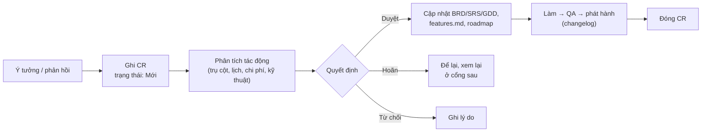

# Yêu cầu thay đổi (Change Requests)

Sổ ghi **mọi thay đổi phạm vi** sau khi [Tầm nhìn](../01-product/vision.md), [BRD](../01-product/brd.md) và [SRS](../01-product/srs.md) đã chốt (2026-10-10): thêm tính năng, đổi luật chơi, dời việc giữa các giai đoạn, bỏ tính năng. Sửa lỗi và việc đã có trong SRS **không** cần CR.

Mục đích: dù làm một mình, vẫn biết *vì sao* phạm vi thay đổi và thay đổi đó đã kéo theo những gì. Đây cũng là chỗ bắt đầu khi muốn **cập nhật thêm sau khi phát hành**.

## Quy trình



Trạng thái: **Mới** → **Đang phân tích** → **Duyệt** / **Hoãn** / **Từ chối** → **Đã làm** (đóng).

Tiêu chí duyệt nhanh: CR phải hỗ trợ ít nhất một [trụ cột thiết kế](../01-product/vision.md#3-trụ-cột-thiết-kế-design-pillars) và không đẩy mốc gần nhất trễ quá 1 tuần. Không đạt thì mặc định **Hoãn** tới sau 1.0.

## Danh sách

| ID | Tiêu đề | Ngày mở | Loại | Tác động lịch | Trạng thái |
| --- | --- | --- | --- | --- | --- |
| [CR-001](#cr-001) | Làm i18n tiếng Anh ngay từ GĐ 0 thay vì GĐ 3 | 2026-10-09 | Dời việc | +1 ngày ở GĐ 0 | Đã làm |
| [CR-002](#cr-002) | Phong cách bảng phấn + 6 nhân vật SVG thay chấm màu avatar | 2026-10-10 | Thay đổi thiết kế | +3 ngày ở GĐ 0 | Đã làm |
| [CR-003](#cr-003) | Thêm Tìm trận, Thử thách hôm nay, Bảng xếp hạng (từ bản thiết kế menu) | 2026-10-10 | Thêm tính năng | Lớn (chưa ước lượng) | Hoãn — xem lại sau 1.0 |
| [CR-004](#cr-004) | Tổ chức lại web theo feature + shadcn/ui | 2026-10-09 | Kỹ thuật | +1 ngày ở GĐ 0 | Đã làm |
| [CR-005](#cr-005) | Luồng trận kiểu party game: phòng chờ 2D, chọn game (vòng quay / chủ phòng chọn + bình chọn), hướng dẫn + độ khó từng người, đếm ngược 5 giây, cộng điểm và vinh danh kiểu Kahoot, bỏ 3D | 2026-10-10 | Đổi luật + thay đổi thiết kế | +1,5–2 tuần ở GĐ 1; bớt việc ở GĐ 2 | Đã làm (2026-10-12) |
| [CR-006](#cr-006) | Cân bằng điểm giữa các mức độ khó, thưởng tốc độ theo từng game, vòng 60 giây cho game mới | 2026-10-10 | Đổi luật (điểm) | +1–2 ngày, làm cùng đợt code 4 game | Đã làm (cơ chế, 2026-10-12) |
| [CR-007](#cr-007) | Nhạc nền nhiều bài + thanh nhạc trên header, làm sớm ở GĐ 1 (tách khỏi FR-GD-07) | 2026-10-14 | Dời việc + thêm chi tiết | +1–2 ngày ở GĐ 1 | Đã làm (2026-10-14) |
| [CR-008](#cr-008) | Âm thanh hiệu ứng khi bấm nút, làm sớm ở GĐ 1; tách rung + Wake Lock thành FR-GD-11 | 2026-10-14 | Dời việc + thêm chi tiết | +1 ngày ở GĐ 1 | Đã làm (2026-10-14) |

---

### CR-001

**Làm i18n tiếng Anh ngay từ GĐ 0 thay vì GĐ 3**

- **Ngày mở / đóng:** 2026-10-09 / 2026-10-09 · **Loại:** Dời việc
- **Lý do:** đang chuyển giao diện sang shadcn, sửa mọi chuỗi một lần rẻ hơn nhiều so với rà lại toàn bộ chữ cứng ở GĐ 3.
- **Tác động:** thêm i18next (~10 KB gzip); mọi chữ phải qua `t()` (thành quy tắc trong `AGENTS.md`); `en.ts` bị TypeScript ép đủ khoá.
- **Tài liệu kéo theo:** [ADR 0007](../02-architecture/decisions/0007-i18n-inline-resources.md), [Lộ trình](../01-product/roadmap.md) (tick mục i18n ở GĐ 3), [Tầm nhìn](../01-product/vision.md#11-câu-hỏi-mở) (Q5).
- **Quyết định:** Duyệt · **Kết quả:** có trong 0.1.0.

### CR-002

**Phong cách bảng phấn + 6 nhân vật SVG thay chấm màu avatar**

- **Ngày mở / đóng:** 2026-10-10 / 2026-10-10 · **Loại:** Thay đổi thiết kế
- **Lý do:** giao diện kem/tím than ban đầu thiếu cá tính; avatar chấm màu không giúp người chơi nhận ra nhau. Bản mẫu mới trên canvas [Brain Rizz — Màn chờ & Menu](https://claude.ai/artifact/GJZbipfsLC2TNo7TPws7CZ). Hỗ trợ BR-09.
- **Tác động:** giao thức thêm trường `avatar` (`JoinOptions`, `SetProfile`, `PlayerView`); thêm màn giới thiệu, menu, chọn bạn đồng hành; token màu mới.
- **Tài liệu kéo theo:** [ADR 0009](../02-architecture/decisions/0009-chalkboard-style-and-characters.md), [UI/UX](../01-product/ui-ux.md), [Thiết kế game › Nhân vật](../01-product/game-design.md#8-nhân-vật--phong-cách-hình-ảnh), [Tổng quan kiến trúc](../02-architecture/overview.md).
- **Quyết định:** Duyệt · **Kết quả:** có trong 0.1.0.

### CR-003

**Thêm Tìm trận, Thử thách hôm nay, Bảng xếp hạng**

- **Ngày mở:** 2026-10-10 · **Loại:** Thêm tính năng · **Người đề xuất:** từ bản thiết kế menu chính
- **Mô tả:** menu chính trên canvas có thêm 3 mục ngoài kế hoạch: Tìm trận (ghép với người lạ), Thử thách hôm nay (3 minigame/ngày, chung đề), Bảng xếp hạng (bạn bè và toàn cầu). Hiện đã hiển thị với nhãn "Sắp có".
- **Phân tích tác động:**
  - *Trụ cột:* hỗ trợ "giữ chân" nhưng Tìm trận đi ngược giả định "chơi với bạn bè" trong [Tầm nhìn](../01-product/vision.md#6-phạm-vi).
  - *Kỹ thuật:* Tìm trận cần matchmaking công khai và chống gian lận mạnh hơn (client hiện biết seed — NFR-SEC-02). Bảng xếp hạng và Thử thách hôm nay cần tài khoản + DB (phụ thuộc UC-16, GĐ 3). Thử thách hôm nay khá rẻ nếu có DB: seed theo ngày.
  - *Chi phí:* phòng công khai làm máy chủ chạy lâu hơn → có thể vượt 1 USD/tháng (NFR-COST-01).
  - *Lịch:* ước lượng thô 3–5 tuần cho cả ba.
- **Đề xuất:** Hoãn tới sau 1.0. Khi xem lại, ưu tiên **Thử thách hôm nay** (rẻ nhất, hợp trụ cột) → Bảng xếp hạng bạn bè → Tìm trận cuối cùng. Phụ thuộc câu hỏi mở Q2 trong [Tầm nhìn](../01-product/vision.md#11-câu-hỏi-mở).
- **Quyết định:** Hoãn (2026-10-10) · **Xem lại:** Cổng 3.
- **Tài liệu kéo theo (khi duyệt):** BRD (BR-14 đổi từ W), SRS (chi tiết UC-17 → UC-19), [Danh sách tính năng](features.md#e7--chế-độ-mở-rộng--tài-khoản), Lộ trình.

### CR-004

**Tổ chức lại web theo feature + shadcn/ui**

- **Ngày mở / đóng:** 2026-10-09 / 2026-10-09 · **Loại:** Kỹ thuật (không đổi hành vi)
- **Lý do:** cấu trúc `ui/screens` cũ khó mở rộng khi có 15 minigame; muốn cấu trúc giống dự án LogiX đã quen.
- **Tác động:** di chuyển toàn bộ `apps/web/src`; thêm alias `@/`; quy tắc "feature chỉ import feature khác qua `index.ts`".
- **Tài liệu kéo theo:** [ADR 0006](../02-architecture/decisions/0006-ui-shadcn-and-theme-tokens.md), [ADR 0008](../02-architecture/decisions/0008-web-feature-folders-and-game-modules.md), [Cây thư mục](../02-architecture/folder-structure.md).
- **Quyết định:** Duyệt · **Kết quả:** có trong 0.1.0.

### CR-005

**Luồng vào trận kiểu party game**

- **Ngày mở:** 2026-10-10 · **Loại:** Đổi luật + thay đổi thiết kế · **Người đề xuất:** chủ dự án (tham khảo Pummel Party, phòng chờ Goose Goose Duck)
- **Mô tả:** trước mỗi minigame đi qua 6 bước:
  1. **Phòng chờ 2D** (bỏ sân khấu 3D): ô người chơi, đếm "Sẵn sàng x/y", mã phòng ẩn/hiện + sao chép, đổi nhân vật ngay trong phòng.
  2. **Chủ phòng chọn số vòng** — mỗi vòng là một minigame, tổng điểm sau các vòng quyết định người thắng.
  3. **Chọn game mỗi vòng:** vòng quay ngẫu nhiên, hoặc chủ phòng chọn từ danh sách (người chơi khác bình chọn để gợi ý).
  4. **Màn hướng dẫn** cách chơi và điều khiển của game được chọn.
  5. **Chọn độ khó** (ban đầu đề xuất độ khó chung cho cả phòng; chốt: mỗi người tự chọn, chủ phòng giám sát), rồi nút Bắt đầu.
  7–9. Chơi → bảng điểm vòng → cộng điểm trận; lặp tới hết số vòng rồi vinh danh người thắng.
  6. **Đếm ngược 5 giây** rồi vào chơi.
- **Đối chiếu với hiện tại:**

| Bước | Hiện có | Phải thêm/đổi |
| --- | --- | --- |
| 1 | Sảnh 3D, danh sách người chơi, sẵn sàng; đổi nhân vật chỉ ở menu | Bỏ 3D; giao diện ô người chơi; đổi nhân vật trong phòng (giao thức `setProfile` đã hỗ trợ sẵn) |
| 2 | Chủ phòng chọn 1–10 vòng ở sảnh | Giữ nguyên, chỉ làm lại giao diện |
| 3 | Chủ phòng chọn game ở sảnh; các vòng sau tự xoay vòng | Pha mới `game-select`; vòng quay; bình chọn |
| 4 | Không có | Pha mới `game-intro`; mỗi minigame thêm nội dung hướng dẫn + điều khiển trong `locales.ts` |
| 5 | Mỗi người tự chọn độ khó ở hồ sơ/sảnh, điểm nhân hệ số | Chọn độ khó **cho từng game** ở màn hướng dẫn; chủ phòng xem độ khó từng người, cảnh báo người lệch, nút "Nhắc" |
| 7–9 | Bảng kết quả vòng, bảng chung cuộc | Thêm bước cộng điểm trận có hiệu ứng sau mỗi vòng; vinh danh top 3 kiểu Kahoot bằng 2D |
| 6 | Đếm ngược 3 giây | Đổi `COUNTDOWN_MS` thành 5 giây |

- **Phân tích tác động:**
  - *Trụ cột:* hợp "Vào là chơi" và "Ngắn, gọn" (luồng rõ ràng hơn). Đề xuất ban đầu "độ khó chung" đi ngược trụ cột "Công bằng cho mọi lứa tuổi" (persona P2, BR-04); phương án đã chốt (mỗi người tự chọn + chủ phòng giám sát) giữ được trụ cột này.
  - *Kỹ thuật — server:* thêm 2 pha vào máy trạng thái phòng (`lobby → game-select → game-intro → countdown → playing → round-results → game-select …`); thêm tin nhắn (đều validate bằng zod): `voteGame`, `spinWheel`, `pickGame`, `setDifficulty`, `introReady`, `nudgeDifficulty`. **Kết quả vòng quay do server quyết định** rồi gửi cho mọi máy để cùng quay tới một lát — client không tự random. Phiếu bình chọn chỉ là state trong RAM của phòng (`votes: Map<người chơi, gameId>`), xoá khi qua vòng. **Không cần database, không cần Supabase.** Chi phí server gần như không đổi.
  - *Kỹ thuật — shared:* `PartyStateView` thêm `votes`, `introReady`, `playedGames`, kết quả vòng quay; `difficulty` của từng người giữ nguyên nhưng được đặt lại ở mỗi vòng. Đổi giao thức → client và server phải phát hành cùng lúc (vẫn trước 1.0 nên không cần tăng MAJOR).
  - *Kỹ thuật — web:* làm lại `features/lobby`; thêm feature `game-select` và `game-intro`; gỡ `LobbyStage` 3D → **bớt three.js khỏi gói tải ở sảnh**, quy tắc "một canvas WebGL" dễ giữ hơn.
  - *Tài liệu kéo theo:* BRD (BR-04, BR-11, RULE-05/06), SRS (UC-05, UC-06 viết lại; thêm UC chọn game, UC hướng dẫn; FR-VC-02, FR-VC-12, FR-VC-13, FR-GD-05), GDD (vòng lặp chơi, độ khó, tính điểm), UI/UX (màn S4–S6 mới), đặc tả minigame (mục hướng dẫn + điều khiển), Tổng quan kiến trúc (pha, tin nhắn), ADR mới về độ khó chung.
  - *Lịch:* +1–1,5 tuần ở GĐ 1. Bù lại FR-VC-12 (màn hướng dẫn) và FR-VC-13 (chọn game vòng sau) vốn đã có trong GĐ 1 được làm luôn trong CR này.
- **Đề xuất của PM:** Duyệt, làm trước 4 minigame MVP còn lại (vì mỗi game mới cần nội dung hướng dẫn theo khuôn mới).
- **Bản mẫu:** canvas [Brain Rizz — Màn chờ & Menu](https://claude.ai/artifact/GJZbipfsLC2TNo7TPws7CZ), khu 5–11.
- **Câu hỏi đã trả lời (2026-10-10):**

| # | Câu hỏi | Quyết định của chủ dự án |
| --- | --- | --- |
| 1 | Độ khó chung hay riêng? | **Mỗi người tự chọn độ khó cho từng game** ở màn hướng dẫn (điểm vẫn nhân hệ số). Chủ phòng chọn độ khó của mình và **xem được độ khó của từng người**; người chọn lệch so với đa số được đánh dấu, chủ phòng bấm "Nhắc" được. → Bước 5 không còn đi ngược trụ cột "Công bằng". |
| 2 | Luồng một trận? | Phòng chờ → chủ phòng chọn số vòng (một lần) → **lặp mỗi vòng:** 3 chọn game → 4 hướng dẫn → 5 độ khó + bắt đầu → 6 đếm ngược 5 giây → 7 chơi → 8 bảng điểm vòng → 9 cộng điểm trận cho từng người → hết số vòng: bảng xếp hạng người thắng. |
| 3 | Ai bắt đầu ở bước 5? | Theo đề xuất PM: ai đọc xong bấm "Đã hiểu"; chủ phòng bấm Bắt đầu khi mọi người xong; tự bắt đầu sau 20 giây. |
| 4 | Bình chọn ảnh hưởng vòng quay? | **Không.** Bình chọn chỉ để gợi ý chủ phòng khi muốn chơi đích danh một game. Vòng quay gồm toàn bộ game hệ thống. |
| 5 | Có lặp game không? | **Không lặp:** game đã chơi bị loại khỏi vòng quay và danh sách ở các vòng sau. |
| 6 | Bước 7 là gì? | 7 chơi, 8 tổng điểm vòng, 9 cộng điểm trận — lặp tới hết trận. |
| 7 | Bục trao giải 3D? | **Bỏ 3D.** Vinh danh top 3 kiểu Kahoot bằng 2D để tối ưu hiệu năng. |

- **Hệ quả thêm từ quyết định:**
  - Không còn chỗ nào dùng 3D → gỡ hẳn three.js / React Three Fiber khỏi dự án khi làm (ghi [ADR 0010](../02-architecture/decisions/0010-drop-3d-2d-lobby-and-podium.md)). Gói tải nhẹ hơn; bỏ 2 việc 3D của GĐ 2 (avatar .glb, bục 3D).
  - Thêm tin nhắn `nudgeDifficulty` (chủ phòng → một người), giới hạn tối đa 1 lần/10 giây cho mỗi người.
- **Giả định PM tự đặt (báo lại nếu không đúng):**
  - Đổi nhân vật ở phòng chờ không huỷ sẵn sàng.
  - "Lệch" = khác mức độ khó mà nhiều người trong phòng đang chọn nhất. Chỉ là cảnh báo cho chủ phòng, không chặn bắt đầu.
  - Hết game chưa chơi (số vòng nhiều hơn số game đang có) thì danh sách được làm mới từ đầu. Hiện mới có 1 game nên mọi vòng tạm thời đều là Kẻ lạc đàn.
  - Từ bảng cộng điểm sang vòng sau: chủ phòng bấm "Vòng tiếp theo" như hiện tại.
  - *(Bổ sung 2026-10-12 khi bắt đầu code; chủ dự án chưa trả lời nên PM áp dụng đề xuất, đổi được sau)*:
    - **"Chơi lại"** giữ nguyên người chơi và số vòng, vào thẳng Chọn game vòng 1. **"Về phòng chờ"** về phòng chờ để đổi nhân vật, số vòng, chờ thêm người.
    - **Hoà điểm:** hoà điểm vòng thì cùng hạng và cùng điểm trận; hoà điểm trận ở cuối thì ai có tổng điểm vòng cao hơn xếp trên.
    - **Bắt đầu trận:** cần ≥ 2 người và **tất cả** (kể cả chủ phòng) đã sẵn sàng.
    - Chủ phòng không bỏ phiếu. Vòng quay chỉ có game đã làm xong.
    - Màu "trả lời đúng" giữ như bản mẫu (vàng chủ đạo kèm dấu ✓).
    - Vòng cuối cũng hiện bảng điểm vòng và bảng cộng điểm trước; chủ phòng bấm "Xem người thắng" mới sang vinh danh.
- **Quyết định:** **Duyệt** (2026-10-10). Đã cập nhật BRD 1.1, SRS 1.1, GDD 1.1, UI/UX 1.1, Tầm nhìn, Lộ trình, Danh sách tính năng. Tổng quan kiến trúc, Tech stack và Cây thư mục mô tả code nên sẽ cập nhật khi làm.
- **Đã làm:** 2026-10-12, sau khi QA soát. Cập nhật kèm: SRS 1.2 (chốt "Chơi lại"), Tổng quan kiến trúc, Tech stack, Cây thư mục, ADR 0010, Danh sách tính năng, Nhật ký phát hành.

### CR-006

**Cân bằng điểm giữa các mức độ khó và thưởng tốc độ theo từng game**

- **Ngày mở:** 2026-10-10 · **Loại:** Đổi luật (điểm) · **Người đề xuất:** game-designer (khi viết đặc tả 4 game MVP), PM tổng hợp
- **Bối cảnh:** khi viết đặc tả [Theo dấu ánh đèn](../04-minigames/light-trail.md), [Cân não](../04-minigames/balance.md), [Bóng bay số](../04-minigames/number-balloons.md), [Xoay hình](../04-minigames/rotate-match.md), mô phỏng điểm theo công thức hiện tại (RULE-06, RULE-07, `packages/shared/src/scoring.ts`) cho thấy hai vấn đề chung cho mọi game.
- **Vấn đề 1 — thưởng tốc độ chung (trọn 50 khi ≤ 1,5 giây, hết từ 8 giây) không hợp với mọi game:**

| Game | Vì sao | Thưởng trung bình ở Siêu khó |
| --- | --- | --- |
| Theo dấu ánh đèn | Đồng hồ tính cả ~3 giây trình chiếu, lúc đó không bấm được | ~3/50 |
| Bóng bay số | 5 lần chạm đã mất ~1,75 giây | ~7/50 |
| Cân não | Câu Siêu khó cần 5–7 giây suy luận | ~14/50 |
| Xoay hình | Hợp, giữ nguyên | 8–23/50 |

- **Vấn đề 2 — cùng một người, chọn mức càng cao điểm càng thấp; chọn Mầm được gấp đôi.** Điểm vòng của người lớn so với khi chơi Thường (mô phỏng của từng đặc tả):

| Game | Người lớn ở Mầm | Người lớn ở Khó | Người lớn ở Siêu khó | Trẻ 7 tuổi ở Mầm |
| --- | --- | --- | --- | --- |
| Cân não | ~162 % | ~69 % | ~48 % | ~65 % |
| Bóng bay số | ~210 % | ~93 % | ~75 % | ~77 % |
| Xoay hình | ~223 % | ~66 % | ~45 % | ~93 % |
| Theo dấu ánh đèn | (chưa mô phỏng) | ~89 % | ~81 % | ~81 % |

  - *Nguyên nhân:* câu Siêu khó mất gấp 2–3 lần thời gian câu Thường nhưng hệ số chỉ × 1,5; combo không có trần (chuỗi 20 câu đúng nhân tới × 2,8) nên chơi mức dễ, nhanh được lợi gấp đôi.
  - *Hệ quả:* người giỏi không có lý do chọn mức cao. Cơ chế "lệch" + "Nhắc" của CR-005 chỉ chặn được về mặt xã giao.
- **Đề xuất của PM:**
  1. **Một cơ chế "miễn trừ thời gian" cho thưởng tốc độ**: mỗi game tự khai báo số mili giây được trừ khỏi thời gian trả lời theo câu đố và độ khó (thời gian trình chiếu, số lần chạm, mức khó). Server trừ trước khi tính thưởng. Gộp 3 đề xuất riêng của các đặc tả (`revealMs`, `speedAllowanceMs`, nhân khung theo hệ số) thành **một trường tuỳ chọn** trong `MinigameDef`. Không đổi giao thức.
  2. **Hệ số điểm theo từng game** thay cho hệ số chung 0,8 / 1 / 1,25 / 1,5: tính từ thời gian giải dự kiến mỗi mức (đã có trong bảng Cân bằng của từng đặc tả), để người chơi đúng sức ở bất kỳ mức nào được điểm vòng xấp xỉ nhau. Kèm **trần combo × 1,5**.
     - Không công thức nào chặn hẳn việc người lớn chọn mức dễ (họ vẫn giải nhanh hơn trẻ). Phần đó vẫn do chủ phòng giám sát. Mục tiêu là **không phạt người chọn mức cao**.
  3. **Vòng 60 giây cho 4 game mới** (Kẻ lạc đàn giữ 45 giây), để ở Siêu khó vẫn còn ≥ 8 câu mỗi vòng.
  4. **Trả lời sai thì hiện đáp án đúng trong 1,5 giây khoá, áp dụng cho mọi game.** 3/4 đặc tả mới đã làm vậy; Kẻ lạc đàn sửa theo cho nhất quán.
  - Cơ chế làm ngay cùng đợt code 4 game; **con số cụ thể chốt sau buổi chơi thử đủ 5 game MVP**, chỉnh số không cần sửa code.
- **Tác động:** shared (`MinigameDef` thêm trường tuỳ chọn, `scoring.ts` nhận hệ số theo game + trần combo), server (`handleAnswer` trừ miễn trừ), web (Kẻ lạc đàn hiện đáp án đúng khi sai). Tài liệu: GDD mục 6–7, BRD RULE-06/07, SRS FR-VC-05/06, đặc tả 5 game.
- **Quyết định:** **Duyệt** (2026-10-12), cùng với việc làm 4 game theo đúng đề xuất trong đặc tả. Cơ chế làm cùng đợt code 4 game; con số chốt sau buổi chơi thử đủ 5 game MVP.
- **Giả định PM khi code (2026-10-12, đổi được sau chơi thử):**
  - Hệ số Mầm = **min(giá trị mô phỏng cho trẻ 7 tuổi, 1)**: Theo dấu ánh đèn, Cân não, Bóng bay số mô phỏng ra 1,15–1,35 nên đặt 1; Xoay hình ra 0,86 nên đặt 0,85. Lý do: hệ số không giảm khi lên mức, và người lớn chọn Mầm không được lợi thêm (với × 1,35 người lớn ở Mầm được ~200 % điểm Thường). Trẻ ở Mầm được khoảng 80–90 % điểm người lớn ở Thường.
  - Miễn trừ `Infinity`/NaN/số âm do game khai báo sai được coi là 0 (không miễn trừ).
  - Cân não giữ bộ vật đồ ăn như đặc tả; chỉ đổi sang bộ trung tính nếu chơi thử thấy trẻ bị nhiễu.
- **Đã làm:** 2026-10-12, QA PASS. Cơ chế trong `scoring.ts` + `PartyRoom.ts`; 4 game mới khai báo hệ số/miễn trừ, vòng 60 giây; Kẻ lạc đàn hiện đáp án đúng khi sai. Còn lại: chốt con số sau buổi chơi thử đủ 5 game (chỉnh hằng, không sửa cơ chế). Cập nhật kèm: BRD 1.2, SRS 1.3, GDD 1.2, đặc tả 5 game, `_template.md`.

### CR-007

**Nhạc nền nhiều bài + thanh nhạc trên header, làm sớm ở GĐ 1**

- **Ngày mở:** 2026-10-14 · **Loại:** Dời việc + thêm chi tiết · **Người đề xuất:** chủ dự án
- **Mô tả:** nhạc nền gồm nhiều bài do chủ dự án tự chọn, chép vào thư mục `apps/web/src/assets/music/`. Trên header có thanh nhạc để phát/dừng và chuyển bài; máy tính có thêm tên bài và âm lượng.
- **Lý do:** nhạc nền đã có trong phạm vi (FR-GD-07, GĐ 2), nhưng SRS chưa nói giao diện điều khiển; chủ dự án muốn có sớm để không khí phòng chờ sôi động hơn trước buổi chơi thử. Không đi ngược trụ cột nào; giữ trụ cột 4 "Nhẹ và rẻ" bằng cách chỉ tải nhạc khi phát và không thêm thư viện.
- **Phân tích tác động:**
  - *Kỹ thuật:* chỉ web (feature mới `features/music/`, một `HTMLAudioElement`, không thêm thư viện). Không đổi giao thức, seed hay server. Không thêm canvas WebGL.
  - *Hiệu năng:* bài nhạc chỉ tải khi phát (`preload="none"`), không tăng gói JS ban đầu đáng kể (NFR-PERF-01). Mỗi bài nên ≤ 3 MB.
  - *Pháp lý:* chủ dự án dùng nhạc "no copyright", có thể không được phép dùng trong game → ngoại lệ NFR-LEGAL-01, rủi ro [R-12](../01-product/vision.md#10-rủi-ro-risk-register). Cách giảm: chuyển repo sang private trước khi commit nhạc, ghi nguồn từng bài vào `assets/LICENSES.md`.
  - *Lịch:* +1–2 ngày ở GĐ 1; GĐ 2 bớt tương ứng.
- **Quyết định:** **Duyệt** (2026-10-14, chủ dự án). Giả định PM chốt theo đề xuất ban đầu, chủ dự án đồng ý "theo hướng nói ban đầu":
  - Mặc định bật; phát ở lần chạm đầu (trình duyệt chặn tự phát, NFR-UX-02).
  - Phát lần lượt theo tên file, hết danh sách thì lặp lại.
  - Đếm ngược và đang chơi: nhạc nhỏ còn một nửa, thanh nhạc ẩn cùng nút ngôn ngữ/giao diện.
  - Tab ẩn thì tạm dừng.
- **Tài liệu kéo theo:** SRS 1.4 (thêm FR-GD-10, tách khỏi FR-GD-07; sửa UC-11, NFR-UX-02, NFR-LEGAL-01), vision.md (R-12), roadmap, `assets/LICENSES.md`, features.md, changelog.
- **Kết quả:** đã làm 2026-10-14, QA PASS (Chrome headless, gồm cả vào pha chơi). Còn lại: chủ dự án chép file nhạc và ghi nguồn vào `assets/LICENSES.md`; thử trên iPhone thật (mở khoá âm thanh, giảm âm, khoá máy/cuộc gọi). Sẽ có trong bản 0.1.0 hoặc bản trung gian GĐ 1.

### CR-008

**Âm thanh hiệu ứng khi bấm nút, làm sớm ở GĐ 1**

- **Ngày mở:** 2026-10-14 · **Loại:** Dời việc + thêm chi tiết · **Người đề xuất:** chủ dự án
- **Mô tả:** tiếng click khi bấm nút trong toàn hệ thống, cùng tiếng báo lỗi, tích tắc đếm ngược và đúng/sai. Chủ dự án giao PM tự chọn tiếng, sẽ thay bằng file mong muốn sau khi thử.
- **Lý do:** âm thanh hiệu ứng đã có trong phạm vi (FR-GD-07, GĐ 2); làm cùng đợt nhạc nền ([CR-007](#cr-007)) vì dùng chung phần mở khoá âm thanh. Giữ trụ cột 4 "Nhẹ và rẻ": tiếng mặc định tạo bằng Web Audio (0 KB, không vướng giấy phép), không thêm thư viện.
- **Phân tích tác động:**
  - *Kỹ thuật:* chỉ web (feature mới `features/sfx/`); một AudioContext dùng chung với nhạc nền; gắn tiếng bằng một listener chung cho mọi nút, nút đặc biệt khai báo `data-sfx`. Đúng/sai bắt từ `answerResult` ở tầng React, không sửa scene Phaser. Không đổi giao thức.
  - *Pháp lý:* tiếng tạo bằng code không cần giấy phép; file thay thế sau này (gợi ý Kenney Interface Sounds, CC0) ghi vào `assets/LICENSES.md`.
  - *Lịch:* +1 ngày ở GĐ 1.
- **Quyết định:** **Duyệt** (2026-10-14, chủ dự án: "tự quyết định cho sound, triển khai luôn"). Giả định PM:
  - 8 loại tiếng: click, toggle, confirm, back, error, tick, correct, wrong. Có file `apps/web/src/assets/sfx/<loại>.mp3` thì dùng file, không thì dùng tiếng tạo bằng code.
  - Nút bật/tắt riêng, độc lập với nhạc nền; mặc định bật; âm lượng cố định.
  - Tách rung + Wake Lock thành FR-GD-11, giữ ở GĐ 2.
- **Tài liệu kéo theo:** SRS 1.5 (FR-GD-07 viết lại, thêm FR-GD-11; UC-11, NFR-UX-02, mục Dữ liệu), roadmap, features.md, changelog.
- **Kết quả:** đã làm 2026-10-14, QA PASS (Chrome headless, chơi thật một vòng 2 tab). Nút bật/tắt dùng icon chuông để không nhầm với âm lượng nhạc. Còn lại: nghe thử bằng tai, thử iPhone thật; chủ dự án thay file tiếng mong muốn vào `apps/web/src/assets/sfx/` và ghi nguồn vào `assets/LICENSES.md`.

---

## Mẫu CR mới

Copy khối dưới, đặt mã kế tiếp, thêm một dòng vào bảng Danh sách.

```markdown
### CR-00X

**<Tiêu đề ngắn>**

- **Ngày mở:** YYYY-MM-DD · **Loại:** Thêm tính năng | Đổi luật | Dời việc | Thay đổi thiết kế | Kỹ thuật | Bỏ tính năng
- **Mô tả:** muốn gì, cho ai.
- **Lý do:** vấn đề nào, BR nào, trụ cột nào.
- **Phân tích tác động:**
  - *Trụ cột:* …
  - *Kỹ thuật:* phần nào phải sửa (shared / server / web), có đổi giao thức hay seed không.
  - *Chi phí:* …
  - *Lịch:* ước lượng, ảnh hưởng mốc nào.
- **Quyết định:** Duyệt | Hoãn | Từ chối (YYYY-MM-DD) — lý do.
- **Tài liệu kéo theo:** BRD / SRS / GDD / UI-UX / ADR / features.md / roadmap.
- **Kết quả:** có trong bản x.y.z.
```

[← Theo dõi](README.md) · [Mục lục tài liệu](../README.md)
