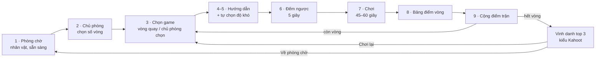

# Thiết kế game (GDD)

| | |
| --- | --- |
| Giai đoạn SDLC | Thiết kế — phần luật chơi và cảm giác chơi |
| Phiên bản tài liệu | 1.3 · 2026-10-16 — luật Kiểm tra não và Điểm Não theo [CR-009](../00-tracking/change-requests.md#cr-009) |
| Liên quan | [SRS](srs.md) (yêu cầu), [UI/UX](ui-ux.md) (màn hình), [Minigame](../04-minigames/README.md) (đặc tả từng game) |
| Cập nhật khi | Đổi luật, điểm, độ khó, chế độ chơi — đổi luật nào cũng phải ghi [CR](../00-tracking/change-requests.md) |

## 1. Khái niệm

Party game trí tuệ trên trình duyệt. Mỗi trận gồm vài vòng ngắn; mỗi vòng là một minigame mà mọi người cùng giải một bộ câu đố trong 45–60 giây, ai đúng nhiều và nhanh nhất thắng vòng. Cảm hứng thể loại từ Big Brain Academy (5 nhóm kỹ năng), nhưng toàn bộ tên, hình, nhân vật là của dự án.

Trụ cột thiết kế: [Tầm nhìn › Trụ cột](vision.md#3-trụ-cột-thiết-kế-design-pillars).

## 2. Vòng lặp chơi (core loop)

Một trận mặc định 3 vòng; mỗi vòng khoảng 1,5 phút kể cả chọn game, hướng dẫn và xem điểm, nên một trận 3 vòng khoảng 5 phút. Cảm hứng nhịp chơi: Pummel Party (mỗi minigame có màn hướng dẫn, ai đọc xong bấm sẵn sàng) và Kahoot (bảng điểm sau mỗi câu, vinh danh top 3).

### Chọn game mỗi vòng

- **Vòng quay may mắn:** mỗi lát là một game chưa chơi trong trận; server quyết định kết quả, mọi máy quay cùng lúc và dừng cùng chỗ.
- **Chủ phòng chọn:** chủ phòng chọn bất kỳ game nào còn lại. Người chơi khác bình chọn để gợi ý ("Cả phòng đang muốn: Cân não · 3 phiếu"); phiếu không ràng buộc chủ phòng và không ảnh hưởng vòng quay.
- **Không lặp:** game đã chơi bị loại khỏi các vòng sau; chơi hết mọi game thì làm mới danh sách.

## 3. Chế độ chơi

| Chế độ | Mô tả | Số người | Giai đoạn |
| --- | --- | --- | --- |
| **Đấu nhóm** (chính) | Chủ phòng chọn 1–10 vòng (mặc định 3), mỗi vòng một minigame chọn bằng vòng quay hoặc chủ phòng chọn | 2–8, cùng lúc | GĐ 0–1 |
| **Luyện tập** | Chơi tự do từng minigame, chọn độ khó; client tự chấm nên không lên bảng xếp hạng | 1 | GĐ 1–2 ([CR-009](../00-tracking/change-requests.md#cr-009)) |
| **Kiểm tra não** | 5 game, mỗi nhóm kỹ năng một game, độ khó cố định, server chấm → "Điểm Não" + biểu đồ 5 cạnh. Luật: [mục dưới](#kiểm-tra-não) | 1 | GĐ 1–2 (CR-009) |
| **Đấu bóng ma** | Lưu lượt chơi; bạn bè đấu lại bất cứ lúc nào, không cần online cùng lúc | 1 vs bản ghi | GĐ 3 |
| **Bảng xếp hạng** | Điểm Não toàn cầu và từng minigame, lấy từ các lượt Kiểm tra não | — | GĐ 1–2 (CR-009) |
| Thử thách hôm nay, Tìm trận | Có trong bản thiết kế menu, chưa nằm trong phạm vi 1.0 | — | Chờ [CR-003](../00-tracking/change-requests.md#cr-003) |

### Kiểm tra não

Chế độ chơi một mình (UC-14, [CR-009](../00-tracking/change-requests.md#cr-009)), ra **Điểm Não** và điểm 5 kỹ năng, lên bảng xếp hạng. Mọi người chơi cùng một luật để điểm so được với nhau. Cài đặt: `packages/shared/src/brain-test.ts`; server (`BrainTestRoom`) và web dùng chung.

**Luật một lượt**

- 5 game, mỗi nhóm kỹ năng một game, luôn theo thứ tự Nhận diện → Ghi nhớ → Phân tích → Tính toán → Hình dung (`CATEGORIES`).
- Mỗi game: hướng dẫn ngắn → người chơi bấm **Sẵn sàng** → đếm ngược 3 giây → chơi → màn kết quả game giữ 3 giây → sang game kế.
- Server phát seed, giữ đồng hồ và chấm từng câu **y như vòng party** ([§7](#7-tính-điểm)): điểm câu đúng theo `pointsForCorrect`, hệ số và miễn trừ thời gian của từng game, combo trần × 1,5, sai thì khoá 1,5 giây. Chuỗi đúng tính lại từ 0 ở đầu mỗi game.
- **Điểm game** = tổng điểm các câu đúng trong game đó (điểm thô). Server lưu điểm game cùng số câu đúng. Bảng xếp hạng từng minigame dùng thẳng điểm thô này, vì mọi lượt chơi game đó cùng độ khó, cùng thời lượng.

**Độ khó cố định: Thường (`BRAIN_TEST_DIFFICULTY = 1`)**

- Thường là mốc so sánh của CR-006: hệ số × 1 ở mọi game và là mức dành cho người lớn chơi đúng sức, nên điểm chuẩn ở dưới tính thẳng được từ bảng Cân bằng của từng đặc tả.
- Không cho tự chọn độ khó: hệ số độ khó cân điểm *trung bình* giữa các mức, không làm điểm từng người so được với nhau trên bảng xếp hạng.
- Trẻ em vẫn chơi được nhưng điểm thấp hơn người lớn. Bảng xếp hạng không chia theo lứa tuổi; muốn chơi vừa sức thì dùng Luyện tập hoặc phòng party.

**Thời lượng (`BRAIN_TEST_DURATION_MS_BY_CATEGORY`)**

Thời lượng đặt theo nhóm, không theo game. Mỗi nhóm có đúng một game nên lượt nào cũng dài như nhau, dù bốc trúng game nào. Game không bao giờ dài hơn vòng party của nó.

| Nhóm | Thời lượng | Vì sao |
| --- | --- | --- |
| Nhận diện | 30 s | Kẻ lạc đàn ~1,5 s mỗi câu (~17 câu trong 30 s), Bóng của ai ~2 s mỗi câu (~12 câu) |
| Ghi nhớ | 45 s | Mỗi câu có 3–3,4 s trình chiếu không bấm được; 45 s còn 7–12 câu |
| Phân tích | 40 s | 2,5–3,7 s mỗi câu → 9–13 câu |
| Tính toán | 45 s | ~5 s mỗi câu; 45 s còn ~8 câu |
| Hình dung | 40 s | 2,7–3,3 s mỗi câu → 10–12 câu |

Tổng **200 giây chơi**. Cộng 5 × (≈ 12 s đọc hướng dẫn + 3 s đếm ngược + 3 s kết quả) ra khoảng **4 phút 50 giây** một lượt (`BRAIN_TEST_ESTIMATED_TOTAL_MS`, để hiện ở màn giới thiệu). Vòng party 45–60 s thì 5 game đã hết 5 phút chỉ riêng phần chơi, vượt mục tiêu 4–5 phút.

**Cách chọn game (`pickBrainTestGames(seed, available?)`)**

- Server tạo `seed` cho lượt. Nhóm thứ `i` bốc **đều** một game trong các game đã đăng ký của nhóm, bằng luồng ngẫu nhiên riêng `createRng(deriveSeed(seed, i))`. Cùng seed → cùng 5 game, trên mọi máy.
- Mọi game đã đăng ký đều được vào, kể cả game còn chờ chơi thử. Hiện tại: Nhận diện có Kẻ lạc đàn và Bóng của ai nên mỗi game có xác suất 1/2; bốn nhóm còn lại mỗi game có xác suất 1/3.
- `available` (tuỳ chọn) giới hạn danh sách game. Id lạ, id trùng và thứ tự trong `available` không ảnh hưởng kết quả. Nhóm không còn game nào trong `available` thì bốc từ mọi game của nhóm đó, để lượt luôn đủ 5 game. Mỗi nhóm có luồng riêng nên giới hạn một nhóm không làm đổi game được bốc ở nhóm khác.

**Quy điểm game về điểm kỹ năng (`skillScore`)**

Các game ăn điểm rất khác nhau: ở cùng mức Thường, người chơi bình thường được ~3 350 điểm Kẻ lạc đàn trong 30 s nhưng chỉ ~1 050 điểm Theo dấu ánh đèn trong 45 s. Cộng thẳng điểm thô thì Điểm Não phụ thuộc vào việc bốc trúng game nào. Vì vậy mỗi game có một **điểm chuẩn** (bảng dưới), và với `r = điểm game / điểm chuẩn`:

- `r ≤ 1`: **kỹ năng = 100 × r** (đạt đúng điểm chuẩn = 100).
- `r > 1`: **kỹ năng = 200 − 100 / r**, tăng chậm dần và không vượt 200.
- Làm tròn số nguyên, kẹp trong 0–200. Điểm âm, NaN hay vô cực coi như 0.

| r (so với điểm chuẩn) | 0 | 0,5 | 0,8 | 1 | 1,25 | 1,5 | 2 | 3 | 5 |
| --- | --- | --- | --- | --- | --- | --- | --- | --- | --- |
| Kỹ năng | 0 | 50 | 80 | 100 | 120 | 133 | 150 | 167 | 180 |

Hai nhánh nối trơn tại `r = 1` (cùng độ dốc). Nhánh trên giảm dần vì ba lẽ: một game điểm chuẩn ước sai không kéo lệch cả Điểm Não; một game xuất sắc không lấn át bốn game còn lại; bot giải câu đố (hạn chế NFR-SEC-02) không vượt quá 200 mỗi kỹ năng. Chỉ dùng phép cộng, nhân, chia nên server và trình duyệt ra cùng một số.

**Điểm Não (`computeBrainResult`)**

- **Điểm Não = tổng 5 kỹ năng**, thang **0–1 000** (`BRAIN_SCORE_MAX`). Người lớn chơi bình thường ở cả 5 game được khoảng 500.
- Nhóm không có kết quả (thiếu game) thì kỹ năng đó = 0. Lượt bị huỷ thì không tính (UC-14).
- Kết quả có id game lạ thì bỏ qua. Một nhóm có nhiều kết quả (không xảy ra khi chơi đúng luồng) thì lấy kỹ năng cao nhất.

**Điểm chuẩn từng game (`BRAIN_TEST_REFERENCE_SCORE`) — SỐ TẠM, chốt sau buổi chơi thử**

Điểm chuẩn là điểm kỳ vọng của người lớn chơi đúng sức ở Thường, trong thời lượng Kiểm tra não của game đó. Cách tính: mô phỏng 4 000 lượt mỗi game bằng chính `generate()`, `speedAllowanceMs` và `pointsForCorrect`. Thời gian thao tác mỗi câu dao động đều ±20 % quanh giả định; câu sai tốn thời gian như câu đúng cộng khoá 1,5 s; câu chưa xong khi hết giờ không tính; giữa hai câu có 0,25–0,35 s hiệu ứng (Lật cặp: 0). Kết quả làm tròn tới 50. Hai cột cuối là điểm của người nhanh hơn 30 % và chậm hơn 40 % so với giả định, chia cho điểm chuẩn.

| Nhóm | Game | Thời lượng | Giả định ở Thường (theo đặc tả): thời gian mỗi câu · tỉ lệ sai | Câu · đúng | **Điểm chuẩn** | Nhanh hơn 30 % | Chậm hơn 40 % |
| --- | --- | --- | --- | --- | --- | --- | --- |
| Nhận diện | Kẻ lạc đàn | 30 s | 1,3 s · 4 % (ước; đặc tả chưa có bảng Cân bằng) | 17,4 · 16,7 | **3 350** | × 1,33 | × 0,73 |
| Nhận diện | Bóng của ai | 30 s | 2,0 s · 8 % | 12,2 · 11,2 | **2 050** | × 1,41 | × 0,68 |
| Ghi nhớ | Theo dấu ánh đèn | 45 s | trình chiếu ~3,0 s + nhập 2,3 s · 10 % | 7,2 · 6,4 | **1 050** | × 1,23 | × 0,78 |
| Ghi nhớ | Ai vừa biến mất | 45 s | xem + che 3,4 s + chọn 1,5 s · 10 % | 8,0 · 7,2 | **1 250** | × 1,15 | × 0,84 |
| Ghi nhớ | Lật cặp | 45 s | phần xem của bàn + chạm 1,5 s · 12 % | 12,2 · 10,8 | **1 950** | × 1,22 | × 0,84 |
| Phân tích | Cân não | 40 s | 3,0 s · 8 % | 11,6 · 10,6 | **1 850** | × 1,48 | × 0,65 |
| Phân tích | Đếm khối | 40 s | 3,7 s · 8 % | 9,3 · 8,5 | **1 400** | × 1,53 | × 0,63 |
| Phân tích | Bi rơi đâu | 40 s | 2,5 s · 10 % | 13,2 · 11,9 | **2 100** | × 1,43 | × 0,68 |
| Tính toán | Bóng bay số | 45 s | 4,9 s · 6 % | 8,0 · 7,6 | **1 250** | × 1,57 | × 0,61 |
| Tính toán | Chạm đích | 45 s | 5,2 s · 6 % | 7,6 · 7,2 | **1 100** | × 1,61 | × 0,58 |
| Tính toán | Đếm tiền nhanh | 45 s | 5,0 s · 7 % | 7,9 · 7,4 | **1 200** | × 1,59 | × 0,60 |
| Hình dung | Xoay hình | 40 s | 2,75 s · 10 % | 12,1 · 10,9 | **1 900** | × 1,45 | × 0,67 |
| Hình dung | Nhìn từ trên | 40 s | 3,25 s · 10 % | 10,4 · 9,4 | **1 550** | × 1,49 | × 0,66 |
| Hình dung | Gấp hộp | 40 s | 3,05 s · 10 % | 11,0 · 9,9 | **1 700** | × 1,48 | × 0,66 |

Đối chiếu: các con số này khớp điểm vòng 60 s đã ghi trong đặc tả sau khi quy về thời lượng mới (vd. Bi rơi đâu ~3 220 điểm / 60 s ≈ 2 150 / 40 s; Theo dấu ánh đèn ~1 550 / 60 s ≈ 1 160 / 45 s, thấp hơn một chút vì 45 s mất trọn phần câu dở cuối vòng).

- **Thêm game mới:** `pnpm new-game` chèn số giữ chỗ 1 500 kèm `TODO`; game designer mô phỏng lại theo cách trên và thay số trước khi đổi trạng thái game sang ✅. Bỏ sót thì TypeScript báo lỗi (bảng có kiểu `Record<GameId, number>`), test kiểm mọi game đều có điểm chuẩn dương.
- **Chốt sau chơi thử:** đo trung vị điểm game của người lớn ở Thường trong Kiểm tra não, lấy làm điểm chuẩn mới (làm tròn tới 50).
- **Đổi số sau khi đã có người chơi:** đổi điểm chuẩn làm Điểm Não cũ và mới không còn so được; đổi thời lượng, độ khó hay luật chấm thì cả điểm từng game cũng lệch; **thêm game vào một nhóm** cũng đổi cách đo kỹ năng của nhóm đó. Mọi thay đổi loại này phải có CR và **tăng `BRAIN_TEST_RULES_VERSION`**. Cả bảng Điểm Não lẫn bảng từng minigame chỉ xếp các lượt cùng phiên bản luật, nên tăng phiên bản là làm mới cả hai bảng (để đơn giản, kể cả khi chỉ đổi điểm chuẩn); lịch sử cá nhân vẫn giữ.

**Hạn chế đã biết**

- Game Ghi nhớ có pha trình chiếu cố định nên người nhanh kéo điểm lên ít hơn (× 1,15–1,23 so với × 1,33–1,61 ở các game). Kỹ năng Ghi nhớ vì thế dồn quanh 100 hơn các kỹ năng khác. Chấp nhận ở bản này; xem lại khi có số đo thật.
- Nhóm Nhận diện mới có hai game (Kẻ lạc đàn, Bóng của ai), ít hơn ba game ở các nhóm khác. Điểm chuẩn hai game ước theo cách khác nhau (Kẻ lạc đàn chưa có bảng Cân bằng), nên cần đối chiếu lại khi có số đo thật.

**Biểu đồ 5 cạnh (màn kết quả)**

- 5 trục theo thứ tự `CATEGORIES`: Nhận diện ở đỉnh trên, rồi theo chiều kim đồng hồ Ghi nhớ, Phân tích, Tính toán, Hình dung. Đầu trục ghi tên nhóm (màu nhóm, §4) và điểm kỹ năng.
- Bán kính **tuyến tính 0 → 200** (`BRAIN_SKILL_MAX`), lưới đồng tâm ở 50, 100, 150, 200. Vòng **100 = chuẩn** vẽ nét đứt, đậm hơn các vòng khác.
- Đa giác lượt này tô màu trong mờ, viền đậm. Có lượt trước thì vẽ thêm đa giác lượt trước chỉ bằng viền nét đứt để so.
- Điểm Não hiện to ở giữa hoặc trên biểu đồ, kèm "/ 1 000".
- Biểu đồ vẽ bằng React + SVG (bất biến 4, ADR 0010), không dùng canvas.

## 4. Năm nhóm kỹ năng

| Nhóm | ID | Rèn | Màu nhận diện (token `--color-<id>`) |
| --- | --- | --- | --- |
| Nhận diện | `identify` | Quan sát, phát hiện khác biệt | Cam `#f2a541` |
| Ghi nhớ | `memorize` | Trí nhớ ngắn hạn, thứ tự | Đỏ hồng `#e85d75` |
| Phân tích | `analyze` | Suy luận, so sánh | Xanh dương `#4d9de0` |
| Tính toán | `compute` | Tính nhẩm, ước lượng | Xanh lá `#3bb273` |
| Hình dung | `visualize` | Xoay, gấp, nhìn không gian | Tím `#7768ae` |

## 5. Danh mục minigame

Đây là **ý đồ thiết kế**. Trạng thái làm và đặc tả chi tiết của từng game nằm ở [Danh mục minigame](../04-minigames/README.md) (bảng đó được script `pnpm new-game` tự cập nhật).

| Nhóm | ID | Minigame | Cách chơi | Khó dần bằng cách | MVP |
| --- | --- | --- | --- | --- | --- |
| Nhận diện | `odd-one-out` | Kẻ lạc đàn | Lưới hình, chạm vào hình khác biệt | Lưới lớn hơn, khác biệt tinh tế hơn | Có |
| Nhận diện | `shadow-match` | Bóng của ai | Chọn bóng đen khớp với đồ vật | Thêm lựa chọn, bóng bị xoay | |
| Nhận diện | `whack-right` | Đập đúng hình | Hình nhô lên từ các lỗ, chỉ đập hình được yêu cầu | Nhanh hơn, thêm hình mồi nhử | |
| Ghi nhớ | `light-trail` | Theo dấu ánh đèn | Các ô sáng theo thứ tự, bấm lặp lại | Chuỗi dài hơn, bấm ngược | Có |
| Ghi nhớ | `who-vanished` | Ai vừa biến mất | Xem nhóm đồ vật 3 giây, một món biến mất | Nhiều đồ hơn, đồ đổi chỗ | |
| Ghi nhớ | `pair-flip` | Lật cặp | Lật thẻ tìm cặp giống nhau | Nhiều thẻ hơn, thời gian ngắn hơn | |
| Phân tích | `balance` | Cân não | Nhìn các cân thăng bằng, chọn vật nặng nhất | Nhiều cân và nhiều vật hơn | Có |
| Phân tích | `cube-count` | Đếm khối | Đếm khối lập phương, kể cả khối bị che | Chồng cao và rộng hơn | |
| Phân tích | `marble-drop` | Bi rơi đâu | Bi lăn qua ống rẽ nhánh, đoán lối ra | Nhiều nhánh, có công tắc đổi hướng | |
| Tính toán | `number-balloons` | Bóng bay số | Nổ bóng theo thứ tự số tăng dần | Số âm, phép tính trên bóng | Có |
| Tính toán | `hit-target` | Chạm đích | Chọn các số cộng lại đúng số đích | Số lớn hơn, thêm phép trừ | |
| Tính toán | `cash-count` | Đếm tiền nhanh | Cộng tổng tờ tiền mệnh giá VNĐ | Nhiều tờ hơn, tính tiền thối | |
| Hình dung | `rotate-match` | Xoay hình | Hình nào là bản xoay (không phải lật gương) của hình mẫu | Hình phức tạp hơn, góc lẻ | Có |
| Hình dung | `top-view` | Nhìn từ trên | Chọn hình chiếu từ trên xuống của khối 3D | Khối nhiều tầng hơn | |
| Hình dung | `fold-box` | Gấp hộp | Hình trải phẳng nào gấp được thành khối đã cho | Mặt có hoạ tiết cần khớp | |

Thứ tự làm: 5 game MVP (mỗi nhóm một game) → thêm 5 game ở GĐ 2 → 5 game cuối ở GĐ 3. Minigame hình khối (Đếm khối, Nhìn từ trên, Gấp hộp) vẽ isometric 2D trong Phaser, không dùng engine 3D.

### Quy tắc thiết kế một minigame mới

Một đặc tả minigame chỉ được duyệt khi trả lời "có" cho tất cả:

- [ ] Hiểu cách chơi trong ≤ 5 giây chỉ với một câu hướng dẫn và hình minh hoạ.
- [ ] Một câu giải được trong 1–8 giây ở mức Thường, sau khi trừ miễn trừ thời gian (khớp khung thưởng tốc độ).
- [ ] Có bảng Cân bằng: thời gian giải dự kiến từng mức → hệ số điểm riêng và miễn trừ thời gian của game (CR-006).
- [ ] Mỗi câu có **đúng một** đáp án, kiểm được bằng máy (test 10.000 seed).
- [ ] Sinh câu đố chỉ bằng số nguyên + `createRng()`; không cần dữ liệu ngoài.
- [ ] Bốn mức độ khó khác nhau rõ rệt; mức Mầm chơi được với trẻ 7 tuổi.
- [ ] Chơi được bằng một ngón tay trên khung dọc 720×1280, vùng chạm ≥ 48 px.
- [ ] Không phụ thuộc chữ (ngoài câu hướng dẫn) để người không đọc giỏi vẫn chơi được.
- [ ] Không chỉ phân biệt bằng màu (người mù màu vẫn chơi được).

Mẫu đặc tả: [04-minigames/_template.md](../04-minigames/_template.md).

## 6. Độ khó

Mỗi người **tự chọn độ khó cho từng game** ở màn hướng dẫn trước vòng chơi (mặc định là mức đã chọn lần trước). Mọi người dùng chung seed nhưng bộ sinh nhận thêm tham số độ khó, nên mỗi người thấy câu đố "cùng gốc" nhưng khác độ phức tạp. Điểm được nhân hệ số để cân bằng: bảng dưới là **hệ số mặc định**; từ CR-006 mỗi game được đặt hệ số riêng (ghi ở mục Cân bằng của đặc tả game) tính từ thời gian giải dự kiến từng mức.

**Giám sát của chủ phòng:** chủ phòng thấy độ khó của từng người. Ai chọn khác mức mà nhiều người đang chọn nhất được đánh dấu "lệch"; chủ phòng bấm **Nhắc** để gửi thông báo nhẹ. Đây chỉ là nhắc nhở xã giao, không chặn chơi — vì có khi cả phòng cố ý để trẻ em chơi Mầm.

| Mức | Tên | Hệ số mặc định | Dành cho |
| --- | --- | --- | --- |
| 0 | Mầm | × 0,8 | Trẻ em, người mới |
| 1 | Thường | × 1 | Mặc định |
| 2 | Khó | × 1,25 | Người đã quen |
| 3 | Siêu khó | × 1,5 | Thử thách |

## 7. Tính điểm

Cài đặt ở `packages/shared/src/scoring.ts` (client và server dùng chung).

**Điểm một câu đúng** = `(100 × hệ số độ khó của game + thưởng tốc độ) × hệ số combo`, làm tròn.

- **Thưởng tốc độ:** tối đa 50. Trả lời trong ≤ 1,5 giây được trọn 50; từ 8 giây trở đi được 0; ở giữa giảm tuyến tính. Thời gian tính từ lúc câu hiện ra (sau câu sai thì tính từ lúc hết khoá), **trừ đi miễn trừ thời gian** của game: thời gian trình chiếu không bấm được, thời gian tối thiểu cho nhiều lần chạm… (`speedAllowanceMs`, CR-006).
- **Combo:** từ câu đúng thứ 3 liên tiếp, mỗi câu thêm 10% (câu thứ 3: × 1,1; thứ 4: × 1,2…), **tối đa × 1,5** (CR-006).
- **Câu sai:** 0 điểm, chuỗi đúng về 0, khoá thao tác 1,5 giây (trong lúc khoá hiện đáp án đúng), rồi sang câu mới.

Ví dụ (hệ số mặc định, không miễn trừ thời gian — như Kẻ lạc đàn):

| Tình huống | Tính | Điểm |
| --- | --- | --- |
| Thường, trả lời sau 1,2 giây, câu đúng đầu tiên | (100 + 50) × 1 | 150 |
| Mầm, trả lời sau 4,75 giây | (80 + 25) × 1 | 105 |
| Siêu khó, 1 giây, câu đúng thứ 3 liên tiếp | (150 + 50) × 1,1 | 220 |

**Điểm trận:** hết mỗi vòng xếp hạng theo điểm vòng, quy ra 10, 8, 6, 5, 4, 3, 2, 1 điểm trận cho hạng 1 → 8. Tổng điểm trận quyết định chung cuộc. Cách này giữ trận hấp dẫn tới vòng cuối: một vòng thắng đậm không quyết định cả trận.

### Nguyên tắc cân bằng

- Một câu ở mức Thường nên mất trung bình 2–4 giây → khoảng 12–20 câu mỗi vòng 45 giây (Kẻ lạc đàn) hoặc 15–25 câu mỗi vòng 60 giây (game mới, CR-006). Ở Siêu khó vẫn phải còn ≥ 8 câu mỗi vòng.
- **Không phạt người chọn mức cao:** người chơi đúng sức ở bất kỳ mức nào được điểm vòng xấp xỉ nhau. Không công thức nào chặn hẳn người lớn chọn mức dễ; phần đó do chủ phòng giám sát (nút Nhắc).
- Con số hệ số và miễn trừ của từng game chốt sau buổi chơi thử đủ 5 game MVP; chỉnh số không cần sửa code, ghi lại ở mục Cân bằng của đặc tả minigame.
- Khoá 1,5 giây khi sai đủ làm bấm bừa thiệt hơn suy nghĩ.

## 8. Nhân vật & phong cách hình ảnh

- **Phong cách:** "bảng phấn lớp học" — nền bảng xanh trong khung gỗ, nội dung trên thẻ giấy dán viền mực, chữ phấn. Quyết định: [ADR 0009](../02-architecture/decisions/0009-chalkboard-style-and-characters.md). Hệ thống thiết kế: [UI/UX](ui-ux.md).
- **Linh vật:** "Bộ não" giáo sư dẫn dắt ở menu và mẹo chơi.
- **Bạn đồng hành:** 6 nhân vật chibi, người chơi chọn một; được phép trùng nhau, màu avatar phân biệt người chơi.

| ID | Tên | Loài |
| --- | --- | --- |
| `khoi` | Khói | Mèo tai cụp (mặc định) |
| `bo` | Bơ | Cún tai xù |
| `mochi` | Mochi | Thỏ trắng |
| `bap` | Bắp | Gà con |
| `cam` | Cam | Cáo lửa |
| `tron` | Tròn | Gấu trúc |

Mỗi nhân vật có 7 biểu cảm dùng chung (`idle` bình thường, `happy` vui, `sad` buồn, `surprised` ngạc nhiên, `angry` tức, `thinking` suy nghĩ, `win` chiến thắng), hoạt ảnh CSS, tự tắt khi người dùng bật giảm chuyển động.

- **Không dùng 3D** ([ADR 0010](../02-architecture/decisions/0010-drop-3d-2d-lobby-and-podium.md)): phòng chờ và vinh danh dùng nhân vật SVG + hoạt ảnh CSS. Sảnh 3D hiện có trong code sẽ được gỡ.
- **Minigame:** 2D phẳng, mỗi nhóm kỹ năng một màu chủ đạo.

## 9. Âm thanh & cảm giác chơi (game feel)

| Sự kiện | Hình | Âm (GĐ 2) | Rung (GĐ 2) |
| --- | --- | --- | --- |
| Trả lời đúng | Hình nảy lên, cộng điểm bay lên | "ting" ngắn, cao dần theo combo | — |
| Trả lời sai | Rung màn hình, lưới mờ đi, khoá 1,5 giây | "bụp" trầm | Rung ngắn |
| Combo ≥ 3 | Nhãn "Combo ×N" | Âm combo | — |
| 5 giây cuối vòng | Đồng hồ đổi màu, nhấp nháy | Tích tắc | — |
| Cộng điểm trận | Số "+10" bay vào thanh điểm, mũi tên lên/xuống hạng | "Ting" theo từng người | — |
| Vòng quay | Vòng xoay chậm dần, lát thắng phát sáng | Tiếng tạch tạch, chậm dần | — |
| Vinh danh | Lần lượt hạng 3 → 2 → 1 lên bục 2D, pháo giấy, nhân vật biểu cảm `win` | Trống dồn rồi nhạc chiến thắng | — |

Âm thanh trong minigame do Phaser phát; nhạc nền và âm giao diện dùng Howler.js. Nguồn âm thanh: [Asset](../03-guides/assets.md#âm-thanh).

## 10. Giữ chân người chơi (GĐ 3)

- Lịch sử điểm theo từng minigame và biểu đồ 5 kỹ năng.
- Mũ phần thưởng khi lập kỷ lục, đội trên nhân vật ở phòng chờ.
- Đấu bóng ma để thách bạn bè dù không online cùng lúc.

## 11. Lịch sử thay đổi tài liệu

| Phiên bản | Ngày | Thay đổi | CR |
| --- | --- | --- | --- |
| 1.0 | 2026-10-10 | Tách từ kế hoạch dự án; thêm quy tắc thiết kế minigame, ví dụ tính điểm, nhân vật | — |
| 1.1 | 2026-10-10 | Vòng lặp chơi 9 bước, chọn game mỗi vòng, độ khó chọn theo từng game + chủ phòng giám sát, bỏ 3D | [CR-005](../00-tracking/change-requests.md#cr-005) |
| 1.2 | 2026-10-12 | Hệ số điểm theo từng game, miễn trừ thời gian cho thưởng tốc độ, trần combo × 1,5, vòng 60 giây cho game mới, hiện đáp án đúng khi sai | [CR-006](../00-tracking/change-requests.md#cr-006) |
| 1.3 | 2026-10-16 | Luật Kiểm tra não: độ khó cố định Thường, thời lượng theo nhóm, cách chọn game, điểm chuẩn từng game, thang kỹ năng 0–200 và Điểm Não 0–1 000, biểu đồ 5 cạnh; Luyện tập và Bảng xếp hạng lên GĐ 1–2 | [CR-009](../00-tracking/change-requests.md#cr-009) |

[← Sản phẩm](README.md) · [Mục lục tài liệu](../README.md)
