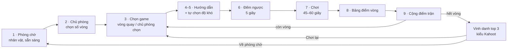

# Thiết kế game (GDD)

| | |
| --- | --- |
| Giai đoạn SDLC | Thiết kế — phần luật chơi và cảm giác chơi |
| Phiên bản tài liệu | 1.2 · 2026-10-12 — cân bằng điểm theo [CR-006](../00-tracking/change-requests.md#cr-006) |
| Liên quan | [SRS](srs.md) (yêu cầu), [UI/UX](ui-ux.md) (màn hình), [Minigame](../04-minigames/README.md) (đặc tả từng game) |
| Cập nhật khi | Đổi luật, điểm, độ khó, chế độ chơi — đổi luật nào cũng phải ghi [CR](../00-tracking/change-requests.md) |

## 1. Khái niệm

Party game trí tuệ trên trình duyệt. Mỗi trận gồm vài vòng ngắn; mỗi vòng là một minigame mà mọi người cùng giải một bộ câu đố trong 45–60 giây, ai đúng nhiều và nhanh nhất thắng vòng. Cảm hứng thể loại từ Big Brain Academy (5 nhóm kỹ năng), nhưng toàn bộ tên, hình, nhân vật là của dự án.

Trụ cột thiết kế: [Tầm nhìn › Trụ cột](vision.md#3-trụ-cột-thiết-kế-design-pillars).

## 2. Vòng lặp chơi (core loop)

Một trận mặc định 3 vòng; mỗi vòng khoảng 1,5 phút kể cả chọn game, hướng dẫn và xem điểm, nên một trận 3 vòng khoảng 5 phút. Cảm hứng nhịp chơi: Pummel Party (mỗi minigame có màn hướng dẫn, ai đọc xong bấm sẵn sàng) và Kahoot (bảng điểm sau mỗi câu, vinh danh top 3).

### Chọn game mỗi vòng

- **Vòng quay may mắn:** mỗi lát là một game chưa chơi trong trận; server quyết định kết quả, mọi máy quay cùng lúc và dừng cùng chỗ.
- **Chủ phòng chọn:** chủ phòng chọn bất kỳ game nào còn lại. Người chơi khác bình chọn để gợi ý ("Cả phòng đang muốn: Cân não · 3 phiếu"); phiếu không ràng buộc chủ phòng và không ảnh hưởng vòng quay.
- **Không lặp:** game đã chơi bị loại khỏi các vòng sau; chơi hết mọi game thì làm mới danh sách.

## 3. Chế độ chơi

| Chế độ | Mô tả | Số người | Giai đoạn |
| --- | --- | --- | --- |
| **Đấu nhóm** (chính) | Chủ phòng chọn 1–10 vòng (mặc định 3), mỗi vòng một minigame chọn bằng vòng quay hoặc chủ phòng chọn | 2–8, cùng lúc | GĐ 0–1 |
| **Luyện tập** | Chơi tự do từng minigame, chọn độ khó | 1 | GĐ 3 |
| **Kiểm tra não** | 5 game, mỗi nhóm kỹ năng một game → "Điểm Não" + biểu đồ 5 cạnh | 1 | GĐ 3 |
| **Đấu bóng ma** | Lưu lượt chơi; bạn bè đấu lại bất cứ lúc nào, không cần online cùng lúc | 1 vs bản ghi | GĐ 3 |
| Thử thách hôm nay, Tìm trận, Bảng xếp hạng | Có trong bản thiết kế menu, chưa nằm trong phạm vi 1.0 | — | Chờ [CR-003](../00-tracking/change-requests.md#cr-003) |

## 4. Năm nhóm kỹ năng

| Nhóm | ID | Rèn | Màu nhận diện (token `--color-<id>`) |
| --- | --- | --- | --- |
| Nhận diện | `identify` | Quan sát, phát hiện khác biệt | Cam `#f2a541` |
| Ghi nhớ | `memorize` | Trí nhớ ngắn hạn, thứ tự | Đỏ hồng `#e85d75` |
| Phân tích | `analyze` | Suy luận, so sánh | Xanh dương `#4d9de0` |
| Tính toán | `compute` | Tính nhẩm, ước lượng | Xanh lá `#3bb273` |
| Hình dung | `visualize` | Xoay, gấp, nhìn không gian | Tím `#7768ae` |

## 5. Danh mục minigame

Đây là **ý đồ thiết kế**. Trạng thái làm và đặc tả chi tiết của từng game nằm ở [Danh mục minigame](../04-minigames/README.md) (bảng đó được script `pnpm new-game` tự cập nhật).

| Nhóm | ID | Minigame | Cách chơi | Khó dần bằng cách | MVP |
| --- | --- | --- | --- | --- | --- |
| Nhận diện | `odd-one-out` | Kẻ lạc đàn | Lưới hình, chạm vào hình khác biệt | Lưới lớn hơn, khác biệt tinh tế hơn | Có |
| Nhận diện | `shadow-match` | Bóng của ai | Chọn bóng đen khớp với đồ vật | Thêm lựa chọn, bóng bị xoay | |
| Nhận diện | `whack-right` | Đập đúng hình | Hình nhô lên từ các lỗ, chỉ đập hình được yêu cầu | Nhanh hơn, thêm hình mồi nhử | |
| Ghi nhớ | `light-trail` | Theo dấu ánh đèn | Các ô sáng theo thứ tự, bấm lặp lại | Chuỗi dài hơn, bấm ngược | Có |
| Ghi nhớ | `who-vanished` | Ai vừa biến mất | Xem nhóm đồ vật 3 giây, một món biến mất | Nhiều đồ hơn, đồ đổi chỗ | |
| Ghi nhớ | `pair-flip` | Lật cặp | Lật thẻ tìm cặp giống nhau | Nhiều thẻ hơn, thời gian ngắn hơn | |
| Phân tích | `balance` | Cân não | Nhìn các cân thăng bằng, chọn vật nặng nhất | Nhiều cân và nhiều vật hơn | Có |
| Phân tích | `cube-count` | Đếm khối | Đếm khối lập phương, kể cả khối bị che | Chồng cao và rộng hơn | |
| Phân tích | `marble-drop` | Bi rơi đâu | Bi lăn qua ống rẽ nhánh, đoán lối ra | Nhiều nhánh, có công tắc đổi hướng | |
| Tính toán | `number-balloons` | Bóng bay số | Nổ bóng theo thứ tự số tăng dần | Số âm, phép tính trên bóng | Có |
| Tính toán | `hit-target` | Chạm đích | Chọn các số cộng lại đúng số đích | Số lớn hơn, thêm phép trừ | |
| Tính toán | `cash-count` | Đếm tiền nhanh | Cộng tổng tờ tiền mệnh giá VNĐ | Nhiều tờ hơn, tính tiền thối | |
| Hình dung | `rotate-match` | Xoay hình | Hình nào là bản xoay (không phải lật gương) của hình mẫu | Hình phức tạp hơn, góc lẻ | Có |
| Hình dung | `top-view` | Nhìn từ trên | Chọn hình chiếu từ trên xuống của khối 3D | Khối nhiều tầng hơn | |
| Hình dung | `fold-box` | Gấp hộp | Hình trải phẳng nào gấp được thành khối đã cho | Mặt có hoạ tiết cần khớp | |

Thứ tự làm: 5 game MVP (mỗi nhóm một game) → thêm 5 game ở GĐ 2 → 5 game cuối ở GĐ 3. Minigame hình khối (Đếm khối, Nhìn từ trên, Gấp hộp) vẽ isometric 2D trong Phaser, không dùng engine 3D.

### Quy tắc thiết kế một minigame mới

Một đặc tả minigame chỉ được duyệt khi trả lời "có" cho tất cả:

- [ ] Hiểu cách chơi trong ≤ 5 giây chỉ với một câu hướng dẫn và hình minh hoạ.
- [ ] Một câu giải được trong 1–8 giây ở mức Thường, sau khi trừ miễn trừ thời gian (khớp khung thưởng tốc độ).
- [ ] Có bảng Cân bằng: thời gian giải dự kiến từng mức → hệ số điểm riêng và miễn trừ thời gian của game (CR-006).
- [ ] Mỗi câu có **đúng một** đáp án, kiểm được bằng máy (test 10.000 seed).
- [ ] Sinh câu đố chỉ bằng số nguyên + `createRng()`; không cần dữ liệu ngoài.
- [ ] Bốn mức độ khó khác nhau rõ rệt; mức Mầm chơi được với trẻ 7 tuổi.
- [ ] Chơi được bằng một ngón tay trên khung dọc 720×1280, vùng chạm ≥ 48 px.
- [ ] Không phụ thuộc chữ (ngoài câu hướng dẫn) để người không đọc giỏi vẫn chơi được.
- [ ] Không chỉ phân biệt bằng màu (người mù màu vẫn chơi được).

Mẫu đặc tả: [04-minigames/_template.md](../04-minigames/_template.md).

## 6. Độ khó

Mỗi người **tự chọn độ khó cho từng game** ở màn hướng dẫn trước vòng chơi (mặc định là mức đã chọn lần trước). Mọi người dùng chung seed nhưng bộ sinh nhận thêm tham số độ khó, nên mỗi người thấy câu đố "cùng gốc" nhưng khác độ phức tạp. Điểm được nhân hệ số để cân bằng: bảng dưới là **hệ số mặc định**; từ CR-006 mỗi game được đặt hệ số riêng (ghi ở mục Cân bằng của đặc tả game) tính từ thời gian giải dự kiến từng mức.

**Giám sát của chủ phòng:** chủ phòng thấy độ khó của từng người. Ai chọn khác mức mà nhiều người đang chọn nhất được đánh dấu "lệch"; chủ phòng bấm **Nhắc** để gửi thông báo nhẹ. Đây chỉ là nhắc nhở xã giao, không chặn chơi — vì có khi cả phòng cố ý để trẻ em chơi Mầm.

| Mức | Tên | Hệ số mặc định | Dành cho |
| --- | --- | --- | --- |
| 0 | Mầm | × 0,8 | Trẻ em, người mới |
| 1 | Thường | × 1 | Mặc định |
| 2 | Khó | × 1,25 | Người đã quen |
| 3 | Siêu khó | × 1,5 | Thử thách |

## 7. Tính điểm

Cài đặt ở `packages/shared/src/scoring.ts` (client và server dùng chung).

**Điểm một câu đúng** = `(100 × hệ số độ khó của game + thưởng tốc độ) × hệ số combo`, làm tròn.

- **Thưởng tốc độ:** tối đa 50. Trả lời trong ≤ 1,5 giây được trọn 50; từ 8 giây trở đi được 0; ở giữa giảm tuyến tính. Thời gian tính từ lúc câu hiện ra (sau câu sai thì tính từ lúc hết khoá), **trừ đi miễn trừ thời gian** của game: thời gian trình chiếu không bấm được, thời gian tối thiểu cho nhiều lần chạm… (`speedAllowanceMs`, CR-006).
- **Combo:** từ câu đúng thứ 3 liên tiếp, mỗi câu thêm 10% (câu thứ 3: × 1,1; thứ 4: × 1,2…), **tối đa × 1,5** (CR-006).
- **Câu sai:** 0 điểm, chuỗi đúng về 0, khoá thao tác 1,5 giây (trong lúc khoá hiện đáp án đúng), rồi sang câu mới.

Ví dụ (hệ số mặc định, không miễn trừ thời gian — như Kẻ lạc đàn):

| Tình huống | Tính | Điểm |
| --- | --- | --- |
| Thường, trả lời sau 1,2 giây, câu đúng đầu tiên | (100 + 50) × 1 | 150 |
| Mầm, trả lời sau 4,75 giây | (80 + 25) × 1 | 105 |
| Siêu khó, 1 giây, câu đúng thứ 3 liên tiếp | (150 + 50) × 1,1 | 220 |

**Điểm trận:** hết mỗi vòng xếp hạng theo điểm vòng, quy ra 10, 8, 6, 5, 4, 3, 2, 1 điểm trận cho hạng 1 → 8. Tổng điểm trận quyết định chung cuộc. Cách này giữ trận hấp dẫn tới vòng cuối: một vòng thắng đậm không quyết định cả trận.

### Nguyên tắc cân bằng

- Một câu ở mức Thường nên mất trung bình 2–4 giây → khoảng 12–20 câu mỗi vòng 45 giây (Kẻ lạc đàn) hoặc 15–25 câu mỗi vòng 60 giây (game mới, CR-006). Ở Siêu khó vẫn phải còn ≥ 8 câu mỗi vòng.
- **Không phạt người chọn mức cao:** người chơi đúng sức ở bất kỳ mức nào được điểm vòng xấp xỉ nhau. Không công thức nào chặn hẳn người lớn chọn mức dễ; phần đó do chủ phòng giám sát (nút Nhắc).
- Con số hệ số và miễn trừ của từng game chốt sau buổi chơi thử đủ 5 game MVP; chỉnh số không cần sửa code, ghi lại ở mục Cân bằng của đặc tả minigame.
- Khoá 1,5 giây khi sai đủ làm bấm bừa thiệt hơn suy nghĩ.

## 8. Nhân vật & phong cách hình ảnh

- **Phong cách:** "bảng phấn lớp học" — nền bảng xanh trong khung gỗ, nội dung trên thẻ giấy dán viền mực, chữ phấn. Quyết định: [ADR 0009](../02-architecture/decisions/0009-chalkboard-style-and-characters.md). Hệ thống thiết kế: [UI/UX](ui-ux.md).
- **Linh vật:** "Bộ não" giáo sư dẫn dắt ở menu và mẹo chơi.
- **Bạn đồng hành:** 6 nhân vật chibi, người chơi chọn một; được phép trùng nhau, màu avatar phân biệt người chơi.

| ID | Tên | Loài |
| --- | --- | --- |
| `khoi` | Khói | Mèo tai cụp (mặc định) |
| `bo` | Bơ | Cún tai xù |
| `mochi` | Mochi | Thỏ trắng |
| `bap` | Bắp | Gà con |
| `cam` | Cam | Cáo lửa |
| `tron` | Tròn | Gấu trúc |

Mỗi nhân vật có 7 biểu cảm dùng chung (`idle` bình thường, `happy` vui, `sad` buồn, `surprised` ngạc nhiên, `angry` tức, `thinking` suy nghĩ, `win` chiến thắng), hoạt ảnh CSS, tự tắt khi người dùng bật giảm chuyển động.

- **Không dùng 3D** ([ADR 0010](../02-architecture/decisions/0010-drop-3d-2d-lobby-and-podium.md)): phòng chờ và vinh danh dùng nhân vật SVG + hoạt ảnh CSS. Sảnh 3D hiện có trong code sẽ được gỡ.
- **Minigame:** 2D phẳng, mỗi nhóm kỹ năng một màu chủ đạo.

## 9. Âm thanh & cảm giác chơi (game feel)

| Sự kiện | Hình | Âm (GĐ 2) | Rung (GĐ 2) |
| --- | --- | --- | --- |
| Trả lời đúng | Hình nảy lên, cộng điểm bay lên | "ting" ngắn, cao dần theo combo | — |
| Trả lời sai | Rung màn hình, lưới mờ đi, khoá 1,5 giây | "bụp" trầm | Rung ngắn |
| Combo ≥ 3 | Nhãn "Combo ×N" | Âm combo | — |
| 5 giây cuối vòng | Đồng hồ đổi màu, nhấp nháy | Tích tắc | — |
| Cộng điểm trận | Số "+10" bay vào thanh điểm, mũi tên lên/xuống hạng | "Ting" theo từng người | — |
| Vòng quay | Vòng xoay chậm dần, lát thắng phát sáng | Tiếng tạch tạch, chậm dần | — |
| Vinh danh | Lần lượt hạng 3 → 2 → 1 lên bục 2D, pháo giấy, nhân vật biểu cảm `win` | Trống dồn rồi nhạc chiến thắng | — |

Âm thanh trong minigame do Phaser phát; nhạc nền và âm giao diện dùng Howler.js. Nguồn âm thanh: [Asset](../03-guides/assets.md#âm-thanh).

## 10. Giữ chân người chơi (GĐ 3)

- Lịch sử điểm theo từng minigame và biểu đồ 5 kỹ năng.
- Mũ phần thưởng khi lập kỷ lục, đội trên nhân vật ở phòng chờ.
- Đấu bóng ma để thách bạn bè dù không online cùng lúc.

## 11. Lịch sử thay đổi tài liệu

| Phiên bản | Ngày | Thay đổi | CR |
| --- | --- | --- | --- |
| 1.0 | 2026-10-10 | Tách từ kế hoạch dự án; thêm quy tắc thiết kế minigame, ví dụ tính điểm, nhân vật | — |
| 1.1 | 2026-10-10 | Vòng lặp chơi 9 bước, chọn game mỗi vòng, độ khó chọn theo từng game + chủ phòng giám sát, bỏ 3D | [CR-005](../00-tracking/change-requests.md#cr-005) |
| 1.2 | 2026-10-12 | Hệ số điểm theo từng game, miễn trừ thời gian cho thưởng tốc độ, trần combo × 1,5, vòng 60 giây cho game mới, hiện đáp án đúng khi sai | [CR-006](../00-tracking/change-requests.md#cr-006) |

[← Sản phẩm](README.md) · [Mục lục tài liệu](../README.md)
