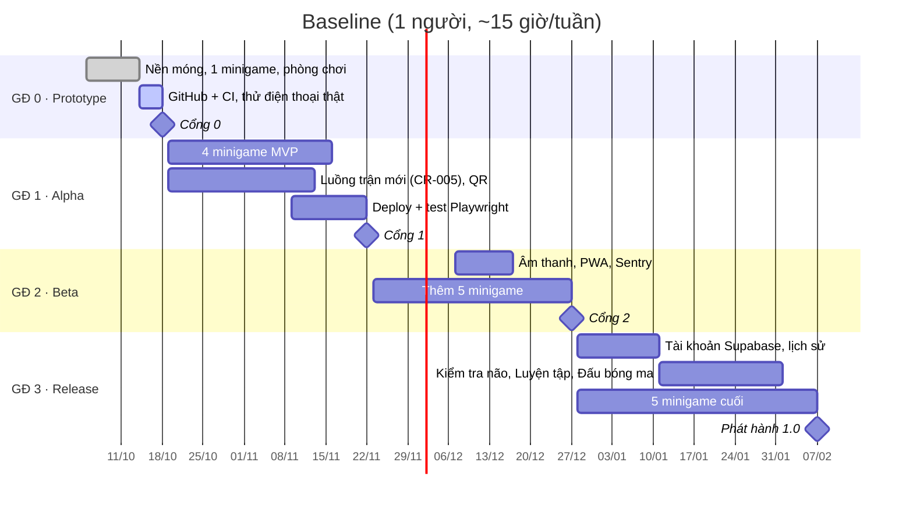

# Lộ trình & mốc thời gian

| | |
| --- | --- |
| Giai đoạn SDLC | Lập kế hoạch |
| Kế hoạch gốc (baseline) | Chốt 2026-10-10. Tuần 1 bắt đầu 2026-10-05; giả định khoảng 15 giờ/tuần |
| Cập nhật khi | Xong một việc (tick checklist), qua một cổng, hoặc dời lịch (ghi cột "Dự báo", **không sửa cột baseline**) |

Tiến độ hằng tuần: [Tình trạng dự án](../00-tracking/status.md). Trạng thái từng tính năng: [Danh sách tính năng](../00-tracking/features.md).

## 1. Các mốc

Tên mốc theo cách gọi của ngành game: Prototype → Alpha → Beta → Release → Live ops. Chỉ sang giai đoạn sau khi qua **cổng kiểm tra** của giai đoạn trước.

| GĐ | Mốc | Phiên bản | Baseline | Dự báo | Thực tế | Cổng kiểm tra | Trạng thái |
| --- | --- | --- | --- | --- | --- | --- | --- |
| 0 | Nền móng · Prototype | 0.1.0 | 05/10 → 18/10/2026 | 18/10/2026 | | Hai máy thật vào cùng phòng, thấy cùng một câu đố | 🚧 Đang làm |
| 1 | MVP · Alpha | 0.5.0 | 19/10 → 22/11/2026 | 02/12/2026 (+10 ngày do CR-005) | | 4 người chơi trọn trận 3 vòng qua 4G, không ai rớt khỏi phòng | ⏳ |
| 2 | Đẹp và vui · Beta | 0.9.0 | 23/11 → 27/12/2026 | 27/12/2026 (bù bằng việc bỏ 3D) | | ≥ 55 FPS ổn định trên Android tầm trung; 10 minigame | ⏳ |
| 3 | Giữ chân · Release | 1.0.0 | 28/12/2026 → 07/02/2027 | 07/02/2027 | | Đạt tiêu chí chấp nhận ở [BRD](brd.md#6-tiêu-chí-chấp-nhận-ở-mức-nghiệp-vụ) | ⏳ |
| — | Vận hành · Live ops | 1.x | Sau 1.0 | | | Theo từng [yêu cầu thay đổi](../00-tracking/change-requests.md) | — |

Các bản 0.2, 0.3, 0.4 là bản trung gian trong GĐ 1 (mỗi bản thêm khoảng 1–2 minigame); quy tắc đánh số: [Quy trình phát triển › Phiên bản](../03-guides/sdlc.md#5-phiên-bản--phát-hành).

## 2. Checklist từng giai đoạn

Mã trong ngoặc trỏ tới [SRS](srs.md).

### Giai đoạn 0 — Nền móng (Prototype)

- [x] Monorepo pnpm + Turborepo, TypeScript, Biome, CI GitHub Actions
- [x] Gói `shared`: PRNG có seed, hợp đồng `MinigameDef`, giao thức tin nhắn, tính điểm, mã phòng
- [x] Minigame đầu tiên: Kẻ lạc đàn (bộ sinh câu đố + test 10.000 seed + scene Phaser)
- [x] `PartyRoom`: tạo phòng bằng mã, chủ phòng, sẵn sàng, đếm ngược, chấm điểm, giữ chỗ khi rớt mạng (UC-02 → UC-10)
- [x] Web: Home / Sảnh (3D tạm) / Chơi / Kết quả, đồng bộ giờ, nối lại sau khi tải lại trang
- [x] Dockerfile + `fly.toml`
- [x] Giao diện shadcn/ui + token sáng/tối, i18n vi/en ([ADR 0006](../02-architecture/decisions/0006-ui-shadcn-and-theme-tokens.md), [ADR 0007](../02-architecture/decisions/0007-i18n-inline-resources.md))
- [x] Phong cách bảng phấn, màn giới thiệu, menu chính, chọn bạn đồng hành, 6 nhân vật ([ADR 0009](../02-architecture/decisions/0009-chalkboard-style-and-characters.md))
- [x] Bộ tài liệu SDLC
- [ ] Commit toàn bộ thay đổi, đưa repo lên GitHub, CI chạy xanh
- [ ] Thử trên điện thoại thật qua Wi-Fi nhà

**Cổng 0:** hai máy thật vào cùng phòng và thấy cùng một câu đố. _(Đã qua trên trình duyệt giả lập máy tính + iPhone; còn thiếu máy thật.)_

### Giai đoạn 1 — MVP (Alpha)

- [x] **Luồng trận mới — [CR-005](../00-tracking/change-requests.md#cr-005)** (làm trước các minigame; xong 2026-10-12, sớm hơn baseline):
  - [x] Bản mẫu giao diện khu 5–11 trên canvas
  - [x] Phòng chờ 2D: ô người chơi, sẵn sàng x/y, ẩn/sao chép mã, đổi nhân vật trong phòng; gỡ 3D (FR-PH-12, FR-PH-13, ADR 0010)
  - [x] Bắt đầu khi ≥ 2 người và tất cả sẵn sàng (FR-VC-01, FR-PH-11)
  - [x] Chọn game mỗi vòng: vòng quay do server quyết định, chủ phòng chọn + bình chọn, không lặp game (FR-VC-13 → 16)
  - [x] Màn hướng dẫn + mỗi người tự chọn độ khó, chủ phòng giám sát và nhắc, "Đã hiểu", tự bắt đầu sau 20 giây (FR-VC-12, FR-VC-17 → 19)
  - [x] Đếm ngược 5 giây (FR-VC-02)
  - [x] Bảng điểm vòng → cộng điểm trận → vinh danh top 3 kiểu Kahoot (FR-VC-20, FR-GD-06)
- [x] 4 minigame MVP còn lại: Theo dấu ánh đèn, Cân não, Bóng bay số, Xoay hình (FR-MG-05), mỗi game có nội dung hướng dẫn theo khuôn mới (xong 2026-10-12)
  - [x] Đặc tả 4 game ([Danh mục minigame](../04-minigames/README.md))
  - [x] Bản mẫu giao diện (canvas, trang Minigame), đã duyệt 2026-10-12
  - [x] Duyệt cân bằng điểm ([CR-006](../00-tracking/change-requests.md#cr-006)), 2026-10-12. Cơ chế làm cùng đợt code
  - [ ] Chốt con số hệ số/miễn trừ sau buổi chơi thử đủ 5 game
  - [x] Bộ sinh câu đố + test 10.000 seed, scene Phaser
- [x] Hiển thị điểm cộng và trạng thái khoá từ `answerResult` (FR-VC-11)
- [ ] Mã QR mời bạn trên máy tính (FR-PH-09)
- [ ] Test nối lại phòng trong `PartyRoom.test.ts` (đã có tải lại trang ở từng pha; còn rớt mạng giữ chỗ / quá 45 giây) ([Kiểm thử](../03-guides/testing.md#6-lỗ-hổng-test-cần-bù))
- [ ] Deploy: web lên Cloudflare Pages, server lên Fly.io (hoặc Render Free)
- [ ] Test Playwright 4 trình duyệt chơi trọn một trận

**Cổng 1:** 4 người chơi trọn trận 3 vòng qua 4G, không ai bị rớt khỏi phòng.

### Giai đoạn 2 — Đẹp và vui (Beta)

- [x] ~~Avatar low-poly 3D, bục trao giải 3D~~ — huỷ theo [ADR 0010](../02-architecture/decisions/0010-drop-3d-2d-lobby-and-podium.md), thay bằng bản 2D ở GĐ 1
- [ ] Âm thanh, nhạc nền, rung phản hồi, Wake Lock (FR-GD-07)
- [ ] Thêm 5 minigame (tổng 10)
- [ ] PWA: cài lên màn hình chính, cache asset (FR-GD-08)
- [ ] Theo dõi lỗi bằng Sentry

**Cổng 2:** ≥ 55 FPS ổn định trên một Android tầm trung.

### Giai đoạn 3 — Giữ chân (Release 1.0)

- [ ] Tài khoản Supabase (khách + Google), lưu lịch sử điểm (UC-16)
- [ ] Chế độ Luyện tập (UC-13)
- [ ] Chế độ Kiểm tra não, biểu đồ 5 kỹ năng (UC-14)
- [ ] Đấu bóng ma (UC-15)
- [ ] Mũ phần thưởng khi lập kỷ lục (FR-MR-05)
- [ ] Đủ 15 minigame
- [x] i18n tiếng Anh — đã làm sớm ở GĐ 0 ([CR-001](../00-tracking/change-requests.md#cr-001))

**Cổng 3 (phát hành 1.0):** đạt toàn bộ tiêu chí chấp nhận ở [BRD](brd.md#6-tiêu-chí-chấp-nhận-ở-mức-nghiệp-vụ) và checklist phát hành ở [Kiểm thử](../03-guides/testing.md#7-checklist-trước-khi-phát-hành).

## 3. Nhìn lại sau mỗi cổng (retrospective)

Qua mỗi cổng, viết 3 dòng vào đây: điều làm tốt, điều cần đổi, ước lượng sai bao nhiêu. Dùng để chỉnh lịch giai đoạn sau.

| Cổng | Ngày | Làm tốt | Cần đổi | Lệch lịch |
| --- | --- | --- | --- | --- |
| 0 | | | | |

[← Sản phẩm](README.md) · [Mục lục tài liệu](../README.md)
