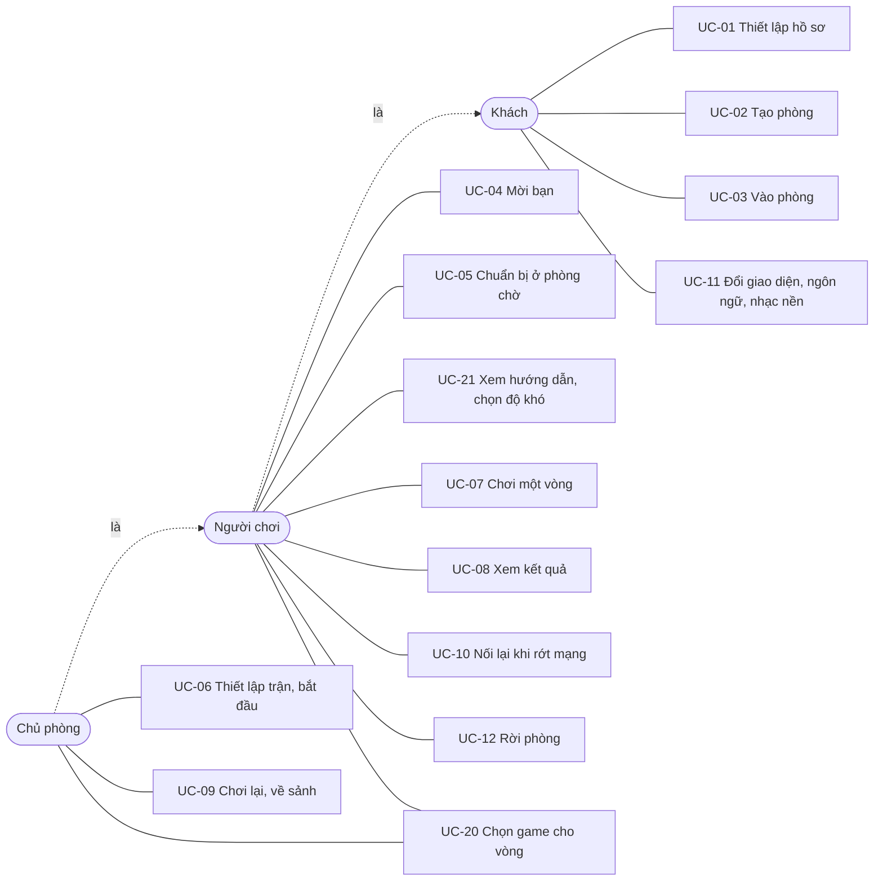
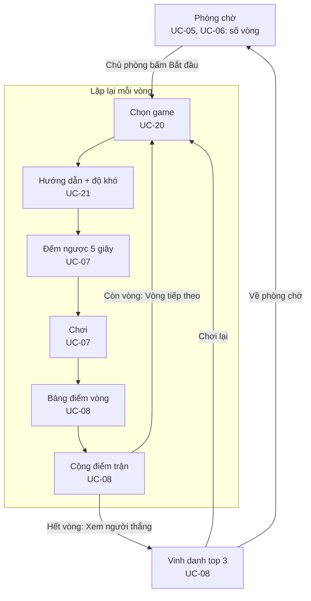

# Đặc tả yêu cầu phần mềm (SRS)

| | |
| --- | --- |
| Giai đoạn SDLC | Phân tích yêu cầu |
| Phiên bản tài liệu | 1.5 · 2026-10-14 — âm thanh hiệu ứng khi bấm nút theo [CR-008](../00-tracking/change-requests.md#cr-008) |
| Đầu vào | [Yêu cầu nghiệp vụ](brd.md) |
| Đầu ra cho | [Thiết kế game](game-design.md), [UI/UX](ui-ux.md), [Kiến trúc](../02-architecture/overview.md), [Kiểm thử](../03-guides/testing.md) |
| Cập nhật khi | Thêm/đổi use case hoặc yêu cầu — tăng phiên bản tài liệu và ghi vào [Lịch sử thay đổi](#9-lịch-sử-thay-đổi-tài-liệu) |

Tiến độ từng yêu cầu **không** ghi ở đây mà ở [Danh sách tính năng](../00-tracking/features.md). SRS chỉ nói hệ thống *phải làm gì*.

## 1. Giới thiệu

### 1.1 Mục đích

Mô tả đầy đủ hành vi của Brain Rizz bản 1.0 để làm căn cứ thiết kế, lập trình, kiểm thử và nghiệm thu.

### 1.2 Phạm vi

Web client (trình duyệt), game server (Colyseus) và gói logic dùng chung. Phạm vi sản phẩm: [Tầm nhìn › Phạm vi](vision.md#6-phạm-vi).

### 1.3 Thuật ngữ

| Thuật ngữ | Nghĩa |
| --- | --- |
| Phòng | Một phiên chơi chung, định danh bằng mã 4 ký tự |
| Trận | Chuỗi 1–10 vòng từ lúc bắt đầu tới bục trao giải |
| Vòng | Một minigame chơi trong thời lượng cố định (45–60 giây) |
| Seed | Số nguyên server phát mỗi vòng; mọi máy dùng nó để sinh cùng một bộ câu đố |
| Pha (`phase`) | Trạng thái phòng. Hiện tại: `lobby` → `countdown` → `playing` → `round-results` / `podium`. Sau CR-005: `lobby` → `game-select` → `game-intro` → `countdown` → `playing` → `round-results` → (`game-select` hoặc `podium`) |
| Vòng quay | Cách chọn game ngẫu nhiên: mỗi lát là một game chưa chơi trong trận; server quyết định kết quả |
| Lệch độ khó | Một người chọn độ khó khác mức mà nhiều người trong phòng đang chọn nhất |
| Điểm vòng | Điểm cộng từ các câu đúng trong một vòng |
| Điểm trận | Điểm quy đổi từ thứ hạng mỗi vòng, cộng dồn cả trận |
| Độ khó | 0 Mầm · 1 Thường · 2 Khó · 3 Siêu khó, mỗi người chọn riêng |

### 1.4 Quy ước mã

`BR-xx` yêu cầu nghiệp vụ ([BRD](brd.md)) · `UC-xx` use case · `FR-<nhóm>-xx` yêu cầu chức năng · `NFR-<nhóm>-xx` yêu cầu phi chức năng · `RULE-xx` quy tắc nghiệp vụ ([BRD](brd.md#5-quy-tắc-nghiệp-vụ)). Mã đã cấp **không bao giờ dùng lại**; yêu cầu bị bỏ thì ghi "Huỷ".

Ưu tiên: **M** bắt buộc · **S** nên có · **C** có thì tốt. Giai đoạn: GĐ 0–3 theo [Lộ trình](roadmap.md).

## 2. Mô tả tổng quan

### 2.1 Bối cảnh sản phẩm

Trình duyệt tải game một lần từ CDN, sau đó giữ một kết nối WebSocket tới game server. Server phát seed, giữ đồng hồ, chấm điểm; client tự sinh câu đố và chỉ gửi đáp án. Sơ đồ: [Tổng quan kiến trúc](../02-architecture/overview.md).

### 2.2 Tác nhân

| Tác nhân | Mô tả |
| --- | --- |
| Khách | Người mở game, chưa vào phòng |
| Người chơi | Đã ở trong một phòng |
| Chủ phòng | Người chơi có quyền điều khiển trận (người tạo phòng hoặc được chuyển quyền) |
| Game server | Hệ thống `PartyRoom`: trọng tài về điểm, đồng hồ, pha |

### 2.3 Môi trường vận hành

- Trình duyệt hiện đại có WebGL và WebSocket: Safari iOS, Chrome Android, Chrome/Edge/Firefox/Safari trên máy tính (2 phiên bản chính gần nhất — giả định, chốt ở [Kiểm thử › Ma trận thiết bị](../03-guides/testing.md#5-ma-trận-thiết-bị)).
- Game server: Node.js 22 trong Docker, Fly.io region Singapore.

### 2.4 Ràng buộc thiết kế

Năm bất biến trong `AGENTS.md` là ràng buộc cứng: câu đố tất định theo seed; server là trọng tài; mọi tin nhắn client được validate bằng zod; mỗi lúc chỉ một canvas WebGL; state đồng bộ khớp `PartyStateView`.

## 3. Use case

### 3.1 Sơ đồ tổng quát

### 3.2 Danh sách use case

| ID | Use case | Tác nhân | BR | Ưu tiên | GĐ |
| --- | --- | --- | --- | --- | --- |
| UC-01 | Thiết lập hồ sơ (chọn bạn đồng hành) | Khách | BR-01, BR-09 | M | 0 |
| UC-02 | Tạo phòng | Khách | BR-01 | M | 0 |
| UC-03 | Vào phòng bằng mã hoặc link | Khách | BR-01, BR-02 | M | 0 |
| UC-04 | Mời bạn bè | Người chơi | BR-02 | M | 0–1 |
| UC-05 | Chuẩn bị ở phòng chờ (sẵn sàng, đổi nhân vật) | Người chơi | BR-01, BR-09 | M | 0–1 |
| UC-06 | Thiết lập trận (số vòng) và bắt đầu | Chủ phòng | BR-07 | M | 0–1 |
| UC-20 | Chọn game cho vòng (vòng quay / chủ phòng chọn + bình chọn) | Chủ phòng, Người chơi, Server | BR-07, BR-15 | M | 1 |
| UC-21 | Xem hướng dẫn và chọn độ khó cho vòng | Người chơi, Chủ phòng | BR-03, BR-04 | M | 1 |
| UC-07 | Chơi một vòng minigame (đếm ngược 5 giây rồi chơi) | Người chơi, Server | BR-03, BR-05 | M | 0–1 |
| UC-08 | Xem kết quả vòng, cộng điểm trận, vinh danh chung cuộc | Người chơi | BR-05, BR-11 | M | 0–1 |
| UC-09 | Chơi lại / đưa cả phòng về sảnh | Chủ phòng | BR-07 | M | 0 |
| UC-10 | Nối lại sau khi mất kết nối | Người chơi, Server | BR-06 | M | 0 |
| UC-11 | Đổi giao diện sáng/tối, ngôn ngữ và nhạc nền | Khách, Người chơi | BR-08 | M | 0–1 |
| UC-12 | Rời phòng | Người chơi | BR-01 | M | 0 |
| UC-13 | Luyện tập một minigame | Khách | BR-10 | S | 3 |
| UC-14 | Kiểm tra não (chơi một mình 5 game) | Khách | BR-10 | S | 3 |
| UC-15 | Đấu bóng ma | Khách | BR-10 | S | 3 |
| UC-16 | Đăng nhập và xem lịch sử điểm | Khách | BR-10 | S | 3 |
| UC-17 | Thử thách hôm nay | Khách | BR-14 | Chờ [CR-003](../00-tracking/change-requests.md#cr-003) | — |
| UC-18 | Tìm trận với người lạ | Khách | BR-14 | Chờ CR-003 | — |
| UC-19 | Xem bảng xếp hạng | Khách | BR-14 | Chờ CR-003 | — |

UC-13 → UC-19 mới ở mức mô tả ngắn; phải viết chi tiết như UC-01 → UC-12 trước khi bắt đầu làm (Definition of Ready, xem [Quy trình phát triển](../03-guides/sdlc.md#3-definition-of-ready--done)).

### 3.3 Đặc tả use case

#### UC-01 — Thiết lập hồ sơ

- **Mục tiêu:** người chơi có tên, nhân vật, độ khó để vào phòng.
- **Kích hoạt:** bấm "Sửa hồ sơ" ở menu, hoặc bấm Tạo/Vào phòng khi chưa có tên.
- **Luồng chính:**
  1. Hệ thống hiện màn "Chọn bạn đồng hành" với 6 nhân vật, ô tên, chọn độ khó; điền sẵn hồ sơ lần trước.
  2. Người chơi chọn nhân vật, nhập tên (1–16 ký tự), chọn độ khó → **Xác nhận**.
  3. Hệ thống lưu hồ sơ trên máy và quay lại menu.
- **Luồng rẽ:**
  - 2a. Tên trống → không cho xác nhận.
  - 3a. Nếu người chơi đang dở thao tác Tạo/Vào phòng → hệ thống tự làm tiếp thao tác đó.
  - 1a. Hồ sơ lưu bị hỏng hoặc sai kiểu → dùng hồ sơ mặc định (nhân vật Khói, độ khó Thường), không báo lỗi.
- **Hậu điều kiện:** hồ sơ có trong `localStorage` (`brain-rizz:profile`).
- **FR:** FR-HS-01 → FR-HS-04.

#### UC-02 — Tạo phòng

- **Tiền điều kiện:** đã có hồ sơ (nếu chưa → UC-01 trước).
- **Luồng chính:**
  1. Khách bấm **Tạo phòng**.
  2. Server tạo phòng riêng với mã 4 ký tự không trùng, đưa khách vào, đặt làm chủ phòng.
  3. Hệ thống chuyển sang sảnh, URL đổi thành `/r/<mã>`.
- **Luồng rẽ:** 2a. Không kết nối được server → thông báo "Không kết nối được tới server", ở lại menu.
- **FR:** FR-PH-01, FR-PH-05.

#### UC-03 — Vào phòng bằng mã hoặc link

- **Luồng chính:**
  1. Khách nhập mã 4 ký tự ở menu → **Vào** (hoặc mở link `/r/<mã>`: bỏ qua màn giới thiệu, mã điền sẵn).
  2. Hệ thống chuẩn hoá mã (chữ hoa, bỏ ký tự lạ) và gửi hồ sơ lên server.
  3. Server kiểm tra hồ sơ, cấp màu chưa ai dùng, thêm người chơi vào phòng.
  4. Hệ thống chuyển sang sảnh.
- **Luồng rẽ:**
  - 3a. Phòng đang chơi → từ chối "Phòng đang chơi, vui lòng chờ hết trận."
  - 3b. Phòng đủ 8 người hoặc mã không tồn tại → từ chối, báo lỗi ở menu.
  - 3c. Hồ sơ không hợp lệ (tên rỗng/quá dài, nhân vật lạ) → từ chối.
- **FR:** FR-PH-02 → FR-PH-04.

#### UC-04 — Mời bạn bè

- **Luồng chính (điện thoại):** bấm **Mời bạn** → bảng chia sẻ của hệ điều hành (Zalo, Messenger…) với nội dung "Vào phòng ABCD nhé!" và link.
- **Luồng rẽ (máy tính):** không có Web Share API → copy link vào clipboard, báo "Đã copy link mời".
- **Mở rộng (GĐ 1):** hiện mã QR của link mời trên máy tính.
- **FR:** FR-PH-05, FR-PH-09.

#### Luồng một trận (sau CR-005)

#### UC-05 — Chuẩn bị ở phòng chờ

- **Tiền điều kiện:** pha `lobby`.
- **Luồng chính:**
  1. Phòng chờ hiện mã phòng (ẩn/hiện được, nút sao chép), nút Mời bạn, bộ đếm "Người chơi x/8" và "Sẵn sàng y/x", 8 ô người chơi: nhân vật, tên, vương miện chủ phòng, trạng thái sẵn sàng, đang kết nối; ô trống ghi "Chỗ trống · Mời bạn".
  2. Người chơi đổi nhân vật ngay trong phòng nếu muốn (không làm mất trạng thái sẵn sàng).
  3. Người chơi bấm **Sẵn sàng** (bấm lại để huỷ). Mọi máy thấy thay đổi ngay.
- **Ràng buộc:** không có cảnh 3D ([ADR 0010](../02-architecture/decisions/0010-drop-3d-2d-lobby-and-podium.md)).
- **FR:** FR-PH-06, FR-PH-12, FR-PH-13.
- **Hiện trạng code (2026-10-12):** đã có 8 ô người chơi, đếm "Sẵn sàng y/x", ẩn/hiện và sao chép mã, đổi nhân vật trong phòng; đã gỡ sân khấu 3D. Chưa có QR (FR-PH-09).

#### UC-06 — Thiết lập trận và bắt đầu

- **Tác nhân:** chủ phòng. **Tiền điều kiện:** pha `lobby`.
- **Luồng chính:**
  1. Chủ phòng đặt số vòng (1–10, mặc định 3). Người chơi khác thấy thiết lập ở dạng chỉ đọc.
  2. Khi có ≥ 2 người và tất cả đã sẵn sàng, nút **Bắt đầu** bấm được; chủ phòng bấm.
  3. Server chốt số vòng, đặt vòng 1, chuyển pha `game-select` (UC-20).
- **Luồng rẽ:**
  - 2a. Chưa đủ điều kiện → nút mờ, ghi "Chờ mọi người sẵn sàng (y/x)".
  - 2b. Người không phải chủ phòng gửi lệnh → từ chối (`not-host`).
- **FR:** FR-VC-01, FR-PH-11.
- **Hiện trạng code (2026-10-12):** đã làm đủ: đặt số vòng, nút Bắt đầu cần ≥ 2 người và tất cả đã sẵn sàng (kể cả chủ phòng), sang `game-select`.

#### UC-20 — Chọn game cho vòng

- **Tác nhân:** chủ phòng (quyết định), người chơi (bình chọn), server. **Tiền điều kiện:** pha `game-select`.
- **Luồng chính — vòng quay:**
  1. Màn hình hiện "Vòng n/N · Chọn trò chơi". Chủ phòng chọn chế độ **Vòng quay may mắn**.
  2. Vòng quay có một lát cho mỗi game hệ thống **chưa chơi** trong trận, màu theo nhóm kỹ năng.
  3. Chủ phòng bấm **Quay!** → server chọn ngẫu nhiên một game trong các lát, gửi kết quả và thời điểm bắt đầu quay cho mọi máy.
  4. Mọi máy chạy cùng hiệu ứng quay và dừng đúng ở game server đã chọn.
  5. Server chuyển pha `game-intro` với game đó (UC-21).
- **Luồng chính — chủ phòng chọn:**
  1. Chủ phòng chọn chế độ **Chủ phòng chọn**: lưới thẻ game; game đã chơi hiện mờ "Đã chơi", game chưa làm hiện khoá "Sắp có".
  2. Người chơi chạm một thẻ để **bình chọn** (mỗi người 1 phiếu, đổi được). Mọi máy thấy số phiếu và avatar người bầu trên từng thẻ, cùng dòng "Cả phòng đang muốn: X · n phiếu".
  3. Chủ phòng bấm **Chơi game này** trên một thẻ bất kỳ (không bắt buộc theo phiếu) → server chuyển pha `game-intro`.
- **Luồng rẽ:**
  - 2a. Tất cả game đã chơi hết (số vòng nhiều hơn số game) → làm mới danh sách, mọi game lại có trên vòng quay.
  - 3a. Người không phải chủ phòng gửi lệnh quay/chọn → từ chối (`not-host`).
- **Quy tắc:** RULE-13, RULE-14, RULE-15.
- **FR:** FR-VC-13, FR-VC-14, FR-VC-15, FR-VC-16.

#### UC-21 — Xem hướng dẫn và chọn độ khó cho vòng

- **Tác nhân:** người chơi, chủ phòng. **Tiền điều kiện:** pha `game-intro`.
- **Luồng chính:**
  1. Mọi máy hiện màn hướng dẫn của game: tên, nhóm kỹ năng, hình minh hoạ, "Cách chơi" (≤ 3 bước), "Điều khiển" (chạm / click / bàn phím nếu game có), "Tính điểm".
  2. Mỗi người **tự chọn độ khó** cho vòng này (4 mức kèm gợi ý độ phức tạp), mặc định là mức đã chọn lần trước.
  3. Người chơi bấm **Đã hiểu!**.
  4. Chủ phòng thấy bảng "Độ khó của cả phòng": từng người, mức đã chọn, đã hiểu hay chưa. Người **lệch** so với đa số được đánh dấu.
  5. Khi mọi người đã hiểu, chủ phòng bấm **Bắt đầu chơi** → server sinh seed, chuyển pha `countdown` (UC-07).
- **Luồng rẽ:**
  - 4a. Chủ phòng bấm **Nhắc** cạnh một người lệch → người đó nhận thông báo "Chủ phòng nhắc: cả phòng đang chơi <mức>"; người đó tự quyết có đổi hay không.
  - 5a. Hết 20 giây kể từ khi vào màn hướng dẫn → server tự bắt đầu, ai chưa chọn thì dùng mức mặc định.
- **Quy tắc:** RULE-05 (sửa), RULE-06.
- **FR:** FR-VC-12, FR-VC-17, FR-VC-18, FR-VC-19.

#### UC-07 — Chơi một vòng minigame

- **Tiền điều kiện:** pha `countdown` (5 giây, theo giờ server; màn hình hiện số to, tên game, độ khó của mình, câu nhắc cách chơi) rồi `playing`.
- **Luồng chính:**
  1. Máy người chơi sinh câu số `i` từ `(seed, i, độ khó của mình)` và hiển thị.
  2. Người chơi trả lời; máy hiện đúng/sai ngay (hiệu ứng nảy hoặc rung) và gửi đáp án lên.
  3. Server sinh lại câu `i`, chấm, tính điểm, gửi `answerResult` riêng cho người đó, cập nhật điểm vòng, tiến độ, chuỗi đúng cho cả phòng.
  4. Đúng hay sai đều sang câu `i+1`. Lặp lại tới hết giờ.
  5. Hết giờ (+0,4 giây dung sai) server kết thúc vòng.
- **Luồng rẽ:**
  - 3a. Sai → khoá thao tác 1,5 giây, chuỗi đúng về 0.
  - 3b. Đáp án sai vòng, sai số câu, ngoài giờ, đang bị khoá, sai kiểu dữ liệu hoặc quá 10 đáp án/giây → server bỏ qua.
- **Hậu điều kiện:** điểm vòng của mọi người đã chốt.
- **FR:** FR-VC-02 → FR-VC-08, FR-VC-11, FR-MG-01 → FR-MG-04.

#### UC-08 — Xem kết quả vòng, cộng điểm trận, vinh danh chung cuộc

- **Luồng chính:**
  1. Server xếp hạng theo điểm vòng, cộng điểm trận (10, 8, 6, 5, 4, 3, 2, 1), chuyển pha `round-results`.
  2. **Bảng điểm vòng** (bước 8): "Vòng n/N · <tên game> — Kết quả": hạng, nhân vật, tên, điểm vòng, số câu đúng, độ khó; người nhất vòng nổi bật.
  3. **Cộng điểm trận** (bước 9): bảng tổng điểm trận kiểu Kahoot, mỗi người có số "+10 / +8…" vừa cộng bay vào thanh điểm và mũi tên lên/xuống hạng so với vòng trước.
  4. Chưa phải vòng cuối → chủ phòng bấm **Vòng tiếp theo** → pha `game-select` (UC-20). Người khác thấy "Chờ chủ phòng…".
  5. Vòng cuối → chủ phòng bấm **Xem người thắng** → pha `podium`: **vinh danh kiểu Kahoot bằng 2D**, lần lượt hiện hạng 3, hạng 2, hạng 1 trên bục, nhân vật biểu cảm chiến thắng, pháo giấy; bên dưới là hạng 4 trở đi.
- **FR:** FR-VC-09, FR-VC-10, FR-VC-20, FR-GD-06.
- **Hiện trạng code (2026-10-12):** đã có bảng điểm vòng, bảng cộng điểm trận (số "+điểm", mũi tên lên/xuống hạng) và vinh danh top 3 bằng 2D. Hoà điểm vòng thì cùng hạng, cùng điểm trận; hoà điểm trận ở cuối thì xét tổng điểm vòng.

#### UC-09 — Chơi lại / về phòng chờ

- **Tác nhân:** chủ phòng. **Tiền điều kiện:** pha `podium` (Chơi lại) hoặc `round-results`/`podium` (Về phòng chờ).
- **Luồng chính — Chơi lại:** chủ phòng bấm **Chơi lại** ở màn vinh danh → server huỷ hẹn giờ, xoá điểm trận/điểm vòng/tiến độ/danh sách game đã chơi, **giữ nguyên người chơi và số vòng**, vào thẳng `game-select` vòng 1 (UC-20).
- **Luồng chính — Về phòng chờ:** chủ phòng bấm **Về phòng chờ** → server huỷ hẹn giờ, xoá như trên và xoá luôn trạng thái sẵn sàng, chuyển pha `lobby` để đổi nhân vật, số vòng hoặc chờ thêm người.
- **Luồng rẽ:**
  - 1a. Phòng còn dưới 2 người → từ chối Chơi lại (cùng điều kiện với Bắt đầu, FR-PH-11); chủ phòng dùng Về phòng chờ.
  - 1b. Người không phải chủ phòng gửi lệnh → từ chối (`not-host`).
- **FR:** FR-VC-10.

#### UC-10 — Nối lại sau khi mất kết nối

- **Luồng chính:**
  1. Mạng rớt → server đánh dấu người chơi "mất kết nối", giữ chỗ 45 giây; các máy khác thấy trạng thái này.
  2. Máy người chơi hiện "Mất kết nối, đang nối lại…" và tự nối lại.
  3. Nối lại thành công → trạng thái về "đang kết nối", tiếp tục từ tiến độ trên server.
- **Luồng rẽ:**
  - 2a. Người chơi tải lại trang → hệ thống dùng token trong `sessionStorage` để vào lại đúng phòng.
  - 3a. Quá 45 giây → server xoá người chơi; nếu là chủ phòng thì chuyển quyền (RULE-04).
- **FR:** FR-PH-07, FR-PH-08.

#### UC-11 — Đổi giao diện, ngôn ngữ và nhạc nền

- **Luồng chính:** bấm nút ngôn ngữ (vi/en) hoặc nút giao diện (Sáng/Tối/Theo hệ thống) → toàn bộ chữ/màu đổi ngay, lựa chọn được nhớ cho lần sau.
- **Luồng rẽ:**
  - 1a. Bấm phát/dừng, bài kế hoặc kéo âm lượng trên thanh nhạc nền → nhạc đổi ngay, lựa chọn được nhớ cho lần sau (CR-007).
  - 1b. Bấm nút bật/tắt âm thanh hiệu ứng → tiếng bấm nút, đếm ngược, đúng/sai bật hoặc tắt ngay, độc lập với nhạc nền, lựa chọn được nhớ (CR-008).
- **Ràng buộc:** lúc đếm ngược và đang chơi minigame, các nút này ẩn để nhường chỗ; nhạc vẫn phát nhưng nhỏ lại.
- **FR:** FR-GD-01, FR-GD-02, FR-GD-07, FR-GD-10.

#### UC-12 — Rời phòng

- **Luồng chính:** bấm **Thoát** (sảnh) hoặc **Rời phòng** (màn kết quả) → rời phòng, về menu; các máy còn lại thấy người đó biến mất; nếu là chủ phòng thì chuyển quyền.
- **FR:** FR-PH-07, FR-PH-10.

#### UC-13 → UC-19 — mô tả ngắn (chưa chi tiết)

| UC | Mô tả ngắn |
| --- | --- |
| UC-13 Luyện tập | Chơi một minigame bất kỳ, tự chọn độ khó, không giới hạn số vòng, không cần server |
| UC-14 Kiểm tra não | 5 game (mỗi nhóm một game) liên tiếp → "Điểm Não" + biểu đồ 5 cạnh |
| UC-15 Đấu bóng ma | Lưu lượt chơi (seed + mốc thời gian từng đáp án); bạn bè mở link để đấu lại bất cứ lúc nào |
| UC-16 Tài khoản | Đăng nhập khách hoặc Google (Supabase); xem lịch sử điểm; nhận mũ khi lập kỷ lục |
| UC-17 Thử thách hôm nay | Mỗi ngày 3 minigame, mọi người cùng một đề (seed theo ngày) |
| UC-18 Tìm trận | Ghép ngẫu nhiên với người chơi khác |
| UC-19 Bảng xếp hạng | Xếp hạng bạn bè và toàn cầu |

## 4. Yêu cầu chức năng

Cột "UC" cho biết yêu cầu thuộc use case nào. Hằng số nằm ở `packages/shared/src/constants.ts`.

### 4.1 Hồ sơ (HS)

| ID | Yêu cầu | UC | Ưu tiên | GĐ |
| --- | --- | --- | --- | --- |
| FR-HS-01 | Màn giới thiệu "Chạm để bắt đầu" khi mở game; bỏ qua khi mở bằng link `/r/<mã>` | UC-01 | S | 0 |
| FR-HS-02 | Hồ sơ gồm tên (1–16 ký tự sau khi bỏ khoảng trắng hai đầu), nhân vật (1 trong 6: Khói, Bơ, Mochi, Bắp, Cam, Tròn), độ khó mặc định (4 mức — sau CR-005 chỉ là mức điền sẵn ở màn hướng dẫn), màu (1 trong 8) | UC-01 | M | 0 |
| FR-HS-03 | Lưu hồ sơ trên máy, tự điền lần sau; dữ liệu hỏng hoặc không đọc được thì dùng mặc định mà không làm vỡ app | UC-01 | M | 0 |
| FR-HS-04 | Bấm Tạo/Vào phòng khi chưa có tên → mở màn hồ sơ, xác nhận xong tự làm tiếp thao tác đang dở | UC-01 | S | 0 |

### 4.2 Phòng (PH)

| ID | Yêu cầu | UC | Ưu tiên | GĐ |
| --- | --- | --- | --- | --- |
| FR-PH-01 | Tạo phòng riêng (không ghép ngẫu nhiên) với mã 4 ký tự từ bảng `ABCDEFGHJKMNPQRSTUVWXYZ23456789`, không trùng phòng đang mở; người tạo là chủ phòng | UC-02 | M | 0 |
| FR-PH-02 | Vào phòng bằng mã (tự chuẩn hoá chữ hoa) hoặc link `/r/<mã>` | UC-03 | M | 0 |
| FR-PH-03 | Tối đa 8 người; chỉ vào được ở pha `lobby` | UC-03 | M | 0 |
| FR-PH-04 | Màu trùng → server cấp màu trống đầu tiên; nhân vật được phép trùng | UC-03 | M | 0 |
| FR-PH-05 | Mời bạn: Web Share API trên điện thoại, copy link trên máy tính; URL luôn đồng bộ `/r/<mã>` | UC-04 | M | 0 |
| FR-PH-06 | Ở phòng chờ: bật/tắt sẵn sàng; đổi tên, màu, nhân vật — trường không gửi giữ nguyên | UC-05 | M | 0 |
| FR-PH-07 | Chủ phòng rời phòng (hoặc hết thời gian giữ chỗ) → chuyển quyền cho người kế tiếp | UC-10, UC-12 | M | 0 |
| FR-PH-08 | Rớt mạng: giữ chỗ 45 giây, hiển thị trạng thái mất kết nối cho cả phòng; tải lại trang tự vào lại phòng cũ | UC-10 | M | 0 |
| FR-PH-09 | Hiện mã QR link mời trên màn hình rộng | UC-04 | S | 1 |
| FR-PH-10 | Rời phòng chủ động từ sảnh hoặc màn kết quả | UC-12 | M | 0 |
| FR-PH-11 | Số người tối thiểu để bắt đầu (và chơi lại): 2 | UC-06, UC-09 | M | 1 |
| FR-PH-12 | Phòng chờ 2D (không 3D): 8 ô người chơi có nhân vật, tên, vương miện chủ phòng, trạng thái sẵn sàng/kết nối; ô trống mời bạn; bộ đếm "Người chơi x/8", "Sẵn sàng y/x" | UC-05 | M | 1 |
| FR-PH-13 | Mã phòng ẩn/hiện được và có nút sao chép; đổi nhân vật ngay trong phòng chờ, không mất trạng thái sẵn sàng | UC-05 | M | 1 |

### 4.3 Vòng chơi & chấm điểm (VC)

| ID | Yêu cầu | UC | Ưu tiên | GĐ |
| --- | --- | --- | --- | --- |
| FR-VC-01 | Chỉ chủ phòng đặt số vòng (1–10, mặc định 3) và bắt đầu trận ở phòng chờ; bắt đầu được khi ≥ 2 người và tất cả sẵn sàng | UC-06 | M | 0–1 |
| FR-VC-02 | Mỗi vòng: seed mới, đếm ngược **5 giây** theo giờ server, mọi máy bắt đầu cùng lúc | UC-07 | M | 0–1 |
| FR-VC-03 | Thời lượng vòng theo từng minigame; server kết thúc vòng sau thời lượng + 0,4 giây dung sai | UC-07 | M | 0 |
| FR-VC-04 | Server chấm bằng cách sinh lại câu đố từ `(seed, index, độ khó người chơi)`; đúng hay sai đều sang câu tiếp | UC-07 | M | 0 |
| FR-VC-05 | Câu sai: khoá thao tác 1,5 giây, chuỗi đúng về 0, không trừ điểm; trong lúc khoá máy người chơi hiện đáp án đúng | UC-07 | M | 0–1 |
| FR-VC-06 | Điểm câu đúng theo RULE-06, RULE-07 (`packages/shared/src/scoring.ts`): hệ số độ khó riêng của game nếu có (`difficultyMultiplier`), trừ miễn trừ thời gian (`speedAllowanceMs`) trước khi tính thưởng tốc độ, combo tối đa × 1,5 | UC-07 | M | 0–1 |
| FR-VC-07 | Bỏ qua đáp án: sai vòng, sai số câu, quá giờ + dung sai, đang khoá, sai kiểu, vượt 10 đáp án/giây | UC-07 | M | 0 |
| FR-VC-08 | Điểm vòng và tiến độ của mọi người cập nhật real-time trên dải điểm khi chơi | UC-07 | M | 0 |
| FR-VC-09 | Hết vòng: xếp hạng, cộng điểm trận theo RULE-09, hiện bảng kết quả vòng | UC-08 | M | 0 |
| FR-VC-10 | Vòng cuối → `podium` (chung cuộc theo điểm trận); chủ phòng "Chơi lại" → xoá điểm, giữ người chơi và số vòng, vào `game-select` vòng 1 (cần ≥ 2 người); "Về phòng chờ" → reset trận về `lobby` | UC-08, UC-09 | M | 0 |
| FR-VC-11 | Hiện điểm cộng từng câu (từ `answerResult`) và trạng thái khoá trên giao diện React | UC-07 | S | 1 |
| FR-VC-12 | Màn hướng dẫn (pha `game-intro`) trước mỗi vòng: tên game, nhóm kỹ năng, hình minh hoạ, cách chơi ≤ 3 bước, điều khiển, tính điểm; nội dung lấy từ `games/<id>/locales.ts` | UC-21 | M | 1 |
| FR-VC-13 | Đầu mỗi vòng (pha `game-select`) chọn game bằng một trong hai cách: vòng quay hoặc chủ phòng chọn từ danh sách | UC-20 | M | 1 |
| FR-VC-14 | Vòng quay: mỗi lát là một game chưa chơi; server chọn kết quả và thời điểm quay, gửi cho mọi máy; mọi máy chạy cùng hiệu ứng và dừng đúng game đó | UC-20 | M | 1 |
| FR-VC-15 | Bình chọn: ở chế độ chủ phòng chọn, mỗi người 1 phiếu/vòng, đổi được; hiển thị số phiếu và người bầu; chỉ là gợi ý, không ảnh hưởng vòng quay; xoá khi sang vòng | UC-20 | S | 1 |
| FR-VC-16 | Không lặp game trong một trận: game đã chơi bị loại khỏi vòng quay và hiện "Đã chơi" trong danh sách; hết game thì làm mới | UC-20 | M | 1 |
| FR-VC-17 | Mỗi người tự chọn độ khó cho từng vòng ở màn hướng dẫn (mặc định mức lần trước); hệ số điểm theo RULE-06 | UC-21 | M | 1 |
| FR-VC-18 | Chủ phòng xem độ khó và trạng thái "đã hiểu" của từng người; người lệch so với đa số được đánh dấu; chủ phòng bấm "Nhắc" gửi thông báo cho người đó (tối đa 1 lần/10 giây/người) | UC-21 | S | 1 |
| FR-VC-19 | Người chơi bấm "Đã hiểu"; chủ phòng bắt đầu khi tất cả đã hiểu; server tự bắt đầu sau 20 giây | UC-21 | M | 1 |
| FR-VC-20 | Sau bảng điểm vòng: bảng tổng điểm trận có hiệu ứng cộng điểm từng người và mũi tên đổi hạng; chủ phòng bấm "Vòng tiếp theo" hoặc "Xem người thắng" | UC-08 | M | 1 |

### 4.4 Minigame (MG)

| ID | Yêu cầu | UC | Ưu tiên | GĐ |
| --- | --- | --- | --- | --- |
| FR-MG-01 | Mỗi minigame có hàm `generate(seed, index, difficulty)` tất định, `check()` và `isAnswer()`, thời lượng vòng riêng (Kẻ lạc đàn 45 giây, game mới 60 giây), tuỳ chọn hệ số điểm và miễn trừ thời gian theo CR-006; đặc tả ở [Minigame](../04-minigames/README.md) | UC-07 | M | 0–3 |
| FR-MG-02 | Mỗi minigame có 4 mức độ khó khác nhau rõ rệt và đúng một đáp án mỗi câu (kiểm bằng test 10.000 seed) | UC-07 | M | 0–3 |
| FR-MG-03 | Mỗi minigame có tên và câu hướng dẫn bằng tiếng Việt và tiếng Anh | UC-07 | M | 0–3 |
| FR-MG-04 | Scene minigame tải theo nhu cầu (chunk riêng), huỷ khi rời vòng | UC-07 | M | 0 |
| FR-MG-05 | Đủ 5 game MVP (GĐ 1), 10 game (GĐ 2), 15 game (GĐ 3) | UC-07 | M | 1–3 |

### 4.5 Giao diện & trải nghiệm (GD)

| ID | Yêu cầu | UC | Ưu tiên | GĐ |
| --- | --- | --- | --- | --- |
| FR-GD-01 | Giao diện Sáng / Tối / Theo hệ thống, nhớ lựa chọn | UC-11 | M | 0 |
| FR-GD-02 | Ngôn ngữ tiếng Việt / tiếng Anh, nhớ lựa chọn; mọi chữ hiển thị qua i18n | UC-11 | M | 0 |
| FR-GD-03 | Phong cách bảng phấn, thẻ nhãn dán, 6 nhân vật SVG có biểu cảm ([ADR 0009](../02-architecture/decisions/0009-chalkboard-style-and-characters.md)) | UC-01, UC-05 | S | 0 |
| FR-GD-04 | Menu chính hiển thị các chế độ chưa làm với nhãn "Sắp có" và thông báo khi bấm | — | S | 0 |
| FR-GD-05 | ~~Sân khấu 3D ở sảnh, avatar low-poly~~ — **Huỷ** (CR-005, ADR 0010), thay bằng FR-PH-12 | — | — | — |
| FR-GD-06 | Vinh danh chung cuộc kiểu Kahoot bằng 2D: lần lượt hiện hạng 3, 2, 1 trên bục, nhân vật biểu cảm thắng, pháo giấy, danh sách hạng còn lại | UC-08 | M | 1 |
| FR-GD-07 | Âm thanh hiệu ứng: tiếng bấm nút theo loại (thường, bật/tắt, xác nhận, quay lại), báo lỗi, tích tắc đếm ngược, trả lời đúng/sai; nút bật/tắt riêng, nhớ lựa chọn, mặc định bật. Tiếng lấy từ file trong thư mục âm thanh nếu có, không có thì tạo bằng Web Audio. Nhạc nền ở FR-GD-10, rung và Wake Lock ở FR-GD-11 ([CR-008](../00-tracking/change-requests.md#cr-008)) | UC-07, UC-11 | S | 1 |
| FR-GD-08 | Cài lên màn hình chính, cache asset (PWA) | — | S | 2 |
| FR-GD-09 | Lỗi từ server hiện thành thông báo ngắn theo mã (`not-host`, `bad-phase`, `invalid`, `rate-limited`, `not-ready`) | — | M | 0 |
| FR-GD-10 | Nhạc nền nhiều bài: thanh nhạc trên header (phát/dừng, bài kế; máy tính thêm tên bài và âm lượng); phát lần lượt, hết danh sách thì lặp lại; mặc định bật, bắt đầu phát ở lần chạm đầu; nhớ bật/tắt, âm lượng, bài đang nghe; nhỏ còn một nửa khi đếm ngược và đang chơi; tạm dừng khi tab ẩn; danh sách bài lấy tự động từ thư mục nhạc, thêm bài không cần sửa code ([CR-007](../00-tracking/change-requests.md#cr-007)) | UC-11 | S | 1 |
| FR-GD-11 | Rung phản hồi khi trả lời; giữ màn hình sáng khi chơi (Wake Lock) — tách từ FR-GD-07 (CR-008) | UC-07 | S | 2 |

### 4.6 Chế độ mở rộng & tài khoản (MR)

| ID | Yêu cầu | UC | Ưu tiên | GĐ |
| --- | --- | --- | --- | --- |
| FR-MR-01 | Luyện tập: chơi từng minigame, chọn độ khó | UC-13 | S | 3 |
| FR-MR-02 | Kiểm tra não: 5 game, "Điểm Não", biểu đồ 5 kỹ năng | UC-14 | S | 3 |
| FR-MR-03 | Đấu bóng ma: lưu và phát lại lượt chơi | UC-15 | S | 3 |
| FR-MR-04 | Tài khoản khách + Google, lưu lịch sử điểm | UC-16 | S | 3 |
| FR-MR-05 | Mũ phần thưởng khi lập kỷ lục | UC-16 | C | 3 |
| FR-MR-06 | Thử thách hôm nay, Tìm trận, Bảng xếp hạng | UC-17 → UC-19 | Chờ CR-003 | — |

## 5. Yêu cầu phi chức năng

| ID | Nhóm | Yêu cầu | Cách kiểm |
| --- | --- | --- | --- |
| NFR-PERF-01 | Hiệu năng | Gói JS ban đầu ≤ 300 KB gzip (hiện khoảng 255 KB JS + 16 KB CSS, 2026-10-12; mỗi minigame là chunk riêng 4–5 KB); màn đầu hiện trong ≤ 2 giây trên 4G | `pnpm build` xem kích thước; Lighthouse giả lập 4G |
| NFR-PERF-02 | Hiệu năng | Minigame ≥ 55 FPS ổn định trên Android tầm trung (Cổng 2) | Đo trên máy thật |
| NFR-PERF-03 | Hiệu năng | Mỗi lúc chỉ một canvas WebGL (sau ADR 0010 chỉ còn Phaser); devicePixelRatio ≤ 2; dừng render khi tab ẩn | Soát code (QA) |
| NFR-PERF-04 | Hiệu năng | Phaser và từng minigame là chunk riêng, tải theo nhu cầu; không dùng three.js (ADR 0010) | Xem output build |
| NFR-NET-01 | Mạng | Phản hồi đúng/sai hiện ngay phía client, không chờ server | Thử với giả lập 3G chậm |
| NFR-NET-02 | Mạng | Đồng hồ dùng giờ server đã hiệu chỉnh (5 ping, lấy RTT nhỏ nhất); server quyết định hết giờ | Test `clock` + chơi thử 2 máy |
| NFR-REL-01 | Tin cậy | Rớt mạng ≤ 45 giây không mất chỗ, không mất điểm | Ngắt mạng giữa trận |
| NFR-REL-02 | Tin cậy | Phòng chịu 8 người trả lời liên tục không lỗi | `pnpm --filter @brain-rizz/server loadtest` |
| NFR-SEC-01 | Bảo mật | Mọi tin nhắn client → server validate bằng zod; dữ liệu sai bị từ chối với mã `invalid` | Test protocol |
| NFR-SEC-02 | Chống gian lận | Chỉ server tính điểm; giới hạn 10 đáp án/giây; bỏ đáp án ngoài giờ. Hạn chế đã biết: client biết seed nên người rành code có thể tự giải — chấp nhận ở mức chơi với bạn bè | Test `PartyRoom` |
| NFR-COMP-01 | Tương thích | Chạy trên ma trận thiết bị ở [Kiểm thử](../03-guides/testing.md#5-ma-trận-thiết-bị) | Kiểm thủ công trước mỗi bản phát hành |
| NFR-UX-01 | Trải nghiệm | Minigame thiết kế khung dọc 720×1280, scale `FIT`; vùng chạm ≥ 48×48 px; tôn trọng safe-area; chặn kéo-để-tải-lại và zoom chạm đôi | Kiểm trên điện thoại |
| NFR-UX-02 | Trải nghiệm | iOS: mở khoá âm thanh ở lần chạm đầu; nhạc nền và âm thanh hiệu ứng dùng chung một AudioContext (CR-007, CR-008) | Kiểm trên iPhone |
| NFR-A11Y-01 | Truy cập | Chữ tương phản ≥ 4,5:1; nút chỉ có icon phải có `aria-label`; thông tin không chỉ phân biệt bằng màu; bảng màu thân thiện người mù màu ở mức Khó | Soát UI |
| NFR-I18N-01 | Đa ngôn ngữ | `vi.ts` là nguồn chuẩn; `en.ts` bị TypeScript ép đủ khoá; không chữ cứng trong JSX/scene | `pnpm typecheck` |
| NFR-COST-01 | Chi phí | Hosting ≤ 1 USD/tháng khi chơi vài chục giờ; tối đa khoảng 6 USD nếu chạy 24/7 | Hoá đơn Fly.io |
| NFR-PRIV-01 | Riêng tư | Trước GĐ 3 không thu thập dữ liệu cá nhân; hồ sơ chỉ lưu trên máy người chơi | Soát code |
| NFR-MAINT-01 | Bảo trì | `pnpm check` xanh trước mọi commit; quyết định kỹ thuật lớn có ADR; cây thư mục luôn cập nhật | CI GitHub Actions |
| NFR-LEGAL-01 | Pháp lý | Asset bên ngoài chỉ CC0 hoặc giấy phép tương thích, ghi ở `assets/LICENSES.md`; không dùng tài sản Nintendo. Ngoại lệ chủ dự án đã chấp nhận: nhạc nền "no copyright" chưa xác minh giấy phép, vẫn ghi nguồn vào sổ (rủi ro [R-12](vision.md#10-rủi-ro-risk-register), CR-007) | Soát trước phát hành |

## 6. Giao diện ngoài

- **Giao diện người dùng:** danh mục màn hình và bản mẫu ở [UI/UX](ui-ux.md).
- **Giao thức client ↔ server:** bảng tin nhắn ở [Tổng quan kiến trúc › Giao thức tin nhắn](../02-architecture/overview.md#giao-thức-tin-nhắn); định nghĩa chuẩn là `packages/shared/src/protocol.ts`.
- **Dịch vụ ngoài:** Cloudflare Pages (web), Fly.io (server); Supabase (GĐ 3); Sentry (GĐ 2).

## 7. Dữ liệu

| Dữ liệu | Nơi lưu | Thời gian sống |
| --- | --- | --- |
| Trạng thái phòng (`PartyStateView`) | RAM của game server | Tới khi phòng trống |
| Giờ hiện câu, thời điểm hết khoá, bộ đếm chống spam | RAM của `PartyRoom` (không đồng bộ xuống client) | Tới khi người chơi rời |
| Hồ sơ người chơi | `localStorage` `brain-rizz:profile` | Lâu dài trên máy |
| Giao diện, ngôn ngữ | `localStorage` `brain-rizz:theme`, `brain-rizz:lang` | Lâu dài trên máy |
| Nhạc nền: bật/tắt, âm lượng, bài đang nghe | `localStorage` `brain-rizz:music` | Lâu dài trên máy |
| Âm thanh hiệu ứng: bật/tắt | `localStorage` `brain-rizz:sfx` | Lâu dài trên máy |
| Token nối lại | `sessionStorage` `brain-rizz:reconnect` | Tới khi đóng tab |
| Tài khoản, lịch sử điểm, lượt chơi bóng ma (GĐ 3) | Supabase Postgres | Lâu dài |

## 8. Ma trận truy vết

| BR | UC | FR chính | Test tự động hiện có |
| --- | --- | --- | --- |
| BR-01 | UC-01, UC-02, UC-03, UC-12 | FR-HS-01→04, FR-PH-01→04, FR-PH-10 | `apps/web/src/features/home/profile.test.ts`; `apps/server/test/PartyRoom.test.ts` (tạo phòng, tên không hợp lệ, nhân vật) |
| BR-02 | UC-03, UC-04 | FR-PH-02, FR-PH-05, FR-PH-09 | `packages/shared/src/misc.test.ts` (mã phòng) |
| BR-03 | UC-07 | FR-MG-01→05 | `packages/shared/src/games/*/<id>.test.ts` (10.000 seed) |
| BR-04 | UC-21, UC-07 | FR-VC-06, FR-VC-17, FR-VC-18 | `misc.test.ts` (scoring) |
| BR-05 | UC-07 | FR-VC-04, FR-VC-07 | `PartyRoom.test.ts` (cùng seed, chấm đúng, chỉ chủ phòng bắt đầu) |
| BR-06 | UC-10 | FR-PH-08 | `PartyRoom.test.ts` (tải lại trang ở game-select, game-intro, playing, round-results); `apps/web/src/stores/game.store.test.ts`. Còn thiếu rớt mạng giữ chỗ / quá 45 giây (T-01) |
| BR-07 | UC-06, UC-20, UC-08, UC-09 | FR-VC-01, FR-VC-09, FR-VC-10, FR-VC-13, FR-VC-20 | `PartyRoom.test.ts` (bắt đầu trận, hoà điểm, điểm trận cộng dồn, vòng cuối → podium, chơi lại, về phòng chờ) |
| BR-15 | UC-20, UC-21 | FR-VC-12 → FR-VC-16, FR-VC-19 | `PartyRoom.test.ts` nhóm "chọn game" (5 test) và "hướng dẫn + độ khó" (6 test) |
| BR-08 | UC-11 | FR-GD-01, FR-GD-02, FR-GD-07, FR-GD-10 | `pnpm typecheck` (khoá i18n); test logic trong `apps/web/src/features/music/` và `features/sfx/` |
| BR-10 | UC-13→16 | FR-MR-01→05 | — (GĐ 3) |
| BR-11 | UC-05, UC-08 | FR-PH-12, FR-GD-06→08 | — |
| BR-12 | — | NFR-COST-01 | — |

## 9. Lịch sử thay đổi tài liệu

| Phiên bản | Ngày | Thay đổi | CR |
| --- | --- | --- | --- |
| 1.0 | 2026-10-10 | Bản đầu, viết lại từ kế hoạch dự án và code hiện tại | — |
| 1.1 | 2026-10-10 | Luồng trận mới: viết lại UC-05, UC-06, UC-07, UC-08, UC-09; thêm UC-20, UC-21, FR-PH-12/13, FR-VC-14→20; sửa FR-VC-01/02/12/13, FR-GD-06; huỷ FR-GD-05 | [CR-005](../00-tracking/change-requests.md#cr-005) |
| 1.2 | 2026-10-12 | Chốt giả định PM khi code CR-005: UC-09 tách "Chơi lại" (→ `game-select` vòng 1, cần ≥ 2 người) và "Về phòng chờ" (→ `lobby`); sửa FR-VC-10, FR-PH-11; cập nhật các dòng "Hiện trạng code", FR-VC-02, FR-GD-09 (`not-ready`), NFR-PERF-01 và ma trận truy vết | [CR-005](../00-tracking/change-requests.md#cr-005) |
| 1.3 | 2026-10-12 | Cân bằng điểm: sửa FR-VC-05 (hiện đáp án đúng khi sai), FR-VC-06 (hệ số theo game, miễn trừ thời gian, trần combo), FR-MG-01 (thời lượng vòng theo game) | [CR-006](../00-tracking/change-requests.md#cr-006) |
| 1.4 | 2026-10-14 | Nhạc nền nhiều bài: thêm FR-GD-10 (GĐ 1), tách nhạc nền khỏi FR-GD-07; sửa UC-11, NFR-UX-02, NFR-LEGAL-01 (ngoại lệ nhạc "no copyright"), mục Dữ liệu và ma trận truy vết | [CR-007](../00-tracking/change-requests.md#cr-007) |
| 1.5 | 2026-10-14 | Âm thanh hiệu ứng: viết lại FR-GD-07 (chỉ còn âm thanh hiệu ứng, dời sang GĐ 1), thêm FR-GD-11 (rung, Wake Lock, GĐ 2); sửa UC-11 (1b), NFR-UX-02, mục Dữ liệu, ma trận truy vết | [CR-008](../00-tracking/change-requests.md#cr-008) |

[← Sản phẩm](README.md) · [Mục lục tài liệu](../README.md)
