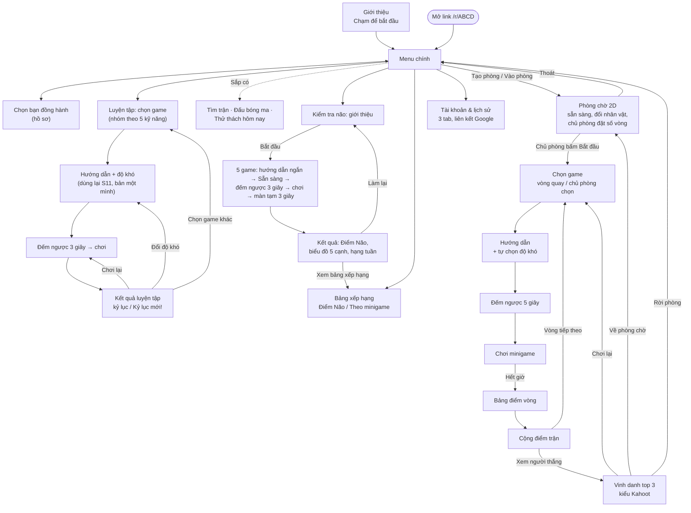

# Thiết kế UI/UX

| | |
| --- | --- |
| Giai đoạn SDLC | Thiết kế — phần giao diện và trải nghiệm |
| Phiên bản tài liệu | 1.3 · 2026-10-16 — 4 màn chơi một mình & tài khoản, menu mới theo [CR-009](../00-tracking/change-requests.md#cr-009) |
| Bản mẫu (canvas) | **[Brain Rizz — Màn chờ & Menu](https://claude.ai/artifact/GJZbipfsLC2TNo7TPws7CZ)** |
| Liên quan | [Thiết kế game](game-design.md), [ADR 0006 — shadcn & token](../02-architecture/decisions/0006-ui-shadcn-and-theme-tokens.md), [ADR 0009 — bảng phấn & nhân vật](../02-architecture/decisions/0009-chalkboard-style-and-characters.md) |
| Cập nhật khi | Thêm màn hình, đổi luồng, thêm artboard vào canvas, đổi token màu/font |

## 1. Nguyên tắc trải nghiệm

1. **Điện thoại trước.** Thiết kế khung 390×844 trước rồi mới mở rộng ra máy tính 1280×720. Minigame luôn ở khung dọc 720×1280, scale `FIT`.
2. **Một ngón tay.** Nút chính nằm nửa dưới màn hình; vùng chạm ≥ 48×48 px; không thao tác kéo thả bắt buộc.
3. **Ít chữ.** Mỗi màn hình một việc chính, một nút chính (màu `primary`). Trẻ 7 tuổi phải đoán được nên bấm gì.
4. **Luôn biết chuyện gì đang xảy ra.** Mất kết nối, đang chờ chủ phòng, đang tải sân khấu — đều có thông báo rõ.
5. **Không số liệu giả.** Tính năng chưa làm hiện nhãn "Sắp có", không hiện số người chơi hay bảng xếp hạng bịa.
6. **Tôn trọng người dùng.** Hỗ trợ giảm chuyển động, sáng/tối, tương phản ≥ 4,5:1, không chỉ phân biệt bằng màu.

## 2. Bản đồ màn hình

App không dùng router: màn hình được chọn theo pha của phòng (`apps/web/src/app/App.tsx`). Link mời `/r/<mã>` chỉ để điền sẵn mã.

## 3. Danh mục màn hình

| # | Màn hình | Thư mục code | Bản mẫu trên canvas | Đã làm trong code | Ghi chú |
| --- | --- | --- | --- | --- | --- |
| S1 | Giới thiệu | `features/home/components/IntroScreen.tsx` | ✅ Desktop + Điện thoại | ✅ | |
| S2 | Menu chính | `features/home/components/MenuScreen.tsx` | ✅ Khu 2 (cũ) · Khu 12 (CR-009) | ✅ | Theo khu 12: thẻ Luyện tập, Kiểm tra não ("Cao nhất …"), dòng Bảng xếp hạng, Tài khoản & lịch sử (trạng thái phiên); còn "Sắp có": Tìm trận, Đấu bóng ma (ô nét đứt), Thử thách hôm nay. Bỏ linh vật + câu gợi ý ở cột phải cho vừa 1280×720 |
| S3 | Chọn bạn đồng hành (hồ sơ) | `features/home/components/ProfileScreen.tsx` | ✅ "Chọn bạn đồng hành" (tương tác) | ✅ | |
| S4 | Phòng chờ 2D | `features/lobby/LobbyScreen.tsx` | ✅ Khu 5 | ✅ | Đã gỡ 3D (ADR 0010). Chưa có mã QR như bản máy tính |
| S10 | Chọn game (vòng quay / chủ phòng chọn + bình chọn) | `features/game-select/` | ✅ Khu 6 | ✅ | CR-005 |
| S11 | Hướng dẫn & độ khó | `features/game-intro/` | ✅ Khu 7 | ✅ | CR-005; lời nhắc của chủ phòng hiện bằng toast |
| S5 | Chơi (đếm ngược 5 giây, dải điểm, khung minigame) | `features/play/CountdownScreen.tsx`, `PlayScreen.tsx` | ✅ Khu 8 + trang Minigame M1 | ✅ | |
| S6 | Bảng điểm vòng + cộng điểm trận | `features/results/ResultsScreen.tsx` | ✅ Khu 9, 10 | ✅ | Tự sang bảng tổng điểm sau 5 giây |
| S7 | Vinh danh top 3 kiểu Kahoot | `features/results/PodiumScreen.tsx` | ✅ Khu 11 | ✅ | 2D, không 3D; pháo giấy CSS |
| S8 | Minigame (mỗi game một scene) | `games/<id>/` | ✅ Trang Minigame: khung chung M1 + 4 game MVP (M2–M5) | 1/15 | Kẻ lạc đàn chưa có bản mẫu riêng (dùng làm ví dụ trong M1) |
| S9 | Banner mất kết nối, thông báo (toast) | `components/common/ConnectionBanner.tsx`, `components/ui/sonner` | ✅ M1 · Trạng thái | ✅ | |
| — | Bảng nhân vật (sticker sheet) | `components/characters/` | ✅ Mèo Khói, Chó Bơ | ✅ 6 nhân vật | 4 nhân vật còn lại chưa có bảng trên canvas |
| S12 | Luyện tập (chọn game, kết quả) | `features/practice/` | ✅ Khu 13 | ✅ | UC-13. Hướng dẫn + độ khó dùng lại S11, khác biệt ghi trên canvas |
| S13 | Kiểm tra não (giới thiệu, màn tạm, kết quả) | `features/brain-test/` | ✅ Khu 14 | ✅ | UC-14. Biểu đồ 5 cạnh SVG tự vẽ |
| S14 | Tài khoản & lịch sử | `features/account/` | ✅ Khu 15 | ✅ | UC-16. 3 tab, Liên kết Google, Xoá dữ liệu |
| S15 | Bảng xếp hạng | `features/leaderboard/` | ✅ Khu 16 | ✅ | UC-19. Điểm Não / Theo minigame, Tuần này / Mọi thời đại |
| — | Trạng thái chung (tải, trống, lỗi, chưa kết nối máy chủ dữ liệu, hộp xác nhận) | dùng chung 4 màn trên | ✅ Khu 17 | ❌ | FR-MR-15 |

Thứ tự thiết kế tiếp theo (đề xuất): bảng nhân vật cho 4 con còn lại; 5 minigame của giai đoạn 2 khi tới lúc.

## 4. Bản mẫu trên canvas

Canvas [Brain Rizz — Màn chờ & Menu](https://claude.ai/artifact/GJZbipfsLC2TNo7TPws7CZ) có 3 trang.

### Trang "Màn chờ & luồng trận" (23 artboard)

| Khu | Artboard | Kích thước |
| --- | --- | --- |
| 1 · Màn giới thiệu | Giới thiệu · Desktop / Giới thiệu · Điện thoại | 1280×720 / 390×844 |
| 2 · Menu chính | Menu chính · Desktop / Menu chính · Điện thoại | 1280×720 / 390×844 |
| 3 · Nhân vật & biểu cảm sticker | Nhân vật · Mèo Khói / Nhân vật · Chó Bơ | 1280×860 |
| 4 · Bộ sưu tập nhân vật | Chọn bạn đồng hành (tương tác) | 1280×720 |
| 5 · Phòng chờ | Desktop chủ phòng (tương tác) / Điện thoại người chơi | 1280×720 / 390×844 |
| 6 · Chọn game | Vòng quay: Desktop (tương tác) + Điện thoại · Chủ phòng chọn: Desktop (tương tác) + Bình chọn điện thoại | 1280×720 / 390×844 |
| 7 · Hướng dẫn & độ khó | Desktop chủ phòng (tương tác) / Điện thoại người chơi | 1280×720 / 390×844 |
| 8 · Đếm ngược | Desktop / Điện thoại | 1280×720 / 390×844 |
| 9 · Kết quả vòng | Desktop / Điện thoại | 1280×720 / 390×844 |
| 10 · Cộng điểm trận | Desktop (tương tác, công tắc vòng cuối) / Điện thoại | 1280×720 / 390×844 |
| 11 · Vinh danh chung cuộc | Desktop (tương tác) / Điện thoại | 1280×720 / 390×844 |

Khu 5–11 kể một câu chuyện liền mạch: phòng 4 người (Hưng chủ phòng, Lan, Minh, Na), vòng 2/3 chơi Kẻ lạc đàn sau khi vòng 1 đã chơi Cân não. Bản điện thoại luôn là góc nhìn của Na. Mỗi khu có ghi chú cam mô tả trạng thái đang tải / lỗi / trống / mất kết nối. Các màn có link nối với nhau theo đúng luồng.

### Trang "Minigame" (20 artboard)

| Khu | Artboard | Kích thước |
| --- | --- | --- |
| M1 · Khung chơi chung | Điện thoại / Điện thoại chế độ tối / Desktop / Trạng thái (10 giây cuối, bị khoá, mất kết nối, hết giờ) | 390×844 / 1280×720 |
| M2 · [Theo dấu ánh đèn](../04-minigames/light-trail.md) | Điện thoại (Thường) / 4 mức độ khó / Trạng thái & chế độ tối / Hình hướng dẫn | 390×844 / 1280×720 / 560×360 |
| M3 · [Cân não](../04-minigames/balance.md) | Điện thoại (Thường) / 4 mức độ khó / Trạng thái & bộ vật / Hình hướng dẫn | như trên |
| M4 · [Bóng bay số](../04-minigames/number-balloons.md) | Điện thoại (Thường) / 4 mức độ khó / Trạng thái & chế độ tối / Hình hướng dẫn | như trên |
| M5 · [Xoay hình](../04-minigames/rotate-match.md) | Điện thoại (Thường) / 4 mức độ khó / Trạng thái & chế độ tối / Hình hướng dẫn | như trên |

Dữ liệu câu đố trên bản mẫu lấy đúng mục "Ví dụ để vẽ bản mẫu" của từng đặc tả. "Hình hướng dẫn" dùng ở màn Hướng dẫn & độ khó (khu 7).

### Trang "Một mình & tài khoản" (18 artboard, [CR-009](../00-tracking/change-requests.md#cr-009))

| Khu | Artboard | Kích thước |
| --- | --- | --- |
| 12 · Menu & lối vào | Menu chính (CR-009) · Desktop / Điện thoại (cuộn) | 1280×720 / 390×1040 |
| 13 · Luyện tập | Chọn game · Desktop / Điện thoại · Kết quả (kỷ lục mới) · Desktop · Kết quả (chưa phá kỷ lục, đồng bộ lỗi) · Điện thoại | 1280×720 / 390×844 |
| 14 · Kiểm tra não | Giới thiệu · Desktop (có lượt trước) / Điện thoại (lần đầu, chưa kết nối máy chủ dữ liệu) · Màn tạm giữa game · Desktop / Điện thoại · Kết quả (đã lưu, hạng tuần) · Desktop / Kết quả (chưa lưu) · Điện thoại · Tối | 1280×720 / 390×844 |
| 15 · Tài khoản & lịch sử | Desktop (khách, bấm thử 3 tab) / Điện thoại (đã liên kết Google, tab Luyện tập) | 1280×720 / 390×844 |
| 16 · Bảng xếp hạng | Desktop (bấm thử tab + kỳ; Mọi thời đại có dòng ghim) / Điện thoại · Theo minigame · Tối | 1280×720 / 390×844 |
| 17 · Trạng thái chung | 8 ô: đang tải, trống (bảng xếp hạng, tab party), lỗi mạng, chưa kết nối máy chủ dữ liệu, 3 hộp xác nhận / Tài khoản khi chưa kết nối · Điện thoại | 1280×860 / 390×844 |

Mọi artboard của trang này có nút **Tweaks › dark** để xem chế độ tối. Câu chuyện chung: người chơi Na (nhân vật Khói), Điểm Não cao nhất 742, hạng 12 tuần này. Số Kiểm tra não tính đúng công thức ở [Thiết kế game › Kiểm tra não](game-design.md#kiểm-tra-não). Mỗi khu có ghi chú cam mô tả hành vi và trạng thái; khu 2 (menu cũ) có ghi chú trỏ sang khu 12.

Quy ước: mỗi màn hình mới có **cả bản điện thoại và bản máy tính**; thêm vào canvas thành một khu mới đánh số tiếp; xong thì cập nhật bảng ở mục 3 và mục này. Việc thiết kế giao cho agent `ui-designer` ([Đội AI agent](../03-guides/ai-agents.md)).

## 5. Hệ thống thiết kế

Nguồn chuẩn là code: token ở `apps/web/src/styles/globals.css`, component ở `apps/web/src/components/ui/` (shadcn đã chỉnh). Bảng dưới chỉ là tóm tắt để tra nhanh.

### Màu

| Token | Sáng | Tối | Dùng cho |
| --- | --- | --- | --- |
| `background` (mặt bảng) | `#2d6a54` xanh bảng | `#24203f` tím than | Nền app |
| `chalk` / `chalk-muted` | Trắng phấn | Trắng phấn | Chữ viết thẳng lên bảng |
| `card` | `#fff8ef` giấy | `#2f2a52` | Thẻ nhãn dán |
| `muted-foreground` | `#5a5578` | `#b9b5d2` | Chữ phụ **bên trong thẻ** |
| `primary` | `#ffd166` vàng sun | `#ffd166` | Nút chính, điểm nhấn |
| `sticker` + `shadow-sticker` | Mực đậm | Mực đậm | Viền và bóng đổ của thẻ, nút |
| `destructive` | `#c93a55` | `#f07a90` | Lỗi, thao tác nguy hiểm |
| `destructive-foreground` | `#fff8ef` | `#1f1b3a` | Chữ trên nút xoá đặc (`Button variant="destructive"`) |
| `identify` … `visualize` | Xem [Thiết kế game › 5 nhóm](game-design.md#4-năm-nhóm-kỹ-năng) | | Màu nhóm kỹ năng |
| Màu avatar (8 màu) | `AVATAR_COLORS` trong `packages/shared/src/constants.ts` | | Phân biệt người chơi |

Quy tắc: chỉ dùng class token (`bg-card`, `text-chalk`, `bg-primary`…), không dùng `text-white`, `bg-ink` cho nền/chữ thông thường. Inline `style` chỉ cho giá trị tính lúc chạy (màu avatar).

### Chữ

| Font | Dùng cho | Class |
| --- | --- | --- |
| Baloo 2 (600–800) | Tiêu đề, nút, logo | `font-display` |
| Be Vietnam Pro (400–800) | Chữ thường | `font-sans` (mặc định) |

Cả hai tải từ Google Fonts trong `apps/web/index.html`, đủ dấu tiếng Việt.

### Component

- **UI cơ bản** (`components/ui/`): AlertDialog, Badge, Button, Card, DropdownMenu, Input, Label, Skeleton, Slider, Sonner (toast), Tabs (`variant` "folder" kiểu bìa hồ sơ / "pill" trên bảng), Toggle, ToggleGroup; thêm bằng `pnpm dlx shadcn@latest add <tên>` trong `apps/web`. Lưu ý (2026-10-16): CLI hiện sinh `import { cn } from "cn"` và đòi ghi đè `button.tsx`; chạy kèm `--dry-run --view`, chép mã về rồi sửa import thành `@/lib/utils`.
- **Dùng chung** (`components/common/`): `PlayerAvatar`, `DifficultyPicker`, `LanguageToggle`, `ThemeToggle`, `ConnectionBanner`, `RankBadge`, `MatchChips` (`RoundChip`, `CategoryChip`, `DifficultyChip`), `HostWaitCard`, `AvatarStrip`.
- **Thương hiệu** (`components/brand/`): `Logo`, `BrainMascot`, `ChalkDoodle`.
- **Nhân vật** (`components/characters/`): `<Character id mood size animated />`.

### Chuyển động

- Hoạt ảnh nhân vật bằng CSS (`styles/characters.css`), tự tắt khi `prefers-reduced-motion`.
- Minigame: đúng → nảy; sai → rung + mờ. Thời lượng hiệu ứng ≤ 400 ms để không chậm nhịp chơi.

## 6. Đa ngôn ngữ & nội dung

- Mọi chữ qua `t()`: khoá thêm vào `apps/web/src/i18n/locales/vi.ts` trước, rồi `en.ts`. Tên/cách chơi minigame ở `apps/web/src/games/<id>/locales.ts`.
- Giọng văn: thân thiện, ngắn, xưng "bạn"; câu hướng dẫn minigame ≤ 12 từ.
- Chữ tiếng Anh thường dài hơn 20–30%: chừa chỗ trong nút và thẻ.

## 7. Lịch sử thay đổi tài liệu

| Phiên bản | Ngày | Thay đổi | CR |
| --- | --- | --- | --- |
| 1.0 | 2026-10-10 | Bản đầu: bản đồ màn hình, danh mục màn hình, tóm tắt hệ thống thiết kế | — |
| 1.1 | 2026-10-10 | Luồng trận mới: bản đồ màn hình, thêm S10, S11, sửa S4–S7, canvas khu 5–11 | [CR-005](../00-tracking/change-requests.md#cr-005) |
| 1.2 | 2026-10-12 | Trang Minigame trên canvas: khung chơi chung + 4 game MVP | — |
| 1.3 | 2026-10-16 | Trang canvas "Một mình & tài khoản" (khu 12–17): menu mới, Luyện tập, Kiểm tra não, Tài khoản & lịch sử, Bảng xếp hạng, trạng thái chung; bản đồ màn hình, S12–S15; component Tabs, AlertDialog, Skeleton; token `destructive-foreground` | [CR-009](../00-tracking/change-requests.md#cr-009) |

[← Sản phẩm](README.md) · [Mục lục tài liệu](../README.md)
