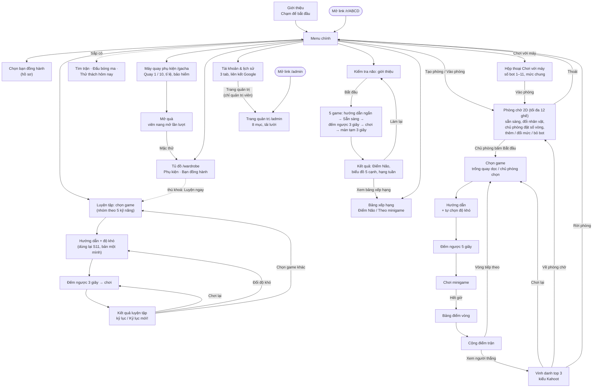

# Thiết kế UI/UX

| | |
| --- | --- |
| Giai đoạn SDLC | Thiết kế — phần giao diện và trải nghiệm |
| Phiên bản tài liệu | 1.11 · 2026-11-20 — phòng chờ luôn hiện đủ 12 ô (mục 6.8); 1.10: máy quay phụ kiện, tủ đồ, thú khoá, 24 phụ kiện theo [CR-023](../00-tracking/change-requests.md#cr-023), [CR-024](../00-tracking/change-requests.md#cr-024) |
| Bản mẫu (canvas) | **[Brain Rizz — Màn chờ & Menu](https://claude.ai/artifact/GJZbipfsLC2TNo7TPws7CZ)** (7 trang: Màn chờ & luồng trận · Minigame · Một mình & tài khoản · Quản trị · Yêu thích & hướng dẫn động · Nhân vật · Phấn & phụ kiện) |
| Liên quan | [Thiết kế game](game-design.md), [ADR 0006 — shadcn & token](../02-architecture/decisions/0006-ui-shadcn-and-theme-tokens.md), [ADR 0009 — bảng phấn & nhân vật](../02-architecture/decisions/0009-chalkboard-style-and-characters.md) |
| Cập nhật khi | Thêm màn hình, đổi luồng, thêm artboard vào canvas, đổi token màu/font |

## 1. Nguyên tắc trải nghiệm

1. **Điện thoại trước.** Thiết kế khung 390×844 trước rồi mới mở rộng ra máy tính 1280×720. Minigame luôn ở khung dọc 720×1280, scale `FIT`.
2. **Một ngón tay.** Nút chính nằm nửa dưới màn hình; vùng chạm ≥ 48×48 px; không thao tác kéo thả bắt buộc.
3. **Ít chữ.** Mỗi màn hình một việc chính, một nút chính (màu `primary`). Trẻ 7 tuổi phải đoán được nên bấm gì.
4. **Luôn biết chuyện gì đang xảy ra.** Mất kết nối, đang chờ chủ phòng, đang tải sân khấu — đều có thông báo rõ.
5. **Không số liệu giả.** Tính năng chưa làm hiện nhãn "Sắp có", không hiện số người chơi hay bảng xếp hạng bịa.
6. **Tôn trọng người dùng.** Hỗ trợ giảm chuyển động, sáng/tối, tương phản ≥ 4,5:1, không chỉ phân biệt bằng màu.

## 2. Bản đồ màn hình

App không dùng router: màn hình được chọn theo pha của phòng (`apps/web/src/app/App.tsx`). Link mời `/r/<mã>` chỉ để điền sẵn mã.

## 3. Danh mục màn hình

| # | Màn hình | Thư mục code | Bản mẫu trên canvas | Đã làm trong code | Ghi chú |
| --- | --- | --- | --- | --- | --- |
| S1 | Giới thiệu | `features/home/components/IntroScreen.tsx` | ✅ Desktop + Điện thoại | ✅ | |
| S2 | Menu chính | `features/home/components/MenuScreen.tsx` | ✅ Khu 2 (cũ) · Khu 12 (CR-009) | ✅ | Theo khu 12: thẻ Luyện tập, Kiểm tra não ("Cao nhất …"), dòng Bảng xếp hạng, Tài khoản & lịch sử (trạng thái phiên); còn "Sắp có": Tìm trận, Đấu bóng ma (ô nét đứt), Thử thách hôm nay. Bỏ linh vật + câu gợi ý ở cột phải cho vừa 1280×720 |
| S3 | Chọn bạn đồng hành (hồ sơ) | `features/home/components/ProfileScreen.tsx` | ✅ "Chọn bạn đồng hành" (tương tác) | ✅ | |
| S4 | Phòng chờ 2D | `features/lobby/LobbyScreen.tsx` | ✅ Khu 5 · Khu 23 (CR-016) · Khu 25 (CR-018) | ✅ (bot: ❌, 12 ghế: ❌) | Đã gỡ 3D (ADR 0010). Chưa có mã QR như bản máy tính. CR-016: ô trống thêm bot, ô bot đổi mức / bỏ ngay trong ô ([mục 6.6](#66-chơi-với-máy-s17-cr-016)). CR-018: 9–12 ghế dùng lưới gọn ([mục 6.8](#68-phòng-12-người-cr-018)) |
| S10 | Chọn game (trống quay dọc / chủ phòng chọn + bình chọn) | `features/game-select/` | ✅ Khu 6 (cũ) · Khu 24 (CR-017) | ✅ (trống quay: ❌) | CR-005. CR-017: trống quay dọc thay vòng quay tròn, bỏ danh sách "Trong vòng quay" ([mục 6.7](#67-trống-quay-dọc-s10-cr-017)); chế độ Chủ phòng chọn giữ khu 6 |
| S11 | Hướng dẫn & độ khó | `features/game-intro/` | ✅ Khu 7 · Khu 28 (CR-021) | ✅ (hướng dẫn động: ✅ 5 game MVP) | CR-005; lời nhắc của chủ phòng hiện bằng toast. CR-021: khung minh hoạ 16:9 rộng hết thẻ, nút Phóng to, hình động ([mục 6.11](#611-hướng-dẫn-to--động-s11-s12-s13-cr-021)) |
| S5 | Chơi (đếm ngược 5 giây, dải điểm, khung minigame) | `features/play/CountdownScreen.tsx`, `PlayScreen.tsx` | ✅ Khu 8 + trang Minigame M1 · Khu 25 (12 người) | ✅ (12 người: ❌) | CR-018: bảng điểm gọn / lưới điểm 2×6 khi đông ([mục 6.8](#68-phòng-12-người-cr-018)) |
| S6 | Bảng điểm vòng + cộng điểm trận | `features/results/ResultsScreen.tsx` | ✅ Khu 9, 10 · Khu 25 (12 người) | ✅ (12 người: ❌) | Tự sang bảng tổng điểm sau 5 giây. CR-018: bảng 2 cột, hàng gọn, hàng của mình dính mép |
| S7 | Vinh danh top 3 kiểu Kahoot | `features/results/PodiumScreen.tsx` | ✅ Khu 11 · Khu 19–20 (CR-010) · Khu 25 (12 người) | ✅ (nhịp CR-010: ❌, 12 người: ❌) | 2D, không 3D; pháo giấy CSS. CR-010: hạng 4+ → 3 → 2 → trống dồn → 1, thẻ Giỏi nhất mỗi thể loại ([mục 6.2](#62-vinh-danh-s7-cr-010), [6.3](#63-thẻ-giỏi-nhất-mỗi-thể-loại-cr-010)) |
| S8 | Minigame (mỗi game một scene) | `games/<id>/` | ✅ Trang Minigame: khung chung M1 + 4 game MVP (M2–M5) | 1/15 | Kẻ lạc đàn chưa có bản mẫu riêng (dùng làm ví dụ trong M1) |
| S9 | Banner mất kết nối, thông báo (toast) | `components/common/ConnectionBanner.tsx`, `components/ui/sonner` | ✅ M1 · Trạng thái | ✅ | |
| — | Bảng nhân vật (sticker sheet) | `components/characters/` | ✅ Mèo Khói, Chó Bơ · trang Nhân vật (12 × 7 biểu cảm, cỡ nhỏ, điểm neo) | ✅ 12 nhân vật | CR-024: 6 thú mới (Pin, Ộp, Thông, Gai, Mây, Lửa) khoá theo thành tích; điểm neo phụ kiện `anchors` cho cả 12 loài ([mục 4](#trang-nhân-vật-2-artboard-cr-024)) |
| S12 | Luyện tập (chọn game, kết quả) | `features/practice/` | ✅ Khu 13 · Khu 27 (CR-020) · Khu 28 | ✅ (yêu thích: ✅) | UC-13. Hướng dẫn + độ khó dùng lại S11, khác biệt ghi trên canvas. CR-020: ⭐ trên thẻ game, mục + chip Yêu thích, ⭐ đầu màn Hướng dẫn ([mục 6.10](#610-game-yêu-thích-s12-cr-020)) |
| S13 | Kiểm tra não (giới thiệu, màn tạm, kết quả) | `features/brain-test/` | ✅ Khu 14 · Khu 28 (CR-021) | ✅ (hướng dẫn động: ❌) | UC-14. Biểu đồ 5 cạnh SVG tự vẽ. Hướng dẫn trước mỗi game dùng khung minh hoạ mới |
| S14 | Tài khoản & lịch sử | `features/account/` | ✅ Khu 15 · Khu 21 (CR-010) | ✅ (thẻ thế mạnh: ❌) | UC-16. 3 tab, Liên kết Google, Xoá dữ liệu. CR-010: thẻ Thế mạnh trong trận party đầu tab Trận party ([mục 6.4](#64-thế-mạnh-trong-trận-party-s14-cr-010)) |
| S15 | Bảng xếp hạng | `features/leaderboard/` | ✅ Khu 16 | ✅ | UC-19. Điểm Não / Theo minigame, Tuần này / Mọi thời đại |
| — | Trạng thái chung (tải, trống, lỗi, chưa kết nối máy chủ dữ liệu, hộp xác nhận) | dùng chung 4 màn trên | ✅ Khu 17 | ❌ | FR-MR-15 |
| — | Hàng nút trên cùng · nút Hiệu ứng | `app/App.tsx`, `IntroScreen.tsx`, `MenuScreen.tsx`, `features/motion/` | ✅ Khu 18 (CR-010) | ❌ | Theo hệ thống / Luôn bật ([mục 6.1](#61-hàng-nút-trên-cùng--nút-hiệu-ứng-cr-010)) |
| S16 | Chat trong phòng (nút nổi + sheet điện thoại, cột phải máy tính, bong bóng biểu cảm) | `features/chat/` | ✅ Khu 22 (CR-011) | ❌ | Hiện ở 5 pha, ẩn lúc đếm ngược/đang chơi ([mục 6.5](#65-khung-chat-trong-phòng-s16-cr-011)) |
| S17 | Chơi với máy (thẻ menu + hộp thoại) | `features/home/` | ✅ Khu 23 (CR-016), khu 25 (CR-018) | ✅ | Số bot 1–11 (CR-018), một mức chung, trạng thái đang tạo / lỗi ([mục 6.6](#66-chơi-với-máy-s17-cr-016)) |
| — | Huy hiệu máy (`BotBadge`), chip mức bot, tên bot | `components/characters/BotBadge` (đề xuất), `components/common/MatchChips.tsx` | ✅ Khu 23 (CR-016) | ❌ | Dùng ở phòng chờ, hướng dẫn, dải điểm, bảng điểm, vinh danh, chat, lịch sử |
| — | Trống quay dọc (`Drum`, thay `LuckyWheel` đã xoá) | `features/game-select/components/Drum.tsx`, hình học `drum.ts` | ✅ Khu 24 (CR-017), artboard thành phần "Drum" | ✅ | Utility `drum-shade` ([mục 6.7](#67-trống-quay-dọc-s10-cr-017)) |
| — | 12 màu avatar | `AVATAR_COLORS` (`packages/shared/src/constants.ts`) | ✅ Khu 25 "12 màu avatar" | ❌ | 4 màu mới đã duyệt ([mục 6.8](#68-phòng-12-người-cr-018)) |
| S18 | Trang quản trị (8 mục, cổng đăng nhập/quyền) | `features/admin/` (tải lười), lối vào ở `features/account` | ✅ Trang "Quản trị", khu 26 (CR-019) | ✅ | Một component co giãn: máy tính cột menu trái, điện thoại tab cuộn ngang ([mục 6.9](#69-trang-quản-trị-s18-cr-019)) |
| — | Khung diễn hướng dẫn (sân khấu, con trỏ bàn tay, sóng chạm, ✓ ✗ ⚡ khoá, huy hiệu bước) + Demo 5 game MVP | `games/_shared/demo/`, `games/<id>/<Name>Demo.tsx` | ✅ Khu 29 (CR-021): đặc tả + `HowToDemo` chạy được + 5 artboard kịch bản | ✅ (5 game MVP) | Chỉ `transform`/`opacity`; 25 game còn lại làm sau khi duyệt ([mục 6.11](#611-hướng-dẫn-to--động-s11-s12-s13-cr-021)) |
| S19 | Máy quay phụ kiện `/gacha` (máy quay, Quay 1 / 10, bảo hiểm, Tỉ lệ & 24 món, mở quà) | `features/gacha/` | ✅ Trang "Phấn & phụ kiện" khu 30 (CR-023) | ❌ | 6 trạng thái: bình thường, thiếu phấn, chưa kết nối, đang tải, lỗi quay, giảm chuyển động ([mục 6.12](#612-máy-quay-phụ-kiện-tủ-đồ-thú-khoá-s19-s20-cr-023-cr-024)) |
| S20 | Tủ đồ `/wardrobe` (tab Phụ kiện, tab Bạn đồng hành, hộp chúc mừng mở thú) | `features/wardrobe/` | ✅ Khu 31 (CR-023, CR-024) | ❌ | Thú khoá: ổ khoá + điều kiện + thanh tiến độ + nút đi tới ([mục 6.12](#612-máy-quay-phụ-kiện-tủ-đồ-thú-khoá-s19-s20-cr-023-cr-024)) |
| — | Thẻ Máy quay + chip số dư + quà mỗi ngày ở menu; "+N phấn" ở kết quả trận / Kiểm tra não / luyện tập; thú khoá ở hồ sơ, phòng chờ | `features/home/`, `features/results/`, `features/brain-test/`, `features/practice/`, `features/lobby/` | ✅ Khu 32 | ❌ | S2, S3, S4, S6, S7, S12, S13 |
| — | 24 phụ kiện SVG, `AccessoryIcon`, `Character accessories`, `RarityBadge`, `ChalkChip` / `ChalkIcon` | `components/characters/accessories.tsx`, `components/common/` | ✅ Khu 33 (đặc tả + thành phần `Wearer`, `AccItem`) | ✅ | Token `rarity-*` |

Thứ tự thiết kế tiếp theo (đề xuất): kịch bản hướng dẫn động cho 25 game còn lại (sau khi chủ dự án duyệt 5 game MVP, mục 6.11); 5 minigame của giai đoạn 2 khi tới lúc.

## 4. Bản mẫu trên canvas

Canvas [Brain Rizz — Màn chờ & Menu](https://claude.ai/artifact/GJZbipfsLC2TNo7TPws7CZ) có 7 trang.

### Trang "Màn chờ & luồng trận" (72 artboard)

| Khu | Artboard | Kích thước |
| --- | --- | --- |
| 1 · Màn giới thiệu | Giới thiệu · Desktop / Giới thiệu · Điện thoại | 1280×720 / 390×844 |
| 2 · Menu chính | Menu chính · Desktop / Menu chính · Điện thoại | 1280×720 / 390×844 |
| 3 · Nhân vật & biểu cảm sticker | Nhân vật · Mèo Khói / Nhân vật · Chó Bơ | 1280×860 |
| 4 · Bộ sưu tập nhân vật | Chọn bạn đồng hành (tương tác) | 1280×720 |
| 5 · Phòng chờ | Desktop chủ phòng (tương tác) / Điện thoại người chơi | 1280×720 / 390×844 |
| 6 · Chọn game | Vòng quay: Desktop (tương tác) + Điện thoại · Chủ phòng chọn: Desktop (tương tác) + Bình chọn điện thoại | 1280×720 / 390×844 |
| 7 · Hướng dẫn & độ khó | Desktop chủ phòng (tương tác) / Điện thoại người chơi | 1280×720 / 390×844 |
| 8 · Đếm ngược | Desktop / Điện thoại | 1280×720 / 390×844 |
| 9 · Kết quả vòng | Desktop / Điện thoại | 1280×720 / 390×844 |
| 10 · Cộng điểm trận | Desktop (tương tác, công tắc vòng cuối) / Điện thoại | 1280×720 / 390×844 |
| 11 · Vinh danh chung cuộc | Desktop (tương tác) / Điện thoại | 1280×720 / 390×844 |
| 18 · Nút Hiệu ứng (CR-010) | Desktop (bấm thử 3 trạng thái) / Điện thoại (bấm thử với vòng quay) | 1280×720 / 390×844 |
| 19 · Vinh danh hồi hộp (CR-010) | Desktop chủ phòng (tự chạy) / Điện thoại Na (tự chạy, cuộn) / Lịch hiện · đặc tả nhịp | 1280×720 / 390×1320 / 1280×860 |
| 20 · Giỏi nhất mỗi thể loại (CR-010) | Trạng thái & bố cục / Điện thoại · Tối (đã cuộn) | 1280×1040 / 390×844 |
| 22 · Chat trong phòng (CR-011) | Điện thoại Na (bấm thử) / Điện thoại · Tối (chủ phòng) / Desktop chủ phòng (bấm thử, thu gọn) / Nút nổi theo 6 pha · Điện thoại / Bong bóng biểu cảm & chuyển động / Trạng thái (8 ô) | 390×844 / 1280×720 / 2540×940 / 1280×720 / 1280×1000 |
| 23 · Chơi với máy (CR-016) | Hàng 1: Menu + hộp thoại · Desktop (bấm thử) / Hộp thoại · Điện thoại (bấm thử) / Menu có thẻ mới · Điện thoại · Tối / Trạng thái hộp thoại + thẻ menu. Hàng 2: Phòng chờ có bot · Desktop chủ phòng (bấm thử) / Điện thoại chủ phòng (bấm thử, cuộn) / Điện thoại · Tối (người chơi Lan) / Đặc tả huy hiệu, chip mức, tên, trạng thái ô. Hàng 3: Huy hiệu máy ở mọi nơi (sáng, tối) / Bot nhường ghế | 1280×720 / 390×844 / 390×844 / 1600×940 · 1280×720 / 390×844 / 390×844 / 1280×1300 · 1280×1330 ×2 / 1280×840 |
| 24 · Trống quay dọc (CR-017) | Hàng 1: Desktop chủ phòng (bấm thử Quay!; Tweaks `stage`, `host`, `reduced`, `dark`) / Điện thoại Na (tự quay mỗi 9 s) / Điện thoại chủ phòng · Tối (đã trúng) / Desktop · Tối (đang quay). Hàng 2: Đặc tả (thông số, đường cong, 4 trạng thái) / Thành phần Drum (Tweaks `pos`, `blur`, `landed`, `compact`) | 1280×720 / 390×844 ×2 / 1280×720 · 1280×1360 / 620×420 |
| 25 · Phòng 12 người (CR-018) | 4 hàng, mỗi hàng Desktop / Điện thoại / Điện thoại · Tối / Desktop · Tối: Phòng chờ · Đang chơi · Kết quả vòng (+ Tổng điểm trận sáng, tối) · Vinh danh. Hàng 5: 12 màu avatar (duyệt 4 màu mới) / Thành phần Avatar | 1280×720 / 390×844 (vinh danh điện thoại 390×1100) · 1280×920 / 96×96 |

Khu 5–11 kể một câu chuyện liền mạch: phòng 4 người (Hưng chủ phòng, Lan, Minh, Na), vòng 2/3 chơi Kẻ lạc đàn sau khi vòng 1 đã chơi Cân não. Bản điện thoại luôn là góc nhìn của Na. Mỗi khu có ghi chú cam mô tả trạng thái đang tải / lỗi / trống / mất kết nối. Các màn có link nối với nhau theo đúng luồng.

Khu 18–20 (CR-010) dùng trận 6 người, 5 vòng (Hưng 42, Na 40, Minh 33, Lan 29, Bảo 24, Vy 18) để có đủ hạng 4+ và đủ 5 thể loại; bản "Điện thoại · Tối" ở khu 20 dùng lại trận 4 người, 3 vòng của khu 5–11 (chỉ 3 thể loại đã chơi). Artboard vinh danh tự chạy lặp lại; Tweaks: `stage` (dừng ở một nhịp), `reduced` (giảm chuyển động), `dark`. Artboard nút Hiệu ứng: Tweaks `osReduce` (máy đang giảm chuyển động), `dark`.

Khu 22 (CR-011) dùng lại phòng 4 người của khu 5–11; điện thoại là góc nhìn Na, máy tính là chủ phòng Hưng. Artboard chat bấm thử có Tweaks `host` (hiện công tắc chủ phòng), `variant` (`normal` / `empty` / `chatOff`), `dark`; artboard bong bóng có Tweaks `reduced`.

Khu 24–25 dùng phòng 12 ghế: Hưng (chủ phòng), Lan, Minh, Na, Bảo, Vy, Khoa, Linh, Tú, Mai, Fen · máy, Bắp · máy, màu avatar theo thứ tự 12 màu đã duyệt (Tú, Mai, Fen, Bắp dùng 4 màu mới). Trận 5 vòng, vòng 2 chơi Kẻ lạc đàn sau khi vòng 1 đã chơi Cân não. Máy tính là góc nhìn Hưng, điện thoại là Na (hạng 11 để thấy hàng của mình dính đáy). Mỗi artboard có Tweaks `dark`; bản "· Tối" là cùng artboard nhúng với `dark`.

Khu 23 (CR-016) kể chuyện Na chơi với máy: Na bấm "Chơi với máy", giữ mặc định 3 bot mức Vừa, rồi đổi một bot sang Khó; bạn Lan vào bằng mã. Phòng chờ có Na (chủ phòng), Fen · máy, Si · máy, Fen 2 · máy (trùng nhân vật nên có số), Lan và 3 ô trống. Tên nhân vật theo `vi.ts` hiện tại (Si, Fen, Mochi, Bắp, Cam, Tròn); màu avatar theo `AVATAR_COLORS`. Artboard hộp thoại có Tweaks `dark`, `state` (`normal` / `loading` / `error`), `open`; bấm thử: lần đầu giả lập lỗi, Thử lại thì thành công và nối sang phòng chờ. Artboard phòng chờ có Tweaks `dark`, `host` (tắt = góc nhìn Lan), `full` (đủ 8 ghế); bấm thử được thêm bot, đổi mức, bỏ bot, Sẵn sàng.

### Trang "Minigame" (20 artboard)

| Khu | Artboard | Kích thước |
| --- | --- | --- |
| M1 · Khung chơi chung | Điện thoại / Điện thoại chế độ tối / Desktop / Trạng thái (10 giây cuối, bị khoá, mất kết nối, hết giờ) | 390×844 / 1280×720 |
| M2 · [Theo dấu ánh đèn](../04-minigames/light-trail.md) | Điện thoại (Thường) / 4 mức độ khó / Trạng thái & chế độ tối / Hình hướng dẫn | 390×844 / 1280×720 / 560×360 |
| M3 · [Cân não](../04-minigames/balance.md) | Điện thoại (Thường) / 4 mức độ khó / Trạng thái & bộ vật / Hình hướng dẫn | như trên |
| M4 · [Bóng bay số](../04-minigames/number-balloons.md) | Điện thoại (Thường) / 4 mức độ khó / Trạng thái & chế độ tối / Hình hướng dẫn | như trên |
| M5 · [Xoay hình](../04-minigames/rotate-match.md) | Điện thoại (Thường) / 4 mức độ khó / Trạng thái & chế độ tối / Hình hướng dẫn | như trên |

Dữ liệu câu đố trên bản mẫu lấy đúng mục "Ví dụ để vẽ bản mẫu" của từng đặc tả. "Hình hướng dẫn" dùng ở màn Hướng dẫn & độ khó (khu 7).

### Trang "Một mình & tài khoản" (20 artboard, [CR-009](../00-tracking/change-requests.md#cr-009))

| Khu | Artboard | Kích thước |
| --- | --- | --- |
| 12 · Menu & lối vào | Menu chính (CR-009) · Desktop / Điện thoại (cuộn) | 1280×720 / 390×1040 |
| 13 · Luyện tập | Chọn game · Desktop / Điện thoại · Kết quả (kỷ lục mới) · Desktop · Kết quả (chưa phá kỷ lục, đồng bộ lỗi) · Điện thoại | 1280×720 / 390×844 |
| 14 · Kiểm tra não | Giới thiệu · Desktop (có lượt trước) / Điện thoại (lần đầu, chưa kết nối máy chủ dữ liệu) · Màn tạm giữa game · Desktop / Điện thoại · Kết quả (đã lưu, hạng tuần) · Desktop / Kết quả (chưa lưu) · Điện thoại · Tối | 1280×720 / 390×844 |
| 15 · Tài khoản & lịch sử | Desktop (khách, bấm thử 3 tab) / Điện thoại (đã liên kết Google, tab Luyện tập) | 1280×720 / 390×844 |
| 16 · Bảng xếp hạng | Desktop (bấm thử tab + kỳ; Mọi thời đại có dòng ghim) / Điện thoại · Theo minigame · Tối | 1280×720 / 390×844 |
| 17 · Trạng thái chung | 8 ô: đang tải, trống (bảng xếp hạng, tab party), lỗi mạng, chưa kết nối máy chủ dữ liệu, 3 hộp xác nhận / Tài khoản khi chưa kết nối · Điện thoại | 1280×860 / 390×844 |
| 21 · Thế mạnh trong trận party ([CR-010](../00-tracking/change-requests.md#cr-010)) | Desktop (tab Trận party, Tweaks `state`: bình thường / rỗng / đang tải) / Điện thoại | 1280×720 / 390×844 |

Mọi artboard của trang "Một mình & tài khoản" có nút **Tweaks › dark** để xem chế độ tối. Câu chuyện chung: người chơi Na (nhân vật Khói), Điểm Não cao nhất 742, hạng 12 tuần này. Số Kiểm tra não tính đúng công thức ở [Thiết kế game › Kiểm tra não](game-design.md#kiểm-tra-não). Mỗi khu có ghi chú cam mô tả hành vi và trạng thái; khu 2 (menu cũ) có ghi chú trỏ sang khu 12.

### Trang "Quản trị" (26 artboard, [CR-019](../00-tracking/change-requests.md#cr-019))

| Khu | Artboard | Kích thước |
| --- | --- | --- |
| 26 · Trang quản trị | Hàng 1: Tổng quan · Desktop (bấm thử menu và chỉ số biểu đồ; Tweaks `section`, `state`, `dark`) / Desktop · Tối / Điện thoại. Hàng 2: Game · Desktop / Điện thoại · Điểm & hệ số · Desktop / Desktop · Tối / Điện thoại · Tối. Hàng 3: Đăng nhập · Desktop / Điện thoại · Người chơi · Desktop / Điện thoại · Tối · Trận đấu · Desktop. Hàng 4: Phòng đang mở · Desktop / Điện thoại · Quản trị viên · Desktop / Điện thoại · Tối · Trận đấu · Điện thoại. Hàng 5 (trạng thái): chưa đăng nhập Google / không có quyền (điện thoại, tối) / chưa kết nối máy chủ dữ liệu / đang tải / trống (điện thoại) / lỗi (tối). Hàng 6: Hộp thoại, lỗi nhập, thông báo, lối vào (desktop, điện thoại tối) | 1280 × (720–2000) / 390 × (844–2400) |

Cả trang dựng từ **một** artboard co giãn `AdminConsole` (container query theo bề rộng vùng nội dung); các artboard khác nhúng nó với `section` / `state` / `dark` khác nhau. Số liệu trên bản mẫu là ví dụ.

### Trang "Yêu thích & hướng dẫn động" (31 artboard, [CR-020](../00-tracking/change-requests.md#cr-020), [CR-021](../00-tracking/change-requests.md#cr-021))

| Khu | Artboard | Kích thước |
| --- | --- | --- |
| 27 · Game yêu thích | Hàng 1: Chọn game · Desktop (bấm thử ⭐ và chip; Tweaks `filter`, `empty`, `dark`) / Desktop · Tối / Điện thoại (bấm thử) / Điện thoại · Tối. Hàng 2: Lọc Yêu thích · Điện thoại / Lọc Yêu thích · trống / Tất cả · chưa có yêu thích (dòng gợi ý) · Tối / Nút ⭐ · đặc tả | 1280×800 / 390×844 · 1280×980 |
| 28 · Hướng dẫn to + động | Hàng 1 (Luyện tập): Desktop (bấm thử ⭐, Phóng to, chạm khung để dừng; Tweaks `screen`, `game`, `motion`, `fav`, `zoom`, `dark`) / Desktop · Tối (Cân não) / Điện thoại (bấm thử) / Điện thoại · Tối (Bóng bay số). Hàng 2 (Phóng to): hộp thoại Desktop / Desktop · Tối / sheet Điện thoại / Điện thoại · Tối. Hàng 3: party 12 người Desktop (chủ phòng) / Kiểm tra não Desktop · Tối / party 12 người Điện thoại (Na) / Kiểm tra não Điện thoại. Hàng 4 (trạng thái): giảm chuyển động Điện thoại / đã dừng Điện thoại · Tối / hết 3 vòng Điện thoại / giảm chuyển động Desktop · Tối | 1280×800 / 390×844 |
| 29 · Khung diễn & kịch bản | Khung diễn · đặc tả / thành phần `HowToDemo` (Tweaks `game`, `mode` play · freeze · still, `paused`, `dark`) / 5 artboard Kịch bản (Kẻ lạc đàn, Theo dấu ánh đèn, Cân não, Bóng bay số, Xoay hình): demo đang chạy, khung tĩnh, 3 bước ↔ huy hiệu bước, dòng thời gian theo làn, bảng từng cảnh | 1280×1500 / 640×360 / 1280×1040 |

`HowToDemo` chạy thật bằng CSS keyframes (chỉ `transform`, `opacity`), sinh từ cùng một bảng mốc thời gian với mục 6.11, nên FE chép được thẳng các mốc % = ms ÷ T. Ảnh thu nhỏ trên thẻ game ở khu 27 nhúng artboard "Hình hướng dẫn" của trang Minigame. Câu chuyện chung: Na đã ⭐ Theo dấu ánh đèn, Bóng bay số, Xoay hình; trận party 12 ghế như khu 24–25.

### Trang "Nhân vật" (2 artboard, [CR-024](../00-tracking/change-requests.md#cr-024))

| Artboard | Nội dung | Kích thước |
| --- | --- | --- |
| [12 bạn đồng hành × 7 biểu cảm](https://claude.ai/artifact/GJZbipfsLC2TNo7TPws7CZ#artboard-Characters12) | 12 hàng (6 luôn mở, vạch chia, 6 thú mới): thẻ tên (màu thân, trạng thái mở, đặc điểm nhận dạng, toạ độ neo) + 7 biểu cảm có hoạt ảnh + cột điểm neo (đầu đỏ, mặt xanh dương, cổ xanh lá). Tweaks `dark`, `motion`, `anchors` | 1600×2080 |
| [12 nhân vật ở cỡ nhỏ](https://claude.ai/artifact/GJZbipfsLC2TNo7TPws7CZ#artboard-Characters12Small) | Sáng và tối cạnh nhau: avatar 22 / 32 / 46 px trên màu ghế theo thứ tự, ô chọn nhân vật 46 px trên thẻ, đứng tự do có viền nhãn dán; màu ghế gần thân thú mới nhất (ΔE2000) | 1440×750 |

SVG trên hai artboard sinh thẳng từ `Character.tsx` + `specs.tsx` (render tĩnh), nên khớp code từng nét. 6 thú mới dùng chung thân `BODY_PATH` và bộ mặt chung, khác ở:

| id | Tên (vi / en) | Thân | Nhận dạng ở cỡ nhỏ |
| --- | --- | --- | --- |
| `pin` | Pin / Pip · chim cánh cụt | `#4F7491` xanh thép | Mặt nạ trắng hình tim, mỏ và chân màng cam, vây hai bên (không tay) |
| `op` | Ộp / Ribbit · ếch | `#45A356` xanh lá | Hai mắt lồi trên đỉnh đầu (mắt ở y 58), miệng rộng, đốm sẫm, bụng vàng chanh |
| `thong` | Thông / Sage · cú | `#9A6A48` nâu hạt dẻ | Đĩa mặt kem quanh mắt hổ phách, chỏm tai lông, mỏ cam, cánh (không tay) |
| `gai` | Gai / Spike · nhím | `#F9DCC0` mặt kem đào | Vòng gai nâu ca-cao quanh lưng và hai bên, mái gai răng cưa, tai tròn nhỏ, mõm sáng + mũi nút |
| `may` | Mây / Cloudy · koala | `#BCC1CA` xám mây | Tai tròn to có lông trắng hình đám mây, mũi đen to hình hạt đậu |
| `lua` | Lửa / Blaze · rồng con (hiếm nhất) | `#9566E2` tím | Sừng vàng, cánh dơi vỗ (`fx-flap-l/-r`), đuôi có lửa lập loè (`fx-flicker`), bụng vàng có vạch, răng nanh |

Màu thân 6 thú mới cách màu ghế gần nhất ΔE2000 ≥ 12 (Gai – cát 12,2; Pin – dừa cạn 14,4; Mây – xanh trời 15,9), và cách thân 11 loài còn lại ≥ 11. Nhận dạng ở 22 px dựa vào viền mực và hình tai/gai/mắt, không riêng màu.

### Trang "Phấn & phụ kiện" (42 artboard, [CR-023](../00-tracking/change-requests.md#cr-023), [CR-024](../00-tracking/change-requests.md#cr-024))

Link thẳng: [trang Phấn & phụ kiện](https://claude.ai/artifact/GJZbipfsLC2TNo7TPws7CZ#page-gacha).

| Khu | Artboard | Kích thước |
| --- | --- | --- |
| 30 · Máy quay phụ kiện | Hàng 1: Máy tính (bấm thử Quay 1 / Quay 10 / Tỉ lệ; Tweaks `device`, `state`, `screen`, `step`, `reduced`, `dark`) / Máy tính · Tối / Điện thoại (bấm thử) / Điện thoại · Tối. Hàng 2 (điện thoại): mở 10 lượt đang mở / xong · tối / mở 1 lượt Huyền thoại / Tỉ lệ & 24 món (sheet, tối) / thiếu phấn / chưa kết nối / đang tải (tối) / lỗi quay / giảm chuyển động. Hàng 3 (máy tính): mở 10 lượt / Tỉ lệ (hộp thoại, tối) / thiếu phấn / mở 1 lượt (tối) | 1280×800 / 390×844 |
| 31 · Tủ đồ & thú khoá | Hàng 1: Phụ kiện · Máy tính (bấm thử; Tweaks `device`, `tab`, `slot`, `sheet`, `unlock`, `empty`, `dark`) / Bạn đồng hành · Máy tính · Tối / Phụ kiện · Điện thoại / chỗ Cổ · Điện thoại · Tối. Hàng 2: Bạn đồng hành · Điện thoại / sheet điều kiện Lửa · Tối / hộp chúc mừng Pin / tủ trống / Bạn đồng hành · Máy tính / hộp chúc mừng · Máy tính · Tối | 1280×800 / 390×844 |
| 32 · Menu, hồ sơ, +N phấn | Hàng 1: Menu · Máy tính (bấm thử Nhận quà) / đã nhận · Tối / Điện thoại (cuộn) / đã nhận · Tối / chưa kết nối. Hàng 2: Hồ sơ có thú khoá · Máy tính (hộp điều kiện Gai) / Điện thoại (sheet Thông) / Điện thoại · Tối / đặc tả "+N phấn", khoá thú ở phòng chờ, avatar nhỏ (sáng, tối) | 1280×800 / 390×1300 / 390×844 / 1280×1040 |
| 33 · Đặc tả | Độ hiếm · viên nang · phấn (sáng, tối) / 24 phụ kiện · điểm neo · 12 loài / thành phần `Wearer` (Tweaks `ch`, `acc`, `mood`, `locked`, `sticker`, `noFace`) / `AccItem` (Tweaks `id`, `size`, `dim`) | 1280×1240 / 200×200 / 96×96 |

Cả khu 30–32 dựng từ ba artboard co theo `device` (`Gacha`, `Wardrobe`, `GachaMenu`); các artboard còn lại nhúng chúng với props khác. Nhân vật và phụ kiện trên canvas là SVG xuất thẳng từ `Character.tsx` + `accessories.tsx` + `specs.tsx` (cùng điểm neo), nên khớp code từng nét. Câu chuyện chung: Na (Khói, đang đeo Vương miện + Kính tròn + Khăn len), 1.240 phấn, đã quay 17 lượt (Sử thi trở lên còn tối đa 9 lượt, Huyền thoại 43), có 10 món trước khi quay 10 (cap, round-glasses, bell, scarf ra trùng → +40 phấn; 6 món mới gồm Chuỗi ngọc Sử thi); lượt 1 ra Kính ngôi sao Huyền thoại. Thú: Pin vừa mở (10/10 trận), Ộp (1.560) và Mây (742) đã mở; Thông 1.050/1.200, Gai 1/3, Lửa 2/5 nhóm còn khoá.

Quy ước: mỗi màn hình mới có **cả bản điện thoại và bản máy tính**; thêm vào canvas thành một khu mới đánh số tiếp; xong thì cập nhật bảng ở mục 3 và mục này. Việc thiết kế giao cho agent `ui-designer` ([Đội AI agent](../03-guides/ai-agents.md)).

## 5. Hệ thống thiết kế

Nguồn chuẩn là code: token ở `apps/web/src/styles/globals.css`, component ở `apps/web/src/components/ui/` (shadcn đã chỉnh). Bảng dưới chỉ là tóm tắt để tra nhanh.

### Màu

| Token | Sáng | Tối | Dùng cho |
| --- | --- | --- | --- |
| `background` (mặt bảng) | `#2d6a54` xanh bảng | `#24203f` tím than | Nền app |
| `chalk` / `chalk-muted` | Trắng phấn | Trắng phấn | Chữ viết thẳng lên bảng |
| `card` | `#fff8ef` giấy | `#2f2a52` | Thẻ nhãn dán |
| `muted-foreground` | `#5a5578` | `#b9b5d2` | Chữ phụ **bên trong thẻ** |
| `primary` | `#ffd166` vàng sun | `#ffd166` | Nút chính, điểm nhấn |
| `sticker` + `shadow-sticker` | Mực đậm | Mực đậm | Viền và bóng đổ của thẻ, nút |
| `destructive` | `#c93a55` | `#f07a90` | Lỗi, thao tác nguy hiểm |
| `destructive-foreground` | `#fff8ef` | `#1f1b3a` | Chữ trên nút xoá đặc (`Button variant="destructive"`); cùng `destructive` làm badge số tin chưa đọc của chat (4,7:1 sáng, 6,2:1 tối) |
| `bubble-mine` / `bubble-mine-foreground` | `#ffecc6` / `#1f1b3a` (14:1) | `#5c4b22` / `#fff8ef` (8:1) | Bong bóng tin của chính mình trong khung chat (CR-011). Tin người khác dùng `bg-muted` + `text-card-foreground` |
| `bot` / `bot-foreground` | `#b9c7dc` thép nhạt / `#1f1b3a` (9,6:1) | Giữ như sáng (nền so với thẻ tối 7,8:1) | Huy hiệu máy, nhãn "Đấu với máy", thẻ "Chơi với máy" (CR-016). Luôn kèm viền `border-sticker` vì nền chỉ 1,6:1 so với thẻ giấy |
| `identify` … `visualize` | Xem [Thiết kế game › 5 nhóm](game-design.md#4-năm-nhóm-kỹ-năng) | | Màu nhóm kỹ năng |
| Màu avatar (12 màu, CR-018) | `AVATAR_COLORS` trong `packages/shared/src/constants.ts`: 8 màu cũ + `#FF8FE9` hồng sen, `#FB7B74` san hô, `#CBAF86` cát, `#748EDC` dừa cạn (vị trí 8–11) | Như sáng (avatar luôn có viền mực) | Phân biệt người chơi; luôn đi kèm nhân vật + tên |
| `drum-shade` (utility) | Gradient đen 52% ở mép → 0 tại 34% / 66% | Như sáng | Bóng mặt trống cong của trống quay dọc (CR-017) |
| `rarity-common` / `-rare` / `-epic` / `-legendary` + `rarity-foreground` | `#dcd6c8` giấy xám · `#8ec5ff` xanh trời · `#c3a6ff` tím · `#ffd166` vàng; chữ `#1f1b3a` (11,4 / 9,1 / 8 / 11,5:1) | Giữ như sáng (so với thẻ tối 6,5–9,3:1, bảng tối 7,5–10,8:1) | Độ hiếm phụ kiện (CR-023): nhãn, ô món, ánh viên nang. Luôn viền `border-sticker` (so với thẻ giấy chỉ 1,4–2,2:1) + số hạt ◆ + tên, không chỉ dựa vào màu |

Quy tắc: chỉ dùng class token (`bg-card`, `text-chalk`, `bg-primary`…), không dùng `text-white`, `bg-ink` cho nền/chữ thông thường. Inline `style` chỉ cho giá trị tính lúc chạy (màu avatar).

### Chữ

| Font | Dùng cho | Class |
| --- | --- | --- |
| Baloo 2 (600–800) | Tiêu đề, nút, logo | `font-display` |
| Be Vietnam Pro (400–800) | Chữ thường | `font-sans` (mặc định) |

Cả hai tải từ Google Fonts trong `apps/web/index.html`, đủ dấu tiếng Việt.

### Component

- **UI cơ bản** (`components/ui/`): AlertDialog, Badge, Button, Card, Dialog (CR-016: như AlertDialog nhưng đóng được bằng Esc / lớp phủ / nút ×; nút đóng chỉ hiện khi truyền `closeLabel`; giảm chuyển động chỉ mờ; cao quá màn thì cuộn trong hộp), DropdownMenu, Input, Label, Sheet (CR-011: viền mực 4 px, bo 3xl ở cạnh hướng vào màn, giảm chuyển động chỉ mờ; nút đóng chỉ hiện khi truyền `closeLabel` đã dịch), Skeleton, Slider, Sonner (toast), Switch (CR-011: rãnh 48×28 viền mực, bật = `primary`, vùng chạm 64×44), Tabs (`variant` "folder" kiểu bìa hồ sơ / "pill" trên bảng), Toggle, ToggleGroup; thêm bằng `pnpm dlx shadcn@latest add <tên>` trong `apps/web`. Lưu ý (2026-10-16): CLI hiện sinh `import { cn } from "cn"` và đòi ghi đè `button.tsx`; chạy kèm `--dry-run --view`, chép mã về rồi sửa import thành `@/lib/utils`.
- **Dùng chung** (`components/common/`): `PlayerAvatar`, `DifficultyPicker`, `LanguageToggle`, `ThemeToggle`, `ConnectionBanner`, `RankBadge`, `MatchChips` (`RoundChip`, `CategoryChip`, `DifficultyChip`), `HostWaitCard`, `AvatarStrip`, `RarityBadge` + `RarityPips` + `RARITY_BG` (CR-023: cỡ `xs` chỉ hạt ◆ + aria-label, `sm`, `md`; nhận `label` đã dịch), `ChalkIcon` + `ChalkChip` (CR-023: tông `board` số dư trên bảng, `card` giá trong thẻ, `reward` "+N phấn"; cỡ `sm` 28 / `md` 36 / `lg` 44; `srLabel` cho trình đọc màn hình).
- **Hàng nút trên cùng** (thứ tự cố định): `MusicBar` · `SfxToggle` · nút Hiệu ứng (CR-010, `features/motion/`) · `LanguageToggle` · `ThemeToggle`. Mọi nút là `Button variant="chalk" size="icon-chalk"` (44×44).
- **Thương hiệu** (`components/brand/`): `Logo`, `BrainMascot`, `ChalkDoodle`.
- **Nhân vật** (`components/characters/`): `<Character id mood size animated />`. 12 loài trong `CHARACTER_SPECS` (`specs.tsx`), mỗi loài có `anchors: { head, face, neck }` để đặt phụ kiện (gacha-pets-unlocks 5.5), toạ độ trong khung 200×200: **head** = đỉnh đầu giữa hai tai, chỗ đặt đáy món, thấp hơn mép viền trên ~6 (thường `100, 40`); **face** = điểm giữa hai mắt, `scale` = khoảng cách hai mắt / 48; **neck** = tâm cổ ngay dưới miệng/mỏ (140–152 tuỳ loài). Ếch: neo đầu `scale 0.85` giữa hai mắt lồi.
- **Phụ kiện** (`components/characters/accessories.tsx`, CR-023): `ACCESSORY_ART` (24 món, khoá theo `CosmeticId`), `AccessoryIcon` (ảnh nhỏ một món), `wornAccessories`. `<Character accessories={…} hideFaceAccessory />` vẽ món theo `spec.anchors` ([mục 6.12](#612-máy-quay-phụ-kiện-tủ-đồ-thú-khoá-s19-s20-cr-023-cr-024)).

### Chuyển động

- Hoạt ảnh nhân vật bằng CSS (`styles/characters.css`), tắt khi giảm chuyển động. Riêng rồng Lửa: cánh vỗ `fx-flap-l` / `fx-flap-r` (1,1 s, xoay quanh gốc cánh) và lửa đuôi `fx-flicker` (0,5 s); chỉ chạy khi `animated`.
- Minigame: đúng → nảy; sai → rung + mờ. Thời lượng hiệu ứng ≤ 400 ms để không chậm nhịp chơi.
- **Một nguồn "giảm chuyển động"** (CR-010): giảm khi nút Hiệu ứng ở "Theo hệ thống" **và** máy báo `prefers-reduced-motion: reduce`; "Luôn bật" thì luôn đầy đủ. React, CSS (`motion-safe:`/`motion-reduce:`, `@media` trong `characters.css`) và scene Phaser đều đọc nguồn này, không tự đọc `matchMedia`.
- **Giảm chuyển động không phải bỏ nhịp**: thứ tự và thời điểm hiện giữ nguyên, chỉ thay trượt/nảy/xoay bằng mờ dần (≤ 400 ms); bỏ pháo giấy, nhân vật đứng yên, vòng quay dừng ngay ở kết quả. Âm thanh đi theo nút Âm thanh, không theo nút Hiệu ứng.
- **Đường cong dùng chung** (CR-021, token trong `@theme`, Tailwind sinh `ease-*`; không đổi theo sáng/tối):

| Token | Giá trị | Dùng cho |
| --- | --- | --- |
| `--ease-glide` | `cubic-bezier(0.45, 0, 0.25, 1)` | Lướt giữa hai điểm: con trỏ bàn tay, bóng ma xoay, nhịp thẻ mẫu |
| `--ease-settle` | `cubic-bezier(0.2, 0.7, 0.3, 1)` | Vào/ra, mờ dần, sóng chạm, nhấn tay, đòn cân nghiêng |
| `--ease-pop` | `cubic-bezier(0.34, 1.56, 0.64, 1)` | Nảy có vượt: ✓ ✗ ⚡, vòng khoanh, huy hiệu số, tay bật lại, ⭐ bật (trùng đường cong "trúng" của trống quay mục 6.7) |

## 6. Đặc tả chi tiết

Thông số để frontend-dev làm theo. Câu chữ ghi ở đây là đề xuất: frontend-dev thêm vào `vi.ts` trước rồi `en.ts`, tên khoá có thể đổi cho khớp nhóm sẵn có. Mục 6.1–6.4 chỉ dùng token sẵn có; mục 6.5 thêm token `bubble-mine`; mục 6.6 thêm token `bot` và component `Dialog`; mục 6.7 thêm utility `drum-shade`; mục 6.8–6.10 chỉ dùng token và component sẵn có; mục 6.11 thêm 3 token đường cong `--ease-glide`, `--ease-settle`, `--ease-pop` (dùng chung với nảy ⭐ của 6.10) và dùng lại `Dialog`, `Sheet`; mục 6.12 thêm token `rarity-*`, component `RarityBadge`, `ChalkChip`, `ChalkIcon`, `AccessoryIcon` và prop `accessories` của `Character`.

### 6.1 Hàng nút trên cùng · nút Hiệu ứng (CR-010)

Bản mẫu: [canvas khu 18](https://claude.ai/artifact/GJZbipfsLC2TNo7TPws7CZ) (Desktop bấm thử 3 trạng thái; Điện thoại bấm thử với vòng quay).

- **Vị trí:** ngay sau `SfxToggle` ở cả 3 chỗ có hàng nút: `App.tsx` (mọi màn trong phòng và màn một mình), `IntroScreen.tsx`, `MenuScreen.tsx`. Menu điện thoại có 7 nút (hỏi đáp, nhạc ×2, âm thanh, hiệu ứng, ngôn ngữ, giao diện) = 356 px: vừa khít 390 px; màn hẹp hơn thì xuống dòng, căn phải như hiện nay, không thu nhỏ nút.
- **Hình dạng:** `Button variant="chalk" size="icon-chalk"` (44×44, vùng chạm đạt chuẩn), icon lucide **`SparklesIcon`** cho mọi trạng thái; trạng thái báo bằng nền và chấm, không chỉ bằng màu.

| Trạng thái | Khi nào | Hình | `title` (vi / en) |
| --- | --- | --- | --- |
| Theo hệ thống | Mặc định, máy bình thường | Như các nút phấn khác (`border-chalk/70 bg-board-shade text-chalk`) | "Hiệu ứng: theo cài đặt của máy" / "Effects: following your device" |
| Theo hệ thống · máy giảm | Mặc định, máy báo `reduce` | Như trên + chấm 12 px góc trên phải: `bg-identify`, viền 2 px `border-sticker` | "Máy đang giảm chuyển động — bấm để luôn bật hiệu ứng" / "Your device reduces motion — tap to always show effects" |
| Luôn bật | Người dùng đã bấm | Nền phấn đặc: `bg-chalk text-background border-chalk` (tương phản icon 5,9:1 sáng, 14:1 tối) | "Hiệu ứng: luôn bật — bấm để theo cài đặt của máy" / "Effects: always on — tap to follow your device" |

- **Trợ năng:** `aria-label` cố định "Luôn bật hiệu ứng" / "Always show effects" + `aria-pressed` (true khi Luôn bật); `title` đổi theo bảng trên; `data-sfx="toggle"`.
- **Phản hồi:** bấm → toast (sonner) 2,5 s: "Đã luôn bật hiệu ứng" / "Effects always on", hoặc "Hiệu ứng theo cài đặt của máy" / "Effects follow your device". Điện thoại không có `title` khi chạm nên toast là phản hồi chính.
- **Lưu:** trên máy (localStorage, bọc try/catch), mặc định "Theo hệ thống"; đổi giữa trận áp dụng ngay cho hiệu ứng bắt đầu sau đó.
- **Khoá i18n gợi ý:** `motion.toggle`, `motion.titleSystem`, `motion.titleReduced`, `motion.titleOn`, `motion.toastOn`, `motion.toastSystem`.

### 6.2 Vinh danh (S7, CR-010)

Bản mẫu: [canvas khu 19](https://claude.ai/artifact/GJZbipfsLC2TNo7TPws7CZ) (Desktop chủ phòng, Điện thoại Na, artboard "Lịch hiện vinh danh").

**Lịch hiện** (ms tính từ lúc vào màn; N = số người hạng 4+; nên tách thành hàm thuần có test):

| Nhịp | Thời điểm | Ví dụ 6 người (N = 3) |
| --- | --- | --- |
| Hàng hạng 4+ thứ i, đếm **từ dưới lên** (i = 0…N−1) | `600 + 450·i` | hạng 6: 600 · hạng 5: 1.050 · hạng 4: 1.500 |
| Hạng 3 | hàng cuối + 900; không có hạng 4+: 600 | 2.400 |
| Hạng 2 | hạng 3 + 1.400 | 3.800 |
| Trống dồn (chờ) | hạng 2 + 900, dài 2.000 | 4.700 → 6.700 |
| Hạng 1 | hết trống | 6.700 |
| Thẻ Giỏi nhất mỗi thể loại | hạng 1 + 1.600; mỗi hàng + 120 | 8.300 → 8.780 |

- Thiếu bục (2 người, đồng hạng làm một bậc trống): nhịp sau dời lên chỗ của bậc trống, không chờ. Đồng hạng trên cùng bậc: lật cùng lúc. Ví dụ: 4 người → hạng 1 lúc 5,8 s; 8 người → 7,6 s.
- **Trước khi lật:** bục đứng sẵn từ đầu (màu `rankBg`, số hạng hiện, chưa có tên/điểm); chỗ nhân vật là vòng phấn nét đứt có "?" (`border-chalk/55`, chữ `text-chalk-muted`). Danh sách hạng 4+ có khung thẻ và tiêu đề từ đầu, hàng chưa lật để `opacity-0` (giữ chỗ). Không phần nào làm nhảy bố cục khi lật.
- **Lúc chờ trống:** trên bục 1 hiện chữ "Và hạng nhất là…" / "And the winner is…" (`font-display`, `text-primary`, ba chấm chạy); vòng "?" bục 1 phập phồng.
- **Nhãn "Bạn về …"** (`results.youPlace`, chỉ điện thoại): giữ chỗ bằng `invisible`/`opacity-0` từ đầu, hiện lúc **chỗ của mình lật + 300 ms** (ở hạng 4+ thì theo hàng của mình). Không có trong bảng xếp hạng (khán giả) thì không có nhãn.
- **Nút chủ phòng** (Chơi lại, Về phòng chờ) và Rời phòng bấm được ngay từ 0 ms; bấm giữa chừng thì sang màn mới, không đợi hết nhịp.
- **Vào lại phòng giữa lúc vinh danh** (mất kết nối rồi vào lại, hoặc màn mở khi pha `podium` đã chạy lâu): hiện hết ngay, không phát trống/fanfare.
- **Trình đọc màn hình:** một vùng `role="status"` đọc từng nhịp: "Hạng 3: Minh, 33 điểm" … "Và hạng nhất là…" … "Hạng 1: Hưng, 42 điểm".

**Chuyển động:**

| Phần tử | Bình thường | Giảm chuyển động |
| --- | --- | --- |
| Hàng hạng 4+ | Trượt từ phải 24 px + hiện, 320 ms, `cubic-bezier(.2,.8,.3,1)` | Mờ dần 320 ms |
| Hạng 3, hạng 2 | Nhân vật nhô lên 40 px, scale .8→1, 520 ms, `cubic-bezier(.34,1.56,.64,1)`; tên + điểm mờ dần 300 ms trễ 150 ms | Mờ dần 320 ms |
| Chờ trống | Vòng "?" bục 1 scale 1→1,08, 400 ms, lặp qua lại | Chữ hiện, không phập phồng |
| Hạng 1 | Bung 760 ms: translateY 60→−18→0 px, scale .6→1,12→,96→1, `cubic-bezier(.34,1.56,.64,1)`; vương miện rơi từ −48 px, xoay −25°→0, 480 ms trễ 200 ms; viền bục loé (outline `primary` 10 px → 0, 600 ms); pháo giấy: 12 mảnh rơi cùng lúc rồi 12 mảnh rơi rải; nhân vật lắc lư (`animated`) sau 1 s | Mờ dần 400 ms; không pháo giấy, không nảy, nhân vật đứng yên (`animated={false}`) |
| Thẻ thể loại | Trượt lên 16 px + hiện, 400 ms; mỗi hàng trượt từ phải như hàng hạng 4+ | Mờ dần |
| Nhãn "Bạn về …" | Xoay −6°→−2°, scale .85→1, 360 ms, `cubic-bezier(.34,1.56,.64,1)` | Mờ dần |

**Bố cục máy tính** khi có thẻ thể loại: ≥ 1280 px ba cột `[320 px thẻ thể loại] [bục, mỗi bậc 160 px] [330 px hạng 4+ và nút]`; 1024–1279 px: thẻ xuống dưới hàng bục + cột phải, rộng hết, hàng xếp 2 cột. Bậc bục giữ cao 210/150/112 px (hạng 1/2/3), nhân vật 150/120 px. Điện thoại: nhãn → bục → hạng 4+ → thẻ thể loại → chờ chủ phòng → Rời phòng (trang cuộn).

**Âm thanh** (Web Audio, recipe mới trong `features/sfx/recipes.ts` + `kinds.ts`, không thêm file; theo nút Âm thanh, kể cả khi giảm chuyển động):

| Loại | Lúc phát | Âm sắc mong muốn |
| --- | --- | --- |
| `tick` (có sẵn) | Mỗi hàng hạng 4+ | Giữ nguyên, nhỏ hơn ~50% |
| `reveal` (mới) | Hạng 3, hạng 2 | "Ba-dum" đi lên, ~220 ms: tam giác (triangle) E5 659 Hz 80 ms rồi B5 988 Hz 140 ms (bắt đầu ở 70 ms); attack 5 ms, tắt dần theo hàm mũ; đỉnh ~0,22 |
| `drumroll` (mới) | Đúng 2.000 ms chờ hạng 1 | Trống snare dồn nhanh dần: nhiễu trắng → highpass 700 Hz → bandpass 2 kHz (Q 0,7); mỗi tiếng gõ attack 2 ms, tắt 60 ms; khoảng cách gõ 85 ms → 38 ms (≈ 12 → 26 tiếng/giây); đỉnh tăng 0,12 → 0,38 (crescendo), xen kẽ ±15% như hai tay. Dưới nền: rền timpani sine 73 Hz + 110 Hz, gain 0 → 0,18 trong 2 s, tremolo 6 Hz sâu 30%. Dừng gọn lúc hạng 1 |
| `fanfare` (mới) | Lúc lật hạng 1 | ~1,3 s, kèn đồng vui: tiếng xèng (nhiễu → highpass 5 kHz, tắt 1,1 s, đỉnh 0,3) + tiếng thùng (sine 120→50 Hz, 120 ms); giai điệu G4–C5–E5 (392/523/659 Hz, mỗi nốt 120 ms) rồi hợp âm C5+E5+G5+C6 giữ 840 ms, vibrato 5,5 Hz ±8 cent từ 600 ms, nhả 300 ms. Mỗi nốt 2 sawtooth lệch ±7 cent → lowpass (900 → 3.200 Hz trong 40 ms rồi 1.800 Hz), mỗi giọng ~0,08 để tổng ≤ 0,3 |

**Khoá i18n gợi ý:** `results.drumroll` ("Và hạng nhất là…" / "And the winner is…"), `results.revealLive` ("Hạng {{rank}}: {{name}}, {{count}} điểm" / "Place {{rank}}: {{name}}, {{count}} pts").

### 6.3 Thẻ Giỏi nhất mỗi thể loại (CR-010)

Bản mẫu: [canvas khu 20](https://claude.ai/artifact/GJZbipfsLC2TNo7TPws7CZ) (trạng thái & bố cục; điện thoại tối) và trong khu 19 (khi tự chạy).

- **Nội dung:** chỉ thể loại **đã chơi** trong trận, thứ tự cố định Nhận diện → Ghi nhớ → Phân tích → Tính toán → Hình dung (không theo thứ tự vòng). Người nhận = `categoryLeaders()`: điểm vòng cao nhất của thể loại, phải > 0; hoà thì cùng nhận.
- **Một hàng (74 px, 2 dòng):** dòng 1 `CategoryChip` + tổng điểm vòng căn phải (`font-display` 18 px, định dạng số theo ngôn ngữ); dòng 2 avatar 28 px (`PlayerAvatar`, chồng −9 px) + tên (`font-display` 16 px, cắt "…"). Nền `bg-card`, viền 3 px `border-sticker`, bo 14 px.
- **Hoà:** tối đa 2 avatar và 2 tên. 1 người: "Na"; 2 người: "Minh & Lan"; từ 3 người: "Hưng, Minh +2" kèm chip tròn "+2" 28 px (`bg-muted text-card-foreground`, viền `border-sticker`) sau 2 avatar. `aria-label` của hàng đọc đủ: "Phân tích: Minh & Lan, 1.240 điểm vòng".
- **Hàng có mình:** nền `bg-primary/30` (như hàng của mình ở danh sách hạng 4+) và "(bạn)" sau tên mình — không chỉ phân biệt bằng màu.
- **Ẩn:** thể loại cả phòng 0 điểm thì không có hàng; không còn hàng nào thì không hiện thẻ lẫn khung giữ chỗ (bố cục máy tính về 2 cột như cũ).
- **Khung giữ chỗ** (trước khi lật hạng 1): cùng kích thước, viền nét đứt 3 px `border-chalk/55`, nền `bg-board-shade`, tiêu đề `text-chalk`, dòng phụ "Lật sau hạng nhất…" `text-chalk-muted`, mỗi hàng chỉ có chip + vòng nét đứt + "?". Tới lúc hiện thì thay bằng thẻ thật (mờ/trượt như mục 6.2).
- **Điện thoại:** khi thẻ hiện mà người chơi chưa tự cuộn, cuộn nhẹ tới thẻ (`scrollIntoView({ block: "nearest" })`, giảm chuyển động thì không mượt).
- **Câu chữ:** tiêu đề "Giỏi nhất mỗi thể loại" / "Best in each category"; dòng phụ "Tổng điểm vòng theo thể loại trong trận" / "Total round points per category this match"; "Lật sau hạng nhất…" / "Revealed after 1st place…"; tên của mình "{{name}} (bạn)" / "{{name}} (you)"; hai người "{{a}} & {{b}}"; nhiều người "{{a}}, {{b}} +{{count}}".

### 6.4 Thế mạnh trong trận party (S14, CR-010)

Bản mẫu: [canvas khu 21](https://claude.ai/artifact/GJZbipfsLC2TNo7TPws7CZ) (trang "Một mình & tài khoản").

- **Vị trí:** đầu tab Trận party, trên bảng lịch sử; tab chưa có trận nào thì vẫn dùng EmptyState sẵn có (không hiện thẻ).
- **Số liệu** (từ `match_results` của chính mình): mỗi thể loại — *số danh hiệu* = số trận có thể loại đó trong `category_titles`; *TB* = trung bình `category_scores[thể loại]` trên các trận **có chơi** thể loại đó (cần `category_scores` chỉ chứa khoá thể loại đã chơi — xem Chuyển giao); *số trận* = số trận có chơi.
- **"Mạnh nhất":** nhiều danh hiệu nhất; hoà → TB cao hơn; chưa có danh hiệu nào → TB cao nhất. Nhãn nhỏ `bg-primary text-ink` viền `border-sticker` trên góc ô + nền ô `bg-primary/30`.
- **Máy tính:** khung `bg-muted` viền 3 px `border-sticker` bo 18 px, 5 ô lưới 5 cột, mỗi ô: `CategoryChip`; vương miện 20 px (tô `fill-primary` khi có danh hiệu, chỉ viền khi 0) + "4 danh hiệu"; "TB 1.460 điểm"; "trong 5 trận" (`text-muted-foreground`). **Điện thoại:** 5 hàng ≥ 50 px: chip (92 px) · vương miện + "4 danh hiệu" · "TB 1.460" / "5 trận" căn phải.
- **Chưa chơi thể loại:** ô viền nét đứt `border-muted-foreground`, chữ "Chưa chơi" — vẫn hiện để biết còn thiếu gì.
- **Trạng thái:** đang tải → khung + 5 ô `Skeleton` cùng kích thước; rỗng (chỉ có trận cũ chưa có điểm thể loại) → khung viền đứt, vương miện trên ô vàng, "Chơi thêm một trận party để biết bạn giỏi thể loại nào. Các trận cũ chưa có điểm theo thể loại."; lỗi/chưa kết nối → trạng thái sẵn có của tab.
- **Câu chữ:** "Thế mạnh trong trận party" / "Party strengths"; "Danh hiệu = giỏi nhất thể loại đó trong một trận · TB = điểm vòng trung bình mỗi trận" / "Title = best in that category in a match · Avg = average round points per match"; "{{count}} danh hiệu" / "{{count}} title(s)" (en `_one` "1 title", `_other` "{{count}} titles"); "TB {{n}} điểm" / "Avg {{n}} pts"; "trong {{count}} trận" / "in {{count}} match(es)"; "Chưa chơi" / "Not played yet"; "Mạnh nhất" / "Top skill"; câu rỗng en: "Play a party match to see which category you shine in. Older matches have no category points."

### 6.5 Khung chat trong phòng (S16, CR-011)

Bản mẫu: [canvas khu 22](https://claude.ai/artifact/GJZbipfsLC2TNo7TPws7CZ) (điện thoại Na bấm thử, điện thoại tối chủ phòng, desktop chủ phòng bấm thử, nút nổi theo 6 pha, bong bóng & chuyển động, 8 trạng thái). Mục này có **token mới** `bubble-mine` và **component mới** `Sheet`, `Switch` (mục 5).

**Theo pha** (`Phase` của phòng):

| Pha | Điện thoại | Máy tính (≥ 1024 px) | Bong bóng trên avatar |
| --- | --- | --- | --- |
| `lobby` | Nút nổi + sheet | Cột phải 320 px | Ô người chơi (`PlayerSlot`) |
| `game-select` | Nút nổi + sheet | Cột phải | Không (màn không có avatar) |
| `game-intro` | Nút nổi + sheet | Cột phải | Không |
| `countdown`, `playing` | **Ẩn hẳn**, không chừa chỗ; sheet đang mở thì tự đóng | **Ẩn hẳn** cột, nội dung dùng cả bề ngang | Không |
| `round-results` | Nút nổi + sheet; badge nảy 1 lần + nhãn "N tin mới" 3 giây | Cột phải (badge trên thanh thu gọn nếu đang thu gọn) | Hàng bảng điểm vòng, cộng điểm trận |
| `podium` | Nút nổi + sheet | Cột phải | Nhân vật trên bục, hàng hạng 4+ |

Tin đến lúc `countdown`/`playing`: cộng vào số chưa đọc, không âm thanh, không bong bóng.

**Điện thoại (< 1024 px):**

- **Nút nổi:** 56×56, `bg-card`, viền 3 px `border-sticker`, bo 18 px, `shadow-sticker-sm`, icon lucide `MessageCircleIcon` 26 px; `fixed`, `right`/`bottom` = `max(16px, env(safe-area-inset-*))`. Badge: tròn cao 26 px, `bg-destructive text-destructive-foreground`, viền `border-sticker`, góc trên phải lệch −10 px; quá 9 ghi "9+". Chat bị tắt: icon `MessageCircleOffIcon`, không badge, vẫn bấm được để đọc tin cũ. `aria-label` đọc cả số: "Mở chat · 3 tin chưa đọc".
- **Không che nút chính:** khi nút nổi hiện, khung cuộn của màn có đệm đáy để lúc cuộn tới cuối, mép dưới nút chính (Sẵn sàng, Bắt đầu, Quay, Vòng tiếp, Chơi lại, Rời phòng…) cách đáy màn ≥ 80 px (16 + 56 + 8). Gợi ý: `pb-[calc(80px+env(safe-area-inset-bottom))] md:pb-0`. Giữa lúc cuộn, nút nổi có thể đè lên thẻ nội dung bên phải; không sao, nút chính luôn tới được.
- **Sheet:** `Sheet side="bottom"`, cao 60% màn (tối thiểu 440, tối đa 560 px), lớp phủ nhạt hơn mặc định (`bg-ink/30`) để còn thấy bong bóng ở nửa trên; bấm lớp phủ hoặc nút X (44 px, `closeLabel`) để đóng. Thứ tự từ trên: thanh kéo (trang trí) → tiêu đề "Chat phòng" + "4 người" (+ công tắc nếu là chủ phòng) → dải đã tắt tiếng → danh sách tin → dòng lỗi → hàng biểu cảm → ô nhập. Bàn phím mở thì sheet bám trên bàn phím (`visualViewport`), danh sách co lại.
- **Hàng biểu cảm:** 1 hàng, 6 nút cao 44 (emoji rộng 44; GG, "Nhanh lên!" theo chữ), cách 6 px; vừa 354 px bên trong sheet.

**Máy tính (≥ 1024 px):** cột phải 320 px nằm trong mặt bảng, thẻ `bg-card` viền 3 px, bo 22 px, cao hết mặt bảng. Nút thu gọn (44 px, `PanelRightCloseIcon`) → thanh 68 px có nút chat 48 px + badge + chữ "Chat" + nút mở rộng; nhớ trên máy (localStorage, bọc try/catch). Hàng biểu cảm là lưới 3×2. Từ 768 đến 1023 px dùng kiểu điện thoại.

**Tin trong danh sách** (`role="log"`, `aria-live="polite"`, cuộn bám đáy; có tin mới khi người xem đã cuộn lên thì không tự kéo xuống):

| Loại | Người khác | Của mình |
| --- | --- | --- |
| Chữ tự do | Avatar 32 + tên (`font-display` 15 px, vương miện nếu là chủ phòng) + bóng `bg-muted text-card-foreground`, viền 2,5 px, bo `4 16 16 16`, chữ 15 px | Căn phải, không avatar/tên, bóng `bg-bubble-mine text-bubble-mine-foreground`, bo `16 4 16 16` |
| Câu chọn sẵn (GG, "Nhanh lên!") | Nhãn `bg-primary text-ink`, `font-display` 18 px, bóng `shadow-sticker-sm`, nghiêng −2° | Như bên trái, nghiêng 2° |
| Emoji lẻ | 34 px, không bóng | 34 px, căn phải |

Tin bị lọc hiện `***` đúng như máy chủ gửi, không đánh dấu thêm. Không có tin hệ thống (vào/rời phòng), không có giờ gửi.

**Ô nhập:** `Input` 1 dòng, chữ 16 px (iPhone không tự phóng to), đệm phải 66 px cho bộ đếm "n/120" (`text-muted-foreground`, chuyển `text-destructive` từ 100). Chặn gõ quá 120 ở client (`maxLength`), máy chủ vẫn cắt. Enter để gửi; nút Gửi 48×48 `bg-primary`, `SendIcon`, `aria-label="Gửi"`, tắt khi ô rỗng/chỉ có khoảng trắng.

**Tắt tiếng:** bấm avatar (vùng chạm 44 px) hoặc tên của người khác → `DropdownMenu` một mục "Tắt tiếng {{name}}" (`VolumeXIcon`) + dòng giải thích "Chỉ ẩn trên máy bạn, {{name}} không biết…". Lưu trên máy theo id người chơi (localStorage, try/catch). Người bị tắt: ẩn cả tin cũ, tin mới, bong bóng, không tính vào số chưa đọc. Đầu danh sách có dải `bg-muted` "Đã tắt tiếng {{name}}" (hoặc "Đã tắt tiếng {{count}} người") + nút "Bật lại" cao 44 (bật lại tất cả người đang bị tắt). Tin của mình không có menu.

**Công tắc chủ phòng:** `Switch` ở hai chỗ, cùng cờ `chatEnabled`: (1) tiêu đề khung chat, chỉ chủ phòng thấy, kèm chữ "Bật"/"Tắt" (trạng thái không chỉ bằng màu); (2) hàng "Chat trong phòng" trong `MatchSetupCard` kèm câu giải thích. Tắt chat: hàng biểu cảm + ô nhập thay bằng khối viền nét đứt `border-muted-foreground`: người chơi thấy "Chủ phòng đã tắt chat · Bạn vẫn xem được tin cũ."; chủ phòng thấy "Bạn đã tắt chat cho cả phòng · Bật lại bằng công tắc ở trên hoặc trong Thiết lập trận. Tin cũ vẫn còn.". Tiêu đề khung có nhãn nét đứt "Đã tắt". Bong bóng cũng ngừng.

**Bong bóng biểu cảm trên avatar:** chỉ cho emoji và câu chọn sẵn (chữ tự do không). `bg-card` (câu chọn sẵn: `bg-primary`), viền 2,5 px, bo 14 px, cao 36 px, đuôi nhọn xuống avatar; nằm trên avatar, tràn ra ngoài ô, không đẩy bố cục; bảng điểm thì lệch góc trên phải avatar. Hiện 2,5 giây; mỗi người một bong bóng, cái mới thay cái cũ. `pointer-events: none`, `aria-hidden` (nội dung đã có trong danh sách tin).

**Chuyển động** (một nguồn giảm chuyển động của `features/motion`, mục 5):

| Phần tử | Bình thường | Giảm chuyển động |
| --- | --- | --- |
| Bong bóng | Nảy vào 200 ms (scale .6 → 1,1 → 1, `cubic-bezier(.34,1.56,.64,1)`), giữ, ra 300 ms mờ + bay lên 10 px | Mờ vào 150 ms, mờ ra 300 ms; thời điểm giữ nguyên |
| Badge số chưa đọc | Nảy 1 lần khi số tăng (scale 0 → 1,25 → 1, 350 ms) | Hiện thẳng |
| Nhãn "N tin mới" (round-results) | Trượt từ phải 8 px + mờ vào, 3 giây rồi mờ ra | Chỉ mờ |
| Sheet | Trượt lên + mờ 200 ms (đã có trong `Sheet`) | Chỉ mờ |
| Thu gọn cột máy tính | Đổi bề rộng 200 ms | Đổi ngay |

**Trạng thái & lỗi** (mã lỗi máy chủ như các lỗi khác):

| Tình huống | Hiển thị |
| --- | --- |
| Trống | Ô vuông viền mực có icon chat + "Chưa có tin nào" + "Chào cả phòng một câu, hoặc bấm một biểu cảm bên dưới." |
| Gửi nhanh quá | Dòng `text-destructive` `role="status"` trên hàng biểu cảm: "Gửi chậm lại chút nhé, thử lại sau 1 giây." 1,5 giây; hàng biểu cảm + nút Gửi mờ 45% và khoá; giữ bản nháp |
| Chat bị tắt | Như mục Công tắc chủ phòng |
| Gửi vào pha chơi | Không xảy ra (khung ẩn); nếu máy chủ vẫn từ chối thì bỏ qua im lặng |
| Mất kết nối / vào lại | Dải `bg-muted` "Đang kết nối lại…" (`RefreshCwIcon`), ô nhập khoá, giữ bản nháp; danh sách cũ để `Skeleton` cho tới khi máy chủ gửi lại tối đa 30 tin gần nhất |

**Câu chữ gợi ý** (vi / en): "Chat phòng" / "Room chat"; "{{count}} người" / "{{count}} players"; "Nhắn cả phòng…" / "Message the room…"; "Gửi" / "Send"; "Mở chat" / "Open chat"; "{{count}} tin chưa đọc" / "{{count}} unread"; "{{count}} tin mới" / "{{count}} new messages"; "Thu gọn chat" / "Collapse chat"; "Mở rộng chat" / "Expand chat"; "Đóng chat" / "Close chat"; "Chưa có tin nào" / "No messages yet"; "Chào cả phòng một câu, hoặc bấm một biểu cảm bên dưới." / "Say hi to the room, or tap a reaction below."; "Gửi chậm lại chút nhé, thử lại sau 1 giây." / "Slow down a little, try again in a second."; "Chủ phòng đã tắt chat" / "The host turned chat off"; "Bạn vẫn xem được tin cũ." / "You can still read earlier messages."; "Bạn đã tắt chat cho cả phòng" / "You turned chat off for the room"; "Chat trong phòng" / "Room chat"; "Bật" / "On"; "Tắt" / "Off"; "Đã tắt" / "Off"; "Tắt tiếng {{name}}" / "Mute {{name}}"; "Chỉ ẩn trên máy bạn, {{name}} không biết." / "Only hidden on your device. {{name}} won't know."; "Đã tắt tiếng {{name}}" / "{{name}} is muted"; "Bật lại" / "Unmute"; "Tuỳ chọn cho {{name}}" / "Options for {{name}}"; "Đang kết nối lại…" (khoá sẵn có). Nhãn trình đọc màn hình cho biểu cảm: "Gửi biểu cảm cười ra nước mắt / cháy quá / vỗ tay / hoảng hốt" / "Send reaction: tears of joy / fire / clap / scream". "GG" và "Nhanh lên!" / "Hurry up!" là câu chọn sẵn, dịch theo ngôn ngữ người xem nếu máy chủ gửi mã câu thay vì chữ (đề xuất cho backend-dev).

### 6.6 Chơi với máy (S17, CR-016)

Bản mẫu: [canvas khu 23](https://claude.ai/artifact/GJZbipfsLC2TNo7TPws7CZ), trang "Màn chờ & luồng trận" (menu + hộp thoại, trạng thái hộp thoại, phòng chờ chủ phòng / người chơi, đặc tả ô, huy hiệu ở mọi nơi, bot nhường ghế). Luật bot: [Kế hoạch chơi với bot](bot-players.md). Mục này có **token mới** `bot` / `bot-foreground` và **component mới** `Dialog` (mục 5).

**Thẻ ở menu:** nút "Chơi với máy" là thẻ đầu tiên của cột phải trên máy tính, và nằm ngay dưới lưới 4 thẻ trên điện thoại (cùng phần tử `<aside>`, chỉ đổi thứ tự). Cao 80 / 72 px, `bg-bot text-bot-foreground`, viền 4 / 3,5 px `border-sticker`, `shadow-sticker`, ô icon giấy 54 / 44 px với `BotIcon`, ba mặt bot nhỏ chồng nhau (trang trí, `aria-hidden`), mũi tên phải. `aria-haspopup="dialog"`. Để vừa 1280×720, cột phải giảm khoảng cách còn 12 px, các dòng MenuRow cao 60 px, ô "?" của Thử thách hôm nay cao 36 px.

**Hộp thoại** (`Dialog`, rộng 480 px máy tính, `w-[calc(100%-2rem)]` điện thoại):

| Phần | Thông số |
| --- | --- |
| Đầu | Ô icon 54 / 48 px `bg-bot` nghiêng −4°; tiêu đề `font-display` 30 / 26 px; mô tả 14 / 13 px `text-muted-foreground`. Nút × 44 px (`closeLabel`) |
| Số bot | Như bộ chỉnh số vòng của `MatchSetupCard`: nút − / + 56 / 52 px (`aria-label` riêng), ô số `output aria-live="polite"`. Từ 1 đến 7, mặc định 3; chạm biên thì nút khoá (`disabled`, mờ 40%) |
| Dải 8 ghế | 8 vòng 32 px cách 8 / 6 px, `aria-hidden`: ghế đầu là mình (vòng vàng 3 px), N ghế bot (nhân vật + huy hiệu xs), còn lại vòng nét đứt `border-muted-foreground`. Dòng dưới 13 px: "Bạn + 3 bot · còn 4 ghế cho bạn bè"; 7 bot thì nói rõ bot sẽ nhường ghế |
| Mức chung | `ToggleGroup type="single"` (như `DifficultyPicker`, không cho bỏ chọn), 4 chip ô chọn cao 54 / 50 px chia đều; mặc định Vừa. Ô mô tả ngay dưới (`bg-muted`, bo 14, `aria-live="polite"`): dòng 1 "**Vừa** · chơi câu độ `DifficultyChip`", dòng 2 câu mô tả |
| Nút chính | `Button` cao 62 / 58 px, "Vào phòng →". Mở hộp thoại thì focus vào nút này (`onOpenAutoFocus`), một chạm là chơi với mặc định |

| Trạng thái | Hiển thị |
| --- | --- |
| Đang tạo phòng | Nút thành "Đang tạo phòng…" + `LoaderCircleIcon` quay, khoá; −/+ và chip khoá (mờ 45%). Nút × vẫn bấm được: huỷ, nếu phòng đã tạo xong thì rời phòng |
| Lỗi kết nối | Khung `role="alert"` viền 2,5 px `border-destructive`, nền `bg-destructive/10`, `WifiOffIcon`: "Chưa tạo được phòng" + "Không kết nối được máy chủ. Kiểm tra mạng rồi thử lại."; giữ lựa chọn; nút thành "Thử lại" + `RefreshCwIcon` |
| Thành công | Đóng hộp thoại, vào thẳng phòng chờ (không có màn trung gian) |

**Chip mức bot** (`BotLevelChip`, đề xuất đặt cạnh `DifficultyChip` trong `MatchChips.tsx`). Màu giữ nguyên ở sáng / tối, chữ mực, viền `border-sticker`, kèm 4 vạch "độ mạnh" (cao 4 / 6 / 8 / 10 px, rộng 3 px, số vạch đậm = mức 1–4, vạch nhạt `ink/22`) nên không chỉ phân biệt bằng màu:

| Mức | Màu | Tương phản chữ | Bot chơi câu độ |
| --- | --- | --- | --- |
| Dễ | `bg-mint` | 9,1:1 | Mầm |
| Vừa | `bg-sky` | 9,1:1 | Thường (không dùng nền giấy như `DifficultyChip` vì lẫn vào thẻ) |
| Khó | `bg-identify` | 8,0:1 | Khó |
| Siêu | `bg-pink` | 8,8:1 | Siêu khó |

- **Nhãn** (trên ô bot): cao 24 px (điện thoại) / 26 px (máy tính), chữ 12 / 13 px đậm, viền 2 px. Chủ phòng thì thêm `ChevronDownIcon` 13 px.
- **Ô chọn** (hộp thoại, chọn mức trong ô): cao 44 px (trong ô) / 50–54 px (hộp thoại), bo 12–14, viền 2,5 px, `shadow-[0_3px_0]`, chữ `font-display` 16–19 px trên vạch. **Đang chọn:** vòng `0 0 0 4px primary, 0 0 0 6.5px sticker` (như chọn nhân vật ở phòng chờ) + dấu tích tròn 20–22 px góc trên phải (`bg-ink text-primary`). Vùng chứa chừa ≥ 7 px để vòng không bị cắt.

**Huy hiệu máy** (`BotBadge`, đề xuất `components/characters/BotBadge`): vòng tròn `bg-bot text-bot-foreground` viền `border-sticker`, `BotIcon` (lucide), luôn `aria-hidden` vì tên đã có "· máy". Góc dưới phải avatar, lệch ra ngoài (vương miện chủ phòng và huy hiệu hạng ở góc trên trái nên không đè nhau; bot không bao giờ là chủ phòng).

| Cỡ | Khung / viền / icon | Lệch | Dùng ở |
| --- | --- | --- | --- |
| `xs` | 16 / 2 / 10 px | −3 px | Avatar 32: `ScoreStrip` (dải điểm điện thoại), tin trong khung chat, dải 8 ghế của hộp thoại |
| `sm` | 20 / 2 / 12 px | −4 px | Avatar 36–48: ô phòng chờ điện thoại (44), danh sách "Đã hiểu" ở `RoomDifficulty` (36), bảng điểm vòng (40 điện thoại, 48 máy tính), `Scoreboard` máy tính (44) |
| `md` | 28 / 3 / 16 px | −5 px | Avatar 68: ô phòng chờ máy tính |
| `inline` | `sm` khi chữ 16–22 px, `md` khi ≥ 26 px | — | Đứng trước tên khi không có avatar tròn: vinh danh (nhân vật đứng trên bục) |

**Tên bot:** web dịch `characters.<id>.name` + hậu tố "· máy" (en "· bot"); ví dụ trong kế hoạch "Bơ · máy" nay là "Fen · máy" theo tên nhân vật hiện tại. Hai bot trùng nhân vật thì số đứng sau tên, đánh theo thứ tự ghế: "Fen · máy", "Fen 2 · máy". Hiển thị như "(bạn)": tên `truncate`, hậu tố `shrink-0 text-muted-foreground` (trên bảng phấn: `text-chalk-muted`), nên khi chật chỉ tên bị cắt. Tin chat của bot đã bị bỏ (cờ `bot` trong tin) chỉ ghi "Fen · máy", không số. Bot không bao giờ có "(bạn)".

**Phòng chờ · ô trống** (`EmptySlot`):

| Ai xem | Hiển thị | Bấm |
| --- | --- | --- |
| Người chơi khác | Như hiện nay: "Chỗ trống" + "Mời bạn" | Mở chia sẻ |
| Chủ phòng | Vòng nét đứt có `BotIcon` (thay dấu +), "Chỗ trống" + dòng gạch chân "+ Thêm bot"; `aria-label` "Chỗ trống, thêm bot", `aria-expanded` | Mở chọn mức ngay trong ô |

- **Chọn mức trong ô:** viền liền 3 px `border-chalk`, nền `bg-board-shade` đậm hơn (≈ `rgb(0 0 0 / .32)`), `role="group"` "Chọn mức cho bot mới". Điện thoại: hàng đầu cao 44 px "Thêm bot" + "Chọn mức" và nút × (44 px, vòng 30 px); dưới là lưới 2×2 ô chọn 44 px; ô cao 156 px, lưới ô dùng `items-start` để ô bên cạnh giữ 60 px. Máy tính: ô giữ 194×148 px, dòng "Thêm bot · chọn mức" 16 px, lưới 2×2 ô chọn 44 px, nút × 44 px (vòng 32 px) đặt lệch ra góc trên phải (−16 px, nằm trong khe lưới). Mở thì focus vào chip Vừa; Esc hoặc × đóng và trả focus về ô; mỗi lúc chỉ mở một ô; bấm chỗ khác cũng đóng.
- **Bấm chip:** gửi `addBot { level }`; trong lúc chờ, chip đó thay chữ bằng vòng xoay (`sr-only` "Đang thêm bot"), các chip khác mờ 45% và khoá. Máy chủ từ chối (vd. vừa đủ người) thì đóng ô + toast "Không thêm được bot, phòng vừa đủ người."
- **Hết ô trống:** không còn "+ Thêm bot". Phòng đủ 8 ghế mà có bot thì dưới lưới có dòng phấn `role="note"` (`InfoIcon`, `text-chalk-muted`, 13 / 14 px) cho mọi người: "Phòng đủ 8 ghế. Bạn bè vẫn vào được bằng mã: bot thêm sau cùng sẽ nhường ghế." Nút "Mời bạn" vẫn bấm được.

**Phòng chờ · ô bot** (`PlayerSlot` khi `isBot`): nhân vật + huy hiệu (sm điện thoại, md máy tính), tên "Fen · máy", chip mức thay cho nhãn trạng thái (bot luôn sẵn sàng và được tính vào "Sẵn sàng n/m"). Không có vương miện, không "(bạn)".

| | Điện thoại (166×60) | Máy tính (194×148) |
| --- | --- | --- |
| Người khác xem | Chỉ xem: nhãn mức không mũi tên, không nút | Như điện thoại |
| Chủ phòng | **Cả ô là một nút** (lớp nút trong suốt phủ ô, `aria-label` "Fen · máy, mức Vừa. Đổi mức hoặc bỏ bot", `aria-expanded`), nhãn mức có mũi tên. Ô quá hẹp để đặt cả chip lẫn × đủ 44 px, nên dồn vào một chạm | Nhãn mức là nút (vùng chạm cao 44 px, lấn lề trên/dưới bằng margin âm), `aria-label` "Đổi mức Fen · máy, đang Vừa". Nút × 44 px (vòng 30 px) góc trên phải trong ô, `aria-label` "Bỏ Fen · máy", bỏ ngay không hỏi lại |
| Đang đổi mức | Ô mở rộng tại chỗ (cao ≈ 208 px): hàng đầu "Đổi mức" + tên + ×; lưới 2×2 ô chọn (mức hiện tại có vòng vàng + tích, `role="radio"`); nút "Bỏ bot" cao 44 px viền mực, chữ `text-destructive`, `XIcon` | Ô giữ kích thước: dòng "Mức cho Fen · máy" + lưới 2×2 ô chọn, × ở góc như khi thêm. Bỏ bot dùng nút × trên ô |

Chọn mức là gửi `setBotLevel` và đóng ô ngay (không có nút Lưu). Bot mới vào và bot đổi mức không đổi vị trí ghế. `MatchSetupCard`: dòng "Bắt đầu khi" đổi thành "Từ 2 người (tính cả bot), tất cả sẵn sàng"; máy tính thêm dòng "Bot trong phòng: 3 · thêm ở ô trống". `HostStatusCard` (điện thoại, người chơi): thêm "· chỉ chủ phòng thêm hoặc bỏ bot".

**Huy hiệu ở các màn khác:**

| Nơi | Thay đổi |
| --- | --- |
| Hướng dẫn & độ khó (`RoomDifficulty`) | Hàng bot: huy hiệu sm trên avatar 36, dòng phụ "Độ khó theo mức Vừa" (`text-muted-foreground` 11,5 px) ở chỗ nhãn "Lệch". Bot **không** bị viền cam, **không** có nút Nhắc dù độ khó khác đa số; đa số chỉ tính người thật. "Đã hiểu" tính cả bot |
| Dải điểm khi chơi (`ScoreStrip`) | Huy hiệu xs góc dưới phải, hạng giữ góc trên trái. Tên dùng `PlayerName compact`: "· máy" chỉ còn `sr-only` (huy hiệu đã báo là bot), `title` giữ đủ "Fen 2 · máy"; chật thì cắt chữ, số của bot trùng nhân vật giữ lại ("Fe… 2"). Lửa combo (14 px) đè góc trên phải avatar thay vì đứng sau điểm, để điểm 5 chữ số vừa cột chữ 53 px của thẻ 108 px |
| `Scoreboard` máy tính | Áp dụng cho mọi người chơi. Huy hiệu sm trên avatar; tên dùng `PlayerName compact` như dải điểm, **không co theo tỉ lệ** (`shrink-0`), chỉ cắt khi dài hơn trần `min(7rem, cột, max(cột − 1,125rem, 4,75rem))`: tối đa 112 px, chừa 18 px cho viên màu độ khó trừ khi chừa vậy làm tên hẹp hơn 76 px (khoảng 6 ký tự, rộng hơn mọi tên bot như "Ember 2" 66 px). "(bạn)" chỉ còn `sr-only` (hàng của mình đã tô nền). Nhãn độ khó lấy phần còn lại (khung `@container`): đủ chỗ thì cắt chữ ("Siê…"), hẹp hơn 44 px thành viên màu 12 px, hẹp hơn 18 px thì chỉ còn cho trình đọc màn hình; `title` giữ tên mức. Điểm và lửa combo cố định (`shrink-0`) |
| Bảng điểm vòng, cộng điểm trận | Huy hiệu sm trên avatar; tên + "· máy" |
| Vinh danh | Huy hiệu `inline` sm trước tên dưới nhân vật. Bot lên bục, nhận vương miện, vào thẻ Giỏi nhất mỗi thể loại như người |
| Khung chat | Avatar 32 + xs; tên "Fen · máy" 15 px. Bot chỉ gửi biểu cảm nhanh; bong bóng trên avatar như người (CR-011). Tắt tiếng bot dùng menu sẵn có |
| Lịch sử tài khoản · Trận party | Khi `bot_count > 0`: nhãn "Đấu với máy" dưới mã phòng (cột thứ 2, nên điện thoại cuộn ngang vẫn thấy): cao 22 px, `bg-bot text-bot-foreground`, viền 2 px `border-sticker`, `BotIcon` 13 px + chữ 11,5 px đậm; `title` và phần `sr-only` "(3 bot)". Hạng "/ 5 người" tính tổng số ghế gồm cả bot |

**Bot nhường ghế** (phòng đủ 8 ghế có bot, người thật vào bằng mã). **Đề xuất: có báo**, bằng toast 3 giây (sonner, `role="status"`) cho những người đã ở trong phòng: "Lan vào phòng · Bắp · máy nhường ghế". Người mới vào không thấy toast. Lý do: bot do chủ phòng thêm và chọn mức, một ô tự biến mất mà không lời giải thích trông như lỗi. Không hỏi xác nhận (luật đã chốt, hỏi lại thì bạn bè phải đứng ngoài chờ), không tự thêm lại bot, không có âm thanh riêng. Nhiều bot nhường liền nhau thì mỗi lần một toast. Dòng phấn "Phòng đủ 8 ghế…" đã báo trước luật này.

**Chuyển động** (một nguồn giảm chuyển động của `features/motion`):

| Phần tử | Bình thường | Giảm chuyển động |
| --- | --- | --- |
| Hộp thoại | Mờ + phóng 95% → 100%, 150 ms (đã có trong `Dialog`) | Chỉ mờ |
| Mở chọn mức trong ô, ô bot mới | Nảy vào 220 ms (scale .9 → 1, `cubic-bezier(.34,1.56,.64,1)`) + mờ | Mờ 200 ms |
| Bỏ bot, bot nhường ghế | Mờ + co còn 95%, 200 ms; ô người mới nảy vào như trên | Chỉ mờ, thứ tự giữ nguyên |
| Vòng xoay đang tạo / đang thêm | Quay 0,9 s / vòng | Đứng yên, chữ vẫn báo trạng thái |
| Toast | Mặc định của sonner | Chỉ mờ |

**Câu chữ gợi ý** (vi / en; khoá `bots.*`, riêng nhãn lịch sử nằm cùng nhóm `account` trong `locales/solo/*.ts`):

| Khoá gợi ý | vi | en |
| --- | --- | --- |
| `bots.menuTitle` | Chơi với máy | Play with bots |
| `bots.menuDesc` | Chưa có bạn? Vào trận ngay với bot | No friends around? Jump in with bots |
| `bots.dialogTitle` | Chơi với máy | Play with bots |
| `bots.dialogDesc` | Phòng có sẵn bot, vẫn có mã để bạn bè vào cùng. | A room with bots ready. It still has a code so friends can join. |
| `bots.countLabel` / `bots.countRange` | Số bot / Từ 1 đến 7 | Bots / 1 to 7 |
| `bots.countUnit` | bot | bot / bots (`_one` / `_other`) |
| `bots.decrease` / `bots.increase` (aria) | Bớt một bot / Thêm một bot | One fewer bot / One more bot |
| `bots.seatsFree` (`_one` / `_other`) | Bạn + {{count}} bot · còn {{free}} ghế cho bạn bè | You + {{count}} bot · seats left for friends: {{free}} / You + {{count}} bots · seats left for friends: {{free}} |
| `bots.seatsFull` | Bạn + 7 bot · đủ 8 ghế. Bạn bè vào bằng mã thì bot nhường ghế. | You + 7 bots · all 8 seats taken. If a friend joins with the code, a bot gives up its seat. |
| `bots.levelLabel` / `bots.levelHint` | Mức của bot / Vào phòng rồi vẫn đổi từng bot | Bot level / You can change each bot in the lobby |
| `bots.level.0`…`3` | Dễ · Vừa · Khó · Siêu | Easy · Medium · Hard · Super |
| `bots.levelDesc.0` | Nghĩ chậm, hay nhầm. Hợp với bé và người mới. | Thinks slowly, often wrong. Great for kids and beginners. |
| `bots.levelDesc.1` | Như người chơi bình thường, thắng thua ngang ngửa. | Plays like a regular player. An even match. |
| `bots.levelDesc.2` | Nhanh và chắc tay. Phải tập trung mới thắng. | Quick and steady. You'll need to focus. |
| `bots.levelDesc.3` | Rất nhanh, hiếm khi sai. Cố hết sức vẫn thắng được. | Very fast, rarely wrong. Beatable at your best. |
| `bots.playsAt` (Trans, `<chip/>` là `DifficultyChip`) | `chơi câu độ <chip/>` | `plays <chip/> puzzles` |
| `bots.start` | Vào phòng | Enter room |
| `bots.creating` | Đang tạo phòng… | Creating room… |
| `bots.errorTitle` / `bots.errorBody` | Chưa tạo được phòng / Không kết nối được máy chủ. Kiểm tra mạng rồi thử lại. | Couldn't create the room / Can't reach the server. Check your connection and try again. |
| `bots.retry` | Thử lại | Try again |
| `bots.close` (aria, nút ×) | Đóng | Close |
| `bots.addBot` | + Thêm bot | + Add bot |
| `bots.emptyAddLabel` (aria) | Chỗ trống, thêm bot | Empty seat, add a bot |
| `bots.pickTitle` / `bots.pickHint` | Thêm bot / Chọn mức | Add a bot / Pick a level |
| `bots.pickTitleWide` (máy tính) | Thêm bot · chọn mức | Add bot · pick a level |
| `bots.pickGroup` (aria) | Chọn mức cho bot mới | Choose a level for the new bot |
| `bots.addAt` (aria từng chip) | Thêm bot mức {{level}} | Add bot: {{level}} |
| `bots.adding` (sr-only) | Đang thêm bot | Adding bot |
| `bots.addFailed` (toast) | Không thêm được bot, phòng vừa đủ người. | Couldn't add a bot. The room just filled up. |
| `bots.suffix` | · máy | · bot |
| `bots.numbered` | {{name}} {{n}} | {{name}} {{n}} |
| `bots.editLabel` (aria, ô bot điện thoại) | {{name}}, mức {{level}}. Đổi mức hoặc bỏ bot | {{name}}, {{level}}. Change level or remove |
| `bots.chipLabel` (aria, chip máy tính) | Đổi mức {{name}}, đang {{level}} | Change level for {{name}}, now {{level}} |
| `bots.editTitle` / `bots.editTitleWide` | Đổi mức / Mức cho {{name}} | Change level / Level for {{name}} |
| `bots.editGroup` (aria) | Đổi mức cho {{name}} | Change level for {{name}} |
| `bots.remove` | Bỏ bot | Remove bot |
| `bots.removeLabel` (aria, nút ×) | Bỏ {{name}} | Remove {{name}} |
| `bots.full` | Phòng đủ 8 ghế. Bạn bè vẫn vào được bằng mã: bot thêm sau cùng sẽ nhường ghế. | All 8 seats are taken. Friends can still join with the code: the last bot added gives up its seat. |
| `bots.yielded` (toast) | {{name}} vào phòng · {{bot}} nhường ghế | {{name}} joined · {{bot}} gave up a seat |
| `bots.inRoom` | Bot trong phòng · {{count}} · thêm ở ô trống | Bots in room · {{count}} · add in empty seats |
| `bots.meterHint` (máy tính) | tính cả bot · bot luôn sẵn sàng | bots included · bots are always ready |
| `bots.hostOnly` | chỉ chủ phòng thêm hoặc bỏ bot | only the host can add or remove bots |
| `bots.introLevel` | Độ khó theo mức {{level}} | Difficulty set by level: {{level}} |
| `lobby.setup.startWhenValue` (sửa khoá sẵn có) | Từ {{min}} người (tính cả bot), tất cả sẵn sàng | {{min}}+ players (bots count), everyone ready |
| `account.vsBots` | Đấu với máy | Vs bots |
| `account.vsBotsCount` (`title`, sr-only) | Có {{count}} bot trong trận | {{count}} bots in this match |

### 6.7 Trống quay dọc (S10, CR-017)

Bản mẫu: [canvas khu 24](https://claude.ai/artifact/GJZbipfsLC2TNo7TPws7CZ) (desktop chủ phòng bấm thử, điện thoại Na, hai bản tối, artboard đặc tả, thành phần Drum). Thay `LuckyWheel` ở chế độ quay ngẫu nhiên; chế độ Chủ phòng chọn giữ nguyên (khu 6). Luật không đổi: trống chứa `wheelSlices(party)` theo đúng thứ tự đó, game trúng do server chọn.

**Bố cục**

- **Bỏ hẳn** thẻ "Trong vòng quay" (máy tính) và hàng chip (điện thoại). Thay bằng một dòng phấn dưới trống (`text-chalk-muted`, 13,5 / 12,5 px): "29 trò trong trống quay · Cân não đã chơi ở vòng 1" (điện thoại: "29 trò trong trống · Cân não đã chơi"). Chưa chơi game nào thì chỉ còn vế đầu; đã chơi nhiều thì nối tên bằng dấu phẩy, quá 2 tên thì "+n".
- **Máy tính (≥ 1024 px):** hàng 2 cột căn giữa, khe 40 px: [trống 620×420 + dòng phấn] [cột 404 px: thẻ Kết quả (cao tối thiểu 188 px) → nút Quay! 84 px (chủ phòng) hoặc thẻ chờ 76 px (người khác) → "Cả phòng đang xem · 12 người" + lưới avatar 6 cột, avatar 40 px, tên 12 px cắt "…"]. Màn thấp hơn 720 px: trống giảm chiều cao (tối thiểu 330 px), giữ cao dòng 64 và bán kính, chỉ cắt bớt mép.
- **Điện thoại:** trống rộng hết vùng nội dung (342 px ở màn 390) × 330 px; dòng phấn; chủ phòng: nút Quay! 64 px khi chờ, thẻ kết quả gọn khi đang quay / đã trúng; người khác: thẻ chờ 74 px (như hiện nay); đáy: hàng avatar chồng nhau 30 px (lệch −8 px, vòng 2 px màu bảng) + "12 người đang xem".
- Đổi tên chế độ (đề xuất): "Vòng quay may mắn" → "Quay ngẫu nhiên", icon cuộn dọc (khung chữ nhật + 2 vạch ngang) thay icon bánh xe.

**Hình học** (số trong artboard đặc tả)

| Phần | Máy tính | Điện thoại |
| --- | --- | --- |
| Khung trống | 620×420, viền 4 `border-sticker`, bo 28, `shadow-sticker`, nền `bg-board` + `bg-board-shade` | 342×330, viền 3,5, bo 24 |
| Số dòng hiện | 7 (giữa + 3 trên + 3 dưới) | 7 |
| Cao dòng | 64 px | 52 px |
| Cong trụ | 20°/dòng. Dòng lệch `d` (số thực) so với tâm: `θ = 20°·d`, `y = R·sin θ`, `R = cao dòng ÷ 0,349` (183 / 149 px), `transform: translateY(y) rotateX(−θ)`, cha có `perspective: 900px`; chỉ vẽ dòng có \|θ\| ≤ 80° (khoảng 10 dòng) | như trên |
| Mờ dần | `opacity = cos(θ)^1,5` → ±1: 0,91 · ±2: 0,67 · ±3: 0,35 | như trên |
| Bóng trụ | lớp phủ `drum-shade` (đen 52% ở mép → 0 tại 34% / 66%), `pointer-events-none` | như trên |
| Dải chọn | cao 74 (dòng + 10), viền 4, bo 18, `bg-card` + `shadow-sticker-sm`, cách mép trái/phải 24 px | cao 62, viền 3,5, bo 15, cách mép 16 px |
| Kim | 2 tam giác `bg-primary` viền mực 3,5, 21×27, sát mép trái/phải, trỏ vào dải | 17×22 |
| Một dòng | `GameThumb` 72×46 (viền 3, bo 12) · tên `font-display` 24 px · `CategoryChip` cao 26 / 13 px; lề trong 36 px (chỗ cho kim), khe 14 | `GameThumb` 54×34 (viền 2,5, bo 9) · tên 18 px · chip cao 22 / 11,5 px; lề 28, khe 10 |

- **Hai lớp:** lớp thường vẽ mọi dòng chữ `text-chalk`; lớp thứ hai là bản sao các dòng \|d\| < 1,3 đặt trong dải chọn (`overflow-hidden`), chữ `text-card-foreground`. Nhờ vậy dòng đi qua dải đổi màu đúng mép dải, không phải đổi màu cả dòng theo ngưỡng.
- **Ô hình game:** dùng `GameThumb` sẵn có (nền `bg-board`). Thêm prop chờ sẵn cho `GameClient.Icon` (khi có thì dùng, không thì `Illustration` thu nhỏ, không nữa thì icon nhóm). Hình trên bản mẫu là phác thảo phấn, không phải hình thật.
- Tên dài cắt "…" (`truncate`, `min-w-0`); chip nhóm không co.

**Chuyển động** (giờ server như `use-wheel-spin`; tách component trống nhận `pos` để không vẽ lại cả màn mỗi khung)

| Pha | Bình thường | Giảm chuyển động |
| --- | --- | --- |
| Chờ quay | Trôi đều 0,8 dòng/giây: `pos = (serverNow ÷ 1.250) mod N`, mọi máy cùng hình | Đứng yên ở `pos = 0` |
| Đang quay | `start = pos lúc wheelSpinAt`; `end` = số nhỏ nhất dạng `k·N + vị trí game trúng` mà ≥ `start + 45` (quãng 45–73 dòng). `p = (serverNow − wheelSpinAt) ÷ wheelSpinMs` (4.000 ms); `pos = start + (end − start)·(1 − (1 − p)⁴)` (easeOutQuart, CSS gần đúng `cubic-bezier(.25,1,.5,1)`). Nhoè theo tốc độ `v = (end − start)·(1 − p)³` dòng/giây: v ≥ 25 → `blur(2.5px)`; 10–25 → `1.2px`; < 10 → 0 (đổi theo bậc, dải chọn tối đa 1,2 px) | Trống đứng yên, thẻ kết quả "Đang quay…" |
| Đã trúng | Dải `bg-primary` chữ ink; vòng loé `0 0 0 12px primary/85` → 0 trong 600 ms; dòng trúng nảy scale 1 → 1,08 → 1 (420 ms, `cubic-bezier(.34,1.56,.64,1)`); kim giật vào 5 px rồi về (420 ms). Giữ 1.500 ms (`WHEEL_RESULT_HOLD_MS`) rồi sang Hướng dẫn | Nhảy thẳng tới game trúng, dải vàng hiện bằng mờ 200 ms, không nảy |
| Vào lại phòng | Đã quay xong: hiện thẳng kết quả. Đang quay dở: tính `pos` theo giờ server, vào giữa chừng | như bên trái |

- **Âm thanh:** `tick` mỗi khi một dòng đi qua giữa dải (khi `floor(pos + 0,5)` đổi), cách nhau ≥ 60 ms, âm lượng 40%; lúc trúng dùng tiếng chọn sẵn có. Theo nút Âm thanh, không theo nút Hiệu ứng.
- **Trợ năng:** trống `role="img"`, `aria-label` = `gameSelect.wheelLabel` (đủ tên trò); kết quả đọc qua thẻ `aria-live="polite"`, không đọc từng dòng; nút Quay! giữ như hiện nay.

**Câu chữ** (vi / en): `gameSelect.modeWheel` "Quay ngẫu nhiên" / "Random spin"; `gameSelect.drumNote` "{{count}} trò trong trống quay · {{played}} đã chơi" / "{{count}} games on the reel · played: {{played}}" (+ bản ngắn `drumNoteShort` "{{count}} trò trong trống · {{played}} đã chơi" / "{{count}} on the reel · played: {{played}}"; `_one` / `_other` cho en); `gameSelect.wheelLabel` "Trống quay gồm {{count}} trò: {{games}}" / "Reel of {{count}} games: {{games}}"; `gameSelect.watching` "Cả phòng đang xem · {{count}} người" / "Everyone's watching · {{count}} players"; `gameSelect.holdingWheel` "{{name}} đang cầm trống quay" / "{{name}} is holding the reel"; `gameSelect.notSpunHint` "Bấm <b>Quay!</b> để chọn game cho vòng {{round}}. Cả phòng cùng xem trống quay." / "Tap <b>Spin!</b> to pick the game for round {{round}}. Everyone watches the reel.". Khoá `inWheel`, `wheelNote` không còn dùng ở màn này.

### 6.8 Phòng 12 người (CR-018)

Bản mẫu: [canvas khu 25](https://claude.ai/artifact/GJZbipfsLC2TNo7TPws7CZ). Nguyên tắc: **≤ 8 ghế giữ đúng bố cục cũ**; bố cục gọn bật theo số ghế đang có (`players.length`, tính cả bot), không theo `MAX_PLAYERS`. **Riêng phòng chờ** (1.11): luôn hiện đủ 12 ô bằng bố cục gọn cột "9–12 ghế", kể cả khi mới có 1 người — 8 ô cũ cạnh dòng "Người chơi 1/12" làm người chơi tưởng phòng chỉ có 8 chỗ.

**Màu avatar (đã duyệt)** — thêm vào cuối `AVATAR_COLORS` (vị trí 8–11), 8 màu cũ giữ thứ tự:

| Đề xuất | Chốt | Tên | Lý do |
| --- | --- | --- | --- |
| `#E9A0EC` | `#FF8FE9` | Hồng sen | Cách tím nho từ ΔE 10,5 lên 15,0 |
| `#FF8080` | `#FB7B74` | San hô | Cách hồng từ 12,7 lên 15,0 |
| `#D8B98C` | `#CBAF86` | Cát | Cách vàng từ 12,6 lên 14,9 |
| `#7FCF7F` | `#748EDC` | Dừa cạn | Xanh lá nằm giữa mint, chanh, ngọc (ΔE 10,1); vùng lam tím còn trống (cách trời 15,8) |

Mọi cặp trong 12 màu có ΔE2000 ≥ 14,7 (bằng cặp gần nhất của 8 màu cũ, mint – ngọc). 4 màu mới đậm hơn (L* 60–74 so với 74–86) nên khác cả độ sáng. Viền mực trên mọi màu ≥ 5,2:1; sáng và tối như nhau vì avatar luôn có viền mực. Màu không bao giờ là cách phân biệt duy nhất (luôn có nhân vật + tên).

| Màn | ≤ 8 ghế | 9–12 ghế |
| --- | --- | --- |
| Phòng chờ · máy tính | Không dùng từ 1.11 (trước: lưới 4 × 2, ô 194×148) — luôn theo cột 9–12 ghế | Lưới 6 cột × 2 hàng, ô cao 112 px (≈ 127 px rộng ở 1280), khe 16 × 12: avatar 52 (huy hiệu máy `md`→`sm`), tên 17 px, nhãn trạng thái / chip mức cao 22 px · 11,5 px, vương miện 34 px lệch −13/−11; nút × bỏ bot 44 px (vòng 28) lệch −12 ra góc trên phải; chọn mức trong ô: lưới 2×2 chip 52×44. Có cột chat (vùng lưới hẹp): `grid-template-columns: repeat(auto-fill, minmax(7.5rem, 1fr))` → 4 cột × 3 hàng, nội dung bảng cuộn dọc |
| Phòng chờ · điện thoại | Không dùng từ 1.11 (trước: 2 cột, ô 60 px) — luôn theo cột 9–12 ghế | 2 cột × 6 hàng, ô 52 px, khe 8: avatar 36 (huy hiệu `xs`), tên 16 px, nhãn 20 px · 10,5 px, vương miện 22 px. Thẻ chủ phòng gọn 52 px, chọn nhân vật 6 × 44 px, nút Sẵn sàng 58 px vẫn trong màn đầu ở 390×844 |
| Hộp thoại Chơi với máy | 1–7 bot, dải 8 ghế 32 px | 1–11 bot (`MAX_PLAYERS − 1`), dải 12 ghế: vòng 26 px cách 5 (máy tính, 367 px), điện thoại 22 px cách 4 (308 px). Câu chữ dùng `{{max}}` sẵn có |
| Bảng điểm khi chơi · máy tính | Hàng 62 px | Hàng 40 px, khe 4: hạng 24 · avatar 30 (huy hiệu `xs`) · tên `font-display` 16 px tối đa 96 px · chấm độ khó 11 px (viền mực, `title` là tên mức) · "câu n" 11 px · lửa combo 13 px · điểm 20 px. 12 hàng vừa cột 392 px, không cuộn |
| Dải điểm khi chơi · điện thoại | Dải thẻ ngang (≤ 5 đối thủ) | Từ 6 đối thủ: lưới 6 cột × 2 hàng, ô cao 46 px gồm **cả mình** (ô của mình nền `bg-primary`): avatar 26 + hạng 17 px góc trên trái + điểm 12 px; lửa combo 12 px góc trên phải. Tên chỉ có trong `aria-label` và `title` ("Minh, hạng 1, 1.320 điểm, câu 9"). Thêm 34 px so với dải cũ, khung minigame co lại (scale FIT) |
| Kết quả vòng · máy tính | Thẻ nhất vòng 380 + bảng 1 cột, hàng 70 | Thẻ nhất vòng 300 px; bảng chia 2 cột × 6 hàng (cột trái hạng 1–6), mỗi cột có tiêu đề cột riêng; hàng 52 px: hạng 32 · avatar 36 · tên 18 px · chip độ khó 22 px · đúng · điểm 23 px |
| Tổng điểm trận · máy tính | Hàng như hiện nay | Hàng 36 px, khe 4: hạng 26 · chip lên/xuống 40×20 · avatar 28 · tên 132 px · thanh 20 px + nhãn "+điểm" · tổng 24 px. Dòng phụ ghi điểm theo hạng của đúng số ghế: "15 · 13 · 11 · 9 · 8 · 7 · 6 · 5 · 4 · 3 · 2 · 1" |
| Kết quả · điện thoại | Hàng 58 px | Hàng 48 px: hạng 28 · avatar 34 · tên 17 px + dòng phụ "8 đúng · chip độ khó" · điểm 20 px. Hàng của mình nền `bg-primary`, `sticky top-0` và `bottom` (chừa 80 px khi có nút chat nổi) nên luôn thấy khi ngoài màn |
| Vinh danh · máy tính | Hạng 4+ một cột, hàng 50 | Từ 6 người hạng 4+: lưới 2 cột trong cột 330 px, `grid-auto-flow: column`, 5 hàng × 36 px, khe 5×6: hạng 22 · avatar 24 · tên 14,5 px (bot ghi "· máy") · điểm 16 px. Bục và nút giữ nguyên |
| Vinh danh · điện thoại | Hàng 50 | Một cột, hàng 44 px (avatar 32), trang cuộn; hàng của mình nền `bg-primary/30` |
| `AvatarStrip` (chọn game, hướng dẫn) | Một hàng avatar 44 có tên | Máy tính: lưới 6 cột, avatar 40, tên 12 px. Điện thoại: avatar chồng nhau 30 px, lệch −8, viền 2 px màu bảng, không tên |

- **Nhịp vinh danh** (mục 6.2) không đổi công thức; 12 người: hàng hạng 4+ cuối lúc 4.200 ms, hạng 1 lúc 9.400 ms. Ở lưới 2 cột, thứ tự lật vẫn từ hạng thấp nhất lên (cột phải 12 → 9, rồi cột trái 8 → 4).
- **Trạng thái:** đang tải phòng chờ hiện 12 ô khung nhạt (chưa làm: hiện chưa có khung tải phòng chờ); mất kết nối dùng banner chung; người mất kết nối mờ 50–60% như cũ.

### 6.9 Trang quản trị (S18, CR-019)

Bản mẫu: [canvas trang "Quản trị", khu 26](https://claude.ai/artifact/GJZbipfsLC2TNo7TPws7CZ). Công cụ nội bộ: vẫn bảng phấn + thẻ nhãn dán, nhưng chữ nhỏ hơn, bảng dày và số dễ dò.

**Khung**

- Viền gỗ 10 px, mặt bảng đệm 16 × 20. Thanh trên: linh vật 40 px + "Brain Rizz" + chip "Quản trị" (`bg-primary`) · email quản trị viên + avatar 32 (ẩn trên điện thoại) · nút "Về trò chơi" (phấn, 44 px; điện thoại chỉ còn icon + `aria-label`).
- **Máy tính** (vùng nội dung ≥ 820 px, đổi bằng container query): cột menu trái 224 px gồm 8 nút 44 px (icon 19 + chữ 15 px đậm, chữ phấn); mục đang mở là thẻ `bg-card` viền 3 px `shadow-sticker-sm`, `aria-current="page"`; mục Phòng đang mở có chip số phòng. **Điện thoại:** hàng tab cuộn ngang ngay dưới thanh trên, tab 44 px viền phấn, tab đang mở nền thẻ.
- Đầu mỗi mục: tiêu đề phấn `font-display` 30 px + một dòng mô tả `text-chalk-muted` 13,5 px; nút phụ của mục căn phải (Làm mới, công tắc Tự làm mới, chip "Đang áp dụng: phiên bản 12").
- **Bảng:** thẻ `bg-card` viền 3,5 bo 20. Hàng ≥ 48 px, chữ 13,5 px, số `tabular-nums` căn phải, tiêu đề cột 11 px in hoa `text-muted-foreground`; vạch hàng `border-sticker/15`, hàng chẵn nền mờ 4%. Điện thoại: ẩn tiêu đề cột và cột phụ, mỗi hàng thành 2 dòng (dòng 1 người/đối tượng + nhãn, dòng 2 chữ phụ 12 px gom các cột bị ẩn). Dựng bằng lưới `div` có `role="table"/"row"/"cell"` để đổi bố cục được.

**Từng mục**

| Mục | Nội dung |
| --- | --- |
| Tổng quan | 4 thẻ "hôm nay" (Đăng nhập, Người hoạt động, Người mới, Trận party; số 32 px, dòng so sánh 12 px) · biểu đồ cột 14 ngày một chuỗi, chọn chỉ số bằng nhóm nút (Đăng nhập · Người hoạt động · Người mới · Trận · Kiểm tra não): cột `bg-analyze` viền mực bo trên 5, cột hôm nay `bg-primary`, lưới 0 / giữa / đỉnh mờ, nhãn trục ngày cách 1, rê chuột hoặc chạm cột hiện thẻ số, có danh sách `sr-only` cho trình đọc màn hình · thẻ Tổng cộng (người chơi + Google/khách, trận, Kiểm tra não, kỷ lục luyện tập, phòng đang mở, quản trị viên). Điện thoại: thẻ số 2 × 2 |
| Game | Thanh công cụ: chip "28 / 30 đang bật" · ô tìm · lọc nhóm · chọn kỳ số liệu (30 ngày / Mọi lúc). Hàng 52 px: ô hình 46×30 · tên + id `mono` 12 px (+ chip "Đang tắt" nét đứt) · chip nhóm · công tắc `Switch` (vùng chạm 56×44, `aria-label` "Bật {{tên}}") · 4 ô hệ số 50×40 (điện thoại 44 px, chia đều cả hàng) + nút về mặc định 40 px · số trận party · lượt Kiểm tra não · TB điểm · người luyện tập. Ô ghi đè: nền `bg-primary/30`, chữ đậm, `title` ghi mặc định; ô thường là hệ số hiệu lực. Game tắt: hàng mờ 55% trừ công tắc. Còn 2 game bật: 2 công tắc đó khoá + toast giải thích |
| Điểm & hệ số | Dải ghi chú nét đứt: chỉ áp dụng trận party mới. Hai cột: **form** 4 nhóm (Điểm mỗi câu đúng: điểm gốc, thưởng nhanh tối đa, mốc Nhanh, mốc Chậm · Combo: bắt đầu từ câu, cộng mỗi câu, tối đa · Hệ số độ khó chung 4 ô · Thưởng top 3 ô); mỗi ô: nhãn 13 px, `Input` 44 px + đơn vị, dòng "Mặc định … · khoảng" 11,5 px, ô đã đổi nền `bg-primary/30` + chip "đã đổi"; nút "Khôi phục mặc định" · **xem thử**: nhóm nút độ khó, thanh trượt giây (0–10, bước 0,5), bộ đếm chuỗi (0–10), khung kết quả "Bản nháp 229 / Đang áp dụng 217" (Khó, 2,5 giây, chuỗi 4) + công thức chữ `mono` · **điểm thứ hạng**: bảng 2–12 ghế × hạng 1–12 (ô 26 px, hàng 12 ghế nền vàng nhạt, khung cuộn ngang trên điện thoại). Dưới: **lịch sử** (phiên bản, ghi chú, giờ · người; bản đang áp dụng ghi "Đang áp dụng", bản cũ có "Nạp vào bản nháp") |
| Đăng nhập | Ô tìm tên/email · lọc loại (Tất cả, Khách mới, Đăng nhập Google, Liên kết Google, Mở lại phiên, Đăng xuất). Cột: thời gian · người chơi (avatar 30, tên, email hoặc "Khách") · chip sự kiện (khách mới `bg-muted`, đăng nhập `bg-sky`, liên kết `bg-mint`, mở lại phiên nét đứt, đăng xuất `bg-pink`) · loại tài khoản · thiết bị "Chrome · Android". "Tải thêm" theo `p_before`. Chân bảng: "không ghi IP" |
| Người chơi | Ô tìm · nhóm nút Tất cả / Google / Khách (kèm số) · cột: người chơi (+ chip "Quản trị") · loại · tạo lúc · đăng nhập gần nhất · hoạt động gần nhất · trận · Kiểm tra não · kỷ lục. Phân trang "1–10 / 1.284" + ‹ › 44 px |
| Trận đấu | Cột: kết thúc · mã phòng (`font-display`) · vòng · người ("12 người · 2 bot") · tên game (cắt "…") · chip cấu hình "v12" (bản cũ nền `bg-muted`) · nút mở 40 px (`aria-expanded`). Mở ra: bảng con hạng · người chơi · điểm trận · tổng điểm vòng |
| Phòng đang mở | Chip tóm tắt (4 phòng · 23 người · 5 bot) + thời gian chạy máy chủ. Lưới thẻ `auto-fill minmax(250px, 1fr)`: mã phòng 30 px, chip pha (Phòng chờ / Chọn game / Đang chơi / Vinh danh), ô hình + tên game + "Vòng 3/5", 3 ô số (người · bot · đang kết nối), chip cấu hình (bản cũ: nét đứt "v11 · bản cũ") + "mở 12 phút trước". Không hiện tên người chơi. Công tắc "Tự làm mới 10 giây" + nút Làm mới ở đầu mục |
| Quản trị viên | Thẻ thêm: email Google + ghi chú (≤ 200) + nút Thêm; lỗi `not-found` hiện dưới ô (viền + vòng `destructive`, `role="alert"`). Danh sách: người (chip "Bạn"), ghi chú, thêm lúc · bởi ai, nút xoá 44 px chữ `text-destructive` (khoá với chính mình, `title` giải thích). Xoá → `AlertDialog` |

**Bản nháp và lưu:** bật/tắt game, hệ số ghi đè (mục Game) và các ô ở Điểm & hệ số là **một bản nháp**. Có thay đổi thì thanh dưới đáy dính (`sticky bottom-0`, thẻ viền 4) hiện "3 thay đổi chưa lưu · tắt 2 game, thưởng nhanh 50 → 60" + Huỷ nháp + Lưu…. Lưu mở `Dialog` tóm tắt thay đổi + ô ghi chú (≤ 200, đếm ký tự) → `admin_update_party_settings` → `POST /admin/config/reload`. Toast: thành công (xanh), đã lưu nhưng reload lỗi (cam, "trận mới nhận trong vòng 30 giây"), lỗi quyền (hồng, giữ bản nháp). Ô sai theo `ScoringConfigSchema`: viền + vòng `destructive`, câu lỗi 11,5 px dưới ô, `aria-invalid`; nút Lưu khoá kèm dòng "Còn n ô chưa hợp lệ". "Khôi phục mặc định" hỏi lại bằng `AlertDialog`, chỉ đổi bản nháp.

**Trạng thái**

| Trạng thái | Hiển thị |
| --- | --- |
| Chưa đăng nhập Google (khách hoặc chưa đăng nhập) | Cổng: ẩn menu, thẻ giữa màn 460 px: "Đăng nhập để vào trang quản trị" + nút Google + "Về trò chơi"; ghi chú "Tài khoản khách không vào được trang quản trị." |
| Đăng nhập nhưng không có quyền | Cổng: "Tài khoản này chưa có quyền quản trị", ghi email đang dùng, nút "Đổi tài khoản Google". Lỗi `42501` giữa phiên cũng về cổng này |
| Chưa kết nối máy chủ dữ liệu | Cổng: "Chưa kết nối máy chủ dữ liệu" + Thử lại |
| Đang tải | Trong mục: thẻ có khung xám nhấp nháy đúng bố cục, `aria-busy` |
| Trống | Ô icon + câu riêng từng mục (vd. "Không có phòng nào đang mở · phòng mới hiện trong vòng 10 giây") |
| Lỗi | Thẻ `role="alert"`: "Không tải được …" + Thử lại; các mục khác vẫn dùng được |

**Lối vào:** màn Tài khoản (bản đã liên kết Google) có hàng "Trang quản trị" 52 px (icon khiên + mũi tên) khi `is_admin()` đúng; mở `/admin`.

**Câu chữ:** lấy từ bản mẫu, đặt trong gói lười `src/i18n/locales/admin/vi.ts` rồi `en.ts`. Số định dạng theo ngôn ngữ (1.284 / 1,284), giờ theo `Asia/Ho_Chi_Minh`.

### 6.10 Game yêu thích (S12, CR-020)

Bản mẫu: [canvas trang "Yêu thích & hướng dẫn động", khu 27](https://claude.ai/artifact/GJZbipfsLC2TNo7TPws7CZ) (chọn game máy tính + điện thoại bấm thử, bản tối, lọc Yêu thích, trống, dòng gợi ý, artboard đặc tả nút ⭐). Dữ liệu và đồng bộ: [kế hoạch mục 3.1](practice-favorites-howto-routes.md#31-yêu-thích--dữ-liệu-backend-dev--frontend-dev).

**Nút ⭐ trên thẻ game** (`PracticePick` › `GameTile`)

- **Cấu trúc:** `div.relative` bọc **hai nút anh em**: nút thẻ (như cũ, mở game) và nút ⭐ (`absolute`). Không lồng button. Hiệu ứng nhấc 3 px chuyển từ nút thẻ lên khung bọc để sao nhấc theo thẻ.
- **Vị trí:** đè góc trên phải ô ảnh, hình tròn cách mép ảnh 4 px; vùng chạm 44 × 44 (nút trong suốt, hình tròn ở giữa).

| | Điện thoại (thẻ 167, lề 8) | Máy tính (thẻ 216, lề 10) |
| --- | --- | --- |
| Hình tròn / sao | 32 / 18 px | 34 / 20 px |
| Nút 44 (so với thẻ) | `top-[58px] right-3` | `top-[66px] right-3.5` |
| Tên game | cao cố định 2 dòng (39 px) để ô ảnh mọi thẻ thẳng hàng | 44 px |

| Trạng thái | Hiển thị |
| --- | --- |
| Chưa yêu thích | `bg-sticker/60`, viền 2 `border-chalk/85`, `StarIcon` rỗng `text-chalk` nét 2,4. Phấn trên nền mực 60 % ≥ 5:1 kể cả khi phần ảnh dưới là màu sáng |
| Rê chuột | `bg-sticker/80`, hình tròn phóng 1,08 (150 ms) |
| Focus bàn phím | `focus-visible:ring-3 ring-ring ring-offset-2 ring-offset-sticker` trên hình tròn (vòng mực ngăn cách nên ≥ 3:1 trên mọi ảnh) |
| Đang nhấn | hình tròn 0,92 |
| Đã yêu thích | `bg-primary`, viền 2,5 `border-sticker`, bóng `0 2px 0` sticker, sao đặc `fill-current text-primary-foreground` (11:1). Khác chưa bật bằng hình (rỗng/đặc) và nền, không chỉ bằng màu |
| Vừa bật | nảy 1 → 1,3 → 1 trong 260 ms, `var(--ease-pop)`, chỉ `motion-safe`; tắt thì đổi ngay |

- **Trợ năng:** `aria-pressed`; `aria-label` **cố định** "Yêu thích: {{name}}" (không đổi theo trạng thái, để trình đọc màn hình đọc "đã nhấn / chưa nhấn"; khác câu chữ "Thêm vào yêu thích / Bỏ yêu thích" ở kế hoạch 3.2, hai câu đó chuyển thành `title`). Thứ tự Tab: thẻ → sao của thẻ → thẻ sau. Bấm sao không mở game.
- **Phản hồi:** toast 2,5 s "Đã ghim {{name}} vào Yêu thích" / "Đã bỏ {{name}} khỏi Yêu thích" (mục Yêu thích ở đầu trang có thể nằm ngoài màn khi đổi).
- **Kỷ lục:** dải kỷ lục trên thẻ và dòng "Kỷ lục ở mức này" ở màn Hướng dẫn đổi `StarIcon` → **`TrophyIcon`**, để ⭐ chỉ còn nghĩa Yêu thích.

**Mục Yêu thích và chip lọc**

| Trường hợp | Hiển thị |
| --- | --- |
| Lọc "Tất cả", có ≥ 1 | Mục **Yêu thích** đứng đầu, trước 5 nhóm. Tiêu đề: sao vàng viền mực 22/26 px (thay chấm màu nhóm) + "Yêu thích" Baloo 20/22 + "{{count}} game". Lưới như mục nhóm: điện thoại 2 cột; máy tính 5 cột thẻ 216 (xuống hàng nếu > 5), không theo cột nhóm. Thứ tự = thứ tự thêm (`ids`). Thẻ giữ màu nhóm của game; game vẫn có ở mục nhóm của nó |
| Lọc "Tất cả", chưa có | Không có mục; thay bằng một dòng gợi ý cao ≥ 48, viền 2,5 nét đứt `border-chalk/45`, bo 14: ☆ + "Bấm ☆ trên thẻ game để ghim game hay chơi lên đầu." (14 px, `text-chalk-muted`) |
| Chip "Yêu thích" | Sau "Tất cả", trước 5 chip nhóm; `StarIcon` rỗng (chưa chọn) / đặc (đang chọn); cùng cỡ chip nhóm (cao 44). Máy tính: 7 chip không vừa cạnh tiêu đề nên hàng chip xuống dưới tiêu đề (cả hàng, căn trái) |
| Lọc "Yêu thích", có | Chỉ mục Yêu thích. Bỏ sao một thẻ thì thẻ rời lưới ngay, toast báo |
| Lọc "Yêu thích", trống | Giữa vùng nội dung: vòng nét đứt 96 + sao rỗng 52, "Chưa có game yêu thích" (Baloo 24), "Bấm ☆ trên thẻ game để ghim game hay chơi lên đầu danh sách.", nút phấn "Xem tất cả game" (về lọc Tất cả) |
| Lọc một nhóm | Như cũ (không có mục Yêu thích), sao vẫn ở mọi thẻ |
| Đang tải / lỗi | Không hiện: danh sách đọc ngay từ máy; kết quả gộp/lấy từ tài khoản thay danh sách khi về (không vòng xoay); lỗi đồng bộ im lặng, sao giữ trạng thái trên máy |

**⭐ ở đầu màn Hướng dẫn Luyện tập** (`PracticeSetup`, khu 28): điện thoại = nút phấn tròn 44 icon-only ở cạnh phải hàng đầu (cùng hàng "‹ Chọn game khác"); máy tính = nút phấn có chữ "Yêu thích" cao 44 cạnh phải tiêu đề "Hướng dẫn". Chưa bật `variant="chalk"`; bật `bg-primary text-primary-foreground border-sticker` + bóng 3 px + sao đặc. Cùng `aria-pressed`, nhãn, toast như trên thẻ.

**Câu chữ** (vi / en, gói `locales/solo`): `practice.favorites` "Yêu thích" / "Favorites" · `practice.favoriteLabel` "Yêu thích: {{name}}" / "Favorite: {{name}}" · `practice.favoriteAdd` "Thêm vào yêu thích" / "Add to favorites" · `practice.favoriteRemove` "Bỏ yêu thích" / "Remove from favorites" · `practice.favoriteAdded` "Đã ghim {{name}} vào Yêu thích" / "Pinned {{name}} to Favorites" · `practice.favoriteRemoved` "Đã bỏ {{name}} khỏi Yêu thích" / "Removed {{name}} from Favorites" · `practice.favoritesHint` "Bấm ☆ trên thẻ game để ghim game hay chơi lên đầu." / "Tap ☆ on a game card to pin it to the top." · `practice.favoritesEmptyTitle` "Chưa có game yêu thích" / "No favorites yet" · `practice.favoritesEmptyBody` "Bấm ☆ trên thẻ game để ghim game hay chơi lên đầu danh sách." / "Tap ☆ on any game card to pin it to the top of the list." · `practice.favoritesEmptyCta` "Xem tất cả game" / "See all games" · `practice.favoriteButton` "Yêu thích" / "Favorite".

### 6.11 Hướng dẫn to + động (S11, S12, S13, CR-021)

Bản mẫu: [canvas trang "Yêu thích & hướng dẫn động"](https://claude.ai/artifact/GJZbipfsLC2TNo7TPws7CZ), khu 28 (3 màn, Phóng to, trạng thái) và khu 29 (khung diễn, `HowToDemo` chạy được, 5 artboard kịch bản). Hợp đồng `GameClient.Demo`: [kế hoạch mục 3.3](practice-favorites-howto-routes.md#33-hướng-dẫn-động-ui-designer--frontend-dev).

**Bố cục thẻ hướng dẫn (`GuideCard`)**

| | Điện thoại (`compact`) | Máy tính |
| --- | --- | --- |
| Khung minh hoạ | Rộng hết thẻ, **16:9**: 315 × 180 ở màn 390 (viền 3, bo 14; sân khấu 309 × 174). Cũ: 140 × 90 cạnh các bước | Rộng hết thẻ, **16:9**: 422 × 240 (viền 3, bo 14; sân khấu 416 × 234). Cũ: 224 × 144. Thẻ giữ rộng 470 (`w-117.5`) để cột phải không đổi (`RoomDifficulty` 2 cột cần ≥ 34rem) |
| Cách chơi | Dưới khung: số 22 (`bg-secondary`), chữ 13, khe 5; tiêu đề "Cách chơi" thành `sr-only` | Dưới khung: số 28, chữ 14, khe 8; tiêu đề `sr-only` |
| Điều khiển, tính điểm | Bỏ hai dòng cũ; thay bằng một dòng 12 px `text-muted-foreground`: ⚡ "Đúng + nhanh = nhiều điểm · sai khoá 1,5 giây" (`intro.scoringShort`). Đủ hai dòng trong hộp Phóng to | Vạch nét đứt; "Điều khiển:" + icon theo thiết bị + chữ của thiết bị đó (một dòng, 13,5); "Tính điểm:" + `intro.scoringLine` (chữ, 13,5). Bỏ khối 2 chip điều khiển và lưới 4 ô tính điểm |
| Tên game | Ngoài thẻ, **28 px** (cũ 32) để "Theo dấu ánh đèn" + chip nhóm vừa một dòng | Trong thẻ 40 px + chip nhóm + mô tả 14 px như cũ |
| Cao thẻ | ≈ 322 px | ≈ 572 px |

- **Nút chính trong màn đầu** (đã đo trên bản mẫu): 390 × 844 — Luyện tập: nút Bắt đầu 58 px ở y 754–812, dư 32; party 12 người: nút "Đã hiểu!" ngay dưới ô độ khó, đáy ở y ≈ 776 (≈ 812 khi có câu nhắc của mức); Kiểm tra não dư > 100. 1280 × 800: thẻ 572 ≤ 604 px cao của hàng, cột phải không đổi. Màn máy tính thấp hơn 800: khung `max-height: calc(100dvh − 560px)`, tối thiểu 160, sân khấu tự co giữa khung (hai bên là màu bảng).
- **Party điện thoại ≤ 7 người (đề xuất):** thẻ cao thêm ~106 px nên đưa nút chính lên ngay dưới ô độ khó như phòng đông (mục 6.8) cho mọi số người; danh sách cả phòng theo sau.
- Thẻ nhỏ (`GameThumb`, lưới chọn game, trống quay) giữ `Illustration` tĩnh.

**Nút và lớp phủ trên khung**

| Phần | Thông số |
| --- | --- |
| Phóng to | 36 × 36 bo 11, nền `bg-sticker/55` (rê chuột /75), viền 2 `border-chalk/85`, `Maximize2Icon` 18 `text-chalk`; vùng chạm 44 (`::after` −5 px); góc trên phải cách 6. `aria-label` "Phóng to hình minh hoạ", `title` "Phóng to". Có ở mọi trạng thái, kể cả giảm chuyển động và game chưa có Demo |
| Dừng / Chạy | Cả khung là một `<button>` trong suốt nằm dưới nút Phóng to: `aria-label` "Dừng hình minh hoạ", `aria-pressed` (WCAG 2.2.2 vì hình lặp quá 5 giây). Đã dừng: đứng ở khung hiện tại, phủ `bg-sticker/28`, ▶ tròn 56 vàng viền mực giữa khung (chỉ là hình) |
| Hết lượt | Thẻ chạy tối đa **3 vòng** rồi đứng ở khung tĩnh + nút "↺ Xem lại" (vàng, cao 44, bo tròn) giữa khung; bấm thì chạy lại từ 0 |
| Giảm chuyển động | Khung tĩnh, không phủ, không nút Dừng |
| Đang tải Demo / lỗi / chưa có Demo | `Illustration` tĩnh trong cùng khung (không vòng xoay, không nhảy bố cục); chưa có cả `Illustration` thì biểu tượng nhóm như cũ |

**Hộp Phóng to** (chỉ demo + cách chơi; không có độ khó, không nút chính)

| | Máy tính — `Dialog` | Điện thoại — `Sheet side="bottom"` |
| --- | --- | --- |
| Khung hộp | Rộng 936, viền 4, bo 28, đệm 18 / 24 / 20 | Cao `calc(100dvh − 40px)`, viền 4 (không viền đáy), bo trên 28, đệm 16 |
| Đầu | Tên game 30 + chip nhóm + nút đóng tròn 44 (`closeLabel`) | Tên 24 + chip nhóm + nút đóng 44 |
| Sân khấu | 880 × 498 (viền 3, bo 18; sân khấu 874 × 492); màn thấp hơn 800: `max-height: calc(100dvh − 300px)` | 358 × 204 (sân khấu 352 × 198) |
| Điều khiển hình | [⏸ Dừng / ▶ Chạy] (`aria-pressed`) + [↺ Xem lại]: nút viền mực cao 44 bo 14 | như máy tính, dưới sân khấu |
| Cách chơi | 3 cột: số 34, chữ 16 đậm | 3 dòng: số 30, chữ 16 đậm, khe 10 |
| Thêm | "Điều khiển:" (cùng hàng nút, bên phải) · "Tính điểm:" 13,5 | vạch nét đứt · "Điều khiển:" · "Tính điểm:" (13,5) · nút "Đóng" cao 52 ở đáy |

- Trong hộp hình lặp mãi; demo ở thẻ chuyển sang khung tĩnh khi hộp mở (một hình động mỗi lúc). Đóng bằng Esc, lớp phủ, ×, "Đóng"; focus trả về nút Phóng to. Giảm chuyển động: hộp hiện khung tĩnh, ẩn hai nút điều khiển hình.

**Khung diễn dùng chung** (`games/_shared/demo/`, canvas khu 29 "Khung diễn · đặc tả")

- **Sân khấu:** SVG `viewBox="0 0 640 360"` (16:9), `preserveAspectRatio="xMidYMid meet"`, nền `bg-board`. Vùng nội dung x 40–600, y 16–344. Góc trên trái 80 × 80 dành cho huy hiệu bước; góc trên phải 96 × 88 để trống cho nút Phóng to. Không có chữ trong sân khấu (chỉ chữ số và ký hiệu), nên không cần dịch.
- **Ba lớp:** (1) `div` khung mang mờ vào/ra của vòng lặp (opacity trên phần tử HTML, GPU ghép lớp); (2) SVG tĩnh: lưới, khung, đế cân…, được dùng filter phấn `#chalk`, không bao giờ chuyển động; (3) SVG động: mọi thứ có keyframe, nét trơn, **không filter**. Mỗi vật = `<g transform="translate(x y)">` (thuộc tính) bọc `<g>` mang CSS transform, vẽ quanh gốc 0,0 nên scale/rotate quanh tâm vật (`transform-box: view-box; transform-origin: 0 0`).
- **Một đồng hồ:** mọi keyframe cùng `animation-duration: T`, `iteration-count: infinite`, bắt đầu cùng lúc; mốc viết theo % = ms ÷ T. Chỉ `transform` (translate, rotate, scale) và `opacity`; không animate `filter`, `d`, `stroke-dashoffset`, kích thước, màu ("vẽ phấn dần" thay bằng nảy scale + opacity).

| Phần | Đặc tả |
| --- | --- |
| Con trỏ bàn tay | `HAND_PATH` sẵn có (`games/_shared/icons`) × 3 = 43 × 51 đơn vị; nền `paper`, viền `ink` 1,4 (= 4,2 đơn vị), nối tròn. Gốc toạ độ = đầu ngón trỏ (icon dời −11, −3,5); toạ độ tay = điểm chạm + (4, 6). Bóng: cùng hình, đen 28 %, lệch (5, 7) |
| Nhấn | Tay scale 1 → 0,86 (90 ms, settle) → 1 (160 ms, pop) quanh đầu ngón; bóng lệch (2, 3), còn 45 % độ đậm |
| Vào / ra | Từ (700, 430) ngoài sân khấu góc dưới phải, glide 450–500 ms; ra về chỗ cũ. Không hiện/ẩn tay bằng opacity |
| Thiết bị | Cảm ứng (`TOUCH_QUERY`): bàn tay. Chuột: mũi tên 23 × 34 cùng nền/viền/bóng, nhấn = 0,9 |
| Sóng chạm | Vòng phấn r 26 nét 4 + chấm r 9 (45 %) tại điểm chạm, bắt đầu cùng lúc nhấn: scale 0,3 → 1,3, opacity 0,95 → 0, 450 ms settle |
| ✓ ✗ ⚡ | Tròn r 17, viền mực 3, bóng 3. ✓ `compute` + dấu mực; ✗ `destructive` + dấu `destructive-foreground`; ⚡ `primary` + tia mực. Hiện bằng nảy 0,2 → 1, 240 ms pop; ✓ sau chạm 120 ms, ✗ sau 60 ms |
| Khoá | Viên thuốc `pink` 80 × 32 viền mực + ổ khoá + thanh `scaleX` 1 → 0 (linear). Kịch bản nén 1,5 s còn 1,2 s |
| Vòng khoanh | Nét vàng 5 trên nét mực 9 (thấy được trên cả thẻ giấy và bảng); hiện bằng nảy |
| Huy hiệu bước | Tròn r 21 tại (40, 40), nền bảng, viền phấn 3, số Baloo 24; mờ chéo 150 ms khi sang bước; khớp số của danh sách 3 bước dưới khung |
| Chuyển câu | Câu cũ mờ + thu 0,96 (160 ms) · nghỉ 40 · câu mới 0,96 → 1 + mờ vào (200 ms), settle |
| Rung khi sai | ±6 đơn vị, 4 đoạn × 60 ms = 240 ms, linear |

| Nhịp chuẩn | ms |
| --- | --- |
| Vòng lặp T | 4.800–6.200 (từng game bên dưới); mờ vào 0–300; giữ khung cuối ≥ 600; mờ ra 300; nghỉ 300–400 |
| Tay lướt giữa hai vật | 250 (gần) – 450 (xa), glide; dừng ngắm trước khi chạm 50–100 |
| Phản hồi của vật | Bắt đầu 60 sau chạm; nảy như game (160–180) |

- **Khi nào dừng:** `playing = false`, tab ẩn (`visibilitychange`), khung ra khỏi màn (IntersectionObserver, ngưỡng 0), hộp Phóng to đang mở (khung ở thẻ), giảm chuyển động (một nguồn, mục 5). Dừng = `animation-play-state: paused` trên gốc.
- **Khung tĩnh** (giảm chuyển động, hết 3 vòng, đang tải): dùng `Illustration` sẵn có của game (đã có số bước, mũi tên nét đứt, ✓/✗). Canvas dựng lại cùng nội dung trên sân khấu 16:9 (dòng "Khung tĩnh" của từng kịch bản bên dưới, cột "Khung tĩnh" của artboard Kịch bản) để FE so.

**Kịch bản 5 game MVP** (đúng các mốc của `HowToDemo` trên canvas; toạ độ trên sân khấu 640 × 360)

#### Kẻ lạc đàn (`odd-one-out`) · T = 4.800 ms

Bước ↔ huy hiệu: ① 0–1.000 "Nhìn lưới hình giống nhau" · ② 1.000–2.400 "Chạm vào hình duy nhất khác biệt" · ③ 2.400–4.800 "Đúng và nhanh để được nhiều điểm".

Bố cục: khung chơi 248 × 248 tại (196, 62); lưới 3 × 3, tâm ô x 248 · 320 · 392, y 114 · 186 · 258; tam giác cạnh 42, hình tròn r 18–19; ✓ ở góc trên phải ô vừa chạm (+32, −36), ⚡ cạnh ✓ (+38).

| ms | Cảnh |
| --- | --- |
| 0–300 | Cả sân khấu hiện dần. Câu 1 (Mầm 3×3): 8 tam giác phấn + 1 hình tròn ở ô giữa phải. Huy hiệu bước ①. |
| 500–1.000 | Tay vào từ góc dưới phải, lướt tới hình tròn (đầu ngón chạm tâm ô). |
| 1.000 | Huy hiệu bước ②. |
| 1.100 | Chạm: tay nhấn 0,86 (90 ms) rồi bật lại (160 ms); sóng chạm 450 ms. |
| 1.160–1.400 | Hình tròn nảy 1 → 1,3 → 1 (180 ms, như game); vòng khoanh vàng nảy ra. |
| 1.220–1.460 | Dấu ✓ nảy ở góc trên phải ô. |
| 1.700–2.100 | Chuyển câu: câu 1 mờ + thu 0,96 (160 ms), nghỉ 40 ms, câu 2 vào (200 ms). Tay lướt nhanh sang ô dưới trái (450 ms). |
| 2.100 | Câu 2: 9 hình tròn xanh trời, ô dưới trái hồng đậm (khác màu và khác cả độ sáng). |
| 2.250 | Chạm hình lạc; sóng chạm; hình nảy (2.310–2.490); vòng khoanh. |
| 2.370 · 2.400 · 2.450 | Dấu ✓; huy hiệu bước ③; huy hiệu ⚡ (nhanh = thêm điểm) nảy cạnh ✓. |
| 2.900–3.300 | Tay rút ra góc dưới phải. |
| 3.300–4.200 | Giữ khung cuối (✓ + ⚡). |
| 4.200–4.500 · 4.500–4.800 | Mờ cả sân khấu 300 ms · nghỉ 300 ms rồi lặp. |

- **Chạm sai minh hoạ khoá:** Không. Ba bước không nhắc lỗi; khoá chỉ minh hoạ ở Bóng bay số và Xoay hình.
- **Khung tĩnh:** Khung 2.700 ms (câu 2 đã ✓ + ⚡, tay đặt trên hình lạc) + số phấn ① cạnh lưới, ② cạnh ô vừa chạm, ③ cạnh ⚡.

#### Theo dấu ánh đèn (`light-trail`) · T = 6.000 ms

Bước ↔ huy hiệu: ① 0–2.150 "Xem các ô lần lượt sáng" · ② 2.150–4.300 "Chạm lại đúng thứ tự đó" · ③ 4.300–6.000 "Siêu khó: chạm ngược từ ô cuối".

Bố cục: lưới 3 × 3 ô 60 bo 11, tâm x 248 · 320 · 392, y 124 · 196 · 268; biểu tượng pha (mắt ↔ tay) tại (130, 170); 3 chấm tiến độ r 7 tại x 106 · 130 · 154, y 226; huy hiệu số r 14 ở góc trên trái ô (−26, −26); huy hiệu tua ngược r 24 tại (522, 168), chữ "3 → 2 → 1" tại (522, 228).

| ms | Cảnh |
| --- | --- |
| 0–300 | Hiện lưới 3×3 (ô 60, bước 72) + biểu tượng mắt + 3 chấm tiến độ rỗng. Huy hiệu bước ①. |
| 500 · 1.050 · 1.600 | Đèn 1 (ô dưới trái), 2 (ô giữa trên), 3 (ô giữa phải) bật: 80 ms mờ vào + phóng 1,1, sáng 300 ms, tắt 100 ms. Chấm k đặc khi đèn k sáng. Nhịp 550 ms (game Mầm 800 ms, nén cho vừa vòng lặp; vẫn < 3 lần/giây). |
| 2.150–2.300 | Tới lượt: mắt mờ đi, bàn tay phấn nảy vào (pop 150 ms); chấm về rỗng. Huy hiệu bước ②. |
| 2.150–2.600 | Con trỏ bàn tay vào, tới ô đèn 1. |
| 2.650 · 3.150 · 3.650 | Chạm 3 ô theo đúng thứ tự: sóng chạm, viền vàng trong ô, huy hiệu số 1 · 2 · 3 nảy ở góc trên trái ô, chấm tương ứng đặc lại. Tay lướt giữa các ô 300 ms. |
| 3.760–4.060 · 3.820 | Đủ 3 ô: các ô đã chạm nảy 1,15 (300 ms); dấu ✓. |
| 3.900–4.300 | Tay rút ra. |
| 4.300–4.630 | Huy hiệu bước ③ + huy hiệu tua ngược (hồng, ◀◀) nảy bên phải; 4.400: ✓ và số xuôi mờ đi, chữ "3 → 2 → 1" hiện; 4.450–4.570: số đảo ngược nảy lần lượt (ô giữa phải = 1, ô giữa trên = 2, ô dưới trái = 3), nền hồng. |
| 4.630–5.400 | Giữ. |
| 5.400–5.700 · 5.700–6.000 | Mờ · nghỉ rồi lặp. |

- **Chạm sai minh hoạ khoá:** Không. Bước ③ minh hoạ luật Siêu khó bằng số đảo ngược thay cho một lượt chạm sai.
- **Khung tĩnh:** Khung 3.850 ms (3 ô đã chạm có số 1 · 2 · 3 + ✓) + mũi tên phấn nét đứt nối 1 → 2 → 3 + huy hiệu tua ngược và "3 → 2 → 1" (như hình tĩnh cũ).

#### Cân não (`balance`) · T = 5.400 ms

Bước ↔ huy hiệu: ① 0–1.900 "Bên cân thấp hơn là bên nặng hơn" · ② 1.900–2.900 "Cân thăng bằng: hai bên nặng bằng nhau" · ③ 2.900–5.400 "Chạm vật nặng nhất ở hàng dưới".

Bố cục: khung dọc 268 × 336 tại (196, 12); hai cân trụ x 330, chốt y 60 và 166, nửa đòn 80 (đầu đòn ±77,6), nghiêng 14° (đĩa lệch 19,35); hàng lựa chọn ô 54 tại x 258 · 330 · 402, y 293; cân nhỏ thăng bằng chốt (126, 54), nửa đòn 46.

| ms | Cảnh |
| --- | --- |
| 0–300 | Hiện khung dọc như màn chơi Mầm: cân trên (táo – chuối), cân dưới (táo – dưa hấu), hàng 3 ô chuối · dưa hấu · táo. Huy hiệu bước ①. |
| 300–480 | Hai đòn nghiêng từ 7° tới 14° (180 ms, ease-out), đĩa hạ/nâng theo (9,75 → 19,35). Không bắt đầu từ nằm ngang để khỏi giống cân thăng bằng. |
| 700–940 | Đĩa táo (thấp) của cân trên: vòng khoanh vàng + mũi tên ↓ vàng nảy ra. |
| 1.300–1.540 | Đĩa dưa hấu (thấp) của cân dưới: vòng khoanh + ↓. |
| 1.900–2.100 | Huy hiệu bước ②. Cân nhỏ thăng bằng (nấm = cà rốt) hiện ở bên trái khung (mờ + 0,9 → 1). |
| 2.050–2.290 · 2.100 | Huy hiệu "=" nảy 1 → 1,3 → 1; vòng khoanh quanh cân nhỏ. |
| 2.900–3.400 | Huy hiệu bước ③. Tay vào, tới ô dưa hấu. |
| 3.500 | Chạm: sóng chạm; 3.560–3.720 ô nảy 1 → 1,15 → 1 (như game); vòng khoanh ô; 3.620 dấu ✓. |
| 4.000–4.400 | Tay rút ra. |
| 4.400–4.800 | Giữ. |
| 4.800–5.100 · 5.100–5.400 | Mờ · nghỉ rồi lặp. |

- **Chạm sai minh hoạ khoá:** Không. Lượt chạm đầu tiên đã đúng, để bé thấy cách suy luận trọn vẹn.
- **Khung tĩnh:** Khung 3.800 ms (mọi vòng khoanh, cân nhỏ, ô dưa hấu ✓, tay trên ô) + số phấn ① cạnh đĩa thấp cân trên, ② dưới cân nhỏ, ③ cạnh ô dưa hấu (như hình tĩnh cũ).

#### Bóng bay số (`number-balloons`) · T = 6.200 ms

Bước ↔ huy hiệu: ① 0–1.000 "Tìm bóng có số nhỏ nhất" · ② 1.000–3.000 "Nổ bóng lần lượt từ nhỏ đến lớn" · ③ 3.000–6.200 "Nhầm một quả là mất câu đó".

Bố cục: khay 4 ô 46, tâm x 239 · 293 · 347 · 401, y 43; bóng rx 32 ry 38 tại (230, 150) · (410, 150) · (230, 272) · (410, 272); ✓ và nhãn khoá bên phải khay (452 / 486, 43).

| ms | Cảnh |
| --- | --- |
| 0–300 | Hiện khay 4 ô nét đứt + bóng 8 · 12 (trên), 3 · 5 (dưới) phồng 0,6 → 1 (200 ms, pop). Huy hiệu bước ①. |
| 400–900 · 550 | Tay vào, tới quả 3; vòng khoanh vàng quanh quả 3 nảy ra (gợi ý số nhỏ nhất). |
| 1.000 | Huy hiệu bước ②. Chạm 3: tay nhấn; bóng phồng 1,2 (80 ms) rồi vỡ (1,35 + mờ, 120 ms); 3 mảnh vỡ bay ra + vòng "bụp" nét đứt (250 ms); số 3 bay vào ô khay 1 (250 ms, thu 0,8); ô khay đổi nền giấy. |
| 1.450 · 1.900 · 2.350 | Như trên với 5, 8, 12 (tay lướt giữa các quả 250 ms). |
| 2.450 | Đủ 4 ô: dấu ✓ cạnh khay. |
| 2.800–3.200 | Chuyển câu: câu 1 ra (160 ms), câu 2 vào: 9 · 2 · 7 · 4 phồng lên. Huy hiệu bước ③. |
| 3.350 | Chạm 2 (tay đang ở sẵn góc trên phải): nổ, số 2 vào ô khay 1. |
| 3.500–3.850 | Tay sang quả 7 và chạm (sai, lẽ ra là 4). |
| 3.910–4.150 | Quả 7 rung ngang ±6 (240 ms) + dấu ✗ nảy. 3.950–4.100: bóng 9 và 4 mờ còn 60 %. |
| 4.000–4.900 | Vòng nét đứt quanh quả 4 nảy rồi nhịp 1 ↔ 1,08 hai lần; huy hiệu thứ tự đúng ② (quả 4), ③ (quả 7), ④ (quả 9) nảy lần lượt 60 ms; nhãn khoá hiện, thanh rút ngắn 1.200 ms (nén từ 1,5 s). |
| 4.200–4.600 | Tay rút ra. |
| 5.600–5.900 · 5.900–6.200 | Mờ · nghỉ rồi lặp. |

- **Chạm sai minh hoạ khoá:** Có, ở câu 2: chạm 7 khi lẽ ra là 4 → ✗ + rung, bóng còn lại mờ 60 %, vòng nét đứt nhịp quanh quả 4, huy hiệu thứ tự đúng ② ③ ④, nhãn khoá rút ngắn 1,2 s.
- **Khung tĩnh:** Khung 950 ms (đủ 4 bóng, vòng khoanh quả 3, tay trên quả 3) + số phấn ①–④ cạnh 3 · 5 · 8 · 12 và mũi tên nét đứt nối 3 → 5 → 8 → 12 (như hình tĩnh cũ).

#### Xoay hình (`rotate-match`) · T = 5.500 ms

Bước ↔ huy hiệu: ① 0–1.000 "Nhìn hình mẫu ở trên cùng" · ② 1.000–2.700 "Chạm hình là mẫu đã xoay đi" · ③ 2.700–5.500 "Hình bị lật hoặc lệch ô là sai".

Bố cục: thẻ mẫu 108 tâm (320, 68); thẻ lựa chọn 128 tâm (232, 254) và (408, 254); ô hình 22; ✓/✗ ở góc trên phải thẻ (+58, −58); icon gương góc trên trái thẻ trái (174, 196); nhãn khoá (206, 64).

| ms | Cảnh |
| --- | --- |
| 0–300 | Hiện thẻ mẫu chữ L (108, viền 4) + 2 thẻ lựa chọn 128: trái L xoay 90°, phải J (lật gương) xoay 90°. Huy hiệu bước ①. |
| 400–800 · 700 | Thẻ mẫu nhịp 1 → 1,06 → 1 (glide); icon ↻ phấn nảy cạnh thẻ mẫu. |
| 1.000–1.500 | Huy hiệu bước ②. Tay vào, tới thẻ trái. |
| 1.600 | Chạm: thẻ co 0,97 (80 ms) rồi về; sóng chạm. |
| 1.660–2.080 | Bóng ma (viền nét đứt hình mẫu, mờ 60 %) hiện ở 0°, xoay tới 90° (240 ms, glide), khớp rồi mờ đi. |
| 2.000–2.120 · 2.050 | Hình nảy 1 → 1,08 → 1; viền xanh thành công; dấu ✓. |
| 2.500–2.900 | Chuyển câu (thẻ mẫu giữ nguyên): trái J xoay 180°, phải L xoay 270°. Huy hiệu bước ③. |
| 3.100 | Tay (đang ở thẻ trái) chạm bản lật. |
| 3.160–3.400 | Thẻ trái rung ±6 (240 ms), viền gạch đứt đỏ, dấu ✗; 3.220 icon gương; 3.200 nhãn khoá, thanh rút 1.200 ms. |
| 3.300–3.820 | Hiện đáp án đúng: thẻ phải viền xanh + ✓; bóng ma xoay 0 → −90° (đi chiều gần nhất), khớp, hình nảy. |
| 3.500–3.900 | Tay rút ra. |
| 4.900–5.200 · 5.200–5.500 | Mờ · nghỉ rồi lặp. |

- **Chạm sai minh hoạ khoá:** Có, ở câu 2: chạm bản lật gương → rung + viền gạch đứt + ✗ + icon gương, nhãn khoá; thẻ đúng hiện viền xanh + ✓ + bóng ma xoay khớp (−90°).
- **Khung tĩnh:** Khung 2.150 ms (câu 1: thẻ trái ✓ + viền xanh) + mũi tên phấn cong từ thẻ mẫu xuống thẻ trái, gạch chéo đỏ trên thẻ lật + icon gương (như hình tĩnh cũ).

**Câu chữ** (vi / en): `intro.demoLabel` (aria khung) "Hình minh hoạ cách chơi {{name}}" / "How to play {{name}}, animated" · `intro.demoZoom` "Phóng to hình minh hoạ" / "Enlarge the demo" (title ngắn "Phóng to" / "Enlarge") · `intro.demoPause` "Dừng hình minh hoạ" / "Pause the demo" · `intro.demoStop` "Dừng" / "Pause" · `intro.demoPlay` "Chạy" / "Play" · `intro.demoReplay` "Xem lại" / "Replay" · `intro.demoClose` "Đóng" / "Close" · `intro.scoringShort` "Đúng + nhanh = nhiều điểm · sai khoá {{seconds}} giây" / "Right + fast = more points · wrong locks {{seconds}} s".

**Đề xuất cho hợp đồng (cần điều phối duyệt):** để thẻ dừng sau 3 vòng ở đúng khung tĩnh, `Demo` nhận thêm hai prop tuỳ chọn `loops?: number` (mặc định lặp mãi) và `onEnd?(): void`; `GuideCard` truyền `loops={3}` và hiện "Xem lại" khi `onEnd`. Không thêm thì `GuideCard` tự hẹn giờ theo T mà `Demo` không công khai.

### 6.12 Máy quay phụ kiện, tủ đồ, thú khoá (S19, S20, CR-023, CR-024)

Bản mẫu: [canvas trang "Phấn & phụ kiện"](https://claude.ai/artifact/GJZbipfsLC2TNo7TPws7CZ#page-gacha), khu 30–33. Hợp đồng dữ liệu, giá, tỉ lệ, bảo hiểm: [gacha-pets-unlocks.md](gacha-pets-unlocks.md) mục 2, 4, 5.4 (số đọc từ `economy.ts`, có thể đổi sau mô phỏng — giao diện không viết cứng).

**Nguyên tắc giao diện (mục 2 của kế hoạch)**

- Không dùng: đồng hồ đếm ngược, "chỉ còn…", "sắp hết", "nhanh tay", chấm đỏ/badge nhắc ở menu, chuỗi điểm danh, rung/nhấp nháy để mời quay. Quà mỗi ngày đã nhận chỉ còn một dòng chữ nhẹ.
- **Quay 1 là nút chính (vàng), Quay 10 là nút phụ (thẻ)** — không đẩy người chơi quay nhiều. Màn kết quả không có "Quay tiếp", chỉ "Mặc thử" và "Xong".
- Minh bạch: tỉ lệ 4 độ hiếm luôn một chạm (nút "Tỉ lệ"), danh sách 24 món có/chưa có, bộ đếm bảo hiểm hiện thường trực, dòng "Phấn kiếm được khi chơi — không mua bằng tiền thật".
- Độ hiếm không chỉ bằng màu: nền màu + số hạt ◆ (1–4) + tên. Thú khoá: xám + ổ khoá + điều kiện chữ + thanh tiến độ.

**Máy quay `/gacha`**

| | Điện thoại 390 × 844 | Máy tính 1280 × 800 |
| --- | --- | --- |
| Đầu màn | Hàng nút trên cùng; "‹" + "Máy quay phụ kiện" (Baloo 28); hàng: số dư `ChalkChip board` cao 44 (chỉ hiển thị, `srLabel` "phấn") · nút phấn "Tỉ lệ" · "Tủ đồ" | "‹" + tiêu đề 40 + dòng mô tả; hàng nút trên cùng bên phải |
| Máy | SVG 224 × 271 giữa vùng còn lại (thiếu phấn: 124 × 150) | Cột trái 560: máy 330 × 399 |
| Bảo hiểm | Thẻ dưới máy: "Sử thi trở lên — chắc chắn trong N lượt nữa" + thanh (`since / 15`), "Huyền thoại" (`since / 60`), "Quay 10 lượt liền luôn có ít nhất 1 món Hiếm". `role="progressbar"` + aria-label đủ số | Cột phải 600: số dư `lg`, nút "Tỉ lệ & 24 món", "Tủ đồ", thẻ Bảo hiểm, thẻ "Tỉ lệ mỗi lượt" (4 dòng + "Xem 24 món") |
| Nút quay | Lưới 2 cột cao 64: "Quay 1" + chip giá `card` (100), "Quay 10" + chip giá (900); aria-label "Quay 1 lượt, 100 phấn" / "Quay 10 lượt, 900 phấn" | Cao 72, dưới máy |

| Trạng thái | Hiển thị |
| --- | --- |
| Bình thường | Như trên |
| Thiếu phấn (`balance < giá`) | Nút tương ứng `disabled` (mờ 50 %, bóng 2 px); Quay 10 tắt riêng khi chỉ đủ Quay 1. Thay thẻ Bảo hiểm (điện thoại) / thêm dưới Bảo hiểm (máy tính) bằng thẻ **Cách kiếm phấn**: "Cần thêm N phấn để quay 1 lượt." + 4 dòng nguồn (trận party, Kiểm tra não, luyện tập, quà mỗi ngày — nút "Nhận" nếu chưa nhận) + "Chơi party" / "Luyện tập" + "Mỗi nguồn có trần trong ngày. Không mua phấn bằng tiền." |
| Chưa kết nối máy chủ dữ liệu | Máy mờ 35 %, số dư "—", nút tắt, ẩn Bảo hiểm; thẻ ổ cắm gạch: "Chưa kết nối máy chủ dữ liệu" + "Máy quay cần máy chủ để giữ phấn và đồ của bạn. Party, luyện tập vẫn chơi bình thường." + "Thử lại" |
| Đang tải | Chip số dư và thanh bảo hiểm là khung xương (`Skeleton`), nút tắt |
| Lỗi quay (RPC lỗi / mạng) | Thẻ `role="alert"` trên nút: "Chưa nhận được kết quả. Bấm Thử lại để xem (không bị trừ thêm phấn)." + "Thử lại" (gửi lại đúng mã yêu cầu `p_request_id`, máy chủ trả lại kết quả cũ nếu lượt đã quay xong). Lỗi `insufficient` (số dư đổi ở máy khác) → tải lại ví rồi về trạng thái thiếu phấn |
| Đang quay | Tay quay xoay 360° (900 ms, ease-pop), đống viên nang lắc 3 lần, viên nang rơi ra cửa; hai nút tắt tới khi có kết quả |

**Mở quà**

- **10 lượt:** điện thoại thay nội dung màn (giữ tiêu đề), máy tính hộp thoại 1000 px trên lớp phủ. Tiêu đề "Mở quà" + "10 lượt · đã mở n/10" (`aria-live="polite"`) + nút "Mở hết" (bỏ qua, hiện ngay cả 10). Lưới: điện thoại 2 × 5 ô ngang cao 76 (quầng 58, món 44); máy tính 5 × 2 ô dọc cao 214 (quầng 112, món 84). Viên nang chưa mở giống hệt nhau (nửa trên giấy, nửa dưới hồng, dấu "?") — không lộ độ hiếm trước.
- Nhịp: viên đang tới lượt lắc ±6° (500 ms lặp); cứ **420 ms** mở một viên: món nảy 0,55 → 1,08 → 1 (320 ms, `--ease-pop`) trên quầng màu độ hiếm; Sử thi thêm 12 tia, Huyền thoại 15 tia vàng xoay 9 s + lấp lánh. Hạt ◆ ở góc quầng. Món mới: chip bạc hà "Mới!"; trùng: chip vàng `ChalkChip reward` "+N" (aria "Trùng, đổi lại N phấn").
- Xong: dòng tổng "6 món mới · 4 món trùng đổi lại" + chip "+40 phấn" (4 món Thường × 10); nút "Mặc thử" (→ `/wardrobe`, chỗ của món hiếm nhất vừa ra) và "Xong" (chính).
- **1 lượt:** viên nang 150 lắc 900 ms rồi bật; món 160 trên quầng 270; tên (Baloo 32), nhãn độ hiếm `md`, "Mới!" hoặc "+N phấn", "Đã cất vào tủ đồ."; "Mặc thử" / "Xong".
- **Giảm chuyển động:** không quay máy, không lắc, không tia xoay; mở thẳng màn kết quả với cả 10 món hiện ngay (mờ dần ≤ 300 ms), số dư cập nhật ngay.

**Tỉ lệ & 24 món** (điện thoại: sheet 92 % chiều cao; máy tính: hộp thoại 1040 × 700, cột trái 340 cố định, cột phải cuộn)

- "Tỉ lệ mỗi lượt": 4 dòng nhãn độ hiếm + "60 %" (Baloo 22) + "9 món · mỗi món 6,67 %". "Bảo hiểm": 3 dòng có ✓. "Trùng món": "Trùng món được đổi lại phấn: 10 (Thường) · 30 (Hiếm) · 80 (Sử thi) · 200 (Huyền thoại)." (số theo `DUPLICATE_REFUND`, `packages/shared/src/cosmetics/economy.ts`)
- "24 món · đã có n": nhóm theo độ hiếm (tiêu đề nhãn + "đã có a/b"), ô 3 cột (điện thoại) / 6 cột (máy tính): ảnh `AccessoryIcon` 48/56 + tên. Đã có: nền `muted` + huy hiệu ✓ xanh; chưa có: viền nét đứt, ảnh xám 45 % + chữ ẩn "Chưa có" cho trình đọc màn hình. Không giấu món nào.

**Tủ đồ `/wardrobe`**

- Đầu màn: "‹" + "Tủ đồ"; chip số dư dẫn sang Máy quay (điện thoại: chip 44 cạnh tiêu đề; máy tính: nút phấn "1.240 · Máy quay ›" cạnh tab). Tab kiểu viên thuốc trên bảng (`Tabs variant="pill"`, cao 42 trong khung 50): **Phụ kiện** · **Bạn đồng hành**.
- **Tab Phụ kiện:** nhân vật đang chọn to (điện thoại 176, máy tính 300) có viền nhãn dán trên bệ phấn nét đứt; 3 nút chỗ (Đầu / Mặt / Cổ, cao ≥ 56) hiện món đang đeo hoặc "Chưa đeo"; nút đang chọn nền vàng (`aria-pressed`). Lưới món đã có của chỗ đang chọn: điện thoại 4 cột ô cao 100 (ảnh 46), máy tính 6 cột ô 128 (ảnh 64); ô đầu "Không đeo" (nét đứt, ⊘), ô cuối "Quay thêm" (→ `/gacha`). Bấm món = đeo (ô vàng + ✓), bấm lại hoặc "Không đeo" = bỏ. Lưu ngay vào hồ sơ trên máy, toast 2,2 s "Đã đeo Vương miện" / "Đã bỏ món đầu". Dòng chân: "Cả phòng thấy đồ bạn đang đeo. Tự lưu trên máy này."
- **Trống:** thẻ móc áo nét đứt "Chưa có phụ kiện nào" + "Quay ở Máy quay phụ kiện để có món đầu tiên…" + nút chính "Đến máy quay". Chưa kết nối máy chủ: vẫn mặc được món đã lưu trên máy, ẩn chip số dư.
- **Tab Bạn đồng hành** (cùng lưới dùng ở Hồ sơ): dòng "Đã mở 9/12. Bạn đồng hành khoá mở bằng thành tích khi chơi, không cần phấn." Điện thoại 3 cột thẻ cao 128 (nhân vật 70); máy tính 6 cột thẻ 248 (nhân vật 118 / 84). Đã mở: như Hồ sơ hiện nay (đang chọn = vàng + ✓, nhân vật vui). Vừa mở chưa xem: chip "Mới!" nghiêng ở góc. **Khoá:** nền `muted`, nhân vật xám (`grayscale` + mờ 55 %), ổ khoá tròn mực góc phải (tối: nền giấy), điều kiện ngắn ("Nhất 1/3 trận") + thanh tiến độ vàng; máy tính ghi đủ điều kiện + tiến độ + nút phụ ("Luyện ngay" / "Chơi party" / "Kiểm tra não") ngay trong thẻ.
- **Sheet / hộp điều kiện** (điện thoại sheet; Hồ sơ máy tính và phòng chờ: hộp nhỏ / popover): nhân vật xám 104 + ổ khoá, "Chưa mở khoá", tên + loài; "Cách mở khoá" (điều kiện đủ câu); "Tiến độ" + thanh 16 (`role="progressbar"`) + gợi ý; Lửa có thêm 5 chấm nhóm (✓ nhóm đã đạt, số = trung bình hiện tại). Nút "Đóng" + nút chính đi tới đúng màn theo URL CR-022 (`/practice/<game>` chọn sẵn mức, `/practice?cat=analyze`, menu tạo phòng, `/brain-test`). Bấm thú khoá không đổi nhân vật.
- **Hộp chúc mừng** (mở khoá mới so với danh sách đã thấy lưu trên máy): chip "Vừa mở khoá", "Bạn đồng hành mới!", nhân vật vui 150/170 + pháo giấy vẽ phấn tĩnh, tên + loài, "✓ Đã đạt: …", nút chính "Chọn Pin làm bạn đồng hành", nút phụ "Để sau". Nhiều thú cùng lúc: lần lượt từng hộp. Giảm chuyển động: chỉ mờ dần.

**Chọn nhân vật ở Hồ sơ và Phòng chờ**

- Hồ sơ: lưới 12 thẻ như tab Bạn đồng hành (thú khoá ở cuối, theo thứ tự `CHARACTER_IDS`); thẻ danh thiếp thêm nút "Phụ kiện · Tủ đồ" (máy tính).
- Phòng chờ (`CharacterPicker`): điện thoại một hàng nút tròn 44–46 **cuộn ngang** (snap, mờ mép phải), đã mở trước, khoá sau (xám + ổ khoá 22); máy tính 12 nút 56 một hàng. Bấm thú khoá → popover/sheet điều kiện như trên. Phòng 12 ghế (`compact`) giữ một hàng.

**Menu**

- Header: chip số dư `ChalkChip board` là nút 44 cạnh nút hồ sơ → `/gacha`; aria-label "1.240 phấn, mở Máy quay phụ kiện". Chưa kết nối: ẩn chip.
- Thẻ **Máy quay phụ kiện** (thẻ giấy `bg-card`, viền 3,5, bóng sticker) ngay dưới "Chơi với máy": phần trên là link (máy quay thu nhỏ trên nền bảng + "Máy quay phụ kiện" + "Đổi phấn lấy mũ, kính, khăn cho bạn đồng hành" + ›); vạch nét đứt; hàng dưới: nút vàng 44 (icon hộp quà `GiftIcon`) "Nhận quà hôm nay" + chip "+20", và nút thẻ "Tủ đồ". Đã nhận → thay nút bằng dòng "✓ Đã nhận quà hôm nay" (`text-muted-foreground`), không giờ đếm. Chưa kết nối → "Cần máy chủ dữ liệu".

**"+N phấn"** (`ChalkChip reward`, nảy vào 360 ms sau khi bảng điểm/kết quả hiện xong, `aria-live` "Bạn nhận N phấn")

- Kết quả trận (bảng tổng điểm + vinh danh): cạnh điểm ở hàng của mình / dưới tên mình. Từ `ServerMessage.Reward`. Chạm trần ngày: chip "+0" tông `card` + dòng nhỏ "Hôm nay đã đủ phấn từ trận party" (không đỏ). Không có phiên / chưa kết nối: không hiện.
- Kiểm tra não: dưới Điểm Não ("+67 phấn" + "Đã cộng vào ví · Máy quay"), từ `chalkEarned`; 0 → ẩn. Luyện tập: "+5" cạnh điểm; hết 10 lượt có phấn → ẩn.

**Phụ kiện trên nhân vật** (`accessories.tsx`, đã làm)

- Mỗi món `{ slot, layer, render(animated), front?(), box }`, vẽ quanh gốc (0, 0) trong đơn vị khung 200: **đầu** — đáy món tại neo đầu (vòm đầu cao hơn gốc 6 ở giữa; món "trùm" như mũ len phủ xuống +12…+16 hai bên); **mặt** — giữa hai mắt, mắt ở (±24, 0); **cổ** — tâm cổ, khăn/vòng cong võng xuống giữa, áo choàng `layer: "back"` vẽ sau thân (vạt lộ dưới đáy thân) + `front()` là cổ áo, móc cài.
- Thứ tự lớp: món sau lưng → thân → cổ → mặt → đầu → tay, đạo cụ, huy chương, hiệu ứng (tay giơ đè gọng kính; huy chương đè khăn).
- `Character` nhận `accessories?: readonly string[]` (id lạ bỏ qua, mỗi chỗ giữ món đầu) và `hideFaceAccessory`: **bật ở avatar ≤ 46 px** (dải điểm, bảng điểm, phòng 12 người, chat, nút hồ sơ ở menu); 68 px trở lên vẽ đủ. Khung tròn của `PlayerAvatar` cắt y 23…148 nên món đầu cao bị cắt là bình thường.
- Kính tròng trong (trắng 28 %) để vẫn thấy biểu cảm; kính râm, kính tim che mắt. Huyền thoại có lấp lánh (`fx-sparkle`), Hào quang lơ lửng (`fx-halo`, mới trong `characters.css`) — chỉ khi `animated`, tắt khi giảm chuyển động.
- `AccessoryIcon id size label?` cho ô lưới / viên nang / danh sách tỉ lệ: căn giữa theo `box`, áo choàng vẽ cả vạt + cổ.

**Câu chữ đề xuất** (vi / en; FE chọn tên khoá, gói lười nếu lớn) — tên món: Mũ len / Beanie · Nơ / Bow · Mũ lưỡi trai / Cap · Vòng hoa / Flower crown · Mũ phù thuỷ / Witch hat · Mũ cử nhân / Grad cap · Tai nghe / Headphones · Vương miện / Crown · Mũ cao bồi / Cowboy hat · Hào quang / Halo · Kính tròn / Round glasses · Kính râm / Sunglasses · Băng dán / Bandage · Kính tim / Heart glasses · Mặt nạ siêu nhân / Hero mask · Kính một tròng / Monocle · Kính ngôi sao / Star glasses · Khăn len / Scarf · Nơ cổ / Bow tie · Vòng chuông / Bell collar · Áo choàng / Cape · Vòng hoa cổ / Lei · Chuỗi ngọc / Pearls · Áo choàng hoàng gia / Royal cape. Độ hiếm: Thường / Common · Hiếm / Rare · Sử thi / Epic · Huyền thoại / Legendary. Chỗ: Đầu / Head · Mặt / Face · Cổ / Neck. Màn: "Máy quay phụ kiện" / "Accessory machine" · "Tủ đồ" / "Wardrobe" · "Quay 1" / "Pull 1" · "Quay 10" / "Pull 10" · "Tỉ lệ" / "Odds" · "Bảo hiểm" / "Guarantee" · "chắc chắn trong {{n}} lượt nữa" / "guaranteed within {{n}} pulls" · "Mở quà" / "Opening" · "Mở hết" / "Open all" · "Mới!" / "New!" · "Mặc thử" / "Try it on" · "Không đeo" / "None" · "Quay thêm" / "Get more" · "Cần thêm {{n}} phấn để quay 1 lượt." / "You need {{n}} more chalk for 1 pull." · "Cách kiếm phấn" / "How to earn chalk" · "Nhận quà hôm nay" / "Claim today's gift" · "Đã nhận quà hôm nay" / "Today's gift claimed" · "Bạn đồng hành mới!" / "New buddy!" · "Cách mở khoá" / "How to unlock" · "Luyện ngay" / "Practice now" · "Để sau" / "Later" · "{{n}} phấn" / "{{n}} chalk".

**Cần điều phối quyết:** (1) Quay 1 làm nút chính, Quay 10 nút phụ (đề xuất trên) — khác thói quen gacha thường đặt Quay 10 nổi bật; (2) thú khoá hiện màu xám (thấy rõ con gì) thay vì bóng đen bí ẩn; (3) Mochi đội mũ len/mũ lưỡi trai che tai — có thể cho neo đầu `scale 0.85` như ếch nếu muốn lộ tai.

## 7. Đa ngôn ngữ & nội dung

- Mọi chữ qua `t()`: khoá thêm vào `apps/web/src/i18n/locales/vi.ts` trước, rồi `en.ts`. Tên/cách chơi minigame ở `apps/web/src/games/<id>/locales.ts`.
- Giọng văn: thân thiện, ngắn, xưng "bạn"; câu hướng dẫn minigame ≤ 12 từ.
- Chữ tiếng Anh thường dài hơn 20–30%: chừa chỗ trong nút và thẻ.

## 8. Lịch sử thay đổi tài liệu

| Phiên bản | Ngày | Thay đổi | CR |
| --- | --- | --- | --- |
| 1.0 | 2026-10-10 | Bản đầu: bản đồ màn hình, danh mục màn hình, tóm tắt hệ thống thiết kế | — |
| 1.1 | 2026-10-10 | Luồng trận mới: bản đồ màn hình, thêm S10, S11, sửa S4–S7, canvas khu 5–11 | [CR-005](../00-tracking/change-requests.md#cr-005) |
| 1.2 | 2026-10-12 | Trang Minigame trên canvas: khung chơi chung + 4 game MVP | — |
| 1.3 | 2026-10-16 | Trang canvas "Một mình & tài khoản" (khu 12–17): menu mới, Luyện tập, Kiểm tra não, Tài khoản & lịch sử, Bảng xếp hạng, trạng thái chung; bản đồ màn hình, S12–S15; component Tabs, AlertDialog, Skeleton; token `destructive-foreground` | [CR-009](../00-tracking/change-requests.md#cr-009) |
| 1.4 | 2026-10-19 | Canvas khu 18–21: nút Hiệu ứng, vinh danh hồi hộp (lịch hiện, chuyển động, âm thanh), thẻ Giỏi nhất mỗi thể loại, thẻ Thế mạnh trong trận party; mục 6 Đặc tả chi tiết; quy tắc một nguồn giảm chuyển động | [CR-010](../00-tracking/change-requests.md#cr-010) |
| 1.5 | 2026-10-20 | Canvas khu 22: khung chat trong phòng (S16), mục 6.5; token `bubble-mine`; component Sheet, Switch | [CR-011](../00-tracking/change-requests.md#cr-011) |
| 1.6 | 2026-10-21 | Canvas khu 23: chơi với bot (S17 thẻ menu + hộp thoại, ô thêm bot và ô bot ở phòng chờ, huy hiệu máy ở mọi nơi, nhãn "Đấu với máy", bot nhường ghế); bản đồ màn hình, S4, S17, mục 6.6; token `bot`; component Dialog | [CR-016](../00-tracking/change-requests.md#cr-016) |
| 1.7 | 2026-11-19 | Canvas khu 24 (trống quay dọc, mục 6.7), khu 25 (phòng 12 người, 4 màu avatar mới, mục 6.8), trang "Quản trị" khu 26 (S18, mục 6.9); bản đồ màn hình, S4–S7, S10, S18; utility `drum-shade` | [CR-017](../00-tracking/change-requests.md#cr-017), [CR-018](../00-tracking/change-requests.md#cr-018), [CR-019](../00-tracking/change-requests.md#cr-019) |
| 1.8 | 2026-11-19 | Trang canvas "Yêu thích & hướng dẫn động": khu 27 (⭐ trên thẻ game, mục + chip Yêu thích, trống, đặc tả nút, mục 6.10), khu 28 (khung minh hoạ 16:9 to hơn ở 3 màn Hướng dẫn, Phóng to, trạng thái), khu 29 (khung diễn, `HowToDemo` chạy được, kịch bản 5 game MVP, mục 6.11); S11–S13; token `--ease-glide`, `--ease-settle`, `--ease-pop` | [CR-020](../00-tracking/change-requests.md#cr-020), [CR-021](../00-tracking/change-requests.md#cr-021) |
| 1.9 | 2026-11-20 | Trang canvas "Nhân vật": bảng 12 bạn đồng hành × 7 biểu cảm + điểm neo, bảng cỡ nhỏ 22–46 px sáng/tối; 6 thú mới (Pin, Ộp, Thông, Gai, Mây, Lửa) trong `specs.tsx`; `anchors` head/face/neck cho cả 12 loài; hoạt ảnh `fx-flap-l/-r`, `fx-flicker` | [CR-024](../00-tracking/change-requests.md#cr-024) |
| 1.10 | 2026-11-20 | Trang canvas "Phấn & phụ kiện" khu 30–33: Máy quay phụ kiện (S19), Tủ đồ + thú khoá + hộp chúc mừng (S20), menu (thẻ, chip số dư, quà mỗi ngày), "+N phấn", khoá thú ở hồ sơ/phòng chờ, đặc tả độ hiếm/phấn/24 món; mục 6.12; bản đồ màn hình; 24 phụ kiện SVG + `Character accessories`; token `rarity-*`; component `RarityBadge`, `ChalkChip`, `ChalkIcon`, `AccessoryIcon`; hoạt ảnh `fx-halo` | [CR-023](../00-tracking/change-requests.md#cr-023), [CR-024](../00-tracking/change-requests.md#cr-024) |
| 1.11 | 2026-11-20 | Mục 6.8: phòng chờ luôn hiện đủ 12 ô (bố cục gọn) cho mọi số người, thay cho 8 ô tới 7 người; máy tính 6 × 2 (có cột chat: 4 × 3), điện thoại 2 × 6 | [CR-018](../00-tracking/change-requests.md#cr-018) |

[← Sản phẩm](README.md) · [Mục lục tài liệu](../README.md)
