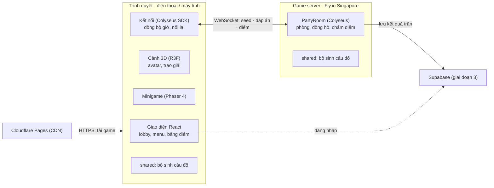
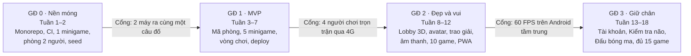

# Brain Rizz — Kế hoạch dự án minigame trí tuệ real-time

Cập nhật: 2026-10-09 · Bản gốc (có thể bình luận): Claude Docs "Brain Party – Kế hoạch dự án minigame trí tuệ real-time". "Brain Party" là tên tạm trong bản đầu; tên dự án hiện là **Brain Rizz**.

## Tóm tắt

**Brain Rizz** là web game gồm 15 minigame trí tuệ chia 5 nhóm kỹ năng, cho 2–8 người chơi cùng lúc qua mã phòng, chạy trên điện thoại, tablet và máy tính mà không cần cài đặt. Toàn bộ dự án viết bằng TypeScript, một người làm được, chi phí vận hành giai đoạn đầu từ 0 đến dưới 1 USD/tháng (tối đa khoảng 6 USD nếu server chạy 24/7).

Ý tưởng kỹ thuật then chốt: **không stream gameplay**. Server chỉ phát một *seed*; mọi máy tự sinh ra cùng một bộ câu đố và chỉ gửi đáp án lên. Nhờ vậy game nhẹ, mượt cả trên 4G, và server rẻ.

| Hạng mục | Lựa chọn | Lý do chính |
| --- | --- | --- |
| Ngôn ngữ | TypeScript (client, server, code dùng chung) | Một ngôn ngữ, chia sẻ type và logic sinh câu đố giữa client và server |
| Khung giao diện | Vite + React 19 + Tailwind | Lobby, menu, bảng điểm là UI web thuần, React làm nhanh nhất |
| Minigame 2D | [Phaser 4](https://phaser.io/download/phaser4) | Có sẵn scene, input cảm ứng, tween, âm thanh, scale theo màn hình |
| 3D (lobby, avatar, bục trao giải) | three.js + React Three Fiber v9 + drei | Ghép thẳng vào React, hệ sinh thái lớn |
| Real-time | [Colyseus 0.18](https://docs.colyseus.io/) | Server authoritative, room + matchmaking, đồng bộ state dạng delta, reconnect |
| Game server | Fly.io region Singapore (tự tắt khi không ai chơi) | Gần Việt Nam (ping thấp), chỉ trả tiền lúc đang chạy |
| Frontend | Cloudflare Pages (hoặc Vercel) | Miễn phí, CDN toàn cầu |
| Tài khoản & dữ liệu (giai đoạn 3) | Supabase gói Free | Auth + Postgres miễn phí, đủ cho nhóm bạn |
| Model & asset | Kenney, Quaternius, KayKit (CC0) + glTF-Transform | Miễn phí kể cả thương mại, phong cách low-poly đồng bộ |

## Phạm vi & giả định

- **Đồ họa:** minigame là 2D cho mượt; 3D chỉ dùng ở lobby, avatar và màn trao giải.
- **Số người:** tối đa 8 người/phòng, chơi với bạn bè qua mã phòng hoặc link mời, không cần matchmaking người lạ.
- **Thiết bị:** điện thoại, tablet, máy tính. Thiết kế ưu tiên màn hình dọc (portrait) vì đa số sẽ cầm điện thoại.
- **Đội ngũ:** 1 người, đã biết JS/TS. Lộ trình tính theo khoảng 15 giờ/tuần (giả định).
- **Ngân sách:** càng gần 0 càng tốt, chấp nhận vài USD/tháng cho server.
- **Ngôn ngữ giao diện:** tiếng Việt trước, chừa sẵn i18n cho tiếng Anh.
- **Bản quyền:** lấy cảm hứng từ cách chơi của Big Brain Academy, nhưng tên game, tên minigame, nhân vật và hình ảnh đều tự làm, không dùng tài sản của Nintendo.

## Thiết kế game

Game xoay quanh 5 nhóm kỹ năng giống tinh thần Big Brain Academy: Nhận diện, Ghi nhớ, Phân tích, Tính toán, Hình dung ([Nintendo](https://nintendo.com/my/switch/azls/index.html)). Bản gốc trên Switch có 20 minigame, mỗi nhóm 4 game ([Source Gaming](https://sourcegaming.info/2022/01/18/big-brain-academy-brain-vs-brain/)); dự án làm 15 game tự thiết kế (mỗi nhóm 3), 5 game trước cho bản MVP.

### Chế độ chơi

1. **Đấu nhóm (chế độ chính):** chủ phòng chọn 3–5 vòng. Mỗi vòng là một minigame, mọi người giải cùng một bộ câu đố trong 45–60 giây. Điểm của đối thủ chạy real-time trên màn hình. Kết thúc là màn trao giải 3D.
2. **Kiểm tra não (chơi một mình):** 5 game, mỗi nhóm một game, ra "Điểm Não" và biểu đồ 5 cạnh cho thấy điểm mạnh, điểm yếu.
3. **Đấu bóng ma (giai đoạn 3):** lưu lại lượt chơi của bạn; bạn bè vào đấu lại bất cứ lúc nào, không cần online cùng lúc.
4. **Luyện tập:** chơi tự do từng minigame, chọn độ khó.

### Độ khó riêng cho từng người

Mỗi người tự chọn mức Mầm, Thường, Khó hoặc Siêu khó. Mọi người vẫn dùng chung seed, nhưng bộ sinh câu đố nhận thêm tham số độ khó, và điểm được nhân hệ số (0,8 / 1 / 1,25 / 1,5). Nhờ vậy trẻ em và người lớn chơi chung vẫn cân bằng.

### Cách tính điểm

Đã cài đặt ở `packages/shared/src/scoring.ts`.

- Câu đúng: 100 × hệ số độ khó, cộng thưởng tốc độ tối đa 50 (trả lời trong 1,5 giây được trọn, sau 8 giây không còn).
- Chuỗi đúng liên tiếp (combo) từ câu thứ 3: thêm 10% mỗi câu.
- Câu sai: khóa thao tác 1,5 giây (chống bấm bừa), không trừ điểm, sang câu tiếp theo.
- Xếp hạng mỗi vòng quy ra điểm trận (10, 8, 6, 5, 4, 3, 2, 1); tổng điểm trận quyết định thứ hạng chung cuộc.

### Danh sách minigame

| Nhóm | Minigame | Cách chơi | Khó dần bằng cách | MVP | Trạng thái |
| --- | --- | --- | --- | --- | --- |
| Nhận diện | Kẻ lạc đàn | Lưới hình, chạm vào hình khác biệt | Lưới lớn hơn, khác biệt tinh tế hơn | Có | **Đã làm** |
| Nhận diện | Bóng của ai | Chọn bóng đen khớp với đồ vật | Thêm lựa chọn, bóng bị xoay | | |
| Nhận diện | Đập đúng hình | Hình nhô lên từ các lỗ, chỉ đập hình được yêu cầu | Nhanh hơn, thêm hình mồi nhử | | |
| Ghi nhớ | Theo dấu ánh đèn | Các ô sáng theo thứ tự, bấm lặp lại | Chuỗi dài hơn, bấm theo thứ tự ngược | Có | |
| Ghi nhớ | Ai vừa biến mất | Xem nhóm đồ vật 3 giây, một món biến mất | Nhiều đồ hơn, đồ đổi chỗ | | |
| Ghi nhớ | Lật cặp | Lật thẻ tìm cặp giống nhau | Nhiều thẻ hơn, thời gian ngắn hơn | | |
| Phân tích | Cân não | Nhìn các cân thăng bằng, chọn vật nặng nhất | Nhiều cân và nhiều vật hơn | Có | |
| Phân tích | Đếm khối | Đếm khối lập phương trong chồng, kể cả khối bị che | Chồng cao và rộng hơn | | |
| Phân tích | Bi rơi đâu | Bi lăn qua các ống rẽ nhánh, đoán lối ra | Nhiều nhánh, có công tắc đổi hướng | | |
| Tính toán | Bóng bay số | Bắn bóng theo thứ tự số tăng dần | Số âm, phép tính trên bóng | Có | |
| Tính toán | Chạm đích | Chọn các số cộng lại đúng số đích | Số lớn hơn, thêm phép trừ | | |
| Tính toán | Đếm tiền nhanh | Cộng tổng tờ tiền mệnh giá VNĐ | Nhiều tờ hơn, có tính tiền thối | | |
| Hình dung | Xoay hình | Hình nào là bản xoay (không phải bản lật gương) của hình mẫu | Hình phức tạp hơn, góc xoay lẻ | Có | |
| Hình dung | Nhìn từ trên | Chọn hình chiếu từ trên xuống của khối 3D | Khối nhiều tầng hơn | | |
| Hình dung | Gấp hộp | Hình trải phẳng nào gấp được thành khối đã cho | Mặt có họa tiết cần khớp | | |

Đặc tả chi tiết từng game: [docs/minigames/](minigames/).

## Kiến trúc tổng thể

Trình duyệt tải game một lần từ CDN, sau đó chỉ giữ một kết nối WebSocket tới game server ở Singapore. Supabase chỉ thêm vào ở giai đoạn 3, nên bản MVP chỉ có hai thành phần phải vận hành. Sơ đồ và luồng chi tiết: [02-architecture.md](02-architecture.md).

## Tech stack

Toàn bộ là TypeScript trong một monorepo, chia ba phần: web client, game server và gói `shared` chứa logic dùng chung.

### Client (trình duyệt)

| Thư viện | Vai trò | Ghi chú |
| --- | --- | --- |
| Vite 8 + React 19 + TypeScript | Khung ứng dụng, lobby, menu, bảng điểm | Code-splitting theo từng minigame |
| Tailwind CSS 4 | Giao diện responsive | Thiết kế mobile trước |
| Zustand | State phía client, cầu nối giữa React, Phaser và 3D | Nhẹ, không cần provider |
| [Phaser 4](https://phaser.io/download/stable) | Engine cho từng minigame | 4.0 ra ngày 10/4/2026 với renderer WebGL mới; nhánh 4.2.x ra tháng 7/2026 ([GameDev.net](https://gamedev.net/news/4825-phaser-v421-released/)) |
| three.js + React Three Fiber v9 + drei | Lobby 3D, avatar, bục trao giải | R3F v9 là bản tương thích React 19 ([R3F](https://r3f.docs.pmnd.rs/tutorials/v9-migration-guide)); dùng WebGLRenderer mặc định cho tương thích rộng |
| `@colyseus/sdk` | Kết nối phòng chơi | Tự nối lại khi rớt mạng |
| Howler.js (giai đoạn 2) | Nhạc nền, âm UI | Phaser tự lo âm thanh trong minigame |
| i18next (khi cần tiếng Anh) | Đa ngôn ngữ | Tiếng Việt trước |
| vite-plugin-pwa (giai đoạn 2) | Cài lên màn hình chính, cache asset | Lần chơi sau tải gần như tức thì |
| Font Be Vietnam Pro | Chữ hiển thị | Hỗ trợ đủ dấu tiếng Việt |

### Server

| Thành phần | Vai trò |
| --- | --- |
| Node.js 22 LTS | Runtime |
| [Colyseus 0.18](https://docs.colyseus.io/) | Room, matchmaking theo mã phòng, đồng bộ state nhị phân dạng delta, reconnect, kèm sẵn playground, bảng monitor và công cụ load test |
| zod 4 | Kiểm tra dữ liệu client gửi lên |
| tsdown | Đóng gói server (gộp luôn gói shared) thành một file |
| Supabase (giai đoạn 3) | Đăng nhập (khách, Google), lưu hồ sơ, lịch sử điểm |

### Công cụ

pnpm workspaces + Turborepo, TypeScript 7, Vitest 5 (unit test), Playwright (test nhiều trình duyệt cùng lúc), Biome 2 (lint + format), GitHub Actions để build và kiểm tra.

### Các phương án đã cân nhắc

| Phương án | Ưu | Nhược | Kết luận |
| --- | --- | --- | --- |
| PixiJS v8 thay Phaser | Nhẹ hơn, render 2D rất nhanh, tự chọn WebGL/WebGPU ([issoh](https://www.issoh.co.jp/tech/details/9180/)) | Phải tự làm scene, input, tween, âm thanh | Dự phòng nếu bundle Phaser quá nặng |
| Minigame bằng React DOM/SVG | Đơn giản nhất | Animation nhiều vật thể kém mượt trên máy yếu | Chỉ hợp game rất tĩnh |
| Supabase Realtime thay game server | Không phải vận hành server, gói Free | Chỉ là kênh chuyển tin, không có trọng tài, đồng hồ, giữ chỗ khi rớt mạng | Xem [ADR 0002](adr/0002-game-server-colyseus-vs-supabase-realtime.md) |
| PartyServer trên Cloudflare Durable Objects | Có trên gói Free, chạy ở edge ([Cloudflare](https://developers.cloudflare.com/durable-objects/platform/pricing)) | Tự viết đồng bộ state và luồng phòng; không chạy được Colyseus | Phương án 0 đồng nếu cần |
| Socket.IO | Quen thuộc | Tự làm state, reconnect, đồng bộ delta | Không chọn |
| Colyseus Cloud | Không phải tự vận hành, từ 15 USD/tháng ([Colyseus](https://www.colyseus.io/pricing)) | Đắt hơn tự host | Khi muốn bớt việc DevOps |

## Thiết kế real-time & netcode

Minigame trí tuệ không cần đồng bộ vật lý từng khung hình, nên chọn mô hình "server làm trọng tài, client tự chơi": server giữ phòng, phát seed, giữ đồng hồ và chấm điểm; client tự sinh câu đố, hiển thị đúng/sai ngay lập tức rồi chờ server xác nhận. Người chơi gần như không cảm thấy độ trễ. Chi tiết luồng và tin nhắn: [02-architecture.md](02-architecture.md).

- **Đồng bộ thời gian:** client ping server 5 lần, lấy lần có RTT nhỏ nhất để tính độ lệch đồng hồ; mọi đồng hồ đếm ngược chạy theo giờ server. Server vẫn là nơi quyết định hết giờ.
- **Seed:** dùng PRNG có seed (mulberry32), tuyệt đối không dùng `Math.random()` trong logic câu đố; mỗi game có hàm thuần `generate(seed, index, difficulty)`.
- **Mất kết nối trên điện thoại:** server giữ chỗ 45 giây; client lưu token trong `sessionStorage` và tự nối lại; tiến độ câu đố nằm trên server.
- **Chống gian lận (mức vừa đủ cho bạn bè):** chỉ server tính điểm; giới hạn 10 đáp án/giây; bỏ đáp án ngoài khung giờ. Hạn chế đã biết: client biết seed nên người rành code có thể tự giải.
- **Mã phòng:** 4 ký tự, bỏ ký tự dễ nhầm (0/O, 1/I/L). Link dạng `/r/ABCD`; điện thoại dùng Web Share API để gửi qua Zalo/Messenger.

## Đồ họa: 2D, 3D và asset

Phong cách: low-poly màu pastel cho 3D, phẳng (flat) cho 2D, mỗi nhóm kỹ năng một màu chủ đạo, cùng một linh vật "giáo sư" tự thiết kế. Chi tiết nguồn, giấy phép và pipeline: [05-assets-guide.md](05-assets-guide.md).

- **3D dùng ở:** sân khấu lobby (avatar đứng thành hàng, ai sẵn sàng thì nhún nhảy), tùy biến avatar (màu, mũ, kính), bục trao giải 3 bậc.
- **Minigame hình khối** (Đếm khối, Nhìn từ trên, Gấp hộp) **không cần engine 3D**: vẽ khối isometric 2D trong Phaser.
- **Lưu ý:** Ready Player Me đã đóng cửa ngày 31/1/2026 sau khi Netflix mua lại ([Avatar SDK](https://avatarsdk.com/blog/2026/08/31/avatar-platforms-2026-whos-alive-whos-gone/)). Hệ avatar tự dựng từ bộ phận ghép, không phụ thuộc dịch vụ ngoài.

## Hiệu năng & trải nghiệm đa thiết bị

Quy tắc quan trọng nhất: **mỗi lúc chỉ có một canvas WebGL đang chạy**. Vào minigame thì gỡ hẳn cảnh 3D; về lobby thì hủy game Phaser.

- Màn hình đầu hiện trong 2 giây trên 4G; gói JS ban đầu dưới khoảng 300 KB gzip (hiện tại: khoảng 150 KB). Phaser, three.js và từng minigame là chunk riêng.
- Giới hạn devicePixelRatio tối đa 2; dừng render khi tab ẩn.
- Minigame thiết kế ở khung dọc 720×1280, scale `FIT`; vùng chạm tối thiểu 48×48 px; tôn trọng `safe-area-inset`.
- iOS Safari chỉ phát âm thanh sau lần chạm đầu; dùng Wake Lock API để màn hình không tắt khi chơi; chặn kéo-để-tải-lại và zoom chạm đôi.

## Hosting, triển khai & chi phí

Tóm tắt (chi tiết và các phương án miễn phí: [04-deployment.md](04-deployment.md), lý do cần game server: [ADR 0002](adr/0002-game-server-colyseus-vs-supabase-realtime.md)):

| Thành phần | Dịch vụ | Chi phí ước tính |
| --- | --- | --- |
| Web client | Cloudflare Pages | 0 USD |
| Game server | Fly.io `sin`, shared-cpu-1x 512 MB, tự tắt khi không ai chơi | Dưới 1 USD/tháng nếu chơi vài chục giờ; tối đa khoảng 4,7 USD nếu chạy 24/7 |
| Tài khoản & lịch sử điểm (giai đoạn 3) | Supabase Free | 0 USD |
| Tên miền | Tùy chọn | Khoảng 1 USD/tháng |

## Lộ trình

Checklist chi tiết từng việc: [06-roadmap.md](06-roadmap.md).

## Test & vận hành

- **Unit test (Vitest):** mỗi bộ sinh chạy 10.000 seed, kiểm tra tính tất định, có đúng một đáp án và độ khó tăng dần.
- **Test phòng chơi:** `@colyseus/testing` chạy server thật trong test (xem `apps/server/test/`).
- **Test nhiều người (Playwright):** mở 4–8 trình duyệt, cả giả lập điện thoại, cùng vào một phòng, chơi hết một trận tự động.
- **Mạng xấu:** giả lập 3G chậm và ngắt mạng giữa trận để thử reconnect.
- **Tải:** `pnpm --filter @brain-rizz/server loadtest`.
- **Thiết bị thật:** ít nhất một iPhone (Safari), một Android tầm trung và một máy tính.
- **Theo dõi:** `/monitor` của Colyseus, Sentry gói miễn phí bắt lỗi JavaScript.

## Rủi ro & cách xử lý

| Rủi ro | Ảnh hưởng | Cách xử lý |
| --- | --- | --- |
| Ôm quá nhiều việc (15 game, 3D, tài khoản) | Dự án bỏ dở giữa chừng | Ra MVP 5 game trước, chơi với bạn bè rồi mới mở rộng |
| Điện thoại mất kết nối khi chuyển app | Rớt khỏi trận, mất điểm | Reconnect 45 giây, tiến độ lưu trên server |
| Chạy cả Phaser lẫn three.js cùng lúc | Giật, nóng máy, crash trên iOS | Mỗi lúc một canvas; hủy engine không dùng |
| Bộ sinh câu đố cho kết quả khác nhau giữa máy | Chấm sai điểm | Chỉ dùng số nguyên + PRNG có seed; test chéo trình duyệt và Node |
| Âm thanh không phát trên iOS | Trải nghiệm kém | Mở khóa audio ở lần chạm đầu |
| Thư viện đổi API (Phaser 4, Colyseus 0.18, TypeScript 7 đều mới) | Code mẫu trên mạng lỗi thời | Khóa phiên bản qua `pnpm-lock.yaml`, đọc migration guide trước khi nâng cấp |
| Giá hosting thay đổi | Chi phí tăng | Server đóng gói Docker, không phụ thuộc nhà cung cấp; có phương án miễn phí |
| Trùng tài sản trí tuệ của Nintendo | Bị gỡ nếu công khai | Tên, hình, nhân vật tự làm; chỉ giữ ý tưởng thể loại |
| Supabase tạm dừng khi ít người chơi | Không đăng nhập được | Chỉ thêm ở giai đoạn 3; chế độ khách vẫn chơi được khi DB ngủ |

## Câu hỏi mở

- [ ] Bạn dành được bao nhiêu giờ mỗi tuần? (Lộ trình đang giả định khoảng 15 giờ.)
- [ ] Giai đoạn đầu chỉ cần chế độ khách (nhập tên là chơi), hay cần đăng nhập ngay?
- [ ] Có muốn chat thoại trong game không, hay cả nhóm đã dùng Discord/Zalo?
- [ ] Chỉ tiếng Việt, hay cần song ngữ Việt–Anh từ đầu?
- [ ] Có định công khai cho người lạ chơi, hay chỉ trong nhóm bạn? (Ảnh hưởng tới chống gian lận và chi phí.)
- [ ] Giữ màn hình dọc hay chuyển sang ngang?
- [ ] Phong cách màu sắc mong muốn?

## Nguồn

- [Colyseus – tài liệu chính thức (v0.18)](https://docs.colyseus.io/)
- [Colyseus – bảng giá](https://www.colyseus.io/pricing)
- [Phaser 4 – lịch sử phát hành](https://phaser.io/download/phaser4)
- [GameDev.net – Phaser v4.2.1](https://gamedev.net/news/4825-phaser-v421-released/)
- [React Three Fiber – v9 migration guide](https://r3f.docs.pmnd.rs/tutorials/v9-migration-guide)
- [three.js – WebGPURenderer](https://threejs.org/manual/en/webgpurenderer)
- [Cloudflare – Durable Objects pricing](https://developers.cloudflare.com/durable-objects/platform/pricing)
- [Fly.io – pricing](https://fly.io/pricing.md)
- [Temps – Fly.io pricing 2026](https://temps.sh/blog/fly-io-pricing-2026)
- [Supabase – Realtime limits](https://supabase.com/docs/guides/realtime/limits)
- [Automation Atlas – Supabase free tier 2026](https://automationatlas.io/answers/supabase-free-tier-limits-2026/)
- [Render – Deploy for Free](https://render.com/docs/free)
- [Cinevva – nhân vật 3D miễn phí](https://app.cinevva.com/de/guides/free-rigged-3d-character-models)
- [Cinevva – tối ưu GLB cho web](https://app.cinevva.com/guides/optimize-glb-for-web)
- [Avatar SDK – nền tảng avatar 2026](https://avatarsdk.com/blog/2026/08/31/avatar-platforms-2026-whos-alive-whos-gone/)
- [Nintendo – Big Brain Academy: Brain vs. Brain](https://nintendo.com/my/switch/azls/index.html)
- [Source Gaming – review Brain vs. Brain](https://sourcegaming.info/2022/01/18/big-brain-academy-brain-vs-brain/)
- [issoh – PixiJS v8](https://www.issoh.co.jp/tech/details/9180/)
