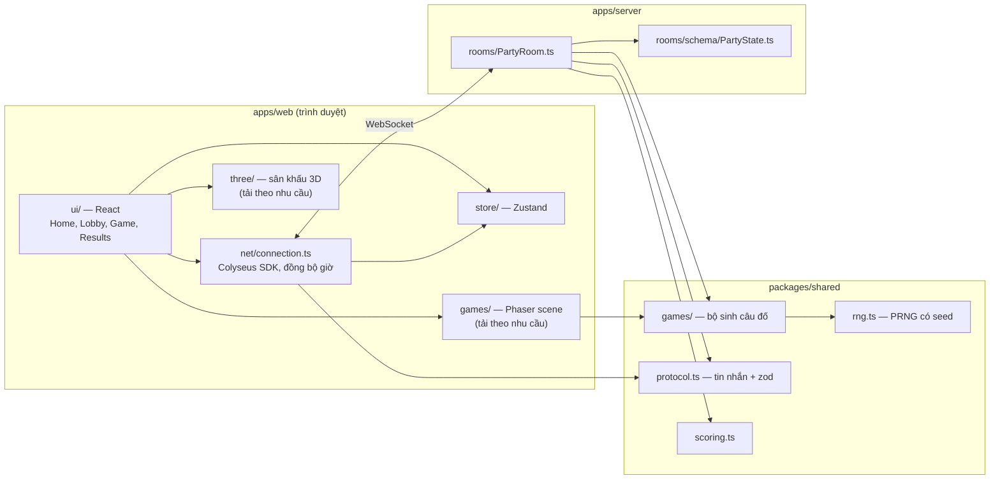
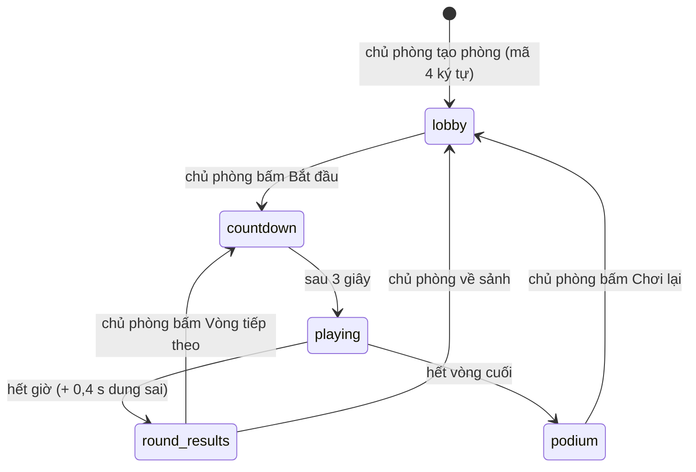
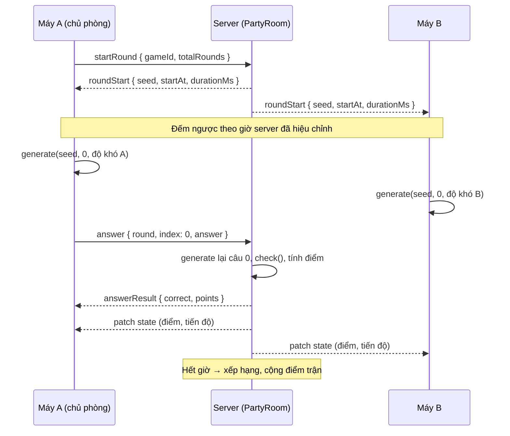

# Kiến trúc

Server làm trọng tài, client tự chơi: server phát **seed**, giữ **đồng hồ** và **chấm điểm**; mỗi máy tự sinh câu đố từ seed bằng cùng một đoạn code (`packages/shared`) và chỉ gửi đáp án lên.

## Thành phần

Quy tắc phụ thuộc: `web` và `server` được import `shared`; `shared` không import gì từ hai app. Scene Phaser không biết mạng là gì — nó chỉ nhận `MinigameBridge` (seed, độ khó, hàm `submit`).

## Vòng đời một phòng

`phase` trong state đồng bộ tương ứng với các trạng thái trên (`round-results` viết bằng gạch ngang).

## Một vòng chơi, từng tin nhắn

## Giao thức tin nhắn

Định nghĩa trong `packages/shared/src/protocol.ts`. Mọi tin client → server được validate bằng zod.

| Chiều | Tin nhắn | Nội dung | Ai được gửi, khi nào |
| --- | --- | --- | --- |
| C → S | join options | `name`, `colorIndex`, `difficulty` | Khi tạo/vào phòng, chỉ ở pha `lobby` |
| C → S | `ready` | `{ ready }` | Ở `lobby` |
| C → S | `setProfile` | tên, màu, độ khó (tuỳ chọn) | Ở `lobby` |
| C → S | `startRound` | `{ gameId, totalRounds? }` | Chủ phòng, ở `lobby` hoặc `round-results` |
| C → S | `answer` | `{ round, index, answer }` | Ở `playing`; `index` phải đúng câu đang làm |
| C → S | `backToLobby` | — | Chủ phòng, ở `podium` hoặc `round-results` |
| C → S | `ping` | `{ clientTime }` | Bất cứ lúc nào (đồng bộ giờ) |
| S → C | patch state | `PartyStateView` (tự động, delta nhị phân) | Liên tục khi state đổi |
| S → C | `roundStart` | `{ round, gameId, seed, startAt, durationMs }` | Đầu mỗi vòng |
| S → C | `answerResult` | `{ index, correct, points, lockedUntil? }` | Chỉ gửi người vừa trả lời |
| S → C | `pong` | `{ clientTime, serverTime }` | Trả lời `ping` |
| S → C | `error` | `{ code, message }` | Khi tin nhắn bị từ chối |

## State đồng bộ

`apps/server/src/rooms/schema/PartyState.ts` (Colyseus schema) — hình dạng khớp `PartyStateView` trong shared:

- Phòng: `code`, `phase`, `hostId`, `gameId`, `round`, `totalRounds`, `seed`, `startAt`, `endsAt`.
- Người chơi (`players: Map<sessionId, Player>`): `name`, `colorIndex`, `difficulty`, `ready`, `connected`, `isHost`, `matchPoints`, `roundScore`, `progress`, `streak`.

Thông tin chỉ server cần (giờ hiện câu của từng người, thời điểm hết khoá, bộ đếm chống spam) giữ trong `Map` riêng của `PartyRoom`, không đồng bộ xuống client.

## Đồng bộ giờ

Client gửi 5 `ping` cách nhau 150 ms khi vào phòng (và 3 lần mỗi khi tab hiện lại), lấy mẫu có RTT nhỏ nhất: `offset = serverTime − (t0 + RTT/2)`. Đồng hồ trên màn hình dùng `Date.now() + offset`. Server vẫn là nơi quyết định hết giờ.

## Mất kết nối

1. Mạng rớt → server gọi `onDrop`, đánh dấu `connected = false`, giữ chỗ 45 giây (`allowReconnection`).
2. SDK tự nối lại; nếu người chơi tải lại trang, `resumeParty()` dùng token trong `sessionStorage`.
3. Quá 45 giây → `onLeave`, xoá người chơi; nếu là chủ phòng thì chuyển quyền cho người kế tiếp.

## Thêm tính năng ở đâu

| Muốn làm | Sửa ở |
| --- | --- |
| Minigame mới | `packages/shared/src/games/` + `apps/web/src/games/` (xem [hướng dẫn](03-development-guide.md#thêm-một-minigame)) |
| Luật chơi, tính điểm | `packages/shared/src/scoring.ts`, `constants.ts` |
| Tin nhắn mới | `packages/shared/src/protocol.ts` → handler trong `PartyRoom.messages` → gọi từ `apps/web/src/net/connection.ts` |
| Màn hình mới | `apps/web/src/ui/screens/` + rẽ nhánh trong `App.tsx` |
| Cảnh 3D | `apps/web/src/three/` (luôn `lazy()` import) |
