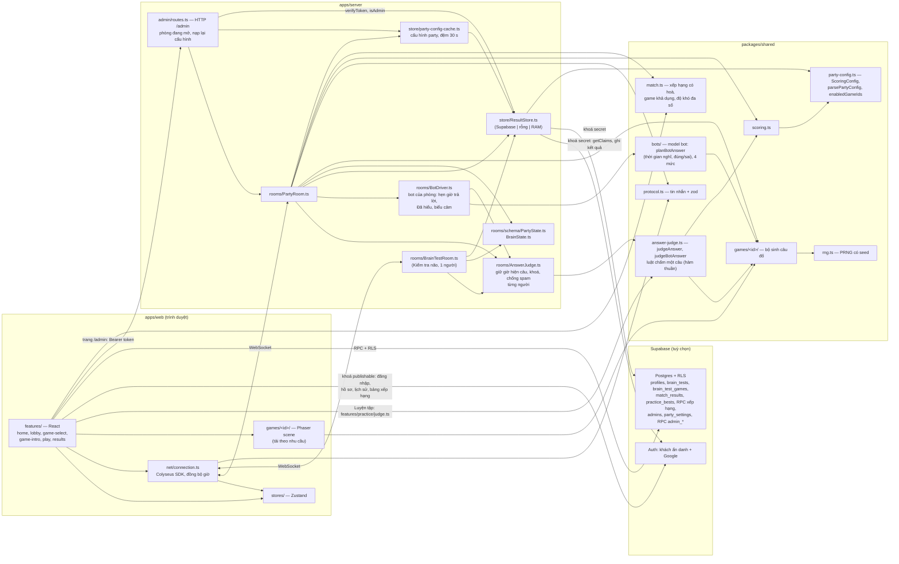
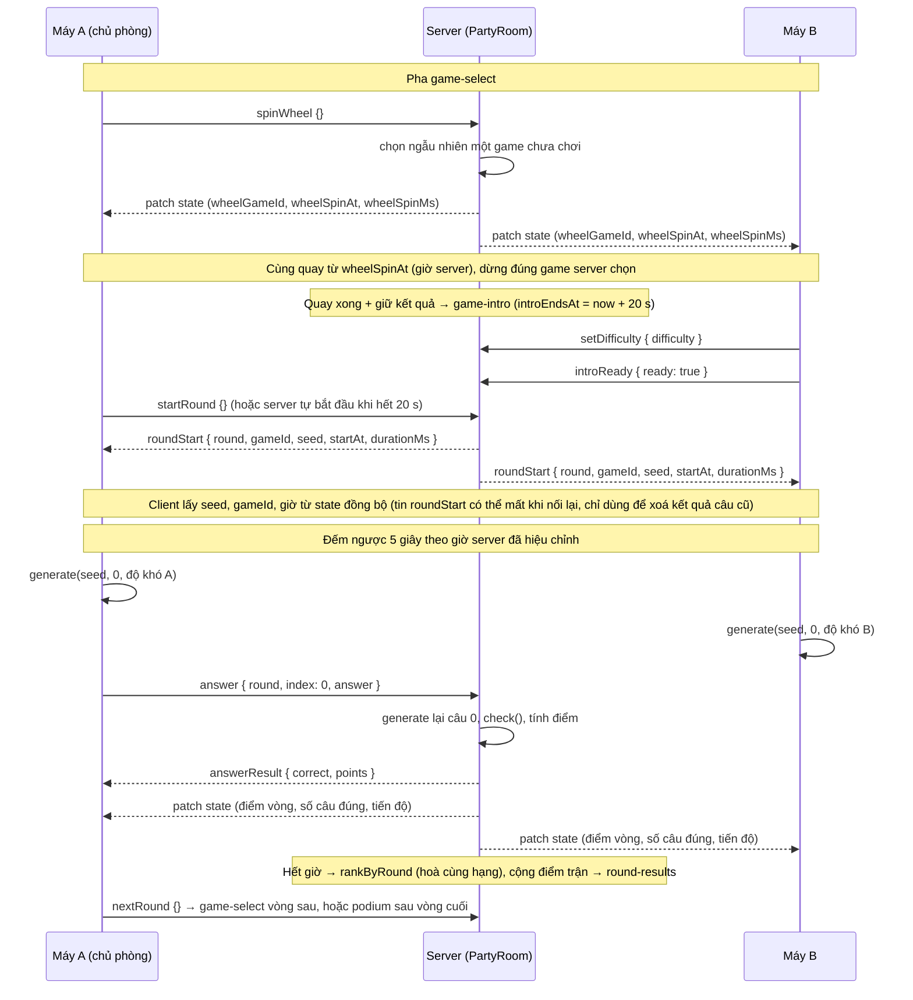
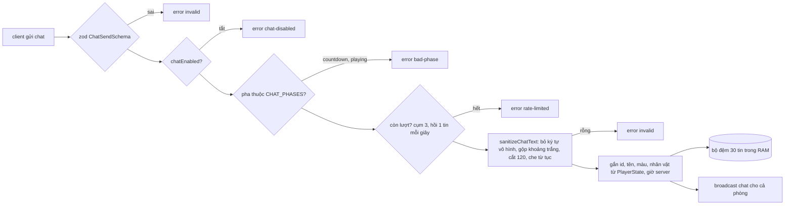
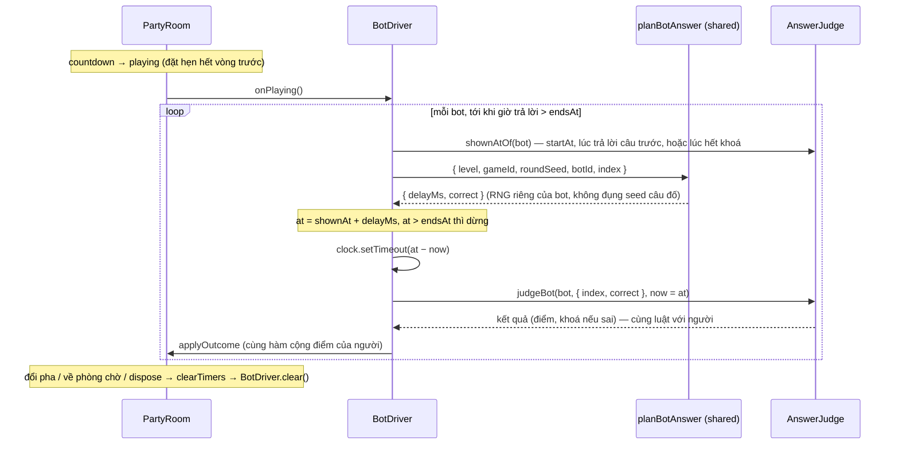
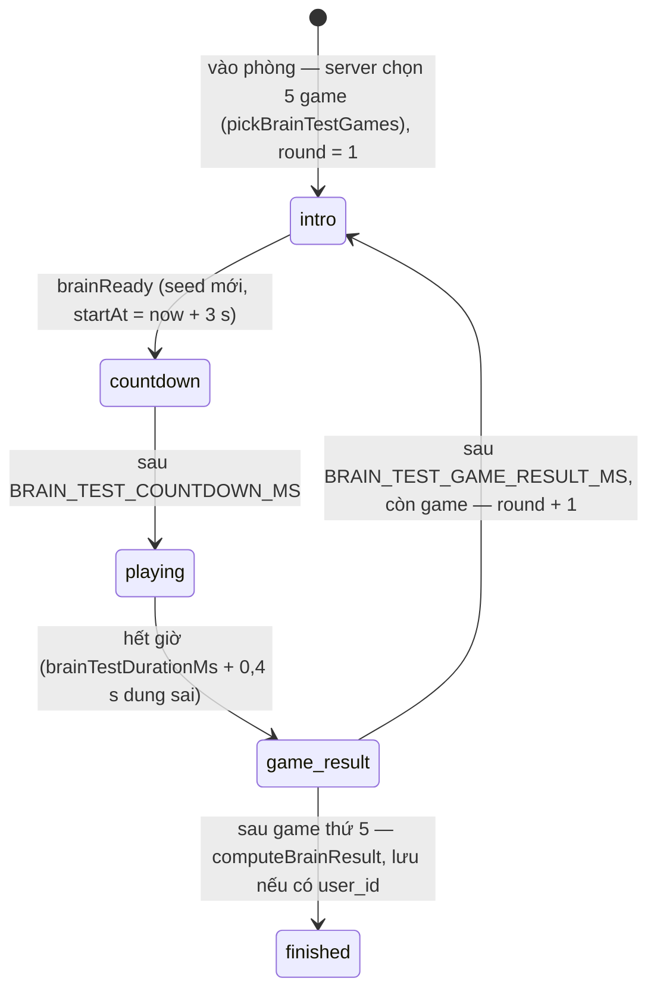

# Kiến trúc

Server làm trọng tài, client tự chơi: server phát **seed**, giữ **đồng hồ** và **chấm điểm**; mỗi máy tự sinh câu đố từ seed bằng cùng một đoạn code (`packages/shared`) và chỉ gửi đáp án lên.

Tài khoản, lịch sử điểm và bảng xếp hạng nằm trên **Supabase** (Auth + Postgres, [ADR 0011](decisions/0011-supabase-accounts-and-solo-modes.md)). Điểm được xếp hạng (Kiểm tra não, kết quả trận party) chỉ do **game server** ghi bằng khoá secret; client chỉ ghi hồ sơ của mình và kỷ lục luyện tập. Thiếu Supabase thì mọi chế độ vẫn chơi được, chỉ không lưu.

## Thành phần

Quy tắc phụ thuộc: `web` và `server` được import `shared`; `shared` không import gì từ hai app. Phòng chơi không gọi Supabase trực tiếp mà qua `ResultStore` (`verifyToken`, `saveBrainTest`, `saveMatchResults`, `loadPartyConfig`, `isAdmin`): bản thật dùng `SUPABASE_URL` + `SUPABASE_SECRET_KEY`, thiếu biến thì là bản rỗng (log một lần), test dùng bản trong RAM (không gọi mạng). Scene Phaser không biết mạng là gì — nó chỉ nhận `MinigameBridge` (seed, độ khó, hàm `submit`, và `unlockDelay` để biết khi nào server hết khoá sau câu sai).

## Vòng đời một phòng

Luồng trận theo [CR-005](../00-tracking/change-requests.md#cr-005) (UC-05 → UC-09, UC-20, UC-21 trong [SRS](../01-product/srs.md)):

```mermaid
stateDiagram-v2
  [*] --> lobby: chủ phòng tạo phòng (mã 4 ký tự)
  lobby --> game_select: startMatch (≥ 2 ghế kể cả bot, tất cả sẵn sàng) — vòng 1
  game_select --> game_intro: pickGame, hoặc spinWheel rồi chờ quay xong (0,3 + 4 + 1,5 s)
  game_intro --> countdown: startRound (mọi người thật đã hiểu) hoặc tự động sau 20 s
  countdown --> playing: sau 5 giây
  playing --> round_results: hết giờ (+ 0,4 s dung sai), kể cả vòng cuối
  round_results --> game_select: nextRound (còn vòng) — round + 1
  round_results --> podium: nextRound (vòng cuối)
  podium --> game_select: playAgain (≥ 2 người; giữ người + số vòng, xoá điểm)
  podium --> lobby: backToLobby
  round_results --> lobby: backToLobby
```

`phase` trong state đồng bộ tương ứng với các trạng thái trên, viết bằng gạch ngang: `game-select`, `game-intro`, `round-results`.

**Hẹn giờ của phòng** (đều chạy trên `this.clock` của room, giờ server quyết định):

| Pha | Hẹn giờ | Khi hết giờ |
| --- | --- | --- |
| `game-select` (sau `spinWheel`) | `WHEEL_SPIN_LEAD_MS + WHEEL_SPIN_MS + WHEEL_RESULT_HOLD_MS` | Vào `game-intro` với game vòng quay đã chọn |
| `game-intro` | `INTRO_AUTO_START_MS` (20 s) | Bắt đầu vòng, dù chưa ai bấm "Đã hiểu" |
| `countdown` | `COUNTDOWN_MS` (5 s) | Sang `playing`, hẹn tiếp giờ hết vòng |
| `playing` | `durationMs` của game + `LATE_ANSWER_GRACE_MS` | Xếp hạng, cộng điểm trận, sang `round-results` |
| `game-intro` (mỗi bot) | ngẫu nhiên trong `BOT_INTRO_READY_MS` (1–3 s) | Bot `introReady = true` |
| `playing` (mỗi bot, mỗi câu) | giờ hiện câu + `delayMs` của model − giờ hiện tại | Chấm câu của bot, hẹn câu kế (xem [Bot](#bot-chơi-cùng-cr-016)) |
| `round-results`, `podium` (mỗi bot, xác suất `BOT_CHAT_CHANCE`) | ngẫu nhiên trong `BOT_CHAT_DELAY_MS` (0,8–3 s) | Bot gửi một biểu cảm qua `ChatRelay` |

Mỗi lần đổi pha, `PartyRoom` huỷ hết hẹn giờ của pha cũ, kể cả hẹn giờ của bot (`clearTimers` gọi `BotDriver.clear()`); callback nào cũng kiểm tra lại pha trước khi chạy. Chủ phòng rời giữa chừng thì quyền chuyển cho người thật kế tiếp và hẹn giờ vẫn chạy, nên phòng không bị kẹt.

## Một vòng chơi, từng tin nhắn

**Chấm một câu** (`judgeAnswer` trong `packages/shared/src/answer-judge.ts`: hàm thuần, nhận `now`, không đọc đồng hồ. Server bọc trong `apps/server/src/rooms/AnswerJudge.ts` cho `PartyRoom` và `BrainTestRoom`; Luyện tập trên web gọi thẳng qua `features/practice/judge.ts`, nên ba chế độ cùng một luật. Công thức điểm ở `packages/shared/src/scoring.ts`):

1. Bỏ qua nếu sai pha, sai vòng, `index` khác câu đang làm, quá `endsAt + LATE_ANSWER_GRACE_MS`, đang bị khoá, gửi quá `MAX_ANSWERS_PER_SECOND` (đáp án sai kiểu cũng bị đếm), hoặc đáp án sai kiểu (`isAnswer`).
2. Server sinh lại câu bằng `generate(seed, index, độ khó)` rồi `check()`. Sai (kể cả đáp án tới sau **hạn trả lời** của game, xem dưới) thì điểm 0, chuỗi về 0 và bị khoá `WRONG_ANSWER_LOCK_MS`.
3. Đúng thì tính `pointsForCorrect`: điểm = (`BASE_POINTS` × hệ số độ khó + thưởng tốc độ) × hệ số combo, làm tròn.
   - **Hệ số độ khó** = `gameMultiplier(game, độ khó)`: lấy `difficultyMultiplier` game khai báo; game không khai báo, hoặc khai báo số không dương / không hữu hạn, thì dùng `DIFFICULTY_MULTIPLIER` chung (CR-006).
   - **Thưởng tốc độ** (0–`MAX_SPEED_BONUS`) tính trên `max(0, thời gian trả lời − miễn trừ)`: trọn thưởng khi ≤ `FAST_ANSWER_MS`, hết khi ≥ `SLOW_ANSWER_MS`. Thời gian trả lời đo bằng giờ server, từ lúc câu hiện (hoặc lúc hết khoá) tới lúc nhận đáp án. Miễn trừ = `gameSpeedAllowanceMs(game, puzzle, độ khó)`: gọi `speedAllowanceMs` của game trên chính câu server vừa sinh lại, kẹp về số hữu hạn ≥ 0 (thiếu hoặc sai thì 0).
   - **Combo** = `comboMultiplier(streak)`: từ câu đúng liên tiếp thứ `STREAK_THRESHOLD` cộng `STREAK_BONUS_PER_STEP` mỗi câu, trần `MAX_COMBO_MULTIPLIER` (× 1,5).

Game không khai báo hai trường CR-006 (như Kẻ lạc đàn) được chấm như trước, chỉ thêm trần combo.

**Câu của bot** (`judgeBotAnswer`, CR-016): bỏ bước 1 phần chống spam và `isAnswer`, bỏ `check()` ở bước 2 (đúng/sai do model bot bốc trước). Từ đó trở đi (giờ hiện câu, hạn trả lời, điểm, combo, khoá khi sai) là **cùng một hàm nội bộ** với `judgeAnswer`, nên cùng thời gian và cùng đúng/sai thì bot được đúng số điểm của người.

**Hạn trả lời** (`answerWindowMs`, [CR-012](../00-tracking/change-requests.md#cr-012)): cho game có vật biến mất, như bia Luyện ngắm, và sau này Đập đúng hình.

- **Khai báo:** hook tuỳ chọn `answerWindowMs?(puzzle, difficulty)` trong `MinigameDef` (`packages/shared/src/games/types.ts`), tính trên câu server tự sinh lại. `gameAnswerWindowMs` kẹp kết quả: `undefined`, không hữu hạn hoặc ≤ 0 đều coi là **không giới hạn**. Game không khai báo hook chấm như trước.
- **Luật:** `judgeAnswer` chấm **sai như bỏ lỡ**, dù `check()` đúng, khi `now − shownAt > hạn + LATE_ANSWER_GRACE_MS` (400 ms). Phép so là `>`, nên đáp án tới đúng mốc `hạn + 400 ms` vẫn được chấm bình thường. `shownAt` là giờ server lúc nhận đáp án câu trước, hoặc lúc hết khoá nếu câu trước sai; câu 0 lấy `startAt`. Kiểm `endsAt + LATE_ANSWER_GRACE_MS` vẫn chạy trước: quá hết vòng thì bỏ qua hẳn, không chấm sai.
- **Phạm vi:** `judgeAnswer` dùng chung nên party, Kiểm tra não và Luyện tập cùng áp dụng. Không đổi tin nhắn hay schema; client tự gửi đáp án "bỏ lỡ" khi hết hạn (Luyện ngắm: `AIM_TRAINER_MISS`).
- **Nối lại:** `PartyRoom` và `BrainTestRoom` gọi `AnswerJudge.resume()` trong `onReconnect`. Với game có hạn, câu đang làm được tính là hiện lại từ `max(lúc nối lại, lúc hết khoá, startAt)`, vì lúc rớt mạng người chơi không thấy vật. Game không có hạn giữ giờ cũ, để thời gian rớt mạng vẫn tính vào thưởng tốc độ. Phía client, scene có hạn dừng đồng hồ hạn khi mất kết nối (`bridge.watchConnection` báo `paused`); nối lại thì chờ state đầy đủ của server về (tối đa 1,5 s) rồi mới hiện câu theo `progress` server (`resumed`, `features/play/connection-sync.ts`; mẫu Luyện ngắm). Phòng đóng hẳn thì không báo `resumed`.
- **Hạn chế đã biết:**
  - `shownAt` theo giờ server nên lệch với lúc vật hiện trên máy bằng độ trễ hai chiều. Mạng chập chờn hoặc Phaser khởi động chậm (câu 0 tính từ `startAt`) có thể làm một cú trúng hợp lệ bị chấm muộn. Scene phải nghe `bridge.answerOutcome()` để quay về đúng câu server đang chờ (Luyện ngắm: `watchHit`).
  - Cố ý rớt mạng rồi nối lại sẽ được làm mới hạn của câu đang dở. Chấp nhận vì lợi rất nhỏ, mỗi lần chỉ một câu.
  - Client biết seed nên bot vẫn giải được (NFR-SEC-02). Hạn trả lời chỉ chặn đáp án muộn, không chặn bot.

**Xếp hạng** (`packages/shared/src/match.ts`, server và web dùng chung):

- Trong vòng (`rankByRound`): hạng của một người = số người có `roundScore` lớn hơn hẳn → hoà điểm thì cùng hạng và cùng điểm trận; hạng kế tiếp bị bỏ qua. Điểm trận co giãn theo số ghế lúc hết vòng ([CR-018](../00-tracking/change-requests.md#cr-018)): `placementPoints(hạng, số ghế, thưởng top)` = `max(1, số ghế − hạng) + thưởng top[hạng]`, thưởng top lấy từ cấu hình của trận (mặc định 3/2/1). 12 người: 15, 13, 11, 9, 8 … 1; 4 người hoà nhất hai người: 7, 7, 3, 1.
- Chung cuộc (`rankByMatch`): `matchPoints` giảm dần; hoà thì `totalScore` (tổng điểm vòng cả trận) cao hơn xếp trên; hoà cả hai thì cùng hạng.
- Hạng tính từ 0 (0 = nhất).

## Giao thức tin nhắn

Định nghĩa trong `packages/shared/src/protocol.ts`. Mọi tin client → server được validate bằng zod.

| Chiều | Tin nhắn | Nội dung | Ai được gửi, khi nào |
| --- | --- | --- | --- |
| C → S | join options | `name`, `colorIndex`, `difficulty`, `avatar` (mặc định `khoi`), `accessToken?` (JWT Supabase, ≤ 4 096 ký tự; sai kiểu/quá dài thì bị bỏ) | Khi tạo/vào phòng, chỉ ở pha `lobby` |
| C → S | create options | thêm `bots?: { count, level }` (`count` 1 – `MAX_PLAYERS − 1` = 11, `level` 0–3; `CreateOptionsSchema`, sai thì bỏ như không gửi) | Chỉ khi tạo phòng ("Chơi với máy"); server đọc ở `onCreate`, `onJoin` không đọc. Bot được thêm ngay sau khi người tạo vào phòng (người tạo giữ màu + nhân vật, bot tránh cả hai) |
| C → S | `ready` | `{ ready }` | Mọi người, ở `lobby` |
| C → S | `setProfile` | tên, màu, độ khó, nhân vật (tuỳ chọn; trường không gửi giữ nguyên) | Mọi người, ở `lobby`; không làm mất trạng thái sẵn sàng |
| C → S | `setRounds` | `{ totalRounds }` (1–10) | Chủ phòng, ở `lobby` |
| C → S | `startMatch` | `{}` | Chủ phòng, ở `lobby`; cần ≥ `MIN_PLAYERS_TO_START` (2) người và tất cả (kể cả chủ phòng) `ready`, nếu không → `not-ready` |
| C → S | `setPickMode` | `{ mode: "wheel" \| "pick" }` | Chủ phòng, ở `game-select`, khi vòng quay chưa quay |
| C → S | `voteGame` | `{ gameId \| null }` | Người không phải chủ phòng, ở `game-select`; 1 phiếu/người, gửi lại là thay, `null` là bỏ; game phải chưa chơi trong trận và không bị quản trị viên tắt (`invalid`) |
| C → S | `spinWheel` | `{}` | Chủ phòng, ở `game-select`, mỗi vòng một lần; server chọn kết quả và đặt `pickMode = "wheel"` |
| C → S | `pickGame` | `{ gameId }` | Chủ phòng, ở `game-select`; game chưa chơi, không bị tắt (`disabledGames`, nếu không → `invalid`), vòng quay không đang quay |
| C → S | `setDifficulty` | `{ difficulty }` (0–3) | Mọi người, ở `game-intro` (và `lobby`) |
| C → S | `introReady` | `{ ready }` | Mọi người, ở `game-intro` ("Đã hiểu") |
| C → S | `nudgeDifficulty` | `{ playerId }` | Chủ phòng, ở `game-intro`; nhắc người khác chủ phòng, không nhắc được bot (`invalid`); tối đa 1 lần / 10 s / người (`rate-limited`); độ khó đa số chỉ tính người thật, các mức hoà nhau thì từ chối (`invalid`) |
| C → S | `startRound` | `{}` | Chủ phòng, ở `game-intro`, khi mọi người thật khác đã `introReady` (nếu không → `not-ready`); không chờ bot |
| C → S | `answer` | `{ round, index, answer }` | Ở `playing`; `index` phải đúng câu đang làm |
| C → S | `nextRound` | `{}` | Chủ phòng, ở `round-results`: còn vòng → `game-select`, hết vòng → `podium` |
| C → S | `playAgain` | `{}` | Chủ phòng, ở `podium`; cần ≥ `MIN_PLAYERS_TO_START` (2) người còn trong phòng, nếu không → `not-ready` (chỉ còn cách `backToLobby`). Giữ người + số vòng, xoá điểm, vòng 1, `game-select` |
| C → S | `backToLobby` | `{}` | Chủ phòng, ở `podium` hoặc `round-results`: xoá điểm, sẵn sàng, game đã chơi |
| C → S | `ping` | `{ clientTime }` | Bất cứ lúc nào (đồng bộ giờ) |
| C → S | `chat` | `{ kind: "text", text }` (≤ 480 ký tự thô, server cắt còn 120) hoặc `{ kind: "quick", id }` (`CHAT_QUICK_IDS`) | Mọi người, ở pha trong `CHAT_PHASES` (không phải `countdown`/`playing` → `bad-phase`), khi `chatEnabled` (nếu không → `chat-disabled`); ~1 tin/giây, cụm 3 (`rate-limited`); chữ rỗng sau khi làm sạch → `invalid`. Xem [Chat trong phòng](#chat-trong-phòng) |
| C → S | `setChatEnabled` | `{ enabled }` | Chủ phòng, mọi pha (người khác → `not-host`) |
| C → S | `addBot` | `{ level }` (0 Dễ, 1 Vừa, 2 Khó, 3 Siêu) | Chủ phòng (`not-host`), ở `lobby` (`bad-phase`); hết ghế (người thật + bot = `MAX_PLAYERS` = 12) → `invalid` |
| C → S | `removeBot` | `{ playerId }` | Chủ phòng, ở `lobby`; `playerId` không phải bot → `invalid` |
| C → S | `setBotLevel` | `{ playerId, level }` | Chủ phòng, ở `lobby`; `playerId` không phải bot → `invalid` |
| S → C | patch state | `PartyStateView` (tự động, delta nhị phân) | Liên tục khi state đổi |
| S → C | `roundStart` | `{ round, gameId, seed, startAt, durationMs }` | Đầu mỗi vòng. Web không dựa vào payload (seed, giờ lấy từ state, vì tin này mất được khi nối lại); chỉ dùng làm tín hiệu xoá kết quả câu cũ |
| S → C | `answerResult` | `{ index, correct, points, lockedUntil? }` | Chỉ gửi người vừa trả lời |
| S → C | `nudge` | `{ difficulty }` — mức nhiều người chọn nhất | Chỉ gửi người bị chủ phòng nhắc |
| S → C | `pong` | `{ clientTime, serverTime }` | Trả lời `ping` |
| S → C | `chat` | `ChatMessagePayload`: `{ id, playerId, name, colorIndex, avatar, kind, text?, quickId?, at, bot? }` (`bot: true` khi người gửi là bot, `name` rỗng, web dịch tên theo `avatar`) | Phát cho cả phòng (kể cả người gửi) khi một tin chat được nhận |
| S → C | `chatHistory` | `{ messages: ChatMessagePayload[] }` (tối đa 30, cũ → mới) | Gửi riêng khi vào phòng và khi nối lại thành công; client gộp vào danh sách đang có theo `id` (bỏ trùng, cũ → mới, giữ tối đa 50 tin), không xoá tin cũ hơn bộ đệm server |
| S → C | `botYielded` | `BotYieldedPayload`: `{ botId, botAvatar, playerId, playerName }` (web dịch tên bot theo `botAvatar`, vì bot đã rời state) | Một lần, khi người thật vào phòng đủ ghế ở `lobby` và bot thêm gần nhất nhường chỗ (CR-016); gửi những người đã ở trong phòng, không gửi người vừa vào. Web hiện toast `bots.yielded` |
| S → C | `error` | `{ code, message, source? }`; `code`: `not-host`, `bad-phase`, `invalid`, `rate-limited`, `not-ready`, `chat-disabled`; `source: "chat"` khi lỗi đến từ `chat` / `setChatEnabled` | Khi tin nhắn bị từ chối |

Tin không có nội dung (`{}`) chấp nhận cả `undefined`/`null`; trường lạ bị bỏ.

## Chat trong phòng

[CR-011](../00-tracking/change-requests.md#cr-011), UC-22. Tin chat là **tin nhắn một lần**, không nằm trong state đồng bộ; thứ duy nhất trong state là cờ `chatEnabled`. Luật thuần ở `packages/shared/src/chat/` (hằng số, lọc từ tục, làm sạch, giới hạn tần suất), server ghép ở `apps/server/src/rooms/ChatRelay.ts`.

- **Danh tính do server gắn**: `name`, `colorIndex`, `avatar` lấy từ `Player` của `client.sessionId` lúc gửi; mọi trường danh tính client gửi kèm bị zod bỏ.
- **Lịch sử**: `ChatRelay` giữ 30 tin gần nhất (`CHAT_HISTORY_SIZE`) trong RAM phòng, không ghi DB. Gửi `chatHistory` trong `onJoin` (Colyseus giữ lại tới khi client xác nhận vào phòng) và trong `onReconnect`, nên người nối lại thấy cả tin gửi trong lúc mình mất kết nối. Phòng đóng là mất.
- **Giới hạn tần suất**: token bucket mỗi người (`CHAT_RATE`: cụm 3 tin, hồi 1 tin/giây), tính bằng giờ server; tin bị từ chối không trừ lượt. Xoá khi người đó rời hẳn (`onLeave`).
- **Lọc từ tục** (`filterProfanity`): danh sách vi + en; từ tiếng Việt dễ trùng khi bỏ dấu (cặc/các, lồn/lon…) chỉ khớp khi có dấu, viết tắt (vcl, đm…) và tiếng Anh khớp cả khi bỏ dấu; viết hoa, leet cơ bản (0 1 3 4 @ $), lách bằng `. _ - *` hoặc khoảng trắng giữa chữ đơn đều bị bắt; khớp nguyên từ nên "class", "các bạn" không bị che.
- **Lỗi chat có nguồn**: mọi lỗi từ `chat` / `setChatEnabled` gắn `source: "chat"`. Web chỉ xử lý trong khung chat (rate-limited → dòng nhắc; bad-phase / invalid → bỏ qua) khi có nguồn này; lỗi không có nguồn luôn mở khoá nút đang chờ và hiện toast, kể cả khi vừa gửi chat.
- **Bật/tắt**: chủ phòng gửi `setChatEnabled` ở mọi pha; cờ giữ qua Chơi lại / Về phòng chờ và khi đổi chủ phòng. Tắt tiếng một người là việc riêng của từng máy (web lưu `localStorage`), server không biết.

## Bot chơi cùng (CR-016)

[ADR 0014](decisions/0014-server-side-bots.md), [kế hoạch](../01-product/bot-players.md), UC-23. Bot là một `Player` trong state (`isBot = true`, `botLevel` 0–3, id `bot-<n>`, `name = ""`) **không có `Client` Colyseus**: không gửi tin, không chiếm `maxClients`. `apps/server/src/rooms/BotDriver.ts` giữ danh sách bot (mức, model, thứ tự thêm) và làm hành vi theo pha; `PartyRoom` lo quyền, pha, ghế, chủ phòng.

- **Thêm bot:** `addBot` của chủ phòng ở `lobby`, hoặc `bots` trong create options (`onCreate` chỉ ghi nhớ, bot vào ngay sau người tạo trong `onJoin`, nên người tạo giữ đúng màu + nhân vật trong hồ sơ và là chủ phòng). Bot luôn `ready`, `connected`; `difficulty = botDifficulty(level)`, không đổi được; nhân vật ưu tiên cái chưa bot nào dùng, rồi cái người thật chưa dùng; màu lấy ô trống.
- **Ghế:** người thật + bot ≤ `MAX_PLAYERS`. Người thật vào phòng đủ ghế (chỉ ở `lobby`) thì bot thêm gần nhất nhường chỗ và server gửi `botYielded` cho những người đã ở trong phòng (không gửi người vừa vào); hết bot mới từ chối "Phòng đã đầy". Bot tính vào `MIN_PLAYERS_TO_START` (1 người + 1 bot bắt đầu và chơi lại được).
- **Chủ phòng:** bot không bao giờ làm chủ phòng; chủ rời thì quyền sang người thật kế tiếp (kể cả người đang giữ chỗ). Không còn người thật nào thì `PartyRoom` huỷ hẹn giờ, bỏ hết bot và `disconnect()`.
- **Theo pha:** `game-select` bot không bỏ phiếu; `game-intro` bot tự "Đã hiểu" sau 1–3 s, `startRound` không chờ bot, `nudgeDifficulty` vào bot bị từ chối, độ khó đa số chỉ tính người thật; Chơi lại và Về phòng chờ giữ bot (vẫn sẵn sàng).
- **Biểu cảm:** ở `round-results` và `podium`, mỗi bot có xác suất `BOT_CHAT_CHANCE` gửi một biểu cảm (thắng vòng: `fire`/`laugh`, thua: `shock`/`gg`, vinh danh: `gg`/`clap`) qua `ChatRelay`, cùng luật với người (tắt chat thì im, giới hạn tần suất); tin có `bot: true`.

**Một câu của bot** (luồng hẹn giờ):

Chấm với `now = at` (giờ trả lời theo kế hoạch) nên điểm của bot không phụ thuộc độ trễ hẹn giờ, và cùng seed vòng thì bot chơi giống hệt nhau. Hẹn giờ của bot đặt sau hẹn hết vòng: tới hạn cùng một tick thì bot được chấm trước (đồng hồ Colyseus chạy hẹn giờ mới đặt trước).

## Phòng Kiểm tra não

`BrainTestRoom` (tên room `brain-test`, UC-14): phòng riêng **một người** (`maxClients = 1`), không mã phòng, tạo bằng `client.create("brain-test", options)`. "Làm lại" là rời phòng và tạo phòng mới.

- Độ khó cố định `BRAIN_TEST_DIFFICULTY` cho mọi người; chấm từng câu bằng `AnswerJudge` như party (khoá khi sai, chống spam, dung sai hết giờ). Tiến độ và chuỗi đúng về 0 ở đầu mỗi game.
- Pha `intro` chờ người chơi bấm Sẵn sàng; quá `BRAIN_TEST_INTRO_IDLE_MS` (5 phút) thì huỷ lượt, không lưu, đóng phòng với close code `BRAIN_TEST_IDLE_CLOSE_CODE` (4100).
- Rớt mạng: giữ chỗ `RECONNECT_WINDOW_S` như party, đồng hồ game vẫn chạy. Thoát hoặc hết giờ giữ chỗ trước `finished` → huỷ lượt, không lưu. Lượt xong trong lúc đang rớt mạng thì chỉ lưu khi nối lại kịp.
- **Lưu kết quả**: token trong join options được xác thực nền (`verifyToken`), không chặn việc chơi. Xong lượt → `saveBrainTest` ghi `brain_tests` (kèm `rules_version = BRAIN_TEST_RULES_VERSION`) + 5 dòng `brain_test_games`. Kết quả báo qua `saveStatus`:

| `saveStatus` | Nghĩa |
| --- | --- |
| `pending` | Chưa xong lượt, đang xác thực token, hoặc đang ghi |
| `saved` | Đã ghi vào tài khoản |
| `guest` | Không gửi token, hoặc token sai/hết hạn → không lưu (có thể hiện ngay từ đầu lượt) |
| `no-db` | Server chưa cấu hình Supabase → không lưu (hiện ngay từ đầu lượt) |
| `failed` | Ghi lỗi (Supabase tạm dừng, mạng…) |

**Tin nhắn** (`BrainClientMessage` trong `protocol.ts`; `answer` và `ping` dùng chung tên và schema với party):

| Chiều | Tin nhắn | Nội dung | Khi nào |
| --- | --- | --- | --- |
| C → S | join options | `name`, `avatar` (mặc định `khoi`), `accessToken?` (`BrainJoinOptionsSchema`) | `client.create("brain-test", …)` |
| C → S | `brainReady` | `{}` | Pha `intro`: bắt đầu đếm ngược game hiện tại; sai pha → `bad-phase` |
| C → S | `answer` | `{ round, index, answer }`, `round` = thứ tự game (1–5) | Pha `playing` |
| C → S | `ping` | `{ clientTime }` | Bất cứ lúc nào |
| S → C | patch state | `BrainStateView` | Liên tục |
| S → C | `roundStart` | `{ round, gameId, seed, startAt, durationMs }` | Đầu mỗi game (vào `countdown`) |
| S → C | `answerResult`, `pong`, `error` | như party | |

**State** (`apps/server/src/rooms/schema/BrainState.ts`, khớp `BrainStateView`; test so khoá trong `test/BrainTestRoom.test.ts`): `phase`, `name`, `avatar`, `difficulty`, `games` (5 × `{ gameId, category, score, correct }`, điểm cập nhật trực tiếp khi chơi), `round` (1–5), `gameId`, `seed`, `startAt`, `endsAt` (0 ở `intro`), `resultEndsAt` (pha `game-result`: lúc tự sang game kế), `progress`, `streak`, `brainScore` và `skills` (nhóm → điểm; 0/rỗng tới khi `finished`), `saveStatus`. Token và `user_id` **không bao giờ** nằm trong state.

## Kết quả trận party

Join options của party nhận `accessToken?`. `PartyRoom` xác thực nền khi vào phòng (token sai vẫn cho chơi), giữ `user_id` trong `Map` riêng theo `sessionId` (giữ qua nối lại, xoá khi rời hẳn). Khi trận vào `podium`, phòng ghi `match_results` **một lần mỗi trận** (chơi lại là trận mới) cho mỗi người còn trong phòng có `user_id`: `placement` theo `rankByMatch` (0 = nhất), `players` (số ghế lúc vào podium, gồm cả bot), `bot_count` (số bot, CR-016; bot không có dòng riêng), `match_points`, `total_score`, `rounds`, `games` (game đã chơi theo thứ tự), `category_scores` (tổng điểm vòng theo thể loại, chỉ thể loại đã chơi), `category_titles` (thể loại người đó giành danh hiệu theo `categoryLeaders`, CR-010) và `settings_version` (`party_settings.version` trận đó dùng, CR-019; 0 = mặc định trong code). Việc ghi chạy nền, lỗi chỉ log.

## State đồng bộ

`apps/server/src/rooms/schema/PartyState.ts` (Colyseus schema) — hình dạng khớp `PartyStateView` trong shared:

- Phòng: `code`, `phase`, `hostId`, `gameId` (game của vòng, đặt khi vào `game-intro`), `round`, `totalRounds`, `seed`, `startAt`, `endsAt`.
- Chọn game: `pickMode` (`"wheel"` | `"pick"`), `votes` (`Map<sessionId, gameId>`), `playedGames` (game đã chơi trong trận; chơi hết thì làm mới khi vào `game-select`), `wheelGameId` (`""` khi chưa quay), `wheelSpinAt` (giờ server, 0 khi chưa quay), `wheelSpinMs`. Phiếu và thông tin vòng quay xoá khi bắt đầu vòng.
- Hướng dẫn: `introEndsAt` (hạn tự bắt đầu ở `game-intro`, 0 ở pha khác).
- Chat: `chatEnabled` (mặc định `true`, chủ phòng đổi). Nội dung chat **không** nằm trong state ([Chat trong phòng](#chat-trong-phòng)).
- Cấu hình party của trận (CR-019, [mục dưới](#cấu-hình-party-và-http-quản-trị-cr-019)): `disabledGames` (game bị tắt), `scoringJson` (`JSON.stringify(ScoringConfig)`, web đọc bằng `parseScoringJson`), `configVersion` (`party_settings.version`, 0 = mặc định).
- Người chơi (`players: Map<sessionId, Player>`): `name`, `colorIndex`, `avatar`, `difficulty` (của vòng hiện tại), `ready` (phòng chờ), `introReady` ("Đã hiểu"), `connected`, `isHost`, `matchPoints`, `lastPoints` (điểm trận vừa cộng ở vòng gần nhất), `totalScore` (tổng điểm vòng cả trận, phá hoà chung cuộc), `roundScore`, `roundCorrect` (số câu đúng trong vòng), `progress`, `streak`, `isBot` và `botLevel` (CR-016; người thật là `false`/0). Khoá của bot là `bot-<n>` thay vì sessionId.

Test "state khớp hình dạng PartyStateView" trong `apps/server/test/PartyRoom.test.ts` so khoá của `state.toJSON()` với `PartyStateView`/`PlayerView`, nên thêm trường ở một bên mà quên bên kia sẽ báo lỗi.

Thông tin chỉ server cần (giờ hiện câu của từng người, thời điểm hết khoá, bộ đếm chống spam — trong `AnswerJudge`; lần nhắc độ khó gần nhất, `user_id` Supabase, lượt chat còn lại và 30 tin chat gần nhất trong `ChatRelay`) giữ trong `Map` riêng của phòng, không đồng bộ xuống client.

## Cấu hình party và HTTP quản trị (CR-019)

Kế hoạch và hợp đồng: [admin-console.md](../01-product/admin-console.md). Quản trị viên chỉnh công thức điểm, hệ số, thưởng top và game bật/tắt của **trận party** ở trang `/admin` của web (ghi bảng `party_settings` qua RPC `admin_update_party_settings`). Luyện tập và Kiểm tra não không đọc cấu hình này.

- **Đọc:** `ResultStore.loadPartyConfig()` đọc dòng 1 của `party_settings` bằng khoá secret rồi qua `parsePartyConfig` (shared): server không tin DB, kiểm từng trường, sai trường nào về mặc định trường đó, không bao giờ ném. Chưa có dòng, lỗi hoặc chưa cấu hình Supabase → `null`.
- **Đệm** (`store/party-config-cache.ts`): 30 giây trong tiến trình; nhiều phòng hỏi cùng lúc chỉ đọc một lần; đọc ra `null` thì giữ bản đã có (chưa có thì `DEFAULT_PARTY_CONFIG`); phòng chờ tối đa 2 giây (`PARTY_CONFIG_WAIT_MS`) rồi dùng bản đang có để Supabase chậm không treo nút Bắt đầu. `invalidatePartyConfig()` bỏ đệm.
- **Áp dụng:** `PartyRoom` nạp lúc tạo phòng (`onCreate`) và mỗi lần bắt đầu trận (`beginMatch`: từ phòng chờ hoặc Chơi lại; sau khi chờ cấu hình thì kiểm lại pha và số người). Cả trận dùng một bản chụp: `AnswerJudge` truyền `scoring` cho `judgeAnswer`/`judgeBotAnswer` (người và bot); chốt vòng dùng `placementPoints(hạng, số ghế, placementTopBonus)`; vòng quay, `pickGame`, `voteGame` dùng `availableGames(playedGames, enabledGameIds(disabledGames))`. Thời gian nghĩ của bot không đổi theo cấu hình.
- **HTTP** (`apps/server/src/admin/routes.ts`, gắn ở `/admin` trong `app.config.ts`): header `Authorization: Bearer <access token Supabase>` → `verifyToken` → `isAdmin` (bảng `admins`). Chưa cấu hình Supabase → 503, thiếu/sai token → 401, không phải admin → 403 (thân `{ error }`). CORS `Access-Control-Allow-Origin: *`, cho header `Authorization`, `OPTIONS` → 204, không dùng cookie, `Cache-Control: no-store`.

| Endpoint | Trả về |
| --- | --- |
| `GET /admin/rooms` | `AdminRoomsResponse` = `{ serverTime, uptimeS, rooms: AdminRoomView[] }`, mỗi phòng party đang mở trên tiến trình này (mới tạo trước): `roomId, code, phase, round, totalRounds, gameId, humans, bots, connected, configVersion, createdAt` (ISO). Không có tên người chơi |
| `POST /admin/config/reload` | `{ version }`: bỏ đệm, nạp lại ngay. Web gọi sau khi lưu cấu hình để trận bắt đầu sau đó áp dụng luôn (lỗi thì chậm nhất 30 giây) |

Kiểu dữ liệu ở `packages/shared/src/admin.ts`. **Thứ tự triển khai:** chạy migration `20261119000000_admin_console.sql` trước khi deploy server mới (server luôn ghi `match_results.settings_version`).

## Đồng bộ giờ

Client gửi 5 `ping` cách nhau 150 ms khi vào phòng (và 3 lần mỗi khi tab hiện lại), lấy mẫu có RTT nhỏ nhất: `offset = serverTime − (t0 + RTT/2)`. Đồng hồ trên màn hình dùng `Date.now() + offset`. Server vẫn là nơi quyết định hết giờ.

## Mất kết nối

1. Mạng rớt → server gọi `onDrop`, đánh dấu `connected = false`, giữ chỗ 45 giây (`allowReconnection`).
2. SDK tự nối lại; nếu người chơi tải lại trang, `resumeParty()` dùng token trong `sessionStorage`.
   Nối lại thành công thì server gửi lại `chatHistory` (30 tin gần nhất, gồm cả tin trong lúc mất kết nối).
   Game có hạn trả lời thì câu đang làm được tính lại giờ hiện (`AnswerJudge.resume`, xem **Hạn trả lời** ở trên).
3. Quá 45 giây → `onLeave`, xoá người chơi; nếu là chủ phòng thì chuyển quyền cho người thật kế tiếp. Không còn người thật nào (chỉ còn bot) thì phòng đóng.

## Thêm tính năng ở đâu

| Muốn làm | Sửa ở |
| --- | --- |
| Minigame mới | `pnpm new-game <id> <nhóm>` → `packages/shared/src/games/<id>/` + `apps/web/src/games/<id>/` (xem [hướng dẫn](../03-guides/development.md#thêm-một-minigame)) |
| Luật chơi, tính điểm | `packages/shared/src/scoring.ts`, `constants.ts` |
| Mục cấu hình điểm party mới (admin chỉnh được) | `packages/shared/src/party-config.ts` (`ScoringConfig`, giới hạn trong `ScoringConfigSchema`, `parseScoringConfig`) → dùng trong `scoring.ts` |
| Endpoint HTTP cho trang quản trị | `apps/server/src/admin/routes.ts` (kiểu trong `packages/shared/src/admin.ts`) |
| Xếp hạng, game còn chơi được, độ khó đa số | `packages/shared/src/match.ts` (server và web dùng chung) |
| Luật chat (giới hạn, từ cấm, biểu cảm chọn sẵn) | `packages/shared/src/chat/`; luồng phòng ở `apps/server/src/rooms/ChatRelay.ts` |
| Tin nhắn mới | `packages/shared/src/protocol.ts` → handler trong `PartyRoom.messages` (hoặc `BrainTestRoom.messages`) → gọi từ `apps/web/src/net/connection.ts` |
| Độ mạnh bot, model bot mới | `packages/shared/src/bots/` (`levels.ts`, `models/`, đăng ký vào `BOT_MODELS`); hành vi theo pha ở `apps/server/src/rooms/BotDriver.ts` |
| Luật Kiểm tra não (chọn game, thời lượng, Điểm Não) | `packages/shared/src/brain-test.ts`; luồng phòng ở `apps/server/src/rooms/BrainTestRoom.ts` |
| Bảng, RLS, RPC bảng xếp hạng | Migration mới trong `supabase/migrations/` ([cài đặt](../03-guides/supabase-setup.md)) |
| Màn hình mới | `apps/web/src/features/<tên>/` + rẽ nhánh trong `app/App.tsx` |
| Hình minh hoạ, hoạt ảnh | SVG + CSS trong React (`components/characters`, `styles/characters.css`); không dùng 3D ([ADR 0010](decisions/0010-drop-3d-2d-lobby-and-podium.md)) |
| Chữ hiển thị, ngôn ngữ | `apps/web/src/i18n/locales/` ([ADR 0007](decisions/0007-i18n-inline-resources.md)) |
| Component UI, màu sáng/tối | `apps/web/src/components/ui/`, `styles/globals.css` ([ADR 0006](decisions/0006-ui-shadcn-and-theme-tokens.md)) |
