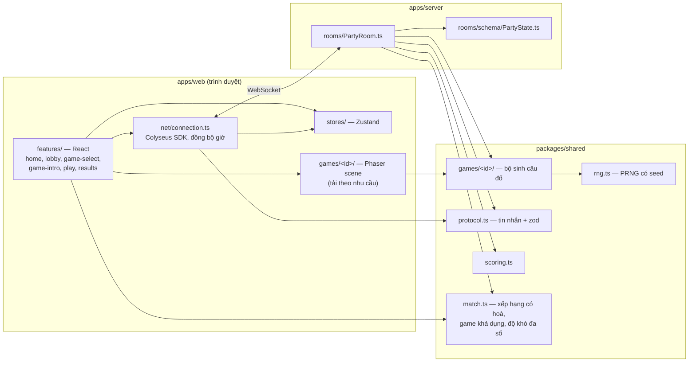
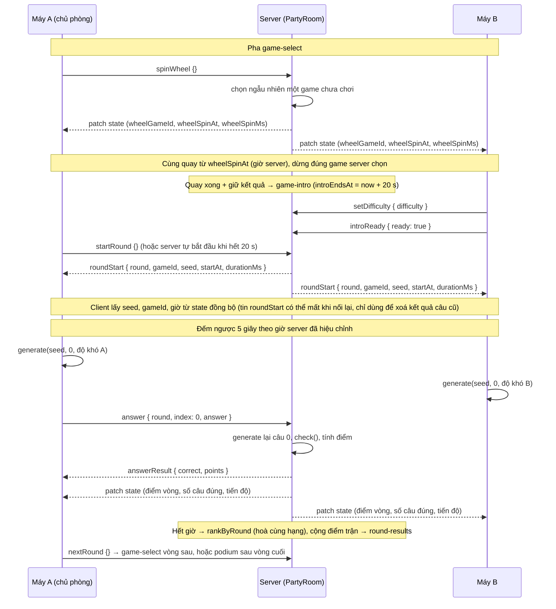

# Kiến trúc

Server làm trọng tài, client tự chơi: server phát **seed**, giữ **đồng hồ** và **chấm điểm**; mỗi máy tự sinh câu đố từ seed bằng cùng một đoạn code (`packages/shared`) và chỉ gửi đáp án lên.

## Thành phần

Quy tắc phụ thuộc: `web` và `server` được import `shared`; `shared` không import gì từ hai app. Scene Phaser không biết mạng là gì — nó chỉ nhận `MinigameBridge` (seed, độ khó, hàm `submit`, và `unlockDelay` để biết khi nào server hết khoá sau câu sai).

## Vòng đời một phòng

Luồng trận theo [CR-005](../00-tracking/change-requests.md#cr-005) (UC-05 → UC-09, UC-20, UC-21 trong [SRS](../01-product/srs.md)):

```mermaid
stateDiagram-v2
  [*] --> lobby: chủ phòng tạo phòng (mã 4 ký tự)
  lobby --> game_select: startMatch (≥ 2 người, tất cả sẵn sàng) — vòng 1
  game_select --> game_intro: pickGame, hoặc spinWheel rồi chờ quay xong (0,3 + 4 + 1,5 s)
  game_intro --> countdown: startRound (mọi người đã hiểu) hoặc tự động sau 20 s
  countdown --> playing: sau 5 giây
  playing --> round_results: hết giờ (+ 0,4 s dung sai), kể cả vòng cuối
  round_results --> game_select: nextRound (còn vòng) — round + 1
  round_results --> podium: nextRound (vòng cuối)
  podium --> game_select: playAgain (≥ 2 người; giữ người + số vòng, xoá điểm)
  podium --> lobby: backToLobby
  round_results --> lobby: backToLobby
```

`phase` trong state đồng bộ tương ứng với các trạng thái trên, viết bằng gạch ngang: `game-select`, `game-intro`, `round-results`.

**Hẹn giờ của phòng** (đều chạy trên `this.clock` của room, giờ server quyết định):

| Pha | Hẹn giờ | Khi hết giờ |
| --- | --- | --- |
| `game-select` (sau `spinWheel`) | `WHEEL_SPIN_LEAD_MS + WHEEL_SPIN_MS + WHEEL_RESULT_HOLD_MS` | Vào `game-intro` với game vòng quay đã chọn |
| `game-intro` | `INTRO_AUTO_START_MS` (20 s) | Bắt đầu vòng, dù chưa ai bấm "Đã hiểu" |
| `countdown` | `COUNTDOWN_MS` (5 s) | Sang `playing`, hẹn tiếp giờ hết vòng |
| `playing` | `durationMs` của game + `LATE_ANSWER_GRACE_MS` | Xếp hạng, cộng điểm trận, sang `round-results` |

Mỗi lần đổi pha, `PartyRoom` huỷ hết hẹn giờ của pha cũ; callback nào cũng kiểm tra lại pha trước khi chạy. Chủ phòng rời giữa chừng thì quyền chuyển cho người kế tiếp và hẹn giờ vẫn chạy, nên phòng không bị kẹt.

## Một vòng chơi, từng tin nhắn

**Chấm một câu** (`handleAnswer` trong `PartyRoom`, công thức ở `packages/shared/src/scoring.ts`):

1. Bỏ qua nếu sai pha, sai vòng, `index` khác câu đang làm, quá `endsAt + LATE_ANSWER_GRACE_MS`, đang bị khoá, hoặc gửi quá `MAX_ANSWERS_PER_SECOND`.
2. Server sinh lại câu bằng `generate(seed, index, độ khó)` rồi `check()`. Sai thì điểm 0, chuỗi về 0 và bị khoá `WRONG_ANSWER_LOCK_MS`.
3. Đúng thì tính `pointsForCorrect`: điểm = (`BASE_POINTS` × hệ số độ khó + thưởng tốc độ) × hệ số combo, làm tròn.
   - **Hệ số độ khó** = `gameMultiplier(game, độ khó)`: lấy `difficultyMultiplier` game khai báo; game không khai báo, hoặc khai báo số không dương / không hữu hạn, thì dùng `DIFFICULTY_MULTIPLIER` chung (CR-006).
   - **Thưởng tốc độ** (0–`MAX_SPEED_BONUS`) tính trên `max(0, thời gian trả lời − miễn trừ)`: trọn thưởng khi ≤ `FAST_ANSWER_MS`, hết khi ≥ `SLOW_ANSWER_MS`. Thời gian trả lời đo bằng giờ server, từ lúc câu hiện (hoặc lúc hết khoá) tới lúc nhận đáp án. Miễn trừ = `gameSpeedAllowanceMs(game, puzzle, độ khó)`: gọi `speedAllowanceMs` của game trên chính câu server vừa sinh lại, kẹp về số hữu hạn ≥ 0 (thiếu hoặc sai thì 0).
   - **Combo** = `comboMultiplier(streak)`: từ câu đúng liên tiếp thứ `STREAK_THRESHOLD` cộng `STREAK_BONUS_PER_STEP` mỗi câu, trần `MAX_COMBO_MULTIPLIER` (× 1,5).

Game không khai báo hai trường CR-006 (như Kẻ lạc đàn) được chấm như trước, chỉ thêm trần combo.

**Xếp hạng** (`packages/shared/src/match.ts`, server và web dùng chung):

- Trong vòng (`rankByRound`): hạng của một người = số người có `roundScore` lớn hơn hẳn → hoà điểm thì cùng hạng và cùng điểm trận (`placementPoints(hạng)`: 10, 8, 6, 5, 4, 3, 2, 1); hạng kế tiếp bị bỏ qua (vd. 10, 10, 6).
- Chung cuộc (`rankByMatch`): `matchPoints` giảm dần; hoà thì `totalScore` (tổng điểm vòng cả trận) cao hơn xếp trên; hoà cả hai thì cùng hạng.
- Hạng tính từ 0 (0 = nhất).

## Giao thức tin nhắn

Định nghĩa trong `packages/shared/src/protocol.ts`. Mọi tin client → server được validate bằng zod.

| Chiều | Tin nhắn | Nội dung | Ai được gửi, khi nào |
| --- | --- | --- | --- |
| C → S | join options | `name`, `colorIndex`, `difficulty`, `avatar` (mặc định `khoi`) | Khi tạo/vào phòng, chỉ ở pha `lobby` |
| C → S | `ready` | `{ ready }` | Mọi người, ở `lobby` |
| C → S | `setProfile` | tên, màu, độ khó, nhân vật (tuỳ chọn; trường không gửi giữ nguyên) | Mọi người, ở `lobby`; không làm mất trạng thái sẵn sàng |
| C → S | `setRounds` | `{ totalRounds }` (1–10) | Chủ phòng, ở `lobby` |
| C → S | `startMatch` | `{}` | Chủ phòng, ở `lobby`; cần ≥ `MIN_PLAYERS_TO_START` (2) người và tất cả (kể cả chủ phòng) `ready`, nếu không → `not-ready` |
| C → S | `setPickMode` | `{ mode: "wheel" \| "pick" }` | Chủ phòng, ở `game-select`, khi vòng quay chưa quay |
| C → S | `voteGame` | `{ gameId \| null }` | Người không phải chủ phòng, ở `game-select`; 1 phiếu/người, gửi lại là thay, `null` là bỏ; game phải chưa chơi trong trận |
| C → S | `spinWheel` | `{}` | Chủ phòng, ở `game-select`, mỗi vòng một lần; server chọn kết quả và đặt `pickMode = "wheel"` |
| C → S | `pickGame` | `{ gameId }` | Chủ phòng, ở `game-select`; game chưa chơi, vòng quay không đang quay |
| C → S | `setDifficulty` | `{ difficulty }` (0–3) | Mọi người, ở `game-intro` (và `lobby`) |
| C → S | `introReady` | `{ ready }` | Mọi người, ở `game-intro` ("Đã hiểu") |
| C → S | `nudgeDifficulty` | `{ playerId }` | Chủ phòng, ở `game-intro`; nhắc người khác chủ phòng; tối đa 1 lần / 10 s / người (`rate-limited`); các mức hoà nhau thì từ chối (`invalid`) |
| C → S | `startRound` | `{}` | Chủ phòng, ở `game-intro`, khi mọi người khác đã `introReady` (nếu không → `not-ready`) |
| C → S | `answer` | `{ round, index, answer }` | Ở `playing`; `index` phải đúng câu đang làm |
| C → S | `nextRound` | `{}` | Chủ phòng, ở `round-results`: còn vòng → `game-select`, hết vòng → `podium` |
| C → S | `playAgain` | `{}` | Chủ phòng, ở `podium`; cần ≥ `MIN_PLAYERS_TO_START` (2) người còn trong phòng, nếu không → `not-ready` (chỉ còn cách `backToLobby`). Giữ người + số vòng, xoá điểm, vòng 1, `game-select` |
| C → S | `backToLobby` | `{}` | Chủ phòng, ở `podium` hoặc `round-results`: xoá điểm, sẵn sàng, game đã chơi |
| C → S | `ping` | `{ clientTime }` | Bất cứ lúc nào (đồng bộ giờ) |
| S → C | patch state | `PartyStateView` (tự động, delta nhị phân) | Liên tục khi state đổi |
| S → C | `roundStart` | `{ round, gameId, seed, startAt, durationMs }` | Đầu mỗi vòng. Web không dựa vào payload (seed, giờ lấy từ state, vì tin này mất được khi nối lại); chỉ dùng làm tín hiệu xoá kết quả câu cũ |
| S → C | `answerResult` | `{ index, correct, points, lockedUntil? }` | Chỉ gửi người vừa trả lời |
| S → C | `nudge` | `{ difficulty }` — mức nhiều người chọn nhất | Chỉ gửi người bị chủ phòng nhắc |
| S → C | `pong` | `{ clientTime, serverTime }` | Trả lời `ping` |
| S → C | `error` | `{ code, message }`; `code`: `not-host`, `bad-phase`, `invalid`, `rate-limited`, `not-ready` | Khi tin nhắn bị từ chối |

Tin không có nội dung (`{}`) chấp nhận cả `undefined`/`null`; trường lạ bị bỏ.

## State đồng bộ

`apps/server/src/rooms/schema/PartyState.ts` (Colyseus schema) — hình dạng khớp `PartyStateView` trong shared:

- Phòng: `code`, `phase`, `hostId`, `gameId` (game của vòng, đặt khi vào `game-intro`), `round`, `totalRounds`, `seed`, `startAt`, `endsAt`.
- Chọn game: `pickMode` (`"wheel"` | `"pick"`), `votes` (`Map<sessionId, gameId>`), `playedGames` (game đã chơi trong trận; chơi hết thì làm mới khi vào `game-select`), `wheelGameId` (`""` khi chưa quay), `wheelSpinAt` (giờ server, 0 khi chưa quay), `wheelSpinMs`. Phiếu và thông tin vòng quay xoá khi bắt đầu vòng.
- Hướng dẫn: `introEndsAt` (hạn tự bắt đầu ở `game-intro`, 0 ở pha khác).
- Người chơi (`players: Map<sessionId, Player>`): `name`, `colorIndex`, `avatar`, `difficulty` (của vòng hiện tại), `ready` (phòng chờ), `introReady` ("Đã hiểu"), `connected`, `isHost`, `matchPoints`, `lastPoints` (điểm trận vừa cộng ở vòng gần nhất), `totalScore` (tổng điểm vòng cả trận, phá hoà chung cuộc), `roundScore`, `roundCorrect` (số câu đúng trong vòng), `progress`, `streak`.

Test "state khớp hình dạng PartyStateView" trong `apps/server/test/PartyRoom.test.ts` so khoá của `state.toJSON()` với `PartyStateView`/`PlayerView`, nên thêm trường ở một bên mà quên bên kia sẽ báo lỗi.

Thông tin chỉ server cần (giờ hiện câu của từng người, thời điểm hết khoá, bộ đếm chống spam, lần nhắc độ khó gần nhất) giữ trong `Map` riêng của `PartyRoom`, không đồng bộ xuống client.

## Đồng bộ giờ

Client gửi 5 `ping` cách nhau 150 ms khi vào phòng (và 3 lần mỗi khi tab hiện lại), lấy mẫu có RTT nhỏ nhất: `offset = serverTime − (t0 + RTT/2)`. Đồng hồ trên màn hình dùng `Date.now() + offset`. Server vẫn là nơi quyết định hết giờ.

## Mất kết nối

1. Mạng rớt → server gọi `onDrop`, đánh dấu `connected = false`, giữ chỗ 45 giây (`allowReconnection`).
2. SDK tự nối lại; nếu người chơi tải lại trang, `resumeParty()` dùng token trong `sessionStorage`.
3. Quá 45 giây → `onLeave`, xoá người chơi; nếu là chủ phòng thì chuyển quyền cho người kế tiếp.

## Thêm tính năng ở đâu

| Muốn làm | Sửa ở |
| --- | --- |
| Minigame mới | `pnpm new-game <id> <nhóm>` → `packages/shared/src/games/<id>/` + `apps/web/src/games/<id>/` (xem [hướng dẫn](../03-guides/development.md#thêm-một-minigame)) |
| Luật chơi, tính điểm | `packages/shared/src/scoring.ts`, `constants.ts` |
| Xếp hạng, game còn chơi được, độ khó đa số | `packages/shared/src/match.ts` (server và web dùng chung) |
| Tin nhắn mới | `packages/shared/src/protocol.ts` → handler trong `PartyRoom.messages` → gọi từ `apps/web/src/net/connection.ts` |
| Màn hình mới | `apps/web/src/features/<tên>/` + rẽ nhánh trong `app/App.tsx` |
| Hình minh hoạ, hoạt ảnh | SVG + CSS trong React (`components/characters`, `styles/characters.css`); không dùng 3D ([ADR 0010](decisions/0010-drop-3d-2d-lobby-and-podium.md)) |
| Chữ hiển thị, ngôn ngữ | `apps/web/src/i18n/locales/` ([ADR 0007](decisions/0007-i18n-inline-resources.md)) |
| Component UI, màu sáng/tối | `apps/web/src/components/ui/`, `styles/globals.css` ([ADR 0006](decisions/0006-ui-shadcn-and-theme-tokens.md)) |
