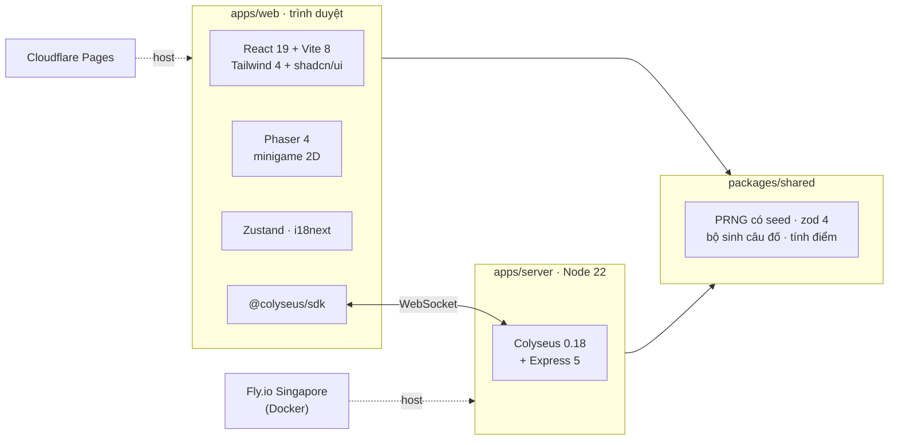

# Tech stack

| | |
| --- | --- |
| Dành cho | Developer mới tham gia, hoặc chính bạn sau vài tháng quay lại |
| Phiên bản | Khớp `package.json` và `pnpm-lock.yaml` ngày 2026-10-12 (đã gỡ three.js theo [ADR 0010](decisions/0010-drop-3d-2d-lobby-and-podium.md)) |
| Cập nhật khi | Thêm/bỏ/nâng phiên bản chính của một thư viện, đổi dịch vụ hosting — kèm ADR nếu là quyết định lớn |

Toàn bộ dự án là **TypeScript** trong một monorepo, gồm ba phần: web client, game server và gói `shared` chứa logic dùng chung. Phiên bản chính xác luôn là cái trong `pnpm-lock.yaml`; bảng dưới ghi phiên bản chính để biết đọc tài liệu nào.

## 1. Tổng quan một hình

## 2. Client — `apps/web`

| Thư viện | Phiên bản | Vai trò | Vì sao |
| --- | --- | --- | --- |
| React | 19.3 | Khung giao diện: menu, phòng chờ 2D, chọn game, bảng điểm, vinh danh (nhân vật SVG + hoạt ảnh CSS, không 3D — [ADR 0010](decisions/0010-drop-3d-2d-lobby-and-podium.md)) | UI web thuần, hệ sinh thái lớn ([ADR 0005](decisions/0005-web-vite-spa-vs-nextjs.md)) |
| Vite | 8.3 | Dev server, build, code-splitting | SPA nhanh, không cần SSR ([ADR 0005](decisions/0005-web-vite-spa-vs-nextjs.md)) |
| Tailwind CSS | 4.3 | Style bằng class, token sáng/tối | Mobile-first nhanh ([ADR 0006](decisions/0006-ui-shadcn-and-theme-tokens.md)) |
| shadcn/ui (Radix `radix-ui` 1.7) | — | Component có sẵn a11y, copy vào `components/ui/` | Sửa được tận gốc ([ADR 0006](decisions/0006-ui-shadcn-and-theme-tokens.md)) — **không** cài package `shadcn` |
| Phaser | 4.2 | Engine cho từng minigame | Có scene, input cảm ứng, tween, âm thanh, scale |
| Zustand | 5.0 | State phía client, cầu nối React ↔ Phaser | Nhẹ, không cần provider |
| @colyseus/sdk | 0.18 | Kết nối phòng, tự nối lại | Đi cặp với server Colyseus |
| i18next + react-i18next | 26 / 17 | Tiếng Việt, tiếng Anh | Bản dịch viết trong code ([ADR 0007](decisions/0007-i18n-inline-resources.md)) |
| sonner | 2.0 | Thông báo ngắn (toast) | Đi kèm shadcn |
| lucide-react | 1.54 | Icon | |
| Font Baloo 2, Be Vietnam Pro | Google Fonts | Tiêu đề / chữ thường | Đủ dấu tiếng Việt ([ADR 0009](decisions/0009-chalkboard-style-and-characters.md)) |

Dự kiến thêm: Howler.js (nhạc nền, GĐ 2), vite-plugin-pwa (GĐ 2), Sentry (GĐ 2), Supabase JS (GĐ 3).

## 3. Server — `apps/server`

| Thành phần | Phiên bản | Vai trò |
| --- | --- | --- |
| Node.js | 22 LTS (≥ 22.12, `.nvmrc`) | Runtime |
| Colyseus (+ `@colyseus/schema`, `@colyseus/tools`) | 0.18 / 5.0 | Phòng, ghép theo mã, đồng bộ state nhị phân dạng delta, reconnect; kèm `/monitor`, `/playground` ([ADR 0002](decisions/0002-game-server-colyseus-vs-supabase-realtime.md)) |
| Express | 5.2 | HTTP cho Colyseus tools |
| zod | 4.6 | Validate mọi tin nhắn client |
| tsdown | 0.23 | Đóng gói server (gộp luôn `shared`) thành một file |
| tsx | 4.23 | Chạy dev có hot reload |
| @colyseus/testing, @colyseus/loadtest | 0.18 | Test phòng với server thật; tải thử 8 người |

## 4. Dùng chung — `packages/shared`

Chỉ phụ thuộc `zod`. Chứa: PRNG có seed (`rng.ts`, mulberry32), giao thức + schema (`protocol.ts`), hằng số (`constants.ts`), độ khó, tính điểm, mã phòng, đồng bộ giờ (`clock.ts`), và bộ sinh câu đố từng minigame (`games/<id>/`). Lý do tồn tại: [ADR 0003](decisions/0003-seeded-deterministic-puzzles.md).

## 5. Công cụ

| Công cụ | Phiên bản | Dùng để |
| --- | --- | --- |
| pnpm (workspaces) | 10.34 (khoá trong `packageManager`) | Quản lý package — bật bằng `corepack enable` |
| Turborepo | 2.11 | Chạy build/test/typecheck theo thứ tự phụ thuộc ([ADR 0001](decisions/0001-monorepo-pnpm-turborepo.md)) — cấu hình theo `node_modules/turbo/docs/`, không theo trí nhớ |
| TypeScript | 7.0 | Kiểu cho toàn repo |
| Vitest | 5.0 | Unit test, test phòng |
| Biome | 2.5 | Lint + format (không dùng ESLint/Prettier) |
| GitHub Actions | — | CI: lint → typecheck → test → build (`.github/workflows/ci.yml`) |
| Playwright | dự kiến GĐ 1 | Test nhiều trình duyệt chơi cùng một trận |
| Claude Code + 5 agent | — | Đội AI theo phòng ban ([Đội AI agent](../03-guides/ai-agents.md)) |

## 6. Hạ tầng & dịch vụ

| Dịch vụ | Dùng cho | Chi phí | Tài khoản cần có | Giai đoạn |
| --- | --- | --- | --- | --- |
| GitHub | Mã nguồn, CI | 0 | Chủ dự án | GĐ 0 |
| Cloudflare Pages | Host web tĩnh + CDN | 0 | Chủ dự án | GĐ 1 |
| Fly.io (region `sin`) | Game server Docker, tự tắt khi không ai chơi | < 1 USD/tháng | Chủ dự án (cần thẻ) | GĐ 1 |
| Render Free | Dự phòng game server 0 đồng | 0 | — | Khi cần |
| Sentry | Bắt lỗi JavaScript | 0 (gói Free) | — | GĐ 2 |
| Supabase | Đăng nhập, Postgres | 0 (gói Free) | — | GĐ 3 |

Chi tiết và so sánh: [Triển khai](../03-guides/deployment.md), [ADR 0004](decisions/0004-hosting-strategy.md).

### Biến môi trường

| Biến | File | Ý nghĩa |
| --- | --- | --- |
| `VITE_SERVER_URL` | `apps/web/.env` | Địa chỉ game server; để trống khi dev (tự dùng `http://<host>:2567`) |
| `PORT` | `apps/server/.env` | Cổng server (mặc định 2567; Fly/Render tự đặt) |
| `NODE_ENV` | `apps/server/.env` | `production` tắt `/monitor` và `/playground` |

Thêm biến mới thì cập nhật `.env.example` tương ứng và bảng này. Không commit file `.env`.

## 7. Các phương án đã cân nhắc

| Phương án | Ưu | Nhược | Kết luận |
| --- | --- | --- | --- |
| PixiJS v8 thay Phaser | Nhẹ hơn, render 2D rất nhanh | Phải tự làm scene, input, tween, âm thanh | Dự phòng nếu bundle Phaser quá nặng |
| Minigame bằng React DOM/SVG | Đơn giản nhất | Animation nhiều vật thể kém mượt trên máy yếu | Chỉ hợp game rất tĩnh |
| Supabase Realtime thay game server | Không phải vận hành server | Không có trọng tài, đồng hồ, giữ chỗ khi rớt mạng | Không chọn ([ADR 0002](decisions/0002-game-server-colyseus-vs-supabase-realtime.md)) |
| PartyServer trên Cloudflare Durable Objects | Gói Free, chạy ở edge | Tự viết đồng bộ state; không chạy được Colyseus | Phương án 0 đồng nếu cần |
| Socket.IO | Quen thuộc | Tự làm state, reconnect, đồng bộ delta | Không chọn |
| Colyseus Cloud | Không phải tự vận hành | Từ 15 USD/tháng | Khi muốn bớt việc DevOps |
| Next.js | SSR, routing | Không cần SSR cho game; phức tạp hơn | Không chọn ([ADR 0005](decisions/0005-web-vite-spa-vs-nextjs.md)) |

## 8. Lưu ý khi nâng cấp

- Phaser 4, Colyseus 0.18, TypeScript 7, Vitest 5 đều là bản mới (2026): nhiều code mẫu trên mạng đã lỗi thời. Đọc migration guide chính thức trước khi viết theo ví dụ.
- Không cài package `shadcn` vào dự án (kéo theo zod 3, làm hỏng Colyseus). Thêm component bằng `pnpm dlx shadcn@latest add <tên>` trong `apps/web`.
- Đổi thuật toán `createRng` hay cách sinh câu đố của game đã phát hành là **thay đổi phá vỡ** (lượt chơi bóng ma cũ không phát lại được) → phải tăng phiên bản MAJOR, xem [Quy trình phát triển](../03-guides/sdlc.md#5-phiên-bản--phát-hành).
- Nâng phiên bản chính một thư viện: tạo nhánh riêng, chạy `pnpm check` + chơi thử 2 máy, ghi vào [Nhật ký phát hành](../00-tracking/changelog.md).

## 9. Nguồn tham khảo

- [Colyseus — tài liệu chính thức (v0.18)](https://docs.colyseus.io/) · [bảng giá Colyseus Cloud](https://www.colyseus.io/pricing)
- [Phaser 4 — lịch sử phát hành](https://phaser.io/download/phaser4) · [GameDev.net — Phaser v4.2.1](https://gamedev.net/news/4825-phaser-v421-released/)
- [Cloudflare — Durable Objects pricing](https://developers.cloudflare.com/durable-objects/platform/pricing)
- [Fly.io — pricing](https://fly.io/pricing.md) · [Render — Deploy for Free](https://render.com/docs/free)
- [Supabase — Realtime limits](https://supabase.com/docs/guides/realtime/limits)

## 10. Lộ trình làm quen cho developer mới

| Bước | Việc | Thời gian |
| --- | --- | --- |
| 1 | Đọc [Tầm nhìn](../01-product/vision.md) (mục 1–6) và [Thiết kế game](../01-product/game-design.md) (mục 2, 7) | 20 phút |
| 2 | Cài đặt và chạy theo [Hướng dẫn phát triển](../03-guides/development.md); mở 2 tab chơi thử một trận | 20 phút |
| 3 | Đọc [Tổng quan kiến trúc](overview.md) và 5 bất biến trong `AGENTS.md` | 20 phút |
| 4 | Đọc code theo đường đi của một đáp án: `games/odd-one-out/OddOneOutScene.ts` → `net/connection.ts` → `PartyRoom.handleAnswer` → `scoring.ts` | 30 phút |
| 5 | Xem [Danh sách tính năng](../00-tracking/features.md) và [Tình trạng dự án](../00-tracking/status.md) để chọn việc | 10 phút |
| 6 | Làm thử: chạy `pnpm new-game <id> <nhóm>` theo [hướng dẫn thêm minigame](../03-guides/development.md#thêm-một-minigame) trên một nhánh nháp | 1 giờ |

[← Kiến trúc](README.md) · [Mục lục tài liệu](../README.md)
