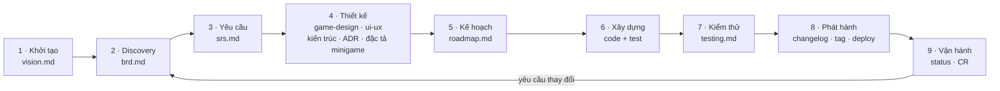

# Quy trình phát triển (SDLC)

Dự án làm một mình nhưng vẫn đi theo vòng đời phát triển như một studio nhỏ: mỗi giai đoạn có tài liệu đầu ra, mỗi tính năng có điều kiện bắt đầu và điều kiện xong, mỗi bản phát hành có số phiên bản và nhật ký. Tài liệu này là "luật chơi" của việc làm dự án.

## 1. Vòng đời và tài liệu của từng giai đoạn

| # | Giai đoạn | Câu hỏi trả lời | Tài liệu đầu ra | Agent hỗ trợ | Xong khi |
| --- | --- | --- | --- | --- | --- |
| 1 | Khởi tạo | Làm gì, vì sao, thành công trông thế nào? | [Tầm nhìn](../01-product/vision.md) | — | Có mục tiêu đo được, phạm vi trong/ngoài |
| 2 | Discovery | Người chơi là ai, cần gì? | [BRD](../01-product/brd.md) | — | Có BR và quy tắc nghiệp vụ |
| 3 | Yêu cầu | Hệ thống phải làm gì? | [SRS](../01-product/srs.md) | — | Mọi BR có UC/FR; có NFR đo được |
| 4 | Thiết kế | Chơi thế nào, trông thế nào, xây thế nào? | [GDD](../01-product/game-design.md), [UI/UX](../01-product/ui-ux.md) + canvas, [Kiến trúc](../02-architecture/overview.md), [ADR](../02-architecture/decisions/README.md), [đặc tả minigame](../04-minigames/README.md) | `game-designer`, `ui-designer` | Có bản mẫu và đặc tả đủ để code |
| 5 | Kế hoạch | Khi nào xong, theo thứ tự nào? | [Lộ trình](../01-product/roadmap.md) | — | Có baseline và cổng kiểm tra |
| 6 | Xây dựng | — | Code + test | `frontend-dev`, `backend-dev`, `game-designer` | `pnpm check` xanh |
| 7 | Kiểm thử | Có an toàn để phát hành không? | [Kiểm thử](testing.md) | `qa-tester` | Đạt Definition of Done |
| 8 | Phát hành | Bản này có gì? | [Nhật ký phát hành](../00-tracking/changelog.md), tag git | — | Đã deploy, đã kiểm sau deploy |
| 9 | Vận hành | Đang chạy thế nào, cần đổi gì? | [Tình trạng](../00-tracking/status.md), [Yêu cầu thay đổi](../00-tracking/change-requests.md) | — | Liên tục |

Giai đoạn 1–5 đã làm xong cho bản 1.0 (2026-10-10). Từ giờ mỗi tính năng chạy lặp các bước 3 → 8 ở quy mô nhỏ.

## 2. Đường đi của một tính năng

Áp dụng cho cả tính năng trong kế hoạch và **tính năng thêm sau khi phát hành**.

1. **Có trong SRS chưa?**
   - Có → sang bước 2.
   - Chưa → mở [yêu cầu thay đổi](../00-tracking/change-requests.md), phân tích tác động, quyết định. Duyệt thì cập nhật BRD/SRS (tăng phiên bản tài liệu) và thêm dòng vào [Danh sách tính năng](../00-tracking/features.md).
2. **Chuẩn bị (Definition of Ready):** UC có luồng chính/luồng rẽ, có bản mẫu nếu là màn hình, có đặc tả nếu là minigame.
3. **Làm:** tạo nhánh `feat/<tên>`, đánh dấu 🚧 trong `features.md`. Việc lớn chạm nhiều phần dùng workflow `/feature` hoặc `/new-minigame` ([Đội AI agent](ai-agents.md)).
4. **Kiểm:** `pnpm check`, agent `qa-tester` (hoặc `/qa-fix`), chơi thử theo [Kiểm thử](testing.md).
5. **Gộp:** tự review diff (có thể dùng `/code-review`), merge vào `main`, thêm dòng vào `[Chưa phát hành]` của changelog, đổi ✅ trong `features.md`.
6. **Phát hành:** khi gom đủ một mốc hoặc một nhóm thay đổi đáng kể → mục 5.

## 3. Definition of Ready & Done

### Definition of Ready — được phép bắt đầu khi

- [ ] Có mã UC/FR trong [SRS](../01-product/srs.md) (hoặc CR đã duyệt).
- [ ] UC có luồng chính, luồng rẽ, tiêu chí chấp nhận.
- [ ] Màn hình mới: có bản mẫu điện thoại + máy tính trên canvas ([UI/UX](../01-product/ui-ux.md)).
- [ ] Minigame mới: đặc tả `docs/04-minigames/<id>.md` đạt [quy tắc thiết kế minigame](../01-product/game-design.md#quy-tắc-thiết-kế-một-minigame-mới).
- [ ] Biết sẽ đổi giao thức/state hay không; nếu có, ghi rõ trong mô tả công việc.

### Definition of Done — được coi là xong khi

- [ ] Chạy đúng các luồng trong UC, kiểm tay trên điện thoại (hoặc giả lập) và máy tính.
- [ ] `pnpm check` xanh; logic mới có test (bộ sinh câu đố: test 10.000 seed).
- [ ] Không vi phạm 5 bất biến trong `AGENTS.md`; `qa-tester` báo PASS.
- [ ] Chữ mới có đủ vi + en; màu dùng token.
- [ ] Tài liệu kèm theo đã cập nhật (xem mục 6).
- [ ] `features.md` và `[Chưa phát hành]` trong changelog đã ghi.

## 4. Git

| Mục | Quy ước |
| --- | --- |
| Nhánh | `main` luôn chạy được. Làm việc trên `feat/<tên>`, `fix/<tên>`, `docs/<tên>`; nhánh sống ngắn (vài ngày) |
| Commit | [Conventional Commits](https://www.conventionalcommits.org/): `feat(web): …`, `fix(server): …`, `docs: …`, `test: …`, `chore: …` |
| Merge | Qua Pull Request trên GitHub để CI chạy, kể cả khi làm một mình |
| Tag | Mỗi bản phát hành gắn tag `v<x.y.z>` trên `main` |
| Không commit | `.env`, file build, asset nguồn nặng (để ở `assets/source/` theo [Asset](assets.md)) |

## 5. Phiên bản & phát hành

### Đánh số phiên bản

Theo [SemVer](https://semver.org/lang/vi/) `MAJOR.MINOR.PATCH`, diễn giải cho game này:

| Tăng | Khi | Ví dụ |
| --- | --- | --- |
| **MAJOR** | Thay đổi phá vỡ: đổi thuật toán seed/bộ sinh của game đã phát hành (lượt chơi cũ không phát lại được), xoá dữ liệu người chơi, đổi luật cốt lõi | 1.0.0 → 2.0.0 |
| **MINOR** | Tính năng mới, minigame mới, chế độ chơi mới | 1.0.0 → 1.1.0 |
| **PATCH** | Sửa lỗi, cân bằng nhỏ, sửa chữ | 1.1.0 → 1.1.1 |

Trước 1.0: mỗi mốc lớn tăng MINOR theo [Lộ trình](../01-product/roadmap.md#1-các-mốc) (0.1 Prototype, 0.2–0.4 bản trung gian, 0.5 Alpha, 0.9 Beta).

**Client và server luôn phát hành cùng phiên bản** vì dùng chung giao thức và bộ sinh câu đố. Số phiên bản ghi ở `version` của cả 4 file `package.json`.

### Checklist phát hành

1. Chạy [checklist trước khi phát hành](testing.md#7-checklist-trước-khi-phát-hành).
2. Đổi `version` trong 4 file `package.json`.
3. Trong [changelog](../00-tracking/changelog.md): đổi `[Chưa phát hành]` thành `[x.y.z] — <tên mốc> · <ngày>`, tạo mục `[Chưa phát hành]` trống mới.
4. Commit `chore(release): vx.y.z`, gắn tag `vx.y.z`, push.
5. Deploy server trước, web sau ([Triển khai](deployment.md)); làm [kiểm tra sau deploy](deployment.md#kiểm-tra-sau-khi-deploy).
6. Cập nhật [Tình trạng dự án](../00-tracking/status.md) và cột "Thực tế" ở [Lộ trình](../01-product/roadmap.md) nếu là một mốc.

### Sửa lỗi khẩn (hotfix)

Lỗi chặn người chơi trên bản đang chạy: nhánh `fix/<tên>` từ tag hiện tại → sửa + test → tăng PATCH → phát hành theo checklist (có thể bỏ bước chơi thử đủ ma trận thiết bị, nhưng không bỏ `pnpm check` và kiểm sau deploy).

## 6. Khi nào cập nhật tài liệu nào

| Khi | Cập nhật |
| --- | --- |
| Bắt đầu / xong một tính năng | [features.md](../00-tracking/features.md); xong thì thêm `[Chưa phát hành]` trong [changelog](../00-tracking/changelog.md) |
| Muốn thêm, đổi, bỏ tính năng ngoài kế hoạch | [change-requests.md](../00-tracking/change-requests.md) → duyệt thì BRD/SRS/GDD + features.md + roadmap |
| Đổi luật chơi, điểm, độ khó | CR + [GDD](../01-product/game-design.md) + đặc tả minigame liên quan |
| Thêm minigame | Đặc tả `04-minigames/<id>.md` + bảng [Danh mục minigame](../04-minigames/README.md) (script tự làm phần lớn) |
| Thêm màn hình | Canvas + [UI/UX](../01-product/ui-ux.md) mục 3–4 |
| Thêm tin nhắn, đổi state | [Tổng quan kiến trúc](../02-architecture/overview.md) |
| Thêm/xoá/đổi tên file code | [Cây thư mục](../02-architecture/folder-structure.md) |
| Chọn công nghệ, đổi kiến trúc | ADR mới + [Tech stack](../02-architecture/tech-stack.md) |
| Thêm biến môi trường | `.env.example` + [Tech stack › Biến môi trường](../02-architecture/tech-stack.md#biến-môi-trường) |
| Hết một ngày làm việc | [Báo cáo ngày](../00-tracking/reports/README.md) `reports/YYYY-MM-DD.md` |
| Hết một tuần | [status.md](../00-tracking/status.md) |
| Qua một cổng | [Lộ trình](../01-product/roadmap.md) (cột Thực tế + nhìn lại) + status.md |
| Phát hành | changelog + tag + status.md |

## 7. Nhịp làm việc

| Nhịp | Việc | Thời gian |
| --- | --- | --- |
| Mỗi phiên làm | Chọn 1 dòng ⏳ trong features.md → làm tới Done | — |
| Cuối mỗi ngày làm | Viết [báo cáo ngày](../00-tracking/reports/README.md) | 5 phút |
| Mỗi tuần | Viết báo cáo tuần trong status.md; xem lại rủi ro và câu hỏi mở | 15 phút |
| Mỗi cổng | Kiểm tiêu chí cổng, viết "nhìn lại" ở roadmap, chỉnh dự báo giai đoạn sau, xem lại các CR đang hoãn | 1 giờ |
| Sau mỗi buổi chơi thử | Ghi phản hồi → lỗi thành issue, ý tưởng thành CR | 15 phút |

## 8. Lỗi và ý tưởng ghi ở đâu

- **Lỗi:** GitHub Issues (sau khi repo lên GitHub), nhãn `bug` + mức độ `S1`–`S4` theo [Kiểm thử › Mức độ lỗi](testing.md#8-báo-lỗi). Trước đó ghi tạm ở mục "Rủi ro"/"Kế hoạch tuần tới" trong status.md.
- **Ý tưởng tính năng:** [change-requests.md](../00-tracking/change-requests.md) với trạng thái Mới.
- **Quyết định kỹ thuật:** ADR trong [decisions/](../02-architecture/decisions/README.md).

[← Hướng dẫn](README.md) · [Mục lục tài liệu](../README.md)
